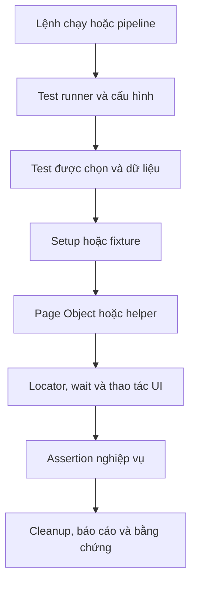

# Automation Testing từ căn bản đến đọc và sửa code: đối chiếu Selenium và Playwright

**Dành cho:** người mới học automation, đã biết một chút Java, chưa từng dùng Selenium hoặc Playwright; cần hiểu code do người khác hoặc AI viết và biết sửa đúng chỗ.

**Ngày biên soạn, đối chiếu tài liệu:** 03/11/2026.

## Cách học và đọc bảng đối chiếu

Selenium và Playwright là **công cụ/thư viện tự động hóa trình duyệt**, có thể dùng với nhiều ngôn ngữ. Tài liệu chọn hai cách triển khai xuyên suốt:

| Selenium + Java | Playwright + JavaScript |
|---|---|
| Selenium WebDriver 4, Java, JUnit 5, Maven. Bạn dùng lại phần Java đã biết. | Playwright Test, JavaScript chạy trên Node.js. Bạn học thêm cú pháp async/await và fixture khi đối chiếu. |

Playwright cũng hỗ trợ Java. Chương 30 có phần chuyển tiếp để bạn nhận ra code Playwright Java nếu gặp; các bảng chính vẫn thống nhất **Selenium + Java ↔ Playwright + JavaScript**. JavaScript và Java là hai ngôn ngữ khác nhau, dù tên gần giống.

Mỗi thao tác có một tiêu đề nói rõ mục tiêu, sau đó là bảng **đúng hai cột**. Những đoạn ngắn trong ô dùng để so sánh; chúng có thể cần biến, import, browser hoặc fixture được khởi tạo ở ví dụ trước. Các tệp dự án đầy đủ được đặt riêng trong code block ở chương 21–22 để dễ sao chép và giữ nguyên xuống dòng.

### Kết quả bạn cần đạt

Sau khi học, với một test mới bạn cần tự giải thích được:

1. Test chạy bằng công cụ nào, bắt đầu từ tệp/lớp nào?
2. Đâu là chuẩn bị, thao tác, chờ, kiểm tra và dọn dẹp?
3. Locator đang tìm phần tử nào trong DOM, có thể trùng hay không?
4. Hàm đang được gọi trả về phần tử, dữ liệu, Promise hay chỉ thực hiện hành động?
5. Khi UI cập nhật chậm, code chờ **điều kiện gì** và chờ tối đa bao lâu?
6. Test xác nhận nghiệp vụ nào, hay chỉ bấm được nút mà chưa kiểm tra?
7. Muốn đổi URL, tài khoản, dữ liệu, timeout, số test hay số worker thì sửa ở đâu?

### Ba tuyến đọc

- **Bắt đầu từ đầu:** chương 1–8 → thao tác và kiểm tra chương 9–18 → dự án chương 19–24 → bài tập chương 27.
- **Đã có source cần đọc ngay:** chương 3, 6–10, 20, 24–26; mở từ điển chương 29 khi gặp thuật ngữ.
- **Chỉ cần tra một thao tác:** dùng mục lục, bảng tra API chương 32, rồi đọc cả ghi chú sau bảng. Không xem hai tên hàm gần giống là hành vi hoàn toàn giống nhau.

### Những quy ước giúp tránh nhầm

- `java`: mã Selenium/Java hoặc phần Playwright Java được ghi rõ ở chương 30.
- `javascript`, `js`: mã JavaScript; khi có `test`, `expect`, `page` thường đang dùng Playwright Test, nhưng vẫn phải xem import.
- `powershell`: lệnh nhập vào terminal Windows, không dán vào tệp Java/JavaScript.
- `xml`: cấu hình Maven; `json`: dữ liệu/cấu hình đúng chuẩn JSON.
- Thời gian trong API Playwright thường dùng **milliseconds**; ví dụ `10_000` là 10 giây. Trong Selenium, `Duration.ofSeconds(10)` biểu diễn rõ đơn vị.
- Ví dụ chạy đầy đủ dùng một ứng dụng đăng nhập nhỏ trên `http://127.0.0.1:3000`, có source ở chương 31. Đây là ứng dụng học tập với dữ liệu giả, không phải website đã tồn tại sẵn.
- Các snippet ngoài dự án đầy đủ có thể giả định HTML riêng như bảng sản phẩm, iframe hay nút tải tệp. Chúng không tự xuất hiện trong ứng dụng đăng nhập.
- Một test xanh chỉ chứng minh các điều kiện đã viết được đáp ứng trong lần chạy đó. Muốn tin kết quả, phải đọc cả dữ liệu, locator, thao tác, wait và assertion.

### Bốn câu hỏi cho mỗi dòng lệnh

Ví dụ bạn gặp `await page.getByLabel('Email').fill('user@example.test');`, hãy hỏi:

1. **Đối tượng:** `page` là tab nào, đến từ đâu?
2. **Tìm gì:** `getByLabel('Email')` tìm control liên kết với nhãn Email, không phải tìm mọi chữ Email trên trang.
3. **Làm gì:** `fill(...)` điền giá trị vào control phù hợp.
4. **Khi nào xong:** `await` chờ thao tác bất đồng bộ hoàn tất; nó không tự xác nhận đăng nhập thành công.

Đây là cách đọc sẽ được lặp lại trong tài liệu: **đối tượng → cách tìm → hành động → kết quả → tiêu chí kiểm tra**.

## Mục lục

**Phần I — Nền tảng và những thao tác đầu tiên**

- [1. Bắt đầu đúng: Selenium, Playwright và ngôn ngữ lập trình](#chuong-1)
- [2. Tư duy automation: một bài test cần chứng minh điều gì?](#chuong-2)
- [3. Cầu nối từ Java sang JavaScript để đọc hai cột](#chuong-3)
- [4. Web căn bản: hiểu DOM để hiểu locator](#chuong-4)
- [5. Browser, session, page và vòng đời test đầu tiên](#chuong-5)
- [6. Locator từ căn bản đến đủ để đọc code thật](#chuong-6)
- [7. Chờ đúng trạng thái: kỹ năng quan trọng nhất để tránh flaky test](#chuong-7)
- [8. Các thao tác người dùng thường gặp: hiểu mục đích, đối số và kết quả](#chuong-8)

**Phần II — Kiểm tra trạng thái, thao tác thực tế và độ tin cậy**

- [9. Đọc nội dung và trạng thái phần tử: biết hàm đang trả về thứ gì](#chuong-9)
- [10. Assertions: biến một script thao tác thành bài kiểm thử](#chuong-10)
- [11. Form, dropdown và bảng dữ liệu: thao tác theo ý nghĩa nghiệp vụ](#chuong-11)
- [12. Iframe, Shadow DOM và dialog: hiểu ranh giới trước khi tìm phần tử](#chuong-12)
- [13. Tab, cửa sổ, popup và điều hướng: không để mất ngữ cảnh](#chuong-13)
- [14. Tệp, ảnh chụp, kéo thả và JavaScript trong trang](#chuong-14)
- [15. Cookie, storage và đăng nhập: quản lý trạng thái để test độc lập](#chuong-15)
- [16. API và network: đọc request, chờ response và phân biệt mock với hệ thống thật](#chuong-16)
- [17. Test runner, hooks, dữ liệu, retries và chạy song song](#chuong-17)
- [18. Debug, report và flaky test: hiểu lỗi trước khi sửa code](#chuong-18)

**Phần III — Cài đặt và hai dự án hoàn chỉnh**

- [19. Chuẩn bị môi trường từ con số 0 trên Windows](#chuong-19)
- [20. Cấu trúc source automation và Page Object Model](#chuong-20)
- [21. Dự án hoàn chỉnh thứ nhất: Selenium + Java + JUnit 5](#chuong-21)
- [22. Dự án hoàn chỉnh thứ hai: Playwright Test + JavaScript](#chuong-22)
- [23. Chạy test, dữ liệu, cấu hình, CI và kết quả](#chuong-23)
- [24. Muốn chỉnh source: tìm đúng file, đúng hàm, đúng con số](#chuong-24)

**Phần IV — Đọc code, tự luyện và tra cứu**

- [25. Đọc một source automation từ đầu mà không bị ngợp](#chuong-25)
- [26. Rà soát code do AI tạo: nhận ra lỗi trước khi sửa](#chuong-26)
- [27. Bài tập đối chiếu có lời giải](#chuong-27)
- [28. Lộ trình học 20 buổi và cách tự đánh giá](#chuong-28)
- [29. Từ điển đọc code automation](#chuong-29)
- [30. Cầu nối thêm: nếu gặp Playwright viết bằng Java](#chuong-30)
- [31. Ứng dụng cục bộ để tự luyện cả hai dự án](#chuong-31)
- [32. Bảng tra API, công thức số lượt chạy và tài liệu chính thức](#chuong-32)

### Phạm vi kiểm chứng mã mẫu

Hai dự án đầy đủ đã được trích từ nội dung để cài dependency, kiểm tra cấu trúc và chạy với ứng dụng cục bộ ở chương 31. Selenium Java + JUnit và Playwright Test + JavaScript đều chạy thành công **bốn lượt kiểm thử**: đăng nhập đúng, sai mật khẩu, thiếu email, thiếu mật khẩu. Khi cố ý làm ứng dụng từ chối tài khoản đúng, test đăng nhập thành công của cả hai dự án đều phát hiện sai lệch và báo không đạt. Selenium được biên dịch target Java 17 bằng JDK 24; Playwright được chạy bằng Node.js 22.17.0; các lượt browser này chạy headless với Chrome/Chromium. Đây là kiểm chứng hai dự án nhập môn, không phải cam kết mọi snippet nâng cao đã được chạy trên mọi browser, Grid hay CI. Các bảng API có liên kết đến tài liệu chính thức để đối chiếu đúng binding và phiên bản.

<a id="chuong-1"></a>

## 1. Bắt đầu đúng: Selenium, Playwright và ngôn ngữ lập trình

### 1.1. Bạn cần phân biệt bốn lớp trước khi học các hàm

Selenium và Playwright là công cụ/thư viện điều khiển trình duyệt, không phải ngôn ngữ lập trình. Java, JavaScript, Python, C# là những ngôn ngữ có thể được dùng cùng các công cụ này. Trong giáo trình, hai cột chính dùng **Selenium WebDriver với Java và JUnit 5**, đối chiếu với **Playwright Test và JavaScript**. Một hành vi nghiệp vụ có thể giống nhau nhưng API, kiểu dữ liệu và cách chờ kết quả khác nhau.

Hãy hình dung bài test như một người giao việc: “mở trang, tìm ô email, nhập dữ liệu, nhấn đăng nhập, xác nhận kết quả”. Ngôn ngữ diễn đạt những chỉ dẫn đó; thư viện chuyển chúng thành thao tác với trình duyệt; test runner tìm và chạy các ca test; assertions xác nhận kết quả. Không lớp nào tự thay thế được thiết kế test.

| Selenium + Java | Playwright + JavaScript |
|---|---|
| **Ngôn ngữ:** Java.<br>**Runtime:** JVM.<br>**Điều khiển browser:** Selenium WebDriver.<br>**Chạy test trong giáo trình:** JUnit 5.<br>**Quản lý dependency/build:** Maven. | **Ngôn ngữ:** JavaScript.<br>**Runtime chạy mã test:** Node.js.<br>**Điều khiển browser và runner:** Playwright Test.<br>**Assertions:** `expect` từ `@playwright/test`.<br>**Quản lý dependency:** npm. |

Selenium còn có IDE và Grid; “Selenium” trong ví dụ API ở đây chủ yếu là **WebDriver**. Playwright cũng có thư viện dùng ngoài runner; “Playwright” trong các tệp `.spec.js` ở đây chủ yếu là **Playwright Test**. Tài liệu gốc phân biệt các thành phần tại [Selenium Overview](https://www.selenium.dev/documentation/overview/) và [Playwright Library so với Playwright Test](https://playwright.dev/docs/library).

### 1.2. Ai gọi ai khi bạn bấm Run?

| Selenium + Java | Playwright + JavaScript |
|---|---|
| Maven/IDE khởi chạy JUnit → JUnit gọi method có `@Test` → method gọi Selenium Java API → phiên WebDriver giao tiếp với browser thông qua driver phù hợp. | Playwright Test tìm test trong tệp `.spec.js` → cấp fixtures như `page` → gọi callback của `test(...)` → Playwright điều khiển browser qua cơ chế của nó. |
| `driver` thường là biến tham chiếu phiên WebDriver; `ChromeDriver` là một implementation cho Chrome. | `page` thường là đối tượng đại diện một tab/trang; `context` giữ trạng thái phiên duyệt web tách biệt; `browser` quản lý tiến trình browser. |

`driver` và `page` là tên biến do người viết đặt. Bạn có thể gặp `webDriver`, `browserPage` hoặc `currentPage`; phải đọc kiểu, import và chỗ khởi tạo để hiểu đối tượng đó là gì. Một hàm đặt tên `login()` cũng chưa chứng minh nó đã kiểm tra đăng nhập thành công: hãy mở phần thân hàm.

### 1.3. Những công cụ này giúp gì và không tự làm gì?

| Selenium + Java | Playwright + JavaScript |
|---|---|
| Điều hướng trang, tìm phần tử, nhập, click, đọc trạng thái, làm việc với tab/frame/cookie và nhiều API khác. Tùy tính năng nâng cao, có thể cần API BiDi, trình duyệt hoặc thành phần bổ sung. | Điều hướng, locator, thao tác, browser context, xử lý sự kiện, network, trace và runner được tổ chức trong hệ sinh thái Playwright. Khả năng cụ thể phụ thuộc API và browser. |
| Selenium WebDriver không tự sinh test case đúng nghiệp vụ hay tự biết checkout cần tổng tiền bao nhiêu. JUnit/assertion và code dự án thể hiện điều mong đợi. | Playwright không biết thông báo “Thành công” có đúng giao dịch hay không. `expect(...)` vẫn phải kiểm tra đúng dữ liệu và đúng phạm vi. |

Đừng bắt đầu bằng “công cụ nào mạnh hơn?”. Với người mới, cần học ba kỹ năng chung: tìm đúng phần tử, đồng bộ đúng trạng thái và kiểm tra đúng kết quả. Khi nắm những kỹ năng đó, đối chiếu API sẽ dễ hơn nhiều.

### 1.4. Đọc một lời gọi hàm thành lời

| Selenium + Java | Playwright + JavaScript |
|---|---|
| `driver.findElement(By.id("email")).sendKeys("an@example.test");`<br>Đọc: từ phiên `driver`, tìm một phần tử theo ID email; trên phần tử trả về, gửi chuỗi ký tự. | `await page.getByLabel('Email').fill('an@example.test');`<br>Đọc: trên trang `page`, tạo locator cho control có label Email; yêu cầu điền chuỗi; chờ Promise của thao tác hoàn thành. |

Ở cột Selenium, `By.id(...)` tạo **mô tả cách tìm**, `findElement(...)` thực hiện tìm và trả `WebElement`, `sendKeys(...)` thực hiện nhập. Ở cột Playwright, `getByLabel(...)` tạo **Locator**; riêng việc khai báo locator không phải một hành động nhập hay click. Hai câu lệnh trên có mục tiêu gần nhau, nhưng `sendKeys` thường nối thêm vào nội dung sẵn có, còn `fill` thay nội dung; chương 8 hướng dẫn đối chiếu đúng.

### 1.5. Quy ước để đọc các bảng trong phần căn bản

- Mỗi bảng có đúng hai cột. Tên thao tác nằm ở tiêu đề phía trên bảng; các dòng trong hai ô mô tả cùng mục đích nhưng không khẳng định API tương đương tuyệt đối.
- Những đoạn ngắn là mảnh ghép để học. Chúng có thể dùng biến đã nêu trong phần mô tả; không phải khối nào cũng là tệp chạy độc lập.
- Trừ khi nói khác, `driver` đã được khởi tạo, implicit wait được đặt bằng 0; `wait` là `new WebDriverWait(driver, Duration.ofSeconds(10))`.
- Phía Playwright, `page` được Playwright Test cấp cho từng test; `test` và `expect` được import từ `@playwright/test`.
- Các ID, label và URL ví dụ là hợp đồng DOM giả định. Nếu trang thật dùng `name="username"`, bạn không thể chép locator `#email` rồi mong nó tự tìm được username.

Các import Selenium thường thấy trong những chương đầu là `WebDriver`, `WebElement`, `By`, `ChromeDriver`, `WebDriverWait`, `ExpectedConditions`, `Duration`, `Keys`, `Actions`, `Select` và các hàm assertion của JUnit. Không cần thuộc lòng đường dẫn ngay; cần biết mỗi tên thuộc trách nhiệm nào.

### 1.6. Năm câu hỏi kiểm tra bạn đã đọc đúng

Với một dòng mã mới, thử trả lời: đối tượng nhận lời gọi là gì; method nhận đối số nào; nó trả về gì; có chờ không; nó chỉ đọc hay tạo tác động lên trang? Ví dụ, `getText()` đọc một chuỗi nhưng `click()` tạo thao tác. Một câu lệnh đọc được chuỗi chưa tự xác minh chuỗi đó đúng.

**Đáp án gợi ý:** Với `driver.findElement(By.id("email")).sendKeys("an@example.test")`: đối tượng đầu là `driver`; `By.id("email")` mô tả cách tìm; `findElement` trả `WebElement`; `sendKeys` nhận chuỗi và trả `void`, thực hiện nhập vào control. Dòng này chưa có explicit wait và chưa có assertion kiểm tra kết quả nhập hay đăng nhập.

<a id="chuong-2"></a>

## 2. Tư duy automation: một bài test cần chứng minh điều gì?

### 2.1. Test không chỉ là kịch bản click

Một test case cần tối thiểu: mục đích, tiền điều kiện, dữ liệu đầu vào, thao tác, kết quả mong đợi và cách đưa môi trường về trạng thái phù hợp. Nếu code chỉ click qua năm trang rồi không lỗi, bạn mới biết một đường thao tác đã thực hiện được; chưa chắc đúng nội dung nghiệp vụ.

Ví dụ mục tiêu rõ: “Tài khoản hợp lệ đăng nhập được, thấy đúng tên người dùng, không còn form login”. Ví dụ còn mơ hồ: “Test login”. Mục tiêu rõ giúp bạn biết phải tìm assertion nào khi đọc code AI.

### 2.2. Arrange — Act — Assert

| Selenium + Java | Playwright + JavaScript |
|---|---|
| **Arrange:** tạo driver, mở login, chuẩn bị tài khoản.<br>**Act:** nhập email/password, nhấn submit.<br>**Assert:** chờ và xác nhận heading hoặc tài khoản hiển thị đúng. | **Arrange:** nhận `page`, mở login, chuẩn bị dữ liệu.<br>**Act:** `fill`, `click`.<br>**Assert:** `await expect(...).toHaveText(...)`, `toHaveURL(...)` hoặc điều kiện nghiệp vụ phù hợp. |

Một phần chuẩn bị có thể nằm trong `@BeforeEach` hoặc `test.beforeEach`, nhưng không vì vậy mà mọi bước trong test phải đưa vào hook. Những thao tác chính làm rõ mục tiêu test thường nên nhìn thấy trong thân test hoặc một flow có tên rõ ràng.

### 2.3. Các tầng kiểm thử và vai trò của UI automation

Unit test kiểm tra một đơn vị logic nhỏ; integration test kiểm tra sự kết hợp giữa các thành phần; API test làm việc qua giao diện dịch vụ; UI/E2E test quan sát luồng qua trình duyệt. Ranh giới cụ thể tùy hệ thống, nên khi đọc source hãy xem đối tượng thật mà test tương tác.

| Selenium + Java | Playwright + JavaScript |
|---|---|
| Thường gặp trong bài test UI/E2E điều khiển browser. Dự án Java còn có thể có unit/API tests bằng công cụ khác cùng build, nhưng không phải test nào trong repo cũng gọi Selenium. | Có thể có browser test và API test với request fixture trong cùng runner. Việc dùng cùng runner không biến mọi test thành UI test. |
| Test Java có `new ChromeDriver()` và `findElement(...)` đang làm việc qua browser. | Test chỉ gọi `request.get(...)` mà không thao tác `page` có thể đang kiểm tra API; test dùng `page.getByRole(...)` đang quan sát UI. |

Khi chọn phạm vi automation, ưu tiên câu hỏi nghiệp vụ cần lặp lại và kết quả quan sát được. Đừng viết hàng trăm E2E test chỉ để kiểm tra lại một phép tính có thể kiểm tra nhanh, chính xác ở tầng thấp hơn. Ngược lại, API trả đúng không chứng minh label trên màn hình hiển thị đúng.

### 2.4. Những thuật ngữ phải hiểu ngay

Trong hai cột sau, các thuật ngữ có ý nghĩa chung; ví dụ minh họa theo hệ sinh thái tương ứng.

| Selenium + Java | Playwright + JavaScript |
|---|---|
| **Test case:** một hành vi cần kiểm tra, thường là method có `@Test`.<br>**Suite:** tập test được chạy theo cấu hình.<br>**Test runner:** JUnit trong giáo trình này. | **Test case:** lời gọi `test('tên', async (...) => {...})`.<br>**Suite/nhóm:** thường tổ chức bằng `test.describe(...)` và cấu hình.<br>**Test runner:** Playwright Test. |
| **Assertion:** `assertEquals`, `assertTrue`, v.v. từ JUnit.<br>**Fixture/setup:** driver, dữ liệu và trạng thái cần cho test.<br>**Teardown:** phần dọn tài nguyên sau test. | **Assertion:** `expect(...).to...`.<br>**Fixture:** tài nguyên được runner chuẩn bị, cấp và thu hồi theo scope.<br>**Teardown:** có thể tự động trong fixtures hoặc code dự án. |
| **Smoke:** nhóm nhỏ xác minh các chức năng thiết yếu.<br>**Regression:** kiểm tra lại để phát hiện hành vi cũ bị hỏng.<br>**Flaky:** test có lúc pass, lúc fail dù không có thay đổi có chủ đích trong điều kiện đang so sánh. | Các nghĩa smoke/regression/flaky tương tự; không phải cứ có retry là test hết flaky. Runner có thể ghi nhận lần chạy lại, nhưng nguyên nhân gốc vẫn cần điều tra. |

### 2.5. Positive, negative và boundary không chỉ là thay dữ liệu

Với login, positive có thể là tài khoản hợp lệ; negative là mật khẩu sai; boundary là trường bỏ trống hoặc độ dài ở ranh giới theo yêu cầu. Mỗi nhóm cần expected result riêng. “Mật khẩu sai” phải xác nhận thông báo phù hợp và không vào dashboard, chứ không trông chờ mọi dòng login đều chạy giống ca thành công.

| Selenium + Java | Playwright + JavaScript |
|---|---|
| Ca hợp lệ có thể kiểm tra `assertEquals("Tổng quan", heading.getText())` sau khi chờ heading.<br>Ca sai chờ error message và xác nhận URL/form vẫn ở trạng thái đăng nhập. | Ca hợp lệ dùng `await expect(page.getByTestId('dashboard-heading')).toHaveText('Tổng quan')`.<br>Ca sai dùng locator thông báo lỗi và assertion cho trạng thái không đăng nhập. |

Việc “click được nút đăng nhập” không phải expected result của ca đăng nhập thành công. Click chỉ là hành động kích hoạt hệ thống; assertion phải quan sát điều hệ thống thực sự làm sau đó.

### 2.6. Test độc lập giúp người mới đọc code dễ hơn

Test B không nên chỉ chạy được vì test A đã đăng nhập hoặc tạo dữ liệu. Khi bạn mở riêng B để debug, nó phải tự có tiền điều kiện rõ ràng hoặc được fixture tạo ra. Tách browser state không tự làm dữ liệu backend độc lập: hai browser sạch vẫn có thể cập nhật cùng một đơn hàng.

| Selenium + Java | Playwright + JavaScript |
|---|---|
| Một driver/session mới cho mỗi test là cách khởi đầu dễ hiểu. Tránh field `static WebDriver` dùng chung cho các test chạy song song. | Page/context fixture mặc định tách browser state cho mỗi test; browser process có thể được dùng chung theo worker. Không tự tạo một `page` toàn cục để mọi test sửa chung. |

Tham khảo định hướng [Selenium: test independence](https://www.selenium.dev/documentation/test_practices/encouraged/test_independency/) và [Playwright: isolation](https://playwright.dev/docs/browser-contexts). Với người mới, chạy độc lập, dễ giải thích quan trọng hơn tối ưu vài giây bằng cách dùng chung trạng thái khó kiểm soát.

### 2.7. Tự kiểm tra trước khi sang API

Nếu bạn viết “mở trang → nhập → click”, hãy bổ sung câu “tôi biết thành công vì...”. Với tài khoản sai, hãy viết câu “tôi biết hệ thống từ chối đúng vì...”. Câu trả lời đó sẽ dẫn đến locator, wait và assertion cần thiết.

**Đáp án gợi ý — tài khoản hợp lệ:** “Tôi biết đăng nhập thành công vì heading dành cho trạng thái đã đăng nhập xuất hiện, có đúng nội dung/tài khoản mong đợi và form login không còn hiển thị.” Chờ các điều kiện liên quan rồi assert; chỉ click xong chưa đủ.

**Đáp án gợi ý — tài khoản sai:** “Tôi biết hệ thống từ chối đúng vì hiện đúng lỗi đăng nhập, form vẫn hiển thị và dashboard không xuất hiện.” Test âm pass khi ứng dụng từ chối đúng theo yêu cầu.

<a id="chuong-3"></a>

## 3. Cầu nối từ Java sang JavaScript để đọc hai cột

### 3.1. Khai báo biến và kiểu dữ liệu

| Selenium + Java | Playwright + JavaScript |
|---|---|
| `String email = "an@example.test";`<br>`int retries = 0;`<br>`boolean remember = true;`<br>Biến được khai báo với kiểu; compiler kiểm tra nhiều sai kiểu trước khi chạy. | `const email = 'an@example.test';`<br>`let retries = 0;`<br>`const remember = true;`<br>Giá trị có kiểu; `let` có thể được gán sang kiểu khác, nhưng cấu hình test nên có quy ước/validation rõ ràng. |
| `final String baseUrl = "http://127.0.0.1:3000";` không cho gán lại biến đó. | `const baseUrl = 'http://127.0.0.1:3000';` không cho gán lại biến đó trong lần thực thi. |

`const` không có nghĩa không được sửa literal trong file để chạy lần sau. Nó cũng không làm object bất biến: `const user = { name: 'An' }; user.name = 'Bình';` vẫn sửa được thuộc tính. Tương tự, `final` với một tham chiếu Java không tự làm mọi trạng thái bên trong object bất biến.

### 3.2. Chuỗi, số và dữ liệu đầu vào

| Selenium + Java | Playwright + JavaScript |
|---|---|
| `String raw = System.getenv("TEST_TIMEOUT_MS");`<br>`int timeout = raw == null ? 10000 : Integer.parseInt(raw);`<br>Input không hợp lệ có thể gây `NumberFormatException`. | `const raw = process.env.TEST_TIMEOUT_MS;`<br>`const timeout = raw === undefined ? 10000 : Number(raw);`<br>Cần kiểm tra `Number.isFinite(timeout)` và điều kiện phù hợp. |
| `"10" + 5` cho chuỗi `"105"`.<br>`Integer.parseInt("10") + 5` cho `15`. | `'10' + 5` cho chuỗi `'105'`.<br>`Number('10') + 5` cho `15`.<br>`Number('')` lại cho `0`, nên không bỏ qua input rỗng. |

Thấy con số trong env chưa đủ để coi nó là số hợp lệ. Khi đọc timeout, workers, retries hoặc ID, hãy tìm chỗ chuyển kiểu và validation. Truyền `TIMEOUT=10` còn phải hỏi “10 giây hay 10 mili giây?”.

### 3.3. So sánh giá trị

| Selenium + Java | Playwright + JavaScript |
|---|---|
| Chuỗi: `"Tổng quan".equals(actualText)` so nội dung.<br>`a == b` với object thường so cùng tham chiếu, không so nội dung tùy ý.<br>Trong test dùng `assertEquals(expected, actual)` để assertion rõ hơn. | Với chuỗi/số/boolean, thường dùng `actualText === 'Tổng quan'`.<br>`==` có ép kiểu nên dễ gây bất ngờ.<br>Với object/array, `===` so cùng tham chiếu; dùng matcher phù hợp khi cần so cấu trúc. |
| `assertEquals("Tổng quan", actualText);` | `expect(actualText).toBe('Tổng quan');` |

Hai dòng assertion trên kiểm tra **giá trị đã lấy**. Chúng không tự chờ DOM đổi text trong tương lai. Phía UI, nên chờ điều kiện phù hợp bằng Selenium wait hoặc dùng Playwright web-first assertion trực tiếp trên Locator.

### 3.4. Điều kiện và fallback

| Selenium + Java | Playwright + JavaScript |
|---|---|
| `if (isReady) { submit.click(); }`<br>`String value = raw != null ? raw : "default";`<br>Điều kiện `if` trong Java cần boolean. | `if (isReady) { await submit.click(); }`<br>`const value = raw ?? 'default';`<br>`if` dùng truthy/falsy; chuỗi `'false'` vẫn truthy. |
| `a && b`, `a \|\| b`, `!a` là các toán tử logic với boolean. | `a && b`, `a \|\| b`, `!a` còn có quy tắc trả giá trị/ép boolean. `raw \|\| 1000` có thể thay cả số `0` hợp lệ; `raw ?? 1000` chỉ fallback với null/undefined. |

### 3.5. Hàm/method nhận gì, trả gì?

| Selenium + Java | Playwright + JavaScript |
|---|---|
| `String makePath(int id) { return "/products/" + id; }`<br>Method khai báo kiểu đầu vào và kiểu kết quả. Nếu khai báo `void`, người gọi không nhận kết quả nghiệp vụ từ `return value`. | `function makePath(id) { return '/products/' + id; }`<br>Không viết kiểu trong JavaScript thuần. Không có `return` thì hàm trả `undefined`. |
| `String path = makePath(7);`<br>Gọi method với argument 7, nhận `"/products/7"`. | `const path = makePath(7);`<br>Gọi hàm với argument 7, nhận `'/products/7'`. |

Khai báo `makePath` chưa gửi request và chưa mở browser. Nó chỉ tạo chuỗi; cần xem chuỗi đó được truyền cho `driver.get`, `page.goto` hay hàm khác ở đâu.

### 3.6. Truyền hàm và gọi hàm khác nhau

| Selenium + Java | Playwright + JavaScript |
|---|---|
| Lambda `d -> d.findElement(By.id("email"))` là một hàm nhận driver và trả phần tử.<br>`wait.until(...)` sẽ gọi lambda theo cơ chế wait. | `async ({ page }) => { ... }` là một hàm được truyền cho runner.<br>`test(...)` đăng ký test; runner sẽ cấp fixtures rồi gọi callback khi thực thi test. |
| `loginPage.login(email, password);` gọi method ngay trong luồng hiện tại. | `await loginPage.login(email, password);` gọi method và chờ Promise.<br>`loginPage.login` chỉ lấy tham chiếu method; chưa gọi nó. |

Callback không có nghĩa tự động chạy song song hoặc bất đồng bộ. Nó chỉ là hàm mà đoạn code khác có thể gọi. Cách và thời điểm gọi phụ thuộc API nhận callback.

### 3.7. Dấu `async` và `await` phải đọc thế nào?

| Selenium + Java | Playwright + JavaScript |
|---|---|
| Với các lời gọi WebDriver Java thông thường, dòng gọi hoàn tất hoặc ném lỗi rồi method tiếp tục dòng sau.<br>`driver.get(url);`<br>`driver.findElement(By.id("email")).sendKeys(email);` | Nhiều API thao tác browser trả Promise.<br>`await page.goto(url);`<br>`await page.getByLabel('Email').fill(email);`<br>`await` lấy kết quả/chờ hoàn thành thao tác đó trong hàm async. |
| Một lệnh Selenium Java hoàn tất không có nghĩa mọi request và cập nhật nền của ứng dụng đã hoàn tất. | Một `await page.goto(...)` hoàn tất cũng không khẳng định mọi dữ liệu nghiệp vụ đã sẵn sàng. Cần assertion/điều kiện UI có ý nghĩa. |

`async function login() { ... }` luôn trả Promise. Nếu bạn quên `await login()`, những dòng phía sau có thể chạy trước phần thao tác cần chờ trong login. `await` không phải khoảng nghỉ cố định; nó chờ kết quả theo cơ chế Promise. [MDN: async function](https://developer.mozilla.org/en-US/docs/Web/JavaScript/Reference/Statements/async_function).

### 3.8. Không phải mọi method Playwright đều cần await

| Selenium + Java | Playwright + JavaScript |
|---|---|
| `By emailBy = By.id("email");` tạo locator description; chưa tìm phần tử.<br>`WebElement email = driver.findElement(emailBy);` thực hiện tìm. | `const email = page.getByLabel('Email');` tạo Locator đồng bộ; không cần await.<br>`await email.fill('an@example.test');` mới là hành động trả Promise. |
| `driver.getCurrentUrl()` trả chuỗi theo API đồng bộ. | `page.url()` trả chuỗi đồng bộ.<br>`page.title()` trả Promise nên thường dùng `await page.title()` hoặc assertion trên page. |

Không thêm `await` bằng thói quen vào mọi dòng, cũng không bỏ nó khỏi mọi dòng. Xem chữ ký API: trả `Locator` khác với trả `Promise<string>` hay `Promise<void>`. Khi editor hiển thị kiểu trả về, đó là một manh mối rất hữu ích.

### 3.9. Array/list và vòng lặp

| Selenium + Java | Playwright + JavaScript |
|---|---|
| `List<String> names = List.of("An", "Bình");`<br>`for (String name : names) { System.out.println(name); }` | `const names = ['An', 'Bình'];`<br>`for (const name of names) { console.log(name); }` |
| `for (WebElement item : items) { item.click(); }` làm lần lượt, nhưng list element cũ có thể stale khi DOM đổi. | `for (const item of items) { await item.click(); }` chờ từng thao tác, với `items` đã được tạo phù hợp.<br>`items.forEach(async item => { await item.click(); });` không làm hàm ngoài tự chờ toàn bộ callback. |

Khi duyệt phần tử động, phải biết danh sách đã ổn định chưa. Chương 6 chỉ ra khác biệt giữa list phần tử Selenium và tập locator Playwright. Nền tảng Java cũ cũng cần lưu ý `List.of` không có ở Java 8; ví dụ dùng Java hiện đại theo cấu hình giáo trình.

### 3.10. Object, class và constructor

| Selenium + Java | Playwright + JavaScript |
|---|---|
| `class LoginPage {`<br>`  private final WebDriver driver;`<br>`  LoginPage(WebDriver driver) { this.driver = driver; }`<br>`}` | `class LoginPage {`<br>`  constructor(page) { this.page = page; }`<br>`}` |
| `LoginPage loginPage = new LoginPage(driver);` | `const loginPage = new LoginPage(page);` |

`this.driver = driver` bên Java gán argument constructor vào field object. `this.page = page` bên JS làm nhiệm vụ tương tự theo mô hình object của JS. `new LoginPage(...)` tạo object Page Object, không tự mở trang nếu constructor không viết hành động mở trang. Hãy kiểm tra constructor thay vì suy luận từ tên lớp.

JavaScript class không cần từ khóa `public` cho method thông thường; `#field` là cú pháp private riêng của JS. Các ví dụ trong giáo trình giữ class đơn giản để bạn tập trung vào trách nhiệm, chưa cần một cây kế thừa BasePage phức tạp.

### 3.11. Import và nơi định nghĩa method

| Selenium + Java | Playwright + JavaScript |
|---|---|
| `import org.openqa.selenium.By;`<br>`import static org.junit.jupiter.api.Assertions.assertEquals;`<br>Tên package/class và static import giúp xác định nguồn API. | `import { test, expect } from '@playwright/test';`<br>`import { LoginPage } from '../pages/login.page.js';`<br>Phần trong `{}` là named import; đường dẫn tương đối trỏ đến file dự án. |
| `driver.findElement(...)` thuộc WebDriver; `loginPage.login(...)` thường là method dự án tự viết. | `page.getByRole(...)` thuộc Playwright; `loginPage.login(...)` thường là method dự án tự viết. |

Khi không hiểu một method, bước đầu tiên là xem nó được import/định nghĩa ở đâu. Đừng tìm trong tài liệu Playwright một method tên `loginWithAdmin()` nếu đó là helper tự viết trong repo.

### 3.12. Ngoại lệ và test fail

| Selenium + Java | Playwright + JavaScript |
|---|---|
| `try { ... } catch (TimeoutException e) { ... } finally { ... }`<br>Ngoại lệ không được xử lý hoặc assertion fail thường làm test thất bại theo runner. | `try { await ...; } catch (error) { ... } finally { ... }`<br>Rejection phải được await/return đúng cách để runner theo được lỗi và vòng đời test. |
| Catch rồi chỉ `System.out.println(e)` có thể che lỗi nếu test tiếp tục và không còn điều kiện fail. | Catch rồi chỉ `console.log(error)` có thể làm test xanh dù bước chính đã hỏng. |

Muốn `catch` tại vị trí hiện tại xử lý rejection của một thao tác async, phải `await` nó trong `try` hoặc gắn `.catch(...)` phù hợp. `return somePromise()` chỉ truyền Promise cho người gọi; đừng mặc định `catch` xung quanh lời gọi không-await sẽ xử lý rejection về sau.

### 3.13. Đơn vị thời gian: nơi rất dễ sửa nhầm

| Selenium + Java | Playwright + JavaScript |
|---|---|
| `Duration.ofSeconds(10)` là 10 giây.<br>`Duration.ofMillis(500)` là 500 ms.<br>`Thread.sleep(1000)` nhận milliseconds, nhưng không nên dùng làm chiến lược chờ chính. | `{ timeout: 10000 }` trong các API timeout thông dụng của Playwright là 10000 ms, tức 10 giây.<br>`await page.waitForTimeout(1000)` đợi cố định 1 giây, chủ yếu dùng khi chẩn đoán. |

Đổi 10 thành 20 ở `Duration.ofSeconds(10)` khác rất nhiều so với đổi `{ timeout: 10 }` thành 20. Luôn ghi đơn vị trong tên config như `timeoutMs`, `waitSeconds` thay vì `time` chung chung.

### 3.14. Đọc một khai báo test

| Selenium + Java | Playwright + JavaScript |
|---|---|
| `@Test`<br>`void validUserCanLogin() { ... }`<br>JUnit nhận diện method là test qua annotation; tên method mô tả mục tiêu. | `test('người dùng hợp lệ đăng nhập được', async ({ page }) => { ... });`<br>Argument đầu là tên hiển thị; argument sau là callback async nhận fixtures. |
| `@BeforeEach` đánh dấu method chuẩn bị trước mỗi test; `@AfterEach` dành cho phần dọn sau test. | `test.beforeEach(async ({ page }) => { ... });` đăng ký hook; page/context mặc định vẫn có vòng đời do runner quản lý. |

`{ page }` ở parameter JavaScript là **object destructuring**: lấy thuộc tính page từ object fixtures mà runner cung cấp. Nó không phải một object page tự nhiên xuất hiện do dùng dấu ngoặc nhọn. Vòng đời JUnit được mô tả ở [JUnit 5 User Guide](https://docs.junit.org/5.12.2/user-guide/); cơ chế cấp tài nguyên xem [Playwright fixtures](https://playwright.dev/docs/test-fixtures).

### 3.15. Bài đọc ngắn: đoán hành vi trước khi chạy

**Câu hỏi:** Hai đoạn dưới đã làm gì, dùng tiêu chí tìm nào và đã chứng minh đăng nhập thành công chưa?

| Selenium + Java | Playwright + JavaScript |
|---|---|
| `String email = "an@example.test";`<br>`By emailBy = By.id("email");`<br>`driver.findElement(emailBy).sendKeys(email);` | `const email = 'an@example.test';`<br>`const emailField = page.getByLabel('Email');`<br>`await emailField.fill(email);` |

**Đáp án:** Hai đoạn đều lấy dữ liệu từ biến email rồi nhập vào một control. Không đoạn nào kiểm tra nhập đúng, chưa đoạn nào click submit và chưa đoạn nào xác nhận login thành công. Cột Selenium dùng locator theo ID; cột Playwright dùng label; muốn nói chúng trỏ cùng control phải đối chiếu HTML.

<a id="chuong-4"></a>

## 4. Web căn bản: hiểu DOM để hiểu locator

### 4.1. Browser đang hiển thị gì?

URL xác định tài nguyên/địa chỉ; HTML mô tả cấu trúc ban đầu; CSS ảnh hưởng cách hiển thị; JavaScript của ứng dụng có thể bổ sung hoặc thay đổi giao diện; DOM là cây đối tượng mà browser đang dùng tại thời điểm quan sát. HTML tải ban đầu và DOM sau tương tác có thể khác nhau.

Automation không chỉ “nhìn ảnh” rồi đoán vị trí. Locator thường tìm phần tử trong DOM hoặc dựa trên thông tin ngữ nghĩa/accessibility của phần tử. Vì vậy muốn hiểu `By.id`, `getByLabel` hoặc `getByRole`, cần đọc được một ít HTML.

### 4.2. Một form giả định dùng chung trong các ví dụ

```html
<main>
  <h1>Đăng nhập</h1>
  <form id="login-form">
    <label for="email">Email</label>
    <input id="email" name="email" type="email" autocomplete="username">

    <label for="password">Mật khẩu</label>
    <input id="password" name="password" type="password">

    <label>
      <input id="remember" type="checkbox">
      Ghi nhớ đăng nhập
    </label>

    <button type="submit" data-testid="login-button">Đăng nhập</button>
    <p role="alert" data-testid="login-error" hidden></p>
  </form>
</main>
```

`input` là tag; `id`, `name`, `type` là tên attribute; `email` là giá trị của id/name trong ví dụ. `label for="email"` nối label với input có ID email. `data-testid` là attribute do đội phát triển dùng làm hợp đồng test; browser không tự thêm nó cho mọi nút.

Địa chỉ giả định là `http://127.0.0.1:3000/login`. Phần HTML này chưa có logic đăng nhập; có giao diện không có nghĩa đã có backend và tài khoản hợp lệ.

### 4.3. DOM element khác text hiển thị

| Selenium + Java | Playwright + JavaScript |
|---|---|
| `driver.findElement(By.id("email"))` nhận `WebElement`, không nhận chuỗi email.<br>`getDomProperty("value")` có thể đọc giá trị hiện tại của input đó. | `page.getByLabel('Email')` nhận Locator, không nhận chuỗi email.<br>`await locator.inputValue()` đọc giá trị input hiện tại. |
| `button.getText()` thường lấy text được hiển thị của phần tử, không phải toàn bộ HTML source. | `await button.innerText()` và `await button.textContent()` là hai API đọc text có phạm vi/semantics khác nhau; assertion nên chọn theo điều cần kiểm tra. |

Một input có `value="abc"` thường không có text con `abc`. Vì vậy lấy `getText()` hoặc `textContent()` từ ô input không phải cách chung để kiểm tra nội dung người dùng đã nhập.

### 4.4. CSS selector: đọc từ đơn giản đến cụ thể

| Selenium + Java | Playwright + JavaScript |
|---|---|
| `By.cssSelector("#email")` — ID email.<br>`By.cssSelector("input[name='email']")` — input có name email.<br>`By.cssSelector("[data-testid='login-button']")` — phần tử có test ID cụ thể. | `page.locator('#email')`.<br>`page.locator('input[name="email"]')`.<br>`page.getByTestId('login-button')` hoặc `page.locator('[data-testid="login-button"]')`. |
| `By.cssSelector("#login-form button[type='submit']")` tìm button phù hợp nằm bên trong form. | `page.locator('#login-form').locator('button[type="submit"]')` hoặc một selector CSS kết hợp tương ứng. |

CSS `#x` là ID; `.x` là class; `[a='b']` lọc attribute; dấu cách tìm hậu duệ; `>` tìm con trực tiếp. Class thường phục vụ style và có thể đổi sau build, nên độ ổn định phải xem dự án. Không mặc định một chuỗi class dài do DevTools chép ra là locator tốt.

### 4.5. XPath: dùng có chủ đích

| Selenium + Java | Playwright + JavaScript |
|---|---|
| `By.xpath("//button[@data-testid='login-button']")`.<br>`By.xpath("//button[normalize-space()='Đăng nhập']")` cho nút có text phù hợp. | `page.locator('xpath=//button[@data-testid="login-button"]')`.<br>Với text nút, thường có thể viết rõ hơn: `page.getByRole('button', { name: 'Đăng nhập', exact: true })`. |
| Trong tìm từ một element, `.//button` giới hạn theo hậu duệ của element đó; bắt đầu bằng `//button` có thể dẫn tới tìm từ phạm vi document theo XPath. | Có thể scope bằng locator cha rồi dùng locator con; XPath vẫn cần hiểu phạm vi của biểu thức, không dựa vào tên biến để đoán. |

XPath tuyệt đối như `/html/body/div[2]/div[3]/form/button` bám chặt cấu trúc, rất dễ hỏng khi thêm một wrapper. XPath tương đối theo attribute/ngữ nghĩa thường dễ bảo trì hơn. Nhưng CSS cũng có thể rất giòn nếu viết `div:nth-child(7) > button:nth-child(2)` mà không có lý do nghiệp vụ.

### 4.6. Accessible role và accessible name

`role` mô tả loại phần tử theo cách công nghệ hỗ trợ hiểu nó; accessible name là tên có thể được xác định từ label, text, aria-label và các quy tắc accessibility. Đây không phải cùng một khái niệm với attribute HTML `name`.

Ví dụ `<button aria-label="Đóng">×</button>` có text nhìn thấy là dấu × nhưng accessible name có thể là “Đóng”. `<input name="email">` chưa tự có accessible name “Email”; cần label hoặc cách đặt tên phù hợp. [MDN giải thích aria-label](https://developer.mozilla.org/en-US/docs/Web/Accessibility/ARIA/Reference/Attributes/aria-label).

| Selenium + Java | Playwright + JavaScript |
|---|---|
| Selenium Java truyền thống không có API `By.role(...)` tích hợp tương đương trực tiếp `getByRole`.<br>Có thể chọn control bằng ID/CSS/XPath phù hợp rồi đọc `getAriaRole()` hoặc `getAccessibleName()` khi cần kiểm tra thông tin đó. | `page.getByRole('button', { name: 'Đóng', exact: true })` tìm theo role và accessible name.<br>`page.getByLabel('Email')` tìm control theo label liên kết.<br>`page.getByPlaceholder('Nhập email')` dựa placeholder, khác label. |

Role-based locator không tự tạo ra một accessibility audit đầy đủ. Nó giúp diễn đạt mục tiêu theo ngữ nghĩa; bạn vẫn phải kiểm tra sự đúng đắn của nhãn và hành vi theo yêu cầu.

### 4.7. Stable locator là hợp đồng, không phải một cú pháp thần kỳ

Giả sử nút có class sinh tự động `css-4f91x` nhưng test ID ổn định `login-button`. Chọn test ID thường giúp tránh phụ thuộc style. Nếu mục tiêu là xác nhận nút thật sự có tên “Đăng nhập”, role/name locator và assertion tên lại thể hiện ý nghĩa tốt. Bạn có thể dùng test ID để tìm, rồi kiểm tra text riêng.

| Selenium + Java | Playwright + JavaScript |
|---|---|
| `By loginButton = By.cssSelector("[data-testid='login-button']");`<br>Locator được đặt ở một chỗ để khi DOM đổi có thể sửa rõ ràng. | `const loginButton = page.getByTestId('login-button');`<br>Locator không phụ thuộc vị trí nút thứ mấy trên trang. |
| Nếu dùng `By.linkText("Hồ sơ")`, nhớ nó dành cho link và phụ thuộc text. | Nếu dùng `getByText('Hồ sơ')`, nhớ có thể khớp nhiều loại phần tử và nhiều kết quả; `getByRole('link', { name: 'Hồ sơ', exact: true })` thể hiện rõ loại cần tìm. |

### 4.8. DevTools dùng để kiểm tra, không chỉ Copy XPath

Mở Inspect để xem tag/attribute/label thực tế; tìm selector và đếm kết quả; kiểm tra iframe, shadow root, hidden state và overlay. Nếu có hai nút “Lưu”, hãy xác định nút thuộc form/modal nào rồi scope locator. “Chọn nút đầu tiên” chỉ hợp lý khi thứ tự là một phần của yêu cầu.

Tài liệu đối chiếu locator nằm ở [Selenium locator strategies](https://www.selenium.dev/documentation/webdriver/elements/locators/) và [Playwright locators](https://playwright.dev/docs/locators). Những ví dụ trong giáo trình là ví dụ tự xây dựng theo DOM giả định; khi áp dụng hãy xem DOM thật.

### 4.9. Bài tập đọc HTML

**Câu hỏi:** Với form ở mục 4.2, `#email`, `input[name='email']` và `getByLabel('Email')` tìm dựa vào đâu? `By.name("Email")` có đúng không?

**Đáp án:** `#email` và `input[name='email']` có thể trỏ cùng control; `getByLabel('Email')` dựa quan hệ label; `getByRole('button', { name: 'Đăng nhập' })` dựa ngữ nghĩa nút. `By.name("Email")` không đúng vì name trong HTML là `email` viết thường. Đây là lỗi đọc locator rất thường gặp: nhầm text label với giá trị attribute.

<a id="chuong-5"></a>

## 5. Browser, session, page và vòng đời test đầu tiên

### 5.1. Khởi tạo tài nguyên không giống mở một URL

| Selenium + Java | Playwright + JavaScript |
|---|---|
| `WebDriver driver = new ChromeDriver();` tạo phiên điều khiển Chrome.<br>`driver.get("http://127.0.0.1:3000/login");` điều hướng phiên đó đến URL.<br>Hai lệnh có trách nhiệm khác nhau. | Trong test `async ({ page }) => {...}`, runner đã chuẩn bị page/context theo fixtures.<br>`await page.goto('http://127.0.0.1:3000/login');` điều hướng page đó.<br>Không cần tự gọi `chromium.launch()` trong mọi test khi dùng fixture mặc định. |

Selenium hiện đại có Selenium Manager để hỗ trợ xác định/quản lý driver khi cấu hình phù hợp; không mặc định mọi source đều phải có đường dẫn `chromedriver.exe` viết cứng. Browser, driver và môi trường vẫn cần tương thích, có quyền chạy và tài nguyên cần thiết. Việc cài đặt sẽ được hướng dẫn riêng; ở đây tập trung đọc vòng đời.

### 5.2. Một mô hình tài nguyên dễ nhớ

| Selenium + Java | Playwright + JavaScript |
|---|---|
| `WebDriver` → một session → các window/tab trong session.<br>Phần tử được tìm trong browsing context hiện tại; chuyển tab/frame làm thay đổi ngữ cảnh mà nhiều lệnh hoạt động. | `Browser` → một hoặc nhiều `BrowserContext` → một hoặc nhiều `Page` trong mỗi context.<br>Locator gắn với page/frame phù hợp; các page là các object riêng. |
| Muốn một phiên người dùng sạch, cách đơn giản là tạo session mới cho test. | Context mới là mô hình phiên trình duyệt tách biệt, có cookie/storage riêng; có thể tạo nhiều context trong cùng browser. |

Cookie/storage tách biệt ở browser không có nghĩa backend tách biệt. Hai session/context dùng chung tài khoản vẫn có thể cùng đọc một giỏ hàng trên server. Vì vậy test isolation cần xét cả dữ liệu ứng dụng.

### 5.3. Hook tạo và thu hồi tài nguyên

| Selenium + Java | Playwright + JavaScript |
|---|---|
| `@BeforeEach`<br>`void setUp() {`<br>`  driver = new ChromeDriver();`<br>`  driver.manage().timeouts().implicitlyWait(Duration.ZERO);`<br>`  wait = new WebDriverWait(driver, Duration.ofSeconds(10));`<br>`}` | Page/context fixture mặc định được runner chuẩn bị cho từng test sử dụng chúng.<br>`test.beforeEach(async ({ page }) => {`<br>`  await page.goto('/login');`<br>`});`<br>URL tương đối `/login` cần `baseURL` trong config. |
| `@AfterEach`<br>`void tearDown() {`<br>`  if (driver != null) driver.quit();`<br>`}` | Thường không tự gọi `browser.close()` trong từng test dùng browser fixture; runner quản lý tài nguyên đó.<br>Tài nguyên tự tạo ngoài fixtures cần có cleanup phù hợp. |

Đây là các đoạn minh họa đặt bên trong lớp/tệp test đúng cấu trúc. `driver` và `wait` ở cột Java là fields của lớp; `test` ở cột JS đã được import. Không dán annotation Java vào `.js` hoặc callback JS vào lớp Java.

### 5.4. Một test login tối thiểu, tách thành các bước đối chiếu

Giả định trang có form theo chương 4; sau login hợp lệ xuất hiện heading test ID `dashboard-heading`, text “Tổng quan”. Tài khoản là dữ liệu mẫu, không phải tài khoản của một dịch vụ công cộng.

| Selenium + Java | Playwright + JavaScript |
|---|---|
| **Mở trang:**<br>`driver.get("http://127.0.0.1:3000/login");` | **Mở trang:**<br>`await page.goto('http://127.0.0.1:3000/login');` |
| **Tìm và chờ ô email:**<br>`WebElement email = wait.until(ExpectedConditions.visibilityOfElementLocated(By.id("email")));` | **Tạo locator email:**<br>`const email = page.getByLabel('Email', { exact: true });`<br>Chờ hành động/điều kiện được thực hiện ở bước sử dụng locator. |
| **Nhập email/password:**<br>`email.clear();`<br>`email.sendKeys("an@example.test");`<br>`driver.findElement(By.id("password")).sendKeys("DemoPassword123!");` | **Điền email/password:**<br>`await email.fill('an@example.test');`<br>`await page.getByLabel('Mật khẩu', { exact: true }).fill('DemoPassword123!');` |
| **Click nút đã chờ:**<br>`By submitBy = By.cssSelector("[data-testid='login-button']");`<br>`wait.until(ExpectedConditions.elementToBeClickable(submitBy)).click();` | **Click nút:**<br>`await page.getByTestId('login-button').click();` |
| **Xác nhận:**<br>`By headingBy = By.cssSelector("[data-testid='dashboard-heading']");`<br>`wait.until(ExpectedConditions.visibilityOfElementLocated(headingBy));`<br>`wait.until(ExpectedConditions.textToBe(headingBy, "Tổng quan"));`<br>`assertEquals("Tổng quan", driver.findElement(headingBy).getText());` | **Xác nhận:**<br>`await expect(page.getByTestId('dashboard-heading')).toBeVisible();`<br>`await expect(page.getByTestId('dashboard-heading')).toHaveText('Tổng quan');` |

Những gì cần nhận ra: URL không phải locator; selector không phải dữ liệu tài khoản; phương thức nhập không phải assertion; click không phải kết quả đăng nhập. Nếu AI gom mọi thứ vào `login()`, hãy mở hàm đó rồi đánh dấu bốn trách nhiệm: tìm, chờ, thao tác, kiểm tra.

### 5.5. Điều hướng tới, quay lại, tiến tới, tải lại

| Selenium + Java | Playwright + JavaScript |
|---|---|
| `driver.get(url);` hoặc `driver.navigate().to(url);` | `await page.goto(url);` |
| `driver.navigate().back();` | `await page.goBack();` |
| `driver.navigate().forward();` | `await page.goForward();` |
| `driver.navigate().refresh();` | `await page.reload();` |

Quay lại có ý nghĩa khi đã có lịch sử phù hợp; `goBack()` có thể không thực hiện một navigation nếu không có trang trước. Với SPA, một thay đổi URL hoặc route không nhất thiết tải lại toàn bộ document. Sau điều hướng, hãy chờ trạng thái nội dung mà test cần, không mặc định load event là mọi nghiệp vụ đã xong. Xem [Selenium browser navigation](https://www.selenium.dev/documentation/webdriver/interactions/navigation/) và [Playwright navigations](https://playwright.dev/docs/navigations).

### 5.6. Đọc URL và title khác với chờ URL và title

| Selenium + Java | Playwright + JavaScript |
|---|---|
| **Đọc ngay:** `String url = driver.getCurrentUrl();`<br>`String title = driver.getTitle();`<br>**Chờ:** `wait.until(ExpectedConditions.urlContains("/dashboard"));` | **Đọc ngay:** `const url = page.url();`<br>`const title = await page.title();`<br>**Chờ/kiểm tra:** `await expect(page).toHaveURL(/\/dashboard$/);` |

Nếu URL có query hoặc slash cuối, regex `/\/dashboard$/` không khớp. Cần viết expectation đúng hợp đồng route; đừng nới thành `/dashboard/` rộng đến mức khớp cả `/login?next=/dashboard` rồi tưởng đã đăng nhập.

### 5.7. Đóng tab và đóng session khác nhau

| Selenium + Java | Playwright + JavaScript |
|---|---|
| `driver.close()` đóng window/tab hiện tại theo phiên.<br>`driver.quit()` kết thúc toàn bộ session và thu hồi các window/driver liên quan.<br>Sau quit, không tiếp tục dùng driver đó. | `await page.close()` đóng page.<br>`await context.close()` đóng context cùng các page của nó.<br>`await browser.close()` đóng browser và tài nguyên liên quan.<br>Với fixture mặc định, để runner quản lý phạm vi browser. |

Đừng thay `quit` bằng `close` chỉ vì nhìn thấy một tab biến mất. Nếu chưa kết thúc session, bạn có thể để lại tiến trình/tài nguyên. Ngược lại, đóng browser fixture được nhiều test trong worker dùng có thể ảnh hưởng test khác.

### 5.8. Headed, headless và kích thước hiển thị

| Selenium + Java | Playwright + JavaScript |
|---|---|
| ChromeOptions/EdgeOptions/FirefoxOptions cấu hình trước lúc tạo driver.<br>Ví dụ Chrome: `options.addArguments("--headless=new");`<br>Kích thước window: `driver.manage().window().setSize(new Dimension(1280, 720));` | `use: { headless: true, viewport: { width: 1280, height: 720 } }` trong config là cách thường gặp.<br>`npx playwright test --headed` hiển thị browser khi chạy theo cấu hình tương ứng. |

Window size của Selenium và viewport của Playwright không phải cùng một đại lượng tuyệt đối: thanh công cụ/viền browser có thể làm vùng nội dung khác nhau. Khi kiểm tra responsive layout, xác minh kích thước viewport thực tế và breakpoint, không chỉ con số đặt trong config. Headless vẫn chạy browser engine; nó không phải một HTTP client đơn giản không có DOM.

### 5.9. Bài tự kiểm tra

**Câu hỏi 1:** Bỏ teardown Selenium nhưng test vẫn pass có nghĩa việc quản lý tài nguyên đã đúng không?

**Đáp án:** Chưa đúng. Session/browser có thể còn lại sau test. Với mô hình mỗi test một driver trong giáo trình, cần gọi `quit()` trong teardown phù hợp kể cả khi test fail.

**Câu hỏi 2:** Dùng Playwright fixture `page` rồi tự thêm `new ChromeDriver()` vào test có phải bước khởi tạo cần thiết không?

**Đáp án:** Không. Bạn đang trộn hai cơ chế điều khiển khác nhau. Một dự án có thể có cả hai vì mục đích đặc biệt, nhưng đó không phải cách học đầu tiên cần thiết; fixture `page` đã được Playwright Test chuẩn bị theo vòng đời tương ứng.

<a id="chuong-6"></a>

## 6. Locator từ căn bản đến đủ để đọc code thật

### 6.1. By, WebElement, Locator: ba tên không được coi là một

| Selenium + Java | Playwright + JavaScript |
|---|---|
| `By emailBy = By.id("email");` lưu **cách tìm**.<br>`WebElement email = driver.findElement(emailBy);` lưu **tham chiếu phần tử đã tìm tại thời điểm đó**. | `const email = page.getByLabel('Email');` lưu **Locator**, mô tả cách tìm phần tử khi được sử dụng.<br>Locator có thể tìm lại phần tử hiện tại cho hành động sau khi ứng dụng render lại. |

Vì vậy một Page Object Selenium có thể ưu tiên lưu `By` rồi tìm khi thao tác, thay vì giữ WebElement cũ quá lâu. Với Playwright, giữ Locator thường là lựa chọn tự nhiên; giữ `ElementHandle` là một mô hình khác và không phải điểm bắt đầu nên dùng khi đọc API Locator hiện đại.

### 6.2. Theo ID và name

| Selenium + Java | Playwright + JavaScript |
|---|---|
| `driver.findElement(By.id("email"))`.<br>`driver.findElement(By.name("email"))`.<br>`By.name` đọc attribute name, không đọc label. | `page.locator('#email')`.<br>`page.locator('[name="email"]')`.<br>`page.getByLabel('Email')` là một chiến lược khác, dựa label chứ không tương đương `By.name`. |

Khi so hai cột, hãy so mục tiêu phần tử theo HTML, không chỉ tìm hai hàm có chữ gần giống. Playwright `getByTitle` đọc title attribute, không phải title của trang; title trang được kiểm tra trên `page`.

### 6.3. Theo class và tag

| Selenium + Java | Playwright + JavaScript |
|---|---|
| `By.className("primary")` nhận một class token.<br>`By.tagName("button")` tìm button theo tag.<br>`By.cssSelector(".primary.large")` tìm phần tử có cả hai class. | `page.locator('.primary')`.<br>`page.locator('button')`.<br>`page.locator('.primary.large')`. |

`By.className("primary large")` không có nghĩa “hai class”; đó là lỗi locator compound thường gặp. Tìm mọi `button` có thể phù hợp để đếm nhưng quá rộng để click một nút cụ thể.

### 6.4. Theo text của link hoặc text hiển thị

| Selenium + Java | Playwright + JavaScript |
|---|---|
| `By.linkText("Hồ sơ")` tìm link theo text đầy đủ.<br>`By.partialLinkText("Hồ")` tìm link theo một phần text.<br>Với phần tử khác, dùng CSS/XPath phù hợp. | `page.getByRole('link', { name: 'Hồ sơ', exact: true })`.<br>`page.getByText('Hồ sơ', { exact: true })` có thể tìm nhiều loại phần tử, không riêng link. |

Text có thể bị thay bởi đa ngôn ngữ, dữ liệu người dùng hoặc khoảng trắng. Điều đó không khiến text locator luôn xấu; nó có nghĩa bạn phải chọn hợp đồng phù hợp mục tiêu. Nếu test xác minh bản dịch, locator/expectation theo text là một phần của hành vi cần đo.

### 6.5. Theo label, placeholder, alt text, test ID

| Selenium + Java | Playwright + JavaScript |
|---|---|
| Label: chọn control qua ID được label liên kết, hoặc locator xác định quan hệ theo DOM.<br>Placeholder: `By.cssSelector("[placeholder='Nhập email']")`.<br>Ảnh alt: `By.cssSelector("img[alt='Logo công ty']")`.<br>Test ID: `By.cssSelector("[data-testid='login-button']")`. | `page.getByLabel('Email', { exact: true })`.<br>`page.getByPlaceholder('Nhập email', { exact: true })`.<br>`page.getByAltText('Logo công ty', { exact: true })`.<br>`page.getByTestId('login-button')`. |

Không phải ứng dụng nào cũng dùng `data-testid`; Playwright có thể cấu hình attribute test ID khác. Khi code có `getByTestId('x')` nhưng DOM dùng `data-qa='x'`, hãy kiểm tra config trước khi kết luận locator sai.

### 6.6. Tìm một phần tử khi có nhiều kết quả

| Selenium + Java | Playwright + JavaScript |
|---|---|
| `findElement(By.cssSelector("button"))` trả phần tử đầu tiên phù hợp theo cơ chế tìm, không tự báo lỗi vì có nhiều button. Nếu không có kết quả, có thể ném `NoSuchElementException` sau chiến lược chờ áp dụng. | `page.locator('button')` có thể mô tả nhiều button. Hành động yêu cầu một phần tử như `.click()` sẽ đòi hỏi kết quả duy nhất; nhiều phần tử có thể gây strict mode violation. |

Selenium không ném lỗi “nhiều kết quả” không chứng minh locator đã chính xác. Nó có thể đang click nút đầu tiên sai mục tiêu. Playwright báo strictness giúp lộ sự mơ hồ, nhưng tự thêm `.first()` có thể chỉ che vấn đề đó.

### 6.7. Scope trong một container

Giả định trang có nhiều form; cần nút “Lưu” trong form hồ sơ có test ID `profile-form`.

| Selenium + Java | Playwright + JavaScript |
|---|---|
| `WebElement form = driver.findElement(By.cssSelector("[data-testid='profile-form']"));`<br>`form.findElement(By.cssSelector("button[type='submit']")).click();` | `const form = page.getByTestId('profile-form');`<br>`await form.getByRole('button', { name: 'Lưu', exact: true }).click();` |

Tìm từ container làm rõ phạm vi. Nếu toàn trang có hai nút Lưu nhưng mỗi form chỉ có một nút, bạn không cần dùng chỉ số may rủi. Khi DOM đổi, locator theo container có ý nghĩa thường dễ đọc hơn một chuỗi CSS/XPath dài dựa vị trí.

### 6.8. Chọn một dòng theo nội dung rồi tìm nút bên trong

Giả định bảng có đúng một dòng hiển thị mã `ORDER-101` và nút “Xem”.

| Selenium + Java | Playwright + JavaScript |
|---|---|
| `By rowBy = By.xpath("//tr[td[normalize-space()='ORDER-101']]");`<br>`WebElement row = wait.until(ExpectedConditions.visibilityOfElementLocated(rowBy));`<br>`row.findElement(By.cssSelector("button[data-action='view']")).click();` | `const row = page.getByRole('row').filter({ hasText: 'ORDER-101' });`<br>`await row.getByRole('button', { name: 'Xem', exact: true }).click();` |

`hasText: 'ORDER-101'` có thể khớp cả `ORDER-1010` vì là phép lọc chứa chuỗi. Trong hệ thống thật, hãy chọn mã qua cell/test ID chính xác, dùng regex phù hợp hoặc thêm điều kiện phân biệt. Bảng trên giả định dữ liệu không có mã gây trùng đó. Không nên coi một ví dụ minh họa là locator đủ chặt cho mọi dữ liệu.

### 6.9. Tìm nhiều phần tử và đếm

| Selenium + Java | Playwright + JavaScript |
|---|---|
| `List<WebElement> rows = driver.findElements(By.cssSelector("tbody tr"));`<br>`int count = rows.size();`<br>Nếu không tìm thấy, kết quả là list rỗng; không ném lỗi chỉ vì không có phần tử. | `const rows = page.locator('tbody tr');`<br>`const count = await rows.count();`<br>`count()` là phép đọc số hiện tại; không tự chờ đến số hàng bạn muốn. |
| **Chờ đúng 3 dòng:**<br>`wait.until(ExpectedConditions.numberOfElementsToBe(By.cssSelector("tbody tr"), 3));` | **Chờ/kiểm tra đúng 3 dòng:**<br>`await expect(page.locator('tbody tr')).toHaveCount(3);` |

Ở đây kỳ vọng “3 dòng” là hợp đồng dữ liệu của test. Nếu kết quả hợp lệ có thể là từ 1 đến 10 dòng, đừng viết bằng 3 chỉ vì lần ghi hình đầu tiên có 3. Hãy xác định điều kiện thật như tồn tại dòng mang ID vừa tạo.

### 6.10. Lấy phần tử theo vị trí

| Selenium + Java | Playwright + JavaScript |
|---|---|
| `driver.findElements(By.cssSelector("tbody tr")).get(0)` lấy dòng đầu trong list đã tìm.<br>`get(1)` là dòng thứ hai.<br>Cần bảo đảm list đủ dài. | `page.locator('tbody tr').first()`.<br>`page.locator('tbody tr').nth(1)` là dòng thứ hai.<br>`last()` là kết quả cuối cùng. |

Chỉ số bắt đầu từ 0 ở cả hai ví dụ. Vị trí có ích khi yêu cầu là “sản phẩm đứng đầu theo sắp xếp”, nhưng nếu mục tiêu là sản phẩm ID cụ thể thì hãy tìm theo ID. Dùng `.first()` để hết strict mode error mà không xem DOM có thể click nhầm bản sao ẩn hoặc nút ở modal khác.

### 6.11. Duyệt danh sách cần chờ nó ổn định

| Selenium + Java | Playwright + JavaScript |
|---|---|
| Sau khi xác minh đủ dữ liệu, có thể lấy list và đọc text:<br>`List<WebElement> items = driver.findElements(By.cssSelector("[data-testid='product-name']"));`<br>`for (WebElement item : items) { System.out.println(item.getText()); }` | Sau khi xác minh điều kiện dữ liệu phù hợp:<br>`const items = page.getByTestId('product-name');`<br>`for (const item of await items.all()) { console.log(await item.innerText()); }` |

`locator.all()` không tự chờ danh sách tải đủ. Với danh sách động, hãy chờ dấu hiệu dữ liệu hoàn tất hoặc assertion về nội dung/số lượng đúng trước khi dùng. Nếu thao tác xóa từng dòng, list/index có thể đổi sau mỗi lần; cần thiết kế lại cách lấy phần tử thay vì lặp qua snapshot cũ. [Selenium finding elements](https://www.selenium.dev/documentation/webdriver/elements/finders/) và [Playwright Locator.all](https://playwright.dev/docs/api/class-locator#locator-all).

### 6.12. Stale element và DOM render lại

| Selenium + Java | Playwright + JavaScript |
|---|---|
| `WebElement save = driver.findElement(saveBy);` lưu tham chiếu element.<br>Nếu ứng dụng thay element bằng node mới, `save.click()` có thể ném `StaleElementReferenceException`.<br>Cần tìm lại theo locator và đồng bộ đúng trạng thái. | `const save = page.getByTestId('save-button');` lưu Locator.<br>Khi dùng `await save.click()`, Playwright tìm element hiện tại phù hợp; locator có thể vượt qua nhiều tình huống re-render thông thường. |

Locator không phải thuốc chữa mọi race. Nếu business state đổi liên tục, có hai phần tử cùng khớp, app không còn dữ liệu mong đợi hoặc element bị thay giữa những giai đoạn không thể hoàn thành, Playwright vẫn có thể timeout/fail. Selenium cũng không phải bắt buộc retry toàn test khi gặp stale; thường cần sửa cách giữ reference và điểm chờ. [Selenium WebElement freshness](https://www.selenium.dev/selenium/docs/api/java/org/openqa/selenium/WebElement.html).

### 6.13. Một locator tốt trả lời được ba câu hỏi

Bạn nên giải thích được: “tại sao nó đúng phần tử?”, “khi nào nó có thể khớp nhiều phần tử?” và “điều gì trong UI làm nó hỏng?”. Nếu câu trả lời duy nhất là “AI tạo ra nên chắc đúng”, hãy kiểm tra lại bằng DOM và dữ liệu cụ thể.

### 6.14. Bài tập nhanh

Trang có hai modal, một modal ẩn, cả hai đều có nút “Lưu”. Selenium `By.xpath("//button[normalize-space()='Lưu']")` và Playwright `getByRole('button', { name: 'Lưu' })` có chắc đang biểu diễn cùng tập phần tử không?

**Đáp án:** Không. Chính sách text/visibility/accessibility khác nhau có thể cho tập kết quả khác nhau. Cách chắc hơn là scope theo modal đang cần và kiểm tra trạng thái đúng, thay vì đoán từ tên method. Ví dụ, xác định dialog đang thao tác bằng test ID hoặc tên truy cập rồi mới tìm nút Lưu bên trong.

<a id="chuong-7"></a>

## 7. Chờ đúng trạng thái: kỹ năng quan trọng nhất để tránh flaky test

### 7.1. Vì sao chạy tay đúng nhưng automation lại lỗi?

Người dùng thường đợi giao diện thay đổi rồi mới thao tác tiếp. Mã có thể chạy nhanh hơn quá trình tải dữ liệu, render, animation hoặc xử lý event. Ví dụ nút đăng nhập đã được click nhưng dashboard xuất hiện sau 800 ms; dòng kiểm tra kế tiếp chạy sau 20 ms thì chưa thấy dashboard. Đây là race giữa tốc độ test và trạng thái ứng dụng.

Chờ tốt không phải là làm mọi thứ chậm lại. Chờ tốt diễn đạt điều kiện cho phép bước tiếp theo có ý nghĩa: input có thể nhập, overlay biến mất, đúng dòng dữ liệu xuất hiện hoặc thông báo hoàn tất được hiển thị.

### 7.2. Khoảng nghỉ cố định khác điều kiện chờ

| Selenium + Java | Playwright + JavaScript |
|---|---|
| **Nghỉ cố định:** `Thread.sleep(3000);`<br>Luôn mất khoảng 3 giây, dù UI sẵn sàng sau 100 ms hay chưa sẵn sàng sau 5 giây. | **Nghỉ cố định:** `await page.waitForTimeout(3000);`<br>Cùng vấn đề: thời gian trôi qua không chứng minh trạng thái đã đúng. |
| **Chờ điều kiện:** `wait.until(ExpectedConditions.visibilityOfElementLocated(resultBy));`<br>Tiếp tục khi điều kiện đạt, hoặc lỗi khi hết thời hạn. | **Chờ/kiểm tra:** `await expect(result).toBeVisible();`<br>Tiếp tục khi kết quả hiển thị, hoặc assertion thất bại khi hết thời hạn. |

Nghỉ cố định đôi khi hữu ích để nhìn thao tác khi debug, nhưng không nên là chiến lược đồng bộ chính. Tăng sleep thường làm suite chậm hơn và vẫn có lúc lỗi khi CI/mạng chậm vượt khoảng đã chọn. Nguồn nền tảng: [Selenium waits](https://www.selenium.dev/documentation/webdriver/waits/) và [Playwright auto-waiting](https://playwright.dev/docs/actionability).

### 7.3. Implicit wait và explicit wait của Selenium

| Selenium + Java | Playwright + JavaScript |
|---|---|
| **Implicit wait:** ảnh hưởng các lệnh tìm element theo cấu hình session, ví dụ `driver.manage().timeouts().implicitlyWait(Duration.ofSeconds(5));`.<br>Nó không phải lệnh “chờ mọi element sẵn sàng để click” hoặc “chờ text đúng”. | Không nên tìm một dòng `implicitlyWait` tương đương để chép sang. Locator/action/assertion có cơ chế chờ riêng; hãy đọc loại lời gọi và timeout của nó. |
| **Explicit wait:** `WebDriverWait wait = new WebDriverWait(driver, Duration.ofSeconds(10));` rồi `wait.until(condition)`.<br>Điều kiện cụ thể thể hiện điều mà bước sau cần. | Dùng hành động có auto-wait và web-first assertion, như `await button.click()` hoặc `await expect(status).toHaveText('Đã lưu')`; một số tình huống cần chờ sự kiện/điều kiện cụ thể. |

Giáo trình dùng implicit wait bằng 0 để các explicit wait dễ truy dấu. Không trộn implicit wait dài với explicit wait rồi cộng nhẩm “5 + 10 = 15 giây”; sự kết hợp có thể làm thời gian chờ khó dự đoán. Khi đọc repo cũ, tìm cả cấu hình implicit wait cấp session và những helper explicit wait.

### 7.4. Presence, visibility và clickable không phải một

| Selenium + Java | Playwright + JavaScript |
|---|---|
| **Có trong DOM:** `wait.until(ExpectedConditions.presenceOfElementLocated(by));`<br>Không bảo đảm nó đang hiển thị. | **Gắn vào DOM:** `await locator.waitFor({ state: 'attached' });` hoặc `await expect(locator).toBeAttached();`<br>Không bảo đảm người dùng nhìn thấy. |
| **Hiển thị:** `wait.until(ExpectedConditions.visibilityOfElementLocated(by));`<br>Phù hợp khi bước sau cần đọc/thao tác phần tử hiển thị. | **Hiển thị:** `await expect(locator).toBeVisible();` hoặc `await locator.waitFor({ state: 'visible' });`. |
| **Visible và enabled:** `wait.until(ExpectedConditions.elementToBeClickable(by));`<br>Tên “clickable” không phải bảo đảm tuyệt đối không có overlay che điểm click. | `.click()` tự chờ các kiểm tra actionability liên quan như visible, stable, nhận events, enabled và kết quả duy nhất.<br>Vẫn không bảo đảm ứng dụng đã sẵn sàng về mọi điều kiện nghiệp vụ. |

Một nút có mặt trong DOM nhưng disabled chưa thể dùng theo luồng bình thường. Một nút visible/enabled có thể còn bị modal khác phủ lên. Nếu Selenium báo click intercepted, đừng chỉ đổi presence thành clickable rồi kết luận đã xử lý hết; hãy xem overlay và trạng thái thật. Các điều kiện Selenium được liệt kê tại [ExpectedConditions Java API](https://www.selenium.dev/selenium/docs/api/java/org/openqa/selenium/support/ui/ExpectedConditions.html).

### 7.5. Auto-wait của Playwright có phạm vi cụ thể

Playwright chờ những điều kiện mà API hành động yêu cầu; các API khác nhau có tập kiểm tra khác nhau. Chẳng hạn `fill` cần một control có thể sửa nội dung, còn `click` còn liên quan đến việc nhận event tại điểm click. Không diễn giải thành “Playwright đợi tất cả API của ứng dụng xong” hay “không cần nghĩ về thời điểm nữa”.

| Selenium + Java | Playwright + JavaScript |
|---|---|
| Có thể chờ nút enabled/visible rồi click, sau đó chờ trạng thái lưu thành công. | `await saveButton.click();` chờ click thực hiện được.<br>`await expect(saveStatus).toHaveText('Đã lưu');` kiểm tra kết quả xử lý sau click. |
| Chờ trước hành động và chờ sau hành động có hai mục đích khác nhau. | Auto-wait trước click không thay cho assertion “đã lưu đúng dữ liệu”. |

Ứng dụng có thể hiện button trước khi gắn event handler trong một quá trình hydrate. Nếu click xảy ra lúc UI chưa sẵn sàng thực sự, chỉ chờ visible vẫn chưa đúng. Cần hợp đồng UI/state tốt, như chưa enabled trước khi xử lý sẵn sàng, và assertion hậu điều kiện để phát hiện khi thao tác không có tác dụng.

### 7.6. isDisplayed/isVisible là đọc trạng thái, không phải chờ mọi thay đổi

| Selenium + Java | Playwright + JavaScript |
|---|---|
| `boolean shown = element.isDisplayed();` đọc trạng thái của reference đó; có thể lỗi nếu element không còn hợp lệ.<br>`assertTrue(shown);` kiểm tra boolean đã đọc. | `const shown = await locator.isVisible();` là phép đọc trạng thái hiện tại; nó không retry tới khi phần tử visible như `toBeVisible()`.<br>`expect(shown).toBe(true);` kiểm tra boolean đã đọc. |
| **Nếu cần đợi:** `wait.until(ExpectedConditions.visibilityOfElementLocated(by));` | **Nếu cần đợi:** `await expect(locator).toBeVisible();` |

Đây là lỗi rất dễ gặp trong mã AI: `expect(await locator.isVisible()).toBeTruthy()` trông có await/expect nhưng vẫn kiểm tra một snapshot boolean. Nếu UI sẽ xuất hiện sau đó, hãy dùng expectation trên locator. [Playwright Locator.isVisible](https://playwright.dev/docs/api/class-locator#locator-is-visible).

### 7.7. Chờ text đúng thay vì chỉ chờ phần tử tồn tại

Giả định cùng phần tử status ban đầu hiển thị “Đang lưu”, sau đó đổi thành “Đã lưu”.

| Selenium + Java | Playwright + JavaScript |
|---|---|
| `By statusBy = By.cssSelector("[data-testid='save-status']");`<br>`wait.until(ExpectedConditions.textToBe(statusBy, "Đã lưu"));`<br>`assertEquals("Đã lưu", driver.findElement(statusBy).getText());` | `const status = page.getByTestId('save-status');`<br>`await expect(status).toHaveText('Đã lưu');` |

Nếu cần chắc người dùng nhìn thấy thông báo, kiểm tra visibility riêng. `toHaveText` không đồng nghĩa `toBeVisible`. Nếu chỉ cần có chứa mã đơn trong text dài hơn, chọn điều kiện chứa phù hợp; đừng đổi exact thành contains mà không xem có làm expectation quá rộng hay không. [Playwright LocatorAssertions](https://playwright.dev/docs/api/class-locatorassertions#locator-assertions-to-have-text).

### 7.8. Chờ giá trị input

| Selenium + Java | Playwright + JavaScript |
|---|---|
| `By emailBy = By.id("email");`<br>`wait.until(d -> "an@example.test".equals(d.findElement(emailBy).getDomProperty("value")));` | `await expect(page.getByLabel('Email')).toHaveValue('an@example.test');` |

Ở Selenium, lambda trả boolean; `until` gọi lại điều kiện để đọc **giá trị mới**. Nếu lấy `String actual = ...` trước wait rồi chỉ so `actual` mãi trong lambda, bạn đang kiểm tra một chuỗi cũ, không quan sát lại UI.

### 7.9. Chờ biến mất và hiểu ý nghĩa của điều kiện âm

| Selenium + Java | Playwright + JavaScript |
|---|---|
| `wait.until(ExpectedConditions.invisibilityOfElementLocated(loadingBy));` có thể đạt khi phần tử ẩn hoặc không còn trong DOM theo điều kiện này. | `await expect(loading).toBeHidden();` có thể đạt khi hidden hoặc không còn element phù hợp.<br>`await expect(loading).toHaveCount(0);` kiểm tra không còn phần tử phù hợp, không chỉ hidden. |

Nếu spinner chưa từng xuất hiện, một assertion “spinner không hiển thị” có thể pass ngay. Điều đó chưa chứng minh thao tác tải đã diễn ra và hoàn tất. Sau click tìm kiếm, hãy kiểm tra dữ liệu tìm kiếm đúng thay vì chỉ kiểm tra spinner biến mất. Với yêu cầu xác nhận spinner xuất hiện rồi biến mất, cần hai giai đoạn quan sát riêng và cân nhắc spinner quá nhanh có thể không phải hợp đồng ổn định để test.

### 7.10. Chờ enabled, selected và số phần tử

| Selenium + Java | Playwright + JavaScript |
|---|---|
| Enabled: `wait.until(d -> d.findElement(saveBy).isEnabled());`<br>Selected: `wait.until(ExpectedConditions.elementSelectionStateToBe(rememberBy, true));`<br>Số lượng: `wait.until(ExpectedConditions.numberOfElementsToBe(rowsBy, 3));` | Enabled: `await expect(save).toBeEnabled();`<br>Checked: `await expect(remember).toBeChecked();`<br>Số lượng: `await expect(rows).toHaveCount(3);` |

`isEnabled()` thường phản ánh trạng thái control theo browser; một `div` được thiết kế như nút có thể dùng aria-disabled hoặc class riêng. Khi điều khiển custom component, phải hiểu HTML/ARIA và contract của component, không mặc định API enabled của native button bao phủ mọi thiết kế.

### 7.11. Explicit wait thực chất làm gì?

Hình dung một vòng: đánh giá điều kiện → nếu chưa đạt thì chờ khoảng polling → đánh giá lại → kết thúc khi đạt hoặc hết thời hạn. Không nên đặt hành động tạo dữ liệu như “click tạo đơn” bên trong điều kiện polling, vì nó có thể được gọi nhiều lần và tạo nhiều đơn.

| Selenium + Java | Playwright + JavaScript |
|---|---|
| `wait.pollingEvery(Duration.ofMillis(200));` thay nhịp kiểm tra cho đối tượng wait đó.<br>Điều kiện nên đọc trạng thái hoặc thao tác có kiểm soát rõ. Không mặc định mọi exception đều được bỏ qua. | Web-first assertions tự quan sát lại theo cơ chế assertion; có thể cấu hình timeout.<br>Nếu dùng `expect.poll`, callback cũng cần tránh side effect có thể lặp lại nhiều lần. |

`WebDriverWait` mặc định bỏ qua một số lỗi không tìm thấy trong điều kiện, không bỏ qua mọi bug Java hoặc mọi stale exception. Nếu code `.ignoring(...)` mở rộng danh sách lỗi, hãy đọc vì sao. [WebDriverWait Java API](https://www.selenium.dev/selenium/docs/api/java/org/openqa/selenium/support/ui/WebDriverWait.html).

### 7.12. Timeout của thao tác, assertion và test là những giới hạn khác nhau

| Selenium + Java | Playwright + JavaScript |
|---|---|
| `new WebDriverWait(driver, Duration.ofSeconds(10))` giới hạn chờ từng lời gọi `until` dùng wait đó.<br>`pageLoadTimeout` liên quan điều hướng tải trang.<br>JUnit có cơ chế timeout test riêng; cấu hình một loại không mặc nhiên đổi mọi loại. | `timeout` của test giới hạn vòng đời test theo runner.<br>`expect: { timeout: ... }` là thời hạn mặc định cho auto-retrying assertions.<br>`actionTimeout`, `navigationTimeout` và `{ timeout: ... }` ở lời gọi có phạm vi riêng. |

Theo tài liệu Playwright Test được đối chiếu, test timeout mặc định là 30 giây, expect timeout là 5 giây; dự án có thể thay các giá trị này. Nếu cả test chỉ còn 1 giây trước khi timeout, thêm assertion timeout 20 giây không có nghĩa test chắc được chạy thêm đủ 20 giây. [Playwright timeouts](https://playwright.dev/docs/test-timeouts).

Timeout bằng 0 có thể mang ý nghĩa tắt giới hạn với một số API/config; phải đọc đúng chỗ, không coi đó là “không chờ”. Đừng tăng toàn bộ timeout đến vài phút trước khi biết bước nào đang chờ điều kiện sai.

### 7.13. Vì sao không nên chờ networkidle theo thói quen?

Polling hoặc request nền có thể khiến việc chờ “mạng im” không ổn định như bạn mong đợi. Ngược lại, dữ liệu realtime qua WebSocket vẫn có thể cập nhật UI sau khi đã đạt networkidle; mạng im chưa chứng minh nội dung nghiệp vụ đã đúng. Khi test nhắm UI, hãy ưu tiên điều kiện UI cụ thể; khi nhắm request/response, chờ đúng request/response liên quan. Playwright khuyến cáo không dùng `networkidle` làm cách đánh giá readiness chung cho testing; xem [Page.waitForLoadState](https://playwright.dev/docs/api/class-page#page-wait-for-load-state).

| Selenium + Java | Playwright + JavaScript |
|---|---|
| Chờ heading/sản phẩm/trạng thái nghiệp vụ bằng explicit wait, thay vì chỉ kiểm tra `document.readyState` là complete. | `await expect(page.getByTestId('results')).toBeVisible();` và assertion dữ liệu cụ thể, thay vì thêm `waitForLoadState('networkidle')` vào mọi bước. |

### 7.14. Bài tập: vì sao assertion vẫn fail dù có await?

**Câu hỏi:** Vì sao `const visible = await page.getByTestId('result').isVisible(); expect(visible).toBe(true);` vẫn có thể fail nếu result xuất hiện sau 300 ms? Hãy sửa theo mục tiêu chờ hiển thị.

**Đáp án:** Await chỉ chờ API `isVisible` trả kết quả, không biến nó thành auto-retrying assertion. Sửa đúng ý định là `await expect(page.getByTestId('result')).toBeVisible();` rồi kiểm tra nội dung cần thiết.

Với Selenium, `wait.until(d -> cachedText.equals("Đã lưu"))` cũng sai nếu `cachedText` là chuỗi lấy một lần trước khi UI đổi. Chuyển việc đọc DOM vào điều kiện, hoặc dùng ExpectedConditions đúng loại.

<a id="chuong-8"></a>

## 8. Các thao tác người dùng thường gặp: hiểu mục đích, đối số và kết quả

### 8.1. Nguyên tắc đọc một action

Với mỗi action, cần xác định đúng phần tử, trạng thái cho phép thao tác, dữ liệu truyền vào và hậu điều kiện. Các ví dụ ngắn dưới đây giả định `element` là WebElement Selenium phù hợp, còn `locator` là Playwright Locator phù hợp. Khi có thay đổi DOM động, cần chờ và tìm lại reference Selenium theo chiến lược đã học.

Một action trả về mà không ném lỗi chỉ nói thao tác đã thực hiện theo API; không tự chứng minh nghiệp vụ đã đúng. Sau `click` đặt hàng, vẫn cần xác nhận mã đơn/tổng tiền/trạng thái theo mục tiêu.

### 8.2. Click một lần

| Selenium + Java | Playwright + JavaScript |
|---|---|
| `wait.until(ExpectedConditions.elementToBeClickable(buttonBy)).click();`<br>Trả về `void` sau thao tác hoặc ném lỗi.<br>Điều kiện trước click nên phù hợp UI. | `await button.click();`<br>Chờ actionability và thực hiện click theo API.<br>Thường trả Promise hoàn thành thao tác, không trả boolean “nghiệp vụ thành công”. |

Nếu click không có tác dụng, kiểm tra có đúng button không, có trạng thái disabled/overlay không, có mở tab/frame khác không, và app có xử lý lỗi hay không. Đừng mặc định đổi sang JavaScript click là tương đương hành vi người dùng.

### 8.3. Double click và right click

| Selenium + Java | Playwright + JavaScript |
|---|---|
| `new Actions(driver).doubleClick(element).perform();`<br>`new Actions(driver).contextClick(element).perform();` | `await locator.dblclick();`<br>`await locator.click({ button: 'right' });` |

Trong Selenium Actions, `doubleClick(...)` xây một hành động trong chuỗi; `.perform()` gửi chuỗi để thực hiện. Quên perform có thể khiến nhìn code tưởng có thao tác nhưng chưa gửi chuỗi hành động. Menu ngữ cảnh riêng của ứng dụng và menu hệ điều hành/browser không phải cùng loại đối tượng để tìm locator. [Selenium mouse actions](https://www.selenium.dev/documentation/webdriver/actions_api/mouse/).

### 8.4. Điền nội dung mới và thay nội dung cũ

| Selenium + Java | Playwright + JavaScript |
|---|---|
| `WebElement email = wait.until(ExpectedConditions.visibilityOfElementLocated(By.id("email")));`<br>`email.clear();`<br>`email.sendKeys("an@example.test");` | `const email = page.getByLabel('Email');`<br>`await email.fill('an@example.test');` |

`sendKeys` thường thêm ký tự vào vị trí nhập hiện tại, nên muốn thay giá trị thường clear trước. `fill` thiết kế cho việc đặt lại nội dung control và tạo input event, không mô phỏng từng phím theo cùng cách gõ tuần tự. Với custom input, mask, validation hoặc event đặc biệt, kiểm tra ứng dụng phản ứng đúng rồi chọn API phù hợp. [Selenium element interactions](https://www.selenium.dev/documentation/webdriver/elements/interactions/) và [Playwright text input](https://playwright.dev/docs/input#text-input).

### 8.5. Gõ nối thêm từng ký tự khi ứng dụng cần event bàn phím

| Selenium + Java | Playwright + JavaScript |
|---|---|
| `element.sendKeys("ABC");` gửi ký tự; không tự clear nội dung cũ.<br>Với shortcut hoặc chuỗi event phức tạp, có thể dùng Keys/Actions. | `await locator.pressSequentially('ABC');` gửi chuỗi phím lần lượt và không tự thay hết nội dung như fill.<br>`await locator.pressSequentially('ABC', { delay: 50 });` thêm khoảng giữa phím khi thực sự cần. |

Không thêm delay để làm mọi test giống người gõ nếu đó không phải mục tiêu. Khi widget gọi tìm kiếm sau từng phím, gõ tuần tự có thể tạo nhiều request hơn fill; test cần chủ động chọn hành vi. Nếu gặp API `type` trong source Playwright cũ, tra trạng thái khuyến nghị của phiên bản; Locator API hiện đại thường ưu tiên `fill` hoặc `pressSequentially` theo mục đích.

### 8.6. Xóa nội dung

| Selenium + Java | Playwright + JavaScript |
|---|---|
| `element.clear();` dành cho control hỗ trợ thao tác xóa.<br>Sau đó có thể `assertEquals("", element.getDomProperty("value"));` khi cần kiểm tra. | `await locator.clear();` hoặc `await locator.fill('');` theo control/API.<br>`await expect(locator).toHaveValue('');` kiểm tra input rỗng. |

`clear` không có nghĩa xóa element khỏi DOM. `Delete` trên bàn phím cũng không có nghĩa xóa nội dung toàn bộ ô nếu chưa chọn toàn bộ. Khi clear không đáp ứng custom widget, xem event và HTML thực tế, không thay bằng script gán `value` rồi bỏ qua mọi event theo thói quen.

### 8.7. Checkbox: bảo đảm checked thay vì click mù

| Selenium + Java | Playwright + JavaScript |
|---|---|
| `WebElement remember = driver.findElement(By.id("remember"));`<br>`if (!remember.isSelected()) { remember.click(); }`<br>`assertTrue(remember.isSelected());` | `const remember = page.getByLabel('Ghi nhớ đăng nhập');`<br>`await remember.check();`<br>`await expect(remember).toBeChecked();` |

Click một checkbox đã chọn sẽ bỏ chọn; `check()` có mục tiêu đưa nó về checked. Cột Selenium dùng kiểm tra trạng thái rồi click để thể hiện cùng ý định trong trường hợp element ổn định. Với UI cập nhật bất đồng bộ, cần chờ state đúng và xử lý reference phù hợp, không bảo đảm một lần `isSelected` rồi click sẽ xử lý mọi race.

### 8.8. Checkbox: bỏ chọn hoặc đặt trạng thái cụ thể

| Selenium + Java | Playwright + JavaScript |
|---|---|
| `if (remember.isSelected()) { remember.click(); }` đưa về không chọn trong trạng thái ổn định.<br>Có thể viết helper nhận `boolean expected` để chỉ click khi state khác. | `await remember.uncheck();` đưa về không chọn.<br>`await remember.setChecked(false);` đặt trạng thái theo boolean.<br>`await expect(remember).not.toBeChecked();` kiểm tra. |

Các API check/uncheck dành cho phần tử có semantics phù hợp, không phải mọi `div` được tô màu. Nếu app dùng một switch custom, kiểm tra role/state và API được hỗ trợ; phải kiểm tra UI thực tế thay vì đoán theo giao diện nhìn giống checkbox.

### 8.9. Radio button

| Selenium + Java | Playwright + JavaScript |
|---|---|
| `WebElement standard = driver.findElement(By.id("shipping-standard"));`<br>`if (!standard.isSelected()) { standard.click(); }`<br>`assertTrue(standard.isSelected());` | `const standard = page.getByLabel('Giao hàng tiêu chuẩn');`<br>`await standard.check();`<br>`await expect(standard).toBeChecked();` |

Radio thường thuộc một nhóm chỉ cho một lựa chọn. Không mặc định uncheck radio giống checkbox; muốn đổi lựa chọn thì chọn radio khác trong nhóm. Label “Giao hàng tiêu chuẩn” và ID trong ví dụ là giả định phải khớp HTML thật.

### 8.10. Native select theo value

Giả định HTML là `<select id="country"><option value="VN">Việt Nam</option></select>`.

| Selenium + Java | Playwright + JavaScript |
|---|---|
| `Select country = new Select(driver.findElement(By.id("country")));`<br>`country.selectByValue("VN");`<br>`assertEquals("VN", country.getFirstSelectedOption().getDomAttribute("value"));` | `const country = page.locator('#country');`<br>`await country.selectOption('VN');`<br>`await expect(country).toHaveValue('VN');` |

`VN` là value của option, khác text “Việt Nam”. `Select` là lớp hỗ trợ của Selenium, không phải một tag do framework tự tạo. Constructor `new Select(...)` cần element `<select>` thật, không phải một combobox dựng bằng div.

### 8.11. Native select theo label hoặc index

| Selenium + Java | Playwright + JavaScript |
|---|---|
| `country.selectByVisibleText("Việt Nam");`<br>`country.selectByIndex(1);` chọn theo vị trí bắt đầu từ 0. | `await country.selectOption({ label: 'Việt Nam' });`<br>`await country.selectOption({ index: 1 });` chọn theo vị trí bắt đầu từ 0. |

Index dễ đổi khi thêm option mặc định hoặc sắp xếp danh sách. Nếu mục tiêu nghiệp vụ là chọn quốc gia VN, value/label rõ ràng hơn chọn option thứ hai. Với multiple select, Selenium có các method chọn/bỏ chọn và kiểm tra `isMultiple`; Playwright có thể truyền mảng option. Hãy kiểm tra DOM có `multiple` và expected values. [Selenium select lists](https://www.selenium.dev/documentation/webdriver/support_features/select_lists/).

### 8.12. Custom dropdown không dùng Select/selectOption một cách máy móc

| Selenium + Java | Playwright + JavaScript |
|---|---|
| Chờ và click control mở dropdown bằng locator phù hợp.<br>Chờ option xuất hiện, tìm option theo nội dung/ID rồi click.<br>Kiểm tra giá trị đã hiển thị sau chọn. | Ví dụ component có role phù hợp:<br>`await page.getByRole('combobox', { name: 'Quốc gia' }).click();`<br>`await page.getByRole('option', { name: 'Việt Nam', exact: true }).click();`<br>Kiểm tra trạng thái đã chọn. |

Không phải custom dropdown nào cũng cho phép cùng chuỗi trên; một combobox nhập text có thể cần fill trước, listbox có thể nằm ở portal ngoài container. Tìm DOM/role thật để xây thao tác. Đây là lý do cần hiểu cả web và công cụ, thay vì chỉ học thuộc `selectOption`.

### 8.13. Nhấn Enter, Tab và Escape

| Selenium + Java | Playwright + JavaScript |
|---|---|
| `element.sendKeys(Keys.ENTER);`<br>`element.sendKeys(Keys.TAB);`<br>`element.sendKeys(Keys.ESCAPE);` | `await locator.press('Enter');`<br>`await locator.press('Tab');`<br>`await locator.press('Escape');` |

Nhấn phím trên locator giúp gắn ý định với control. `page.keyboard.press('Enter')` dùng phần tử đang focus, nên khi đọc cần biết focus đã ở đâu. Enter trong form có thể submit theo quy tắc HTML, còn trong textarea có thể tạo dòng mới; đừng coi cùng một phím là cùng hành vi trên mọi element.

### 8.14. Shortcut chọn toàn bộ và xóa

Ví dụ sau dành cho Windows/Linux khi phím điều khiển là Control.

| Selenium + Java | Playwright + JavaScript |
|---|---|
| `element.sendKeys(Keys.chord(Keys.CONTROL, "a"));`<br>`element.sendKeys(Keys.BACK_SPACE);` | `await locator.press('Control+A');`<br>`await locator.press('Backspace');` |

Trên macOS, shortcut thường dùng Meta/Command; phải chọn theo nền tảng thay vì chép Control vô điều kiện. Playwright có tổ hợp `ControlOrMeta` ở các API/version hỗ trợ để biểu diễn ý định đa nền tảng; nếu dùng nó, kiểm tra tài liệu phiên bản. Với mục tiêu chỉ đặt nội dung input, fill/clear thường ngắn và rõ hơn mô phỏng shortcut. [Selenium keyboard actions](https://www.selenium.dev/documentation/webdriver/actions_api/keyboard/).

### 8.15. Hover

| Selenium + Java | Playwright + JavaScript |
|---|---|
| `new Actions(driver).moveToElement(menu).perform();` | `await menu.hover();` |

Hover thường chỉ mở menu; chưa chọn mục. Sau hover, cần tìm submenu đúng và click mục cần. Nếu menu đóng khi con trỏ di chuyển, xem cấu trúc/đường đi con trỏ và actionability; không nhảy thẳng vào `executeScript` để click mục đang không thể dùng theo UI.

### 8.16. Drag and drop

| Selenium + Java | Playwright + JavaScript |
|---|---|
| `new Actions(driver).dragAndDrop(source, target).perform();` | `await source.dragTo(target);` |

Sau kéo-thả, hãy kiểm tra item đã đổi cột/vị trí/trạng thái đúng. Một thư viện DnD có thể dùng event model riêng, yêu cầu con trỏ đi qua những điểm hoặc keyboard operation; một lệnh kéo-thả tổng quát không bảo đảm phù hợp mọi widget. Nếu fallback sang JavaScript tạo event, hãy ghi rõ phạm vi kiểm thử đã đổi.

### 8.17. Scroll và phần tử ngoài vùng nhìn thấy

| Selenium + Java | Playwright + JavaScript |
|---|---|
| Một số thao tác element có thể tự cuộn vào vùng nhìn theo cơ chế WebDriver.<br>Khi cần scroll có chủ đích: `new Actions(driver).scrollToElement(element).perform();` theo browser/driver hỗ trợ.<br>Có thể đọc code `JavascriptExecutor` trong dự án để cuộn, nhưng đó là cơ chế khác. | Các action như click có thể cuộn element vào vùng nhìn khi cần.<br>`await locator.scrollIntoViewIfNeeded();` biểu diễn yêu cầu cuộn rõ ràng khi phù hợp. |

Với bảng ảo hóa/infinite scroll, phần tử chưa được render thì locator không thể thấy ngay chỉ nhờ “nó nằm ở dòng 500 trong dữ liệu”. Cần cách đưa dữ liệu vào DOM qua hành vi ứng dụng. Cuộn xong vẫn phải chờ đúng nội dung, không chỉ tính số pixel. [Selenium wheel actions](https://www.selenium.dev/documentation/webdriver/actions_api/wheel/).

### 8.18. Focus và blur

| Selenium + Java | Playwright + JavaScript |
|---|---|
| Click/input có thể đưa focus vào control.<br>`element.sendKeys(Keys.TAB);` chuyển focus theo thứ tự Tab trong trường hợp phù hợp.<br>`driver.switchTo().activeElement()` đọc element đang focus. | `await locator.focus();` đặt focus theo API.<br>`await locator.blur();` bỏ focus.<br>`await expect(locator).toBeFocused();` kiểm tra focus. |

Validation thường chạy ở blur, input, change hoặc submit tùy app. Nếu test nhập email sai rồi chờ error mà chưa kích hoạt event hợp đồng yêu cầu, lỗi có thể nằm ở thiết kế thao tác. Không nên gọi trực tiếp hàm validate nội bộ của app rồi coi đó là đã kiểm tra luồng UI người dùng.

### 8.19. Submit form và click submit button

| Selenium + Java | Playwright + JavaScript |
|---|---|
| WebElement có `submit()` trong API, nhưng nó không phải thay thế chung cho mọi button click hoặc mọi form SPA.<br>Với test UI người dùng, thường click nút submit thật hoặc nhấn Enter theo hành vi cần kiểm tra. | Thường click button hoặc nhấn Enter trên control phù hợp.<br>Không có lý do tạo một “method submit tương đương” bằng evaluate để bỏ qua toàn bộ event và điều kiện người dùng. |

Một nút có handler click riêng, browser constraint validation hoặc logic form framework có thể phản ứng khác giữa các cơ chế submit. Hãy kiểm tra đúng đường đi mà test case yêu cầu. `click()` đăng nhập là hành động; “dashboard hiển thị đúng tài khoản” là kết quả.

### 8.20. Nội dung ngày, số và input đặc biệt

| Selenium + Java | Playwright + JavaScript |
|---|---|
| Có thể đọc code dùng `sendKeys` cho control ngày/số, nhưng format, locale, keyboard và browser ảnh hưởng kết quả.<br>Cần kiểm tra property `value` và hành vi UI, không suy ra từ chuỗi đã truyền. | `await dateInput.fill('2026-11-03');` là dạng thường dùng với native date input hỗ trợ.<br>`await expect(dateInput).toHaveValue('2026-11-03');` kiểm tra giá trị.<br>Date picker custom cần tương tác theo DOM riêng. |

Ngày hiển thị 03/11/2026 và giá trị native date `2026-11-03` có thể là hai cách biểu diễn cùng một ngày. Test phải phân biệt format hiển thị, giá trị gửi đi và múi giờ khi liên quan thời gian. Không áp chuỗi ngày mẫu cho mọi input text/date picker.

### 8.21. force và JavaScript click: biết khi nào mình đang đổi cách kiểm thử

| Selenium + Java | Playwright + JavaScript |
|---|---|
| `((JavascriptExecutor) driver).executeScript("arguments[0].click()", element);` gọi click qua JavaScript trong trang.<br>Nó không đi qua toàn bộ thao tác con trỏ/người dùng như native element click. | `await locator.click({ force: true });` bỏ qua một số kiểm tra actionability không thiết yếu cho hành động đó; không phải bảo đảm click đúng nghiệp vụ.<br>`locator.evaluate(el => el.click())` lại là cơ chế JS trong trang, khác native action. |

Nếu button đang bị overlay che vì một bug UI, ép click có thể làm test pass trong khi người dùng thật không thao tác được. Chỉ dùng fallback có lý do và ghi rõ điều bạn đang kiểm tra. Khi debug, ưu tiên xem locator, screenshot/trace, overlay, enabled state và context trước.

### 8.22. Đọc method chain theo ba lớp

| Selenium + Java | Playwright + JavaScript |
|---|---|
| `wait.until(ExpectedConditions.elementToBeClickable(By.id("save"))).click();`<br>1. `By.id` mô tả cách tìm.<br>2. `until` chờ và trả WebElement.<br>3. `click` thực hiện action. | `await page.getByRole('button', { name: 'Lưu', exact: true }).click();`<br>1. `getByRole` tạo Locator.<br>2. `click` dùng Locator, chờ điều kiện liên quan rồi thao tác.<br>3. `await` chờ Promise của thao tác. |

Không phải method chain dài nào cũng là “một hàm phức tạp”. Hãy tách theo giá trị trả về sau từng dấu chấm. Nếu không biết type ở giữa chuỗi, xem API hoặc editor; bạn thường sẽ hiểu ngay tại sao `.getText()` đọc text được nhưng `.click().getText()` không hợp lệ với API click trả void.

### 8.23. Bài tập ôn nhanh và đáp án

**Bài 1:** Ô email đang chứa `old@example.test`; gọi Selenium `sendKeys("new@example.test")` có chắc thay toàn bộ thành email mới không?

**Đáp án:** Không. Muốn thay cần thao tác xóa/chọn lại phù hợp rồi nhập; Playwright fill thể hiện ý định đặt nội dung mới rõ hơn.

**Bài 2:** Checkbox đang checked; test cần giữ checked. Click vô điều kiện đúng không?

**Đáp án:** Không. Click có thể bỏ chọn; dùng chiến lược đặt trạng thái và assertion trạng thái. Selenium kiểm tra `isSelected()` trước khi click nếu cần; Playwright dùng `check()` rồi assertion checked phù hợp.

**Bài 3:** Selenium `new Actions(driver).moveToElement(menu);` đã hover chưa?

**Đáp án:** Chưa thực thi chuỗi Actions trong ví dụ này nếu không có `perform()` hoặc cơ chế thực hiện phù hợp sau đó. Dạng thực thi thường gặp là `new Actions(driver).moveToElement(menu).perform();`.

**Bài 4:** Một custom dropdown dựng từ div gây lỗi khi dùng Selenium Select hoặc Playwright selectOption. Có phải đổi timeout là cách sửa đầu tiên không?

**Đáp án:** Không. Cần nhận diện loại control và thao tác theo cách nó được xây dựng: mở dropdown, tìm option đúng trong vùng tương ứng, chọn và xác minh kết quả. Select/selectOption dành cho native `<select>`.

**Bài 5:** `await save.click()` pass nhưng dữ liệu vẫn chưa lưu. Có mâu thuẫn không?

**Đáp án:** Không. Click hoàn thành không phải business assertion. Cần quan sát kết quả lưu và đúng dữ liệu, chẳng hạn chờ thông báo Đã lưu và xác minh thông tin vừa chỉnh.

**Bài 6:** Quên `await` ở `expect(locator).toHaveText('Đã lưu')` có vấn đề gì và sửa thế nào?

**Đáp án:** Runner có thể không chờ assertion đúng vòng đời. Sửa thành `await expect(locator).toHaveText('Đã lưu');`. Generic assertion như `expect(2 + 2).toBe(4)` không phải loại auto-retrying async assertion trên UI.

**Checkpoint chương 1–8:** Bạn đã có thể chỉ vào từng đoạn code và nói rõ: công cụ/ngôn ngữ nào; đối tượng nào; locator nào; đang chờ trạng thái gì; thao tác gì; dữ liệu gì; phần nào xác minh thành công. Những chương tiếp theo mở rộng các kỹ năng này vào assertion, context phức tạp và cấu trúc dự án.

<a id="chuong-9"></a>

## 9. Đọc nội dung và trạng thái phần tử: biết hàm đang trả về thứ gì

### 9.1. Quy ước khi đọc các bảng từ chương này

Các đoạn trong bảng là **công thức thao tác**, thường nằm trong thân test hoặc method của Page Object, không phải toàn bộ tệp độc lập. Cột trái dùng Selenium 4, Java và assertion JUnit 5; cột phải dùng Playwright Test với JavaScript. Những ví dụ như `status`, `email`, `rows` là biến đã được định nghĩa trong cùng ví dụ; đừng chép một dòng dùng chúng mà bỏ qua phần khởi tạo.

Trong các công thức Selenium, giả sử test đã có `WebDriver driver`, `WebDriverWait wait` với giới hạn 10 giây và implicit wait bằng 0. Tên `By`, `WebElement`, `ExpectedConditions` đến từ các import của Selenium; `assertEquals`, `assertTrue`... đến từ JUnit. Trong Playwright, `page` là fixture của test, `expect` được import từ `@playwright/test`, và các thao tác bất đồng bộ phải được `await`.

Một dòng có thể **đọc dữ liệu**, **thay đổi trang** hoặc **đưa ra kết luận kiểm thử**. Ba loại việc này khác nhau. Ví dụ đọc `false` từ `isDisplayed()` không tự làm test thất bại; test chỉ thất bại nếu code đưa giá trị đó vào assertion hoặc ném lỗi theo thiết kế.

### 9.2. Đọc chữ người dùng nhìn thấy

| Selenium + Java | Playwright + JavaScript |
|---|---|
| `String text = driver.findElement(By.id("status")).getText();`<br>Lấy chuỗi văn bản được hiển thị theo ngữ nghĩa WebDriver của phần tử. | `const text = await page.locator('#status').innerText();`<br>Lấy `innerText` của phần tử. |
| Khi cần đợi thông báo cụ thể: `wait.until(ExpectedConditions.textToBe(By.id("status"), "Đã lưu"));` | Khi cần xác minh thông báo: `await expect(page.locator('#status')).toHaveText('Đã lưu');` |

`getText()` và `innerText()` có mục tiêu đọc văn bản hiển thị tương tự, nhưng không nên giả định mọi khoảng trắng, xuống dòng hoặc trường hợp ẩn đều giống nhau ở mọi trình duyệt. Quan trọng hơn: một lần đọc chuỗi không tự đợi đến khi chuỗi trở thành giá trị nghiệp vụ mong muốn. [Selenium WebElement API](https://www.selenium.dev/selenium/docs/api/java/org/openqa/selenium/WebElement.html), [Playwright innerText](https://playwright.dev/docs/api/class-locator#locator-inner-text).

Giả sử sau khi bấm Lưu, nội dung lần lượt là “Đang lưu...” rồi “Đã lưu”. Nếu code đọc vào lúc đầu, `actual` có thể chứa “Đang lưu...”. Việc thêm `await` trước `innerText()` chỉ đợi thao tác đọc hoàn tất; nó không biến phép đọc thành yêu cầu “đợi đến khi có chữ Đã lưu”.

### 9.3. `textContent` khác văn bản hiển thị

| Selenium + Java | Playwright + JavaScript |
|---|---|
| `String text = driver.findElement(By.id("status")).getDomProperty("textContent");` | `const text = await page.locator('#status').textContent();` |
| Đọc DOM property của node; có thể chứa văn bản của phần tử con đang ẩn. | Trả `string` hoặc `null`; cũng không phải assertion về nội dung hiển thị. |

Ví dụ HTML:

```html
<p id="status">
  Đã lưu
  <span hidden>mã nội bộ</span>
</p>
```

`textContent` có thể gồm cả “mã nội bộ” và khoảng trắng trong source. Khi yêu cầu là người dùng nhìn thấy thông báo nào, hãy chọn cách kiểm tra phù hợp thay vì đổi sang `textContent` chỉ vì nó dễ khớp hơn. Nội dung DOM và nội dung hiển thị không phải cùng một khái niệm. [MDN textContent](https://developer.mozilla.org/en-US/docs/Web/API/Node/textContent).

### 9.4. Đọc giá trị hiện tại của input

| Selenium + Java | Playwright + JavaScript |
|---|---|
| `String value = driver.findElement(By.id("email")).getDomProperty("value");` | `const value = await page.getByLabel('Email', { exact: true }).inputValue();` |
| Xác minh bằng JUnit: `assertEquals("an@example.test", value);`<br>Đây là so sánh trên dữ liệu đã đọc. | Xác minh có retry: `await expect(page.getByLabel('Email', { exact: true })).toHaveValue('an@example.test');` |

`getText()` của `<input>` thường không cho bạn giá trị người dùng đang nhập, vì giá trị đó nằm ở property `value`, không phải node văn bản con. Với textarea/select cũng cần đọc đúng loại dữ liệu. Đừng sửa assertion thành chuỗi rỗng để “test pass” khi thực ra đã dùng sai API đọc.

### 9.5. Attribute trong HTML và property đang sống trong DOM

Giả sử trang ban đầu có `<input id="email" value="old@example.test">`. Người dùng sửa thành `new@example.test`. Attribute ban đầu và property hiện tại có thể khác nhau.

| Selenium + Java | Playwright + JavaScript |
|---|---|
| Attribute: `el.getDomAttribute("value")`.<br>Property: `el.getDomProperty("value")`. | Attribute: `await input.getAttribute('value')`.<br>Giá trị hiện tại: `await input.inputValue()`. |
| `getAttribute("value")` trong code cũ có ngữ nghĩa pha trộn property/attribute; đọc API cụ thể trước khi thay. | Với property tổng quát, có thể `await input.evaluate(el => el.value)` hoặc dùng assertion `toHaveJSProperty`. |

Những attribute hay đọc: `href`, `src`, `aria-label`, `aria-expanded`, `data-status`, `disabled`, `class`. Chỉ vì `disabled` không có attribute không có nghĩa một widget custom chắc chắn cho phép người dùng thao tác; ứng dụng có thể dùng `aria-disabled`, overlay hoặc logic riêng. [Selenium getDomAttribute/getDomProperty](https://www.selenium.dev/selenium/docs/api/java/org/openqa/selenium/WebElement.html#getDomAttribute(java.lang.String)), [Playwright getAttribute](https://playwright.dev/docs/api/class-locator#locator-get-attribute).

### 9.6. Đọc class, style và tọa độ

| Selenium + Java | Playwright + JavaScript |
|---|---|
| Class: `el.getDomAttribute("class")`.<br>CSS: `el.getCssValue("color")`.<br>Hình chữ nhật: `el.getRect()`. | Class: `await locator.getAttribute('class')`.<br>CSS cần xác minh: `await expect(locator).toHaveCSS('color', 'rgb(255, 0, 0)');`<br>Hình chữ nhật: `await locator.boundingBox()`. |
| `getRect()` trả đối tượng có vị trí/kích thước; API đọc không tự kiểm tra bố cục đúng thiết kế. | `boundingBox()` có thể trả `null` khi phần tử không hiển thị; đừng truy cập `.x` mà chưa xử lý điều đó. |

Kiểm tra CSS hữu ích khi chính style là yêu cầu, nhưng một class tên `success` không chứng minh nghiệp vụ đã thành công. Nếu chỉ quan tâm trạng thái đã lưu, thông báo và dữ liệu sau tải lại thường là bằng chứng trực tiếp hơn.

### 9.7. Có hiển thị hay không?

| Selenium + Java | Playwright + JavaScript |
|---|---|
| `boolean visible = el.isDisplayed();`<br>Nếu chưa có phần tử, `findElement` có thể ném lỗi trước khi gọi `isDisplayed`. | `const visible = await locator.isVisible();`<br>Không đợi phần tử chuyển từ ẩn sang hiện chỉ vì có `await`. |
| Đợi hiện: `wait.until(ExpectedConditions.visibilityOfElementLocated(By.id("toast")));` | Đợi và khẳng định hiện: `await expect(page.locator('#toast')).toBeVisible();` |

`isVisible()` hữu ích trong một nhánh rẽ có chủ đích, ví dụ một banner tùy chọn được quyết định bằng điều kiện đã biết. Nó không phải cách thay thế assertion chờ trạng thái. Cũng không nên viết `if (await success.isVisible()) { ... }` rồi không làm gì khi false: test có thể vượt qua mà không kiểm tra điều gì. [Playwright isVisible](https://playwright.dev/docs/api/class-locator#locator-is-visible).

### 9.8. Có được bật, có thể nhập, có được chọn không?

| Selenium + Java | Playwright + JavaScript |
|---|---|
| Bật: `el.isEnabled()`.<br>Checkbox/radio được chọn: `el.isSelected()`.<br>Đọc readonly: `el.getDomAttribute("readonly")`. | Bật: `await locator.isEnabled()`.<br>Được chọn: `await locator.isChecked()`.<br>Có thể sửa: `await locator.isEditable()`. |
| Đợi nút bật: `wait.until(d -> d.findElement(By.id("save")).isEnabled());` | Xác minh nút bật: `await expect(page.locator('#save')).toBeEnabled();` |

Các phương thức này không hoàn toàn có cùng miền áp dụng. `isChecked()` yêu cầu checkbox/radio phù hợp; nó không phải cách đọc mọi widget có màu xanh. Với nút custom dùng `aria-pressed`, hãy kiểm tra đúng hợp đồng accessibility hoặc trạng thái của ứng dụng. Một nút enabled vẫn có thể bị overlay che nên click thất bại.

### 9.9. Đếm phần tử: snapshot và điều kiện số lượng

| Selenium + Java | Playwright + JavaScript |
|---|---|
| Snapshot: `int count = driver.findElements(By.cssSelector(".product-card")).size();` | Snapshot: `const count = await page.locator('.product-card').count();` |
| Đợi đủ ba: `wait.until(ExpectedConditions.numberOfElementsToBe(By.cssSelector(".product-card"), 3));` | Đợi đủ ba: `await expect(page.locator('.product-card')).toHaveCount(3);` |

Danh sách vừa tải xong HTML có thể đang có 0 phần tử trước khi API trả về. `findElements`/`count` không tự mang nghĩa “đợi đủ toàn bộ dữ liệu”. Với Selenium, implicit wait nếu bật có thể ảnh hưởng thời gian tìm nhưng không làm nó chờ đến số lượng nghiệp vụ mong muốn; giáo trình dùng implicit wait 0 và chờ điều kiện tường minh. [Selenium ExpectedConditions](https://www.selenium.dev/selenium/docs/api/java/org/openqa/selenium/support/ui/ExpectedConditions.html), [Playwright count](https://playwright.dev/docs/api/class-locator#locator-count).

### 9.10. Phần tử ẩn khác phần tử không còn trong DOM

| Selenium + Java | Playwright + JavaScript |
|---|---|
| Chờ không nhìn thấy: `wait.until(ExpectedConditions.invisibilityOfElementLocated(By.id("spinner")));`<br>Điều kiện này chấp nhận nhiều trường hợp, gồm không tìm thấy phần tử. | Chờ không nhìn thấy: `await expect(page.locator('#spinner')).toBeHidden();`<br>Cũng có thể đạt nếu phần tử không tồn tại. |
| Muốn chắc không còn node: `wait.until(d -> d.findElements(By.id("spinner")).isEmpty());` | Muốn chắc không còn node: `await expect(page.locator('#spinner')).toHaveCount(0);` |

Ứng dụng có thể giữ một modal trong DOM rồi chỉ ẩn nó. Nếu yêu cầu là modal không che màn hình, kiểm tra hidden có thể đúng. Nếu yêu cầu là một bản ghi đã bị xóa khỏi danh sách, đừng chỉ kiểm tra màu/trạng thái ẩn mà bỏ qua nguồn dữ liệu.

**Tự kiểm tra:** `await page.locator('.row').count()` cho 0 có chứng minh API trả danh sách rỗng không?

**Đáp án:** Không. Nó chỉ cho biết số node khớp tại thời điểm đọc; cần chờ trạng thái tải và đối chiếu dữ liệu/điều kiện đúng. Ví dụ, chờ loading biến mất rồi kiểm tra trạng thái empty được ứng dụng hiển thị theo contract.

<a id="chuong-10"></a>

## 10. Assertions: biến một script thao tác thành bài kiểm thử

### 10.1. Action không thay cho assertion

Script điền email, mật khẩu rồi click Đăng nhập có thể chạy xong dù trang hiển thị “Sai mật khẩu”. “Không có exception khi click” chỉ nói thao tác điều khiển không báo lỗi; chưa chứng minh đăng nhập thành công.

Một test tốt có ba phần: chuẩn bị dữ liệu/trạng thái, thực hiện hành vi cần đo, xác minh kết quả có ý nghĩa. Có thể gọi là Arrange–Act–Assert hoặc Given–When–Then. Tên gọi không quan trọng bằng việc bạn chỉ ra được mỗi phần trong source.

### 10.2. So sánh giá trị thường: chuỗi, số, boolean

| Selenium + Java | Playwright + JavaScript |
|---|---|
| `assertEquals(3, actualCount);`<br>`assertTrue(actualCount > 0);`<br>`assertNotNull(actualName);` | `expect(actualCount).toBe(3);`<br>`expect(actualCount).toBeGreaterThan(0);`<br>`expect(actualName).not.toBeNull();` |
| JUnit thường đặt `expected` trước, `actual` sau; thêm message khi cần giúp chẩn đoán. | `expect(actual)` nhận giá trị thực, matcher nhận giá trị mong đợi. Các matcher generic này không tự đọc lại DOM. |

Không nhầm `toBe` với `toEqual`: với object/array trong JS, `toBe` thường kiểm tra cùng tham chiếu; `toEqual` so sánh cấu trúc theo ngữ nghĩa matcher. Với Java, `assertEquals` dựa vào equality của kiểu dữ liệu; một array thường cần `assertArrayEquals` hoặc chuyển sang List phù hợp. [JUnit assertions](https://docs.junit.org/5.12.2/api/org.junit.jupiter.api/org/junit/jupiter/api/Assertions.html), [Playwright generic assertions](https://playwright.dev/docs/api/class-genericassertions).

`expect(value).not.toBeNull()` chỉ loại `null`, vẫn pass nếu value là `undefined`. Nếu yêu cầu là có giá trị đã được định nghĩa và khác null, hãy kiểm tra thêm `toBeDefined()` hoặc kiểu/nội dung theo contract. Với chuỗi bắt buộc có nội dung, kiểm tra khác null vẫn chưa đủ để loại chuỗi rỗng.

### 10.3. So sánh trạng thái UI đang thay đổi

| Selenium + Java | Playwright + JavaScript |
|---|---|
| `wait.until(ExpectedConditions.textToBe(By.id("status"), "Đã lưu"));`<br>Nếu hết hạn vẫn chưa đúng, explicit wait ném TimeoutException, làm test fail khi không bị che lỗi. | `await expect(page.locator('#status')).toHaveText('Đã lưu');`<br>Assertion tự đọc lại locator trong giới hạn chờ. |
| Snapshot khác: `assertEquals("Đã lưu", driver.findElement(By.id("status")).getText());` kiểm tra đúng một giá trị đã đọc. | Snapshot khác: `expect(await page.locator('#status').innerText()).toBe('Đã lưu');` không tự đọc lại khi chữ đổi sau đó. |

Hãy đọc vị trí đặt `await` và kiểu đối tượng đi vào `expect`: **Locator** giữ được khả năng kiểm tra lại; **string** đã lấy ra chỉ là giá trị tại một thời điểm. Đây là khác biệt khiến hai dòng trông giống nhau nhưng độ ổn định khác nhau. [Playwright auto-retrying assertions](https://playwright.dev/docs/test-assertions).

### 10.4. Khớp toàn bộ, chứa một phần, regex

| Selenium + Java | Playwright + JavaScript |
|---|---|
| Chính xác: `wait.until(ExpectedConditions.textToBe(By.id("notice"), "Đã lưu hồ sơ"));` | Chính xác: `await expect(page.locator('#notice')).toHaveText('Đã lưu hồ sơ');` |
| Chứa: `wait.until(ExpectedConditions.textToBePresentInElementLocated(By.id("notice"), "Đã lưu"));` | Chứa: `await expect(page.locator('#notice')).toContainText('Đã lưu');` |
| Regex: `wait.until(d -> d.findElement(By.id("order-id")).getText().matches("ORD-[0-9]+"));` | Regex: `await expect(page.locator('#order-id')).toHaveText(/^ORD-\d+$/);` |

Regex ở đây là cú pháp của ngôn ngữ đang viết test. Java phải escape dấu `\` trong string, ví dụ regex `\d` thường viết thành `"\\d"`; JavaScript regex literal có thể viết `/\d/`. Không copy nguyên chuỗi giữa hai cột mà bỏ qua quy tắc escape.

Playwright chuẩn hóa khoảng trắng trong một số matcher text khi dùng chuỗi; regex có ngữ nghĩa riêng. Nếu khoảng trắng là một phần của yêu cầu, đọc tùy chọn và dữ liệu thực trước khi thêm `.trim()` để bỏ đi mọi khác biệt.

### 10.5. URL và title sau điều hướng

| Selenium + Java | Playwright + JavaScript |
|---|---|
| `wait.until(ExpectedConditions.urlToBe(baseUrl + "/dashboard"));`<br>`wait.until(ExpectedConditions.titleIs("Dashboard"));` | `await expect(page).toHaveURL(new RegExp('/dashboard$'));`<br>`await expect(page).toHaveTitle('Dashboard');` |
| `driver.getCurrentUrl()` và `driver.getTitle()` chỉ đọc giá trị hiện tại. | `page.url()` trả string ngay, không cần await; `await page.title()` trả title hiện tại. |

URL đúng chưa chắc dữ liệu trang đúng. Một bài login thường nên kiểm tra thêm heading/nội dung xác định được danh tính hoặc màn hình đích. Regex `/dashboard$/` không khớp `/dashboard?tab=1`; hãy chọn điều kiện phản ánh hợp đồng URL thật.

### 10.6. Attribute, property và trạng thái điều khiển

| Selenium + Java | Playwright + JavaScript |
|---|---|
| `wait.until(ExpectedConditions.attributeToBe(By.id("menu"), "aria-expanded", "true"));` | `await expect(page.locator('#menu')).toHaveAttribute('aria-expanded', 'true');` |
| `wait.until(d -> "an@example.test".equals(d.findElement(By.id("email")).getDomProperty("value")));` | `await expect(page.getByLabel('Email', { exact: true })).toHaveValue('an@example.test');` |
| `wait.until(ExpectedConditions.elementToBeSelected(By.id("remember")));` | `await expect(page.getByLabel('Ghi nhớ đăng nhập')).toBeChecked();` |

Nếu ứng dụng cập nhật lại DOM khi nhập, một WebElement cũ có thể stale. Truy lại theo `By` trong điều kiện khi phù hợp sẽ tốt hơn giữ một tham chiếu node cũ qua nhiều lần re-render. Đừng bắt mọi exception rồi trả true: khi đó lỗi bị biến thành thành công.

### 10.7. Assertion danh sách có đúng thứ tự

Giả sử danh sách cuối cùng phải hiển thị An, Bình, Chi theo đúng thứ tự. Chỉ kiểm tra số lượng là 3 sẽ bỏ qua sai tên hoặc sai thứ tự.

| Selenium + Java | Playwright + JavaScript |
|---|---|
| `List<String> expected = List.of("An", "Bình", "Chi");`<br>`wait.until(d -> d.findElements(By.cssSelector(".member-name")).stream().map(WebElement::getText).collect(Collectors.toList()).equals(expected));` | `await expect(page.locator('.member-name')).toHaveText(['An', 'Bình', 'Chi']);` |
| Cần import `java.util.List`, `java.util.stream.Collectors`. Điều kiện tự đọc lại danh sách. | Truyền array cho matcher này kiểm tra tập locator theo thứ tự; cần xác định rõ thứ tự có thuộc yêu cầu không. |

Với bảng có sắp xếp không cố định do nghiệp vụ, so sánh tập dữ liệu theo ID thay vì ép thứ tự ngẫu nhiên. Nhưng cũng đừng tự sort dữ liệu thực/mong đợi nếu yêu cầu thực sự là UI phải hiển thị thứ tự cụ thể.

### 10.8. Hard assertion, soft assertion và nhóm kiểm tra

| Selenium + Java | Playwright + JavaScript |
|---|---|
| JUnit `assertEquals` thất bại sẽ dừng luồng test tại đó.<br>`assertAll("hồ sơ", () -> assertEquals("An", name), () -> assertEquals("active", status));` gom nhiều executable để báo lỗi chung. | `await expect.soft(nameLocator).toHaveText('An');`<br>`await expect.soft(statusLocator).toHaveText('active');` ghi lỗi nhưng cho code tiếp tục. |
| `assertAll` không có nghĩa chạy các thao tác browser song song và không biến giá trị snapshot thành polling. | Test vẫn fail nếu có soft assertion fail. Lệnh sau vẫn có thể bị exception hoặc test timeout trước khi chạy hết. |

Dùng hard assertion cho điều kiện tiên quyết: nếu login hỏng thì không nên tiếp tục tạo đơn như thể đã vào tài khoản. Soft assertion phù hợp khi các quan sát độc lập cần báo cùng nhau, chẳng hạn nhiều trường trên một trang đã tải ổn định. [Playwright soft assertions](https://playwright.dev/docs/test-assertions#soft-assertions).

### 10.9. Kiểm tra một hành vi phải thất bại

Nếu yêu cầu là mật khẩu sai phải bị từ chối, kết quả đúng của test là nhìn thấy thông báo từ chối và không vào khu vực được bảo vệ. Không phải “test phải ném exception Selenium”.

| Selenium + Java | Playwright + JavaScript |
|---|---|
| Điền mật khẩu sai, submit, rồi `wait.until(ExpectedConditions.textToBe(By.id("login-error"), "Sai thông tin đăng nhập"));` | Điền mật khẩu sai, submit, rồi `await expect(page.getByTestId('login-error')).toHaveText('Sai thông tin đăng nhập');` |
| Kiểm tra không điều hướng thành công theo hợp đồng; nếu cần kiểm tra URL dùng explicit wait phù hợp. | Có thể thêm `await expect(page).toHaveURL(/\/login$/);` khi URL này là hợp đồng của ứng dụng. |

`assertThrows` hoặc `await expect(promise).rejects...` dành cho API/hàm mà việc ném lỗi chính là điều bạn muốn xác minh. Với một negative test UI thông thường, lỗi nghiệp vụ nên được quan sát qua UI/response được thiết kế.

### 10.10. Không có assertion thì có thể “xanh giả”

Các mẫu dễ tạo hiểu nhầm:

- Chỉ `console.log(actual)` hoặc `System.out.println(actual)` rồi kết thúc.
- `if (actual.equals(expected)) { print("pass"); }` nhưng không fail khi sai.
- Catch `AssertionError`/exception rồi chỉ in message.
- Xác minh một hằng số vừa tự gán trong test, thay vì kết quả từ ứng dụng.
- Đợi nút hiện nhưng không xác minh hành vi sau click.

**Bài tập:** Sau click Đăng nhập, trang luôn có logo công ty ở mọi màn hình. Test kiểm tra logo hiện và pass. Có chứng minh login thành công không?

**Đáp án:** Không. Cần một dấu hiệu riêng của trạng thái đã đăng nhập, và nên kiểm tra dữ liệu/quyền đúng với tài khoản thử. Ví dụ, chờ heading dashboard visible và đúng nội dung, xác nhận tên tài khoản và form login không còn hiển thị nếu đó là yêu cầu của ứng dụng.

<a id="chuong-11"></a>

## 11. Form, dropdown và bảng dữ liệu: thao tác theo ý nghĩa nghiệp vụ

### 11.1. Xem một form như hợp đồng đầu vào–đầu ra

Với mỗi form, hãy ghi rõ trường nào bắt buộc, kiểu/độ dài/định dạng, giá trị biên, kết quả khi dữ liệu hợp lệ và kết quả khi sai. Automation chỉ lặp lại những quy tắc bạn đã mô tả; nó không tự phát hiện hết quy tắc nghiệp vụ còn thiếu.

Ví dụ form đăng ký: email trống, email sai định dạng, email đã tồn tại, password dưới độ dài tối thiểu, xác nhận password không khớp và dữ liệu hợp lệ là những tình huống khác nhau. Không cần biến tất cả thành test UI nếu có tầng API/unit kiểm tra cùng quy tắc hiệu quả hơn; giữ một số luồng UI để xác minh tích hợp và phản hồi người dùng.

### 11.2. Xóa rồi nhập giá trị mới

| Selenium + Java | Playwright + JavaScript |
|---|---|
| `WebElement email = wait.until(ExpectedConditions.visibilityOfElementLocated(By.id("email")));`<br>`email.clear();`<br>`email.sendKeys("an@example.test");` | `await page.getByLabel('Email', { exact: true }).fill('an@example.test');` |
| `sendKeys` thường thêm vào nội dung hiện có; quên `clear()` có thể tạo chuỗi ghép sai. | `fill` thay giá trị hiện tại; không mô phỏng từng phím như khi người dùng gõ chậm. |

Nếu ứng dụng xử lý logic riêng trên từng phím, cân nhắc thao tác keyboard phù hợp thay vì mặc định fill là sai. Trước khi thay cách nhập, xác định ứng dụng cần event nào và hành vi người dùng nào đang được kiểm thử.

### 11.3. Select HTML thật

Hợp đồng ví dụ: `<select id="country"><option value="vn">Việt Nam</option>...</select>`.

| Selenium + Java | Playwright + JavaScript |
|---|---|
| `Select country = new Select(driver.findElement(By.id("country")));`<br>`country.selectByValue("vn");` | `await page.locator('#country').selectOption('vn');` |
| Theo nhãn: `country.selectByVisibleText("Việt Nam");`<br>Theo chỉ mục: `country.selectByIndex(0);` | Theo nhãn: `await page.locator('#country').selectOption({ label: 'Việt Nam' });`<br>Theo chỉ mục: `await page.locator('#country').selectOption({ index: 0 });` |

Java cần import `org.openqa.selenium.support.ui.Select`. Đây là wrapper dành cho tag `<select>`, không phải mọi thành phần trông giống dropdown. Chỉ mục bắt đầu từ 0 và dễ đổi khi thứ tự option thay đổi. Khi có `value` ổn định thể hiện ý nghĩa nghiệp vụ, thường dễ đọc và bảo trì hơn. [Selenium select lists](https://www.selenium.dev/documentation/webdriver/support_features/select_lists/), [Playwright selectOption](https://playwright.dev/docs/api/class-locator#locator-select-option).

### 11.4. Kiểm tra option đang được chọn và multi-select

| Selenium + Java | Playwright + JavaScript |
|---|---|
| Nhãn đang chọn: `new Select(el).getFirstSelectedOption().getText()`.<br>Danh sách chọn: `new Select(el).getAllSelectedOptions()`. | Giá trị đang chọn: `await select.inputValue()`.<br>Kiểm tra một giá trị: `await expect(select).toHaveValue('vn');`. |
| Với select multiple: `select.selectByValue("qa"); select.selectByValue("dev");` rồi kiểm tra options được chọn. | Với select multiple: `await select.selectOption(['qa', 'dev']);` rồi `await expect(select).toHaveValues(['qa', 'dev']);`. |

`selectOption(['qa', 'dev'])` đặt tập lựa chọn mong muốn; khác việc thao tác tuần tự trên một widget custom có cơ chế thêm/xóa riêng. Nhãn “QA” có thể khác value “qa”; assert nhầm nhãn bằng `inputValue` sẽ fail dù chọn đúng.

### 11.5. Dropdown custom: mở danh sách rồi chọn option

Giả sử HTML có nút role `combobox`, khi mở sẽ có các phần tử role `option`.

| Selenium + Java | Playwright + JavaScript |
|---|---|
| `wait.until(ExpectedConditions.elementToBeClickable(By.cssSelector("[role='combobox'][aria-label='Phòng ban']"))).click();`<br>`wait.until(ExpectedConditions.elementToBeClickable(By.xpath("//*[@role='option' and normalize-space(.)='QA']"))).click();` | `await page.getByRole('combobox', { name: 'Phòng ban', exact: true }).click();`<br>`await page.getByRole('option', { name: 'QA', exact: true }).click();` |
| Dùng `Select` trên một `<div>` sẽ không đúng loại phần tử. | `selectOption` trên custom dropdown không phải `<select>` cũng không phải API phù hợp. |

Nếu nhiều dropdown cùng có option “QA”, scope vào popup/listbox đang mở thay vì dùng toàn trang. Nếu danh sách render bằng portal bên ngoài node chứa combobox, scope phải dựa trên cấu trúc thật; đừng mặc định option luôn là con của nút.

### 11.6. Checkbox và radio: đặt trạng thái thay vì click mù

| Selenium + Java | Playwright + JavaScript |
|---|---|
| `WebElement remember = driver.findElement(By.id("remember"));`<br>`if (!remember.isSelected()) { remember.click(); }` | `await page.getByLabel('Ghi nhớ đăng nhập').check();` |
| Bỏ chọn checkbox: `if (remember.isSelected()) { remember.click(); }` | `await page.getByLabel('Ghi nhớ đăng nhập').uncheck();` |
| Radio chọn: click đúng radio nếu chưa chọn; xác minh bằng `isSelected`/explicit wait. | `await page.getByLabel('Thanh toán khi nhận hàng').check();` rồi `toBeChecked()`. |

Hai lần click cùng checkbox sẽ đảo trạng thái hai lần. Vì vậy hàm tên `selectRememberMe()` mà chỉ gọi `click()` chưa chắc luôn đạt mục tiêu “được chọn”. Với radio, người dùng thường đổi sang radio khác trong cùng nhóm; không mặc định `uncheck()` là thao tác hợp lệ cho radio.

### 11.7. Kiểm tra lỗi validation của ứng dụng

| Selenium + Java | Playwright + JavaScript |
|---|---|
| Submit form trống rồi `wait.until(ExpectedConditions.textToBe(By.id("email-error"), "Email là bắt buộc"));` | Submit form trống rồi `await expect(page.getByTestId('email-error')).toHaveText('Email là bắt buộc');` |
| Có thể kiểm tra `aria-invalid`/mối liên hệ với vùng lỗi nếu hợp đồng UI có chúng. | `await expect(page.getByLabel('Email', { exact: true })).toHaveAttribute('aria-invalid', 'true');` nếu ứng dụng thiết kế thuộc tính đó. |

Thông báo lỗi do trình duyệt sinh từ `required`/`type="email"` khác thông báo do ứng dụng render. Native validation có thể ngăn submit trước khi JavaScript của app hoặc request API chạy. Cần biết bạn đang kiểm tra lớp nào.

### 11.8. Đọc native HTML validity mà không phụ thuộc ngôn ngữ thông báo

| Selenium + Java | Playwright + JavaScript |
|---|---|
| `Boolean valid = (Boolean) ((JavascriptExecutor) driver).executeScript("return arguments[0].validity.valid", emailElement);` | `const valid = await emailLocator.evaluate(el => el.validity.valid);` |
| Đọc thiếu bắt buộc: script trả `arguments[0].validity.valueMissing`. | Đọc thiếu bắt buộc: `await emailLocator.evaluate(el => el.validity.valueMissing)`. |

Ví dụ này chỉ áp dụng cho điều khiển HTML có API validity. `validationMessage` có thể thay đổi theo locale/trình duyệt; chỉ assert câu chữ cụ thể nếu môi trường ngôn ngữ đã được kiểm soát. Đọc validity không thay kiểm tra thông báo tùy biến mà người dùng phải thấy. [MDN Constraint validation](https://developer.mozilla.org/en-US/docs/Web/HTML/Guides/Constraint_validation).

### 11.9. Tìm đúng dòng bảng theo dữ liệu

Giả sử mỗi dòng có `data-testid="user-row"`, cột email và nút “Sửa”. Mục tiêu là sửa người có email `an@example.test`, không phải dòng thứ ba đang thấy hôm nay.

| Selenium + Java | Playwright + JavaScript |
|---|---|
| `WebElement row = wait.until(ExpectedConditions.presenceOfElementLocated(By.xpath("//*[@data-testid='user-row'][.//*[normalize-space(.)='an@example.test']]")));`<br>`row.findElement(By.cssSelector("button[data-action='edit']")).click();` | `const row = page.getByTestId('user-row').filter({ has: page.getByText('an@example.test', { exact: true }) });`<br>`await expect(row).toHaveCount(1);`<br>`await row.getByRole('button', { name: 'Sửa', exact: true }).click();` |

Các selector minh họa cần khớp DOM thật. Predicate quá rộng có thể khớp cả node tổ tiên; nên scope vào tag/cột rõ ràng nếu email xuất hiện nhiều nơi. Trong Selenium, nếu dòng được re-render giữa tìm và click thì cần tìm lại; giữ một By diễn tả dòng để tái truy vấn thường hữu ích.

### 11.10. Bảng tải động, phân trang và danh sách ảo hóa

Một bảng có 100 bản ghi trong API chưa chắc có 100 node `<tr>` trong DOM. Phân trang chỉ render trang hiện tại; virtual scrolling có thể tái sử dụng một số node nhỏ khi cuộn. Vì vậy `count()`/`findElements().size()` không tự là tổng số bản ghi nghiệp vụ.

| Selenium + Java | Playwright + JavaScript |
|---|---|
| Chờ loading biến mất, chờ dữ liệu hoặc số dòng được định nghĩa cho trang hiện tại, rồi kiểm tra nội dung. | `await expect(loading).toBeHidden();` sau đó assertion vào đúng dòng/empty-state; không chỉ dùng `await rows.count()` để đoán đã tải xong. |
| Khi bấm Trang tiếp, đợi số trang hoặc ID/dữ liệu mục tiêu đổi; đừng chỉ đợi node cũ stale nếu app tái sử dụng DOM. | Sau click Trang tiếp, assert chỉ báo trang và dữ liệu của trang mới; locator có thể tiếp tục khớp cùng node nhưng nội dung khác. |

Nếu kết quả có thể rỗng, trạng thái hoàn tất hợp lệ là empty-state, không phải đợi vô hạn đến khi có ít nhất một dòng. Một helper `waitForTable()` cần biết hợp đồng “đã tải xong” của ứng dụng.

### 11.11. Kiểm tra sắp xếp và lọc

| Selenium + Java | Playwright + JavaScript |
|---|---|
| Click header cột, đợi `aria-sort="ascending"` nếu có, đọc danh sách giá trị và so sánh với thứ tự mong đợi đã định nghĩa. | Click header cột, `await expect(header).toHaveAttribute('aria-sort', 'ascending');` nếu UI có thuộc tính này, rồi kiểm tra dữ liệu. |
| Giá tiền đọc từ UI phải parse đúng tiền tệ/locale trước khi so số. | `['2', '10'].sort()` trong JS sắp xếp chuỗi, không phải số; dùng comparator số sau khi parse đúng. |

Không tự coi `"1.200"` là 1.2 hay 1200 nếu chưa biết locale. Không sort dữ liệu thực trước khi so với expected trong test kiểm tra chính chức năng sắp xếp: làm vậy có thể che bug thứ tự UI.

**Bài tập:** Một test chọn option thứ ba và luôn pass ở máy bạn, nhưng fail sau khi thêm một quốc gia mới. Nên sửa theo hướng nào?

**Đáp án:** Tìm theo `value`/nhãn nghiệp vụ ổn định và xác minh lựa chọn, không đổi chỉ mục từ 2 thành 3 mà không xem yêu cầu. Ví dụ, nếu value của Việt Nam là `VN`, chọn theo value đó thay vì vị trí; với custom dropdown thì tìm option bằng nội dung/ngữ nghĩa phù hợp.

<a id="chuong-12"></a>

## 12. Iframe, Shadow DOM và dialog: hiểu ranh giới trước khi tìm phần tử

### 12.1. Ba thứ trông giống hộp trên màn hình nhưng khác kỹ thuật

- Modal HTML là node trong DOM, thường xử lý bằng locator/click/assert như phần tử khác.
- JavaScript dialog do `alert`, `confirm`, `prompt` tạo ra là giao diện đặc biệt của trình duyệt, không tìm bằng CSS của trang.
- Iframe là tài liệu con; phần tử bên trong thuộc một ngữ cảnh tài liệu khác.

Khi không tìm thấy phần tử, trước tiên xem nó thuộc loại nào. Đổi XPath dài hơn không giải quyết được việc đang tìm ở sai frame.

### 12.2. Thao tác trong iframe

| Selenium + Java | Playwright + JavaScript |
|---|---|
| `wait.until(ExpectedConditions.frameToBeAvailableAndSwitchToIt(By.cssSelector("iframe#payment")));`<br>`driver.findElement(By.name("cardNumber")).sendKeys("4111111111111111");` | `const payment = page.frameLocator('iframe#payment');`<br>`await payment.getByLabel('Số thẻ').fill('4111111111111111');` |
| `switchTo().frame(...)` thay ngữ cảnh hiện tại của driver. Các findElement tiếp theo tìm trong frame đó. | `frameLocator` là mô tả phạm vi; locator tạo từ nó tiếp tục biết frame cần tìm. Nó không đổi một “frame đang chọn” toàn cục của page. |

Số thẻ ở đây chỉ là dữ liệu minh họa trong hệ thống thử. Hợp đồng label/name phải khớp trang payment thực. Không dùng thông tin thanh toán thật làm dữ liệu bài học. [Selenium frames](https://www.selenium.dev/documentation/webdriver/interactions/frames/), [Playwright frames](https://playwright.dev/docs/frames).

### 12.3. Quay lại tài liệu cha và iframe lồng nhau

| Selenium + Java | Playwright + JavaScript |
|---|---|
| Lên một cấp: `driver.switchTo().parentFrame();`<br>Ra trang chính: `driver.switchTo().defaultContent();`. | Dùng lại `page` để tìm trên trang chính; dùng `frameLocator` tương ứng cho frame cần thao tác. |
| Iframe lồng nhau: switch vào frame ngoài rồi frame trong; dùng `try/finally` để khôi phục khi xong. | `page.frameLocator('#outer').frameLocator('#inner').getByRole('button', { name: 'Gửi' })`. |

Ví dụ Selenium cần khôi phục ngữ cảnh kể cả khi assertion lỗi:

```java
wait.until(ExpectedConditions.frameToBeAvailableAndSwitchToIt(By.id("payment")));
try {
    WebElement card = wait.until(
        ExpectedConditions.visibilityOfElementLocated(By.name("cardNumber"))
    );
    card.sendKeys("4111111111111111");
} finally {
    driver.switchTo().defaultContent();
}
```

Đoạn này chỉ là thân một test, cần driver/wait/import từ lớp kiểm thử. `finally` không làm test trở thành pass; nó giúp giữ môi trường ở trạng thái có thể dọn dẹp đúng.

### 12.4. Shadow DOM mở

Shadow DOM là vùng DOM được gắn vào một host của web component. Nó không phải iframe: không có tài liệu/trình duyệt con để switch như frame.

| Selenium + Java | Playwright + JavaScript |
|---|---|
| `WebElement host = driver.findElement(By.cssSelector("profile-card"));`<br>`SearchContext root = host.getShadowRoot();`<br>`root.findElement(By.cssSelector("button.save")).click();` | Locator thông dụng có thể đi qua open shadow root:<br>`await page.locator('profile-card').getByRole('button', { name: 'Lưu', exact: true }).click();` |
| `SearchContext` là khả năng tìm phần tử trong một phạm vi; không phải WebDriver mới. | XPath không tự xuyên shadow root như các locator được hỗ trợ khác. |

Với Shadow DOM đóng, không giả định các mẹo DOM như `element.shadowRoot` hoặc locator thông thường sẽ dùng được. Playwright không hỗ trợ xuyên closed shadow root theo cơ chế locator được mô tả; ở phía Selenium cần kiểm tra khả năng WebDriver/browser và API cụ thể, không xem một script chạy trên một phiên bản Chrome là hợp đồng đa trình duyệt. Khi cần kiểm thử component kín, nên thống nhất điểm tương tác người dùng và khả năng kiểm thử với đội phát triển. [Selenium finders và shadow roots](https://www.selenium.dev/documentation/webdriver/elements/finders/), [Playwright locate in Shadow DOM](https://playwright.dev/docs/locators#locate-in-shadow-dom).

### 12.5. Alert: đọc và bấm OK

| Selenium + Java | Playwright + JavaScript |
|---|---|
| Click nút kích hoạt, rồi `Alert alert = wait.until(ExpectedConditions.alertIsPresent());`<br>`String message = alert.getText();`<br>`alert.accept();`<br>`assertEquals("Đã lưu", message);` | Đăng ký xử lý **trước** click:<br>`page.once('dialog', dialog => dialog.accept());`<br>`await trigger.click();`<br>Nếu cần xác minh message và chờ handler đầy đủ, xem mẫu dưới. |
| `accept()` bấm chấp nhận; `dismiss()` bấm hủy khi loại dialog hỗ trợ. | Không có listener thì Playwright mặc định dismiss dialog. Có listener thì listener phải accept/dismiss; chỉ log message có thể làm action bị kẹt. |

Nếu assertion trong handler ném lỗi trước `accept()`, dialog có thể vẫn mở. Khi cần kiểm tra message chắc chắn mà vẫn dọn dialog, hãy đọc message trước, xử lý dialog rồi assert trong luồng test. Công thức dưới biểu diễn rõ việc phải đợi cả action và handler. [Selenium alerts](https://www.selenium.dev/documentation/webdriver/interactions/alerts/), [Playwright dialogs](https://playwright.dev/docs/dialogs).

**Playwright: ghi nhận dialog rồi xác minh trong luồng chính.**

```javascript
const handledDialog = new Promise((resolve, reject) => {
  page.once('dialog', async dialog => {
    try {
      const message = dialog.message();
      await dialog.accept();
      resolve(message);
    } catch (error) {
      reject(error);
    }
  });
});

const [message] = await Promise.all([
  handledDialog,
  page.getByRole('button', { name: 'Thông báo', exact: true }).click(),
]);
expect(message).toBe('Đã lưu');
```

`handledDialog` chỉ hoàn tất sau khi handler đã xử lý dialog; `Promise.all` ở đây phối hợp **một action và sự kiện do chính action tạo ra**, không phải bấm hai nút UI cùng lúc. Message được kiểm tra sau khi dialog đã được chấp nhận. Nếu không có dialog như hợp đồng, test sẽ không tự pass; giới hạn toàn test vẫn chặn việc chờ vô hạn. Trong framework thực có thể đóng gói mẫu này thành helper có timeout/thông báo lỗi rõ hơn.

### 12.6. Confirm, prompt và modal HTML

| Selenium + Java | Playwright + JavaScript |
|---|---|
| Confirm: `wait.until(ExpectedConditions.alertIsPresent()).dismiss();` để hủy. | `page.once('dialog', dialog => dialog.dismiss());` rồi mới click hành vi mở confirm. |
| Prompt: `Alert prompt = wait.until(ExpectedConditions.alertIsPresent());`<br>`prompt.sendKeys("An"); prompt.accept();`. | `page.once('dialog', dialog => dialog.accept('An'));` rồi kích hoạt prompt. |
| Modal HTML: tìm node dialog/nút theo By, explicit wait và click bình thường. | Modal HTML: `const modal = page.getByRole('dialog', { name: 'Xác nhận xóa' });` rồi tìm nút bên trong. |

Không dùng `switchTo().alert()` cho một `<div role="dialog">`. Không dùng `page.getByRole('dialog')` để xử lý JavaScript `alert()`: cùng chữ “dialog” nhưng khác lớp giao diện.

**Tự kiểm tra:** Nút “Đồng ý” ở một popup không tìm thấy bằng XPath. Cần kiểm tra điều gì trước khi sửa selector?

**Đáp án gợi ý:** Xác định popup thuộc lớp giao diện nào: JavaScript confirm dùng API alert/dialog; iframe cần đúng frame; tab mới cần đúng window handle/Page; modal HTML cần locator trong DOM. Kiểm tra ngữ cảnh qua DOM/DevTools trước, vì XPath trang hiện tại không tự thao tác được mọi kiểu popup.

<a id="chuong-13"></a>

## 13. Tab, cửa sổ, popup và điều hướng: không để mất ngữ cảnh

### 13.1. Đối tượng nào đại diện cho tab?

| Selenium + Java | Playwright + JavaScript |
|---|---|
| Mỗi cửa sổ/tab có một handle chuỗi. `driver` thao tác trên handle đang được chọn. | Mỗi tab/popup là một đối tượng `Page`; một BrowserContext có thể chứa nhiều Page. |
| `String original = driver.getWindowHandle();`<br>`Set<String> handles = driver.getWindowHandles();` | `const allPages = context.pages();`<br>`page` vẫn là tham chiếu đến tab ban đầu. |

Tab mới xuất hiện không có nghĩa mọi lệnh tiếp theo tự chạy ở tab đó. Một số lỗi “tìm không thấy heading” thực ra do đang tìm trên tab login cũ.

### 13.2. Tạo tab mới bằng test

| Selenium + Java | Playwright + JavaScript |
|---|---|
| `driver.switchTo().newWindow(WindowType.TAB);`<br>`driver.get(baseUrl + "/help");` | `const helpPage = await context.newPage();`<br>`await helpPage.goto(baseUrl + '/help');` |
| Driver chuyển sang tab vừa tạo. Cần import `WindowType`. | Tạo một Page mới; dùng `helpPage` để thao tác. Nó cùng context nên có thể chia sẻ cookies/state của context. |

Tab mới không phải phiên đăng nhập độc lập. Nếu muốn kiểm tra hai tài khoản khác nhau đồng thời, cân nhắc hai context/driver độc lập thay vì chỉ hai tab trong cùng phiên.

### 13.3. Khi click mở popup: lưu trạng thái trước hành động

| Selenium + Java | Playwright + JavaScript |
|---|---|
| Lưu tập handle trước, click, đợi có handle mới, lấy hiệu hai tập và switch tới handle đó. Không dựa vào thứ tự `Set`. | Tạo Promise chờ trước click:<br>`const popupPromise = page.waitForEvent('popup');`<br>`await openButton.click();`<br>`const popup = await popupPromise;` |

Selenium — phần thân test, giả định chính hành động này chỉ mở một cửa sổ mới:

```java
String original = driver.getWindowHandle();
Set<String> before = new HashSet<>(driver.getWindowHandles());

driver.findElement(By.id("open-help")).click();

String newHandle = wait.until(d -> {
    Set<String> added = new HashSet<>(d.getWindowHandles());
    added.removeAll(before);
    return added.size() == 1 ? added.iterator().next() : null;
});

driver.switchTo().window(newHandle);
wait.until(ExpectedConditions.titleIs("Trợ giúp"));
```

Cần import `java.util.Set`, `java.util.HashSet`. Nếu hành động hợp lệ mở nhiều cửa sổ, điều kiện đúng phải xác định cửa sổ bằng thêm tiêu chí; không chọn đại phần tử đầu tiên. [Selenium windows/tabs](https://www.selenium.dev/documentation/webdriver/interactions/windows/).

Playwright — phần thân test:

```javascript
const popupPromise = page.waitForEvent('popup');
await page.getByRole('link', { name: 'Trợ giúp', exact: true }).click();
const popup = await popupPromise;
await expect(popup).toHaveTitle('Trợ giúp');
```

Không viết `await click()` rồi mới `waitForEvent('popup')`, vì popup có thể đã phát sinh trong lúc click và event bị bỏ lỡ. Nếu cần nhận Page mới ở cấp context chứ không nhất thiết popup từ một page cụ thể, xem `context.waitForEvent('page')`. [Playwright pages và popup](https://playwright.dev/docs/pages).

### 13.4. Đóng tab con và quay lại

| Selenium + Java | Playwright + JavaScript |
|---|---|
| `driver.close();` đóng tab hiện tại.<br>`driver.switchTo().window(original);` quay lại handle ban đầu.<br>`driver.quit()` kết thúc cả session. | `await popup.close();` đóng Page đó.<br>Dùng lại `page` để thao tác tab ban đầu; không có lệnh switch toàn cục bắt buộc. |

Không gọi `quit()` khi chỉ muốn đóng popup rồi tiếp tục test. Với Selenium, đóng tab đang chọn mà chưa switch lại có thể làm lệnh sau báo `NoSuchWindowException`. Với Playwright, tiếp tục dùng biến `popup` đã đóng có thể báo lỗi target/page đã closed.

### 13.5. Điều hướng cùng tab và URL SPA

| Selenium + Java | Playwright + JavaScript |
|---|---|
| `driver.get(url);` mở URL.<br>`driver.navigate().back();` / `.forward()` / `.refresh()`. | `await page.goto(url);`<br>`await page.goBack();` / `await page.goForward();` / `await page.reload();`. |
| Sau action, chờ URL hoặc trạng thái đích bằng ExpectedConditions phù hợp. | Sau action, `await expect(page).toHaveURL(...)` và assertion nội dung đích. |

SPA có thể thay nội dung mà không tạo tải lại tài liệu. Đợi `document.readyState === 'complete'` không chứng minh bảng dữ liệu SPA đã tải xong. Ngược lại, một thao tác AJAX không đổi URL cũng không nên bị kiểm tra bằng điều kiện URL thay đổi.

### 13.6. Khi nào dùng `waitForURL`, khi nào dùng assertion?

| Selenium + Java | Playwright + JavaScript |
|---|---|
| `wait.until(ExpectedConditions.urlContains("/orders/"));` đồng bộ luồng với điều kiện URL. | `await page.waitForURL('**/orders/*');` dùng để chờ mốc điều hướng trong flow; `await expect(page).toHaveURL(/\/orders\/\d+$/)` thể hiện kiểm tra mong đợi. |
| Chờ URL không tự xác minh nội dung của đơn hàng đúng. | Không thêm `waitForLoadState('networkidle')` cho mọi trang. Polling/request nền có thể làm chờ khó ổn định; realtime vẫn có thể đổi UI sau đó. Hãy assert trạng thái nghiệp vụ trực tiếp. |

`networkidle` không có nghĩa mọi dữ liệu nghiệp vụ đã đúng. Một response lỗi nhanh cũng có thể làm mạng “yên”; một trang hợp lệ có analytics polling có thể không yên theo cách test mong đợi. [Playwright navigations](https://playwright.dev/docs/navigations).

**Bài tập:** Code mở trang hóa đơn trong tab mới, nhưng assertion vẫn dùng `page.locator('#invoice')` của tab cũ. Phải sửa đối tượng nào và theo thứ tự nào?

**Đáp án:** Đăng ký `const popupPromise = page.waitForEvent('popup');` trước click mở hóa đơn, click, rồi lấy `const invoicePage = await popupPromise;`. Dùng `invoicePage` để chờ/assert đúng URL và nội dung hóa đơn, chẳng hạn `await expect(invoicePage.locator('#invoice')).toBeVisible();`. Selenium thì lưu handle cũ, chờ handle mới và switch sang đúng tab trước assertion.

<a id="chuong-14"></a>

## 14. Tệp, ảnh chụp, kéo thả và JavaScript trong trang

### 14.1. Upload bằng file input

Giả sử trang có `<input type="file" id="resume">`. Cách ổn định là cung cấp đường dẫn cho file input, thay vì điều khiển hộp chọn file của Windows bằng tọa độ.

| Selenium + Java | Playwright + JavaScript |
|---|---|
| `Path file = Path.of("data", "resume.pdf").toAbsolutePath();`<br>`driver.findElement(By.id("resume")).sendKeys(file.toString());` | `await page.locator('#resume').setInputFiles('data/resume.pdf');` |
| Cần `java.nio.file.Path`. File phải tồn tại trên máy/ngữ cảnh mà chiến lược upload hỗ trợ; với Grid cần xem file detector và remote upload. | Đường dẫn được hiểu theo môi trường chạy test; có thể dùng `path.resolve` để làm rõ đường dẫn tuyệt đối. |

Đây là thao tác chọn file. Vẫn cần kiểm tra ứng dụng có nhận/upload thành công: tên file hiển thị, response/tiến trình, bản ghi đính kèm hoặc khả năng tải lại dữ liệu. Chọn file thành công chưa chứng minh server đã lưu được tệp. [Selenium file upload](https://www.selenium.dev/documentation/webdriver/elements/file_upload/), [Playwright setInputFiles](https://playwright.dev/docs/api/class-locator#locator-set-input-files).

### 14.2. Upload nhiều file, xóa lựa chọn và file chooser

| Selenium + Java | Playwright + JavaScript |
|---|---|
| Input `multiple`: truyền các đường dẫn tuyệt đối ngăn bằng `\n` khi browser/driver hỗ trợ theo hợp đồng upload. Ví dụ `input.sendKeys(path1 + "\n" + path2);`. | Input `multiple`: `await input.setInputFiles(['data/a.pdf', 'data/b.pdf']);`.<br>Xóa lựa chọn: `await input.setInputFiles([]);`. |
| Nếu nút custom cuối cùng kích hoạt input file trong DOM, hãy tìm đúng input để dùng sendKeys. Không có API WebDriver cổ điển chung để thao tác mọi hộp chọn file của hệ điều hành. | Có thể chờ chooser trước click: `const chooserPromise = page.waitForEvent('filechooser');` rồi click, lấy chooser và `await chooser.setFiles(...)`. |

Nếu tệp rất lớn, thời gian upload có thể vượt timeout và tạo tác động dữ liệu thật. Dùng file thử có kích thước/định dạng kiểm soát được. Cần kiểm tra extension, MIME, dung lượng và nội dung theo yêu cầu; đừng chỉ đổi tên một file text thành `.pdf` rồi mặc định đó là PDF hợp lệ.

### 14.3. Download: Selenium và Playwright không có API tương đương hoàn toàn

| Selenium + Java | Playwright + JavaScript |
|---|---|
| Với Chrome có thể cấu hình thư mục download bằng `ChromeOptions` trước khi tạo driver, sau đó dùng kiểm tra tệp/API thích hợp. WebDriver cổ điển không cho bạn một Download object cùng cơ chế chờ hoàn tất chung cho mọi browser. | `const promise = page.waitForEvent('download');`<br>`await downloadButton.click();`<br>`const download = await promise;`<br>`await download.saveAs(outputPath);` |
| Đọc tên link/click chỉ xác minh hành động bắt đầu; muốn xác minh file cần xử lý thư mục, thời điểm hoàn tất và nội dung. Grid có thêm cơ chế download riêng cần xem cấu hình/phiên bản. | `download.suggestedFilename()` là tên gợi ý; `saveAs` đợi download hoàn tất để lưu. Tệp tạm của context có thể bị xóa khi context đóng. |

Một cấu hình Chrome minh họa, phải tạo **trước** `new ChromeDriver(options)`:

```java
Path downloadDir = Path.of("target", "downloads").toAbsolutePath();
Files.createDirectories(downloadDir);

Map<String, Object> prefs = new HashMap<>();
prefs.put("download.default_directory", downloadDir.toString());
prefs.put("download.prompt_for_download", false);

ChromeOptions options = new ChromeOptions();
options.setExperimentalOption("prefs", prefs);
WebDriver driver = new ChromeDriver(options);
```

Đây là cấu hình đặc thù Chrome, không phải tùy chọn portable cho mọi browser. Cần các import `Files`, `Path`, `Map`, `HashMap`, `ChromeOptions`. Dùng thư mục riêng cho từng test/run khi chạy song song; tránh để một tệp cũ từ hôm qua làm test hôm nay pass.

Selenium có hướng dẫn cân nhắc lấy URL/cookies rồi dùng HTTP client để kiểm tra download thay cho việc phụ thuộc giao diện browser. Nếu yêu cầu chính là “nút tải đúng nội dung”, có thể tách kiểm tra UI kích hoạt và kiểm tra HTTP/file. Đừng khẳng định Selenium hoàn toàn không thể kiểm tra download; cần chọn đúng tầng và cơ chế. [Selenium file downloads](https://www.selenium.dev/documentation/test_practices/discouraged/file_downloads/), [Playwright downloads](https://playwright.dev/docs/downloads).

### 14.4. Download phải kiểm tra cả nội dung cần thiết

Playwright — ví dụ trong test có fixture `testInfo`, tên tệp đầu ra do test định nghĩa:

```javascript
const downloadPromise = page.waitForEvent('download');
await page.getByRole('button', { name: 'Xuất CSV', exact: true }).click();
const download = await downloadPromise;

expect(download.suggestedFilename()).toMatch(/\.csv$/);
const savedPath = testInfo.outputPath('users.csv');
await download.saveAs(savedPath);

// Khi yêu cầu cần nội dung, đọc CSV và kiểm tra header/dữ liệu bằng parser phù hợp.
// Không chỉ dừng ở điều kiện tên file có đuôi .csv.
```

Biến `testInfo` có thể nhận qua callback `test('...', async ({ page }, testInfo) => { ... })`. Dùng tên tệp do test kiểm soát giúp kết quả dễ tìm và tránh phụ thuộc tên do server sinh. Với CSV có dấu phẩy trong chuỗi/nháy kép, không dùng `split(',')` như parser tổng quát.

### 14.5. Chụp screenshot toàn viewport và riêng phần tử

| Selenium + Java | Playwright + JavaScript |
|---|---|
| `byte[] png = ((TakesScreenshot) driver).getScreenshotAs(OutputType.BYTES);`<br>`Files.write(Path.of("target", "page.png"), png);` | `await page.screenshot({ path: 'test-results/page.png' });` |
| Riêng element: `byte[] png = el.getScreenshotAs(OutputType.BYTES);` rồi ghi tệp. | `await locator.screenshot({ path: 'test-results/card.png' });` |
| Ảnh toàn trang dài phụ thuộc browser/API; không mặc định screenshot thông thường chụp toàn bộ trang cuộn. | `await page.screenshot({ path: 'test-results/full.png', fullPage: true });` có tùy chọn toàn trang. |

Cần tạo thư mục đích nếu đoạn code ghi file không tự tạo thư mục. Trong framework thật, nên dùng tên theo test/run thay vì mọi test ghi cùng `page.png`. Screenshot là bằng chứng hỗ trợ chẩn đoán; nó không tự là assertion chức năng. [Selenium TakesScreenshot](https://www.selenium.dev/selenium/docs/api/java/org/openqa/selenium/TakesScreenshot.html), [Playwright screenshots](https://playwright.dev/docs/screenshots).

### 14.6. Visual assertion khác chụp ảnh lưu bằng chứng

| Selenium + Java | Playwright + JavaScript |
|---|---|
| Selenium chụp ảnh; so sánh ảnh thường cần thư viện/công cụ riêng cùng chiến lược baseline, tolerance và ổn định môi trường. | `await expect(page).toHaveScreenshot('dashboard.png');` hoặc assertion screenshot trên locator dùng baseline theo cấu hình Playwright Test. |

Baseline là ảnh mong đợi đã được xem xét. Font, browser, hệ điều hành, viewport, animation và dữ liệu thời gian đều có thể làm ảnh đổi. Không tự cập nhật baseline sau mỗi lần fail mà chưa xem thay đổi; làm vậy có thể chấp nhận luôn bug giao diện. Đặt phạm vi so sánh đúng mục tiêu, tránh dùng một ảnh toàn trang biến động để kiểm tra một nút nhỏ. [Playwright visual comparisons](https://playwright.dev/docs/test-snapshots).

### 14.7. Hover, double click, context click và kéo thả

| Selenium + Java | Playwright + JavaScript |
|---|---|
| `new Actions(driver).moveToElement(menu).perform();`<br>`new Actions(driver).doubleClick(item).perform();`<br>`new Actions(driver).contextClick(item).perform();` | `await menu.hover();`<br>`await item.dblclick();`<br>`await item.click({ button: 'right' });` |
| `new Actions(driver).dragAndDrop(source, target).perform();` | `await source.dragTo(target);` |

Java cần `org.openqa.selenium.interactions.Actions`. Chuỗi Actions thường chỉ được thực thi khi gọi `perform()`; quên nó có thể khiến code chỉ tạo mô tả thao tác mà chưa làm gì.

Kéo thả thực tế có nhiều kiểu: mouse drag, HTML5 Drag and Drop với `DataTransfer`, canvas, sortable widget hoặc kéo file từ hệ điều hành. Hai API trên không bảo đảm mọi thư viện UI đều phản hồi giống nhau. Hãy kiểm tra kết quả thật sau thao tác, ví dụ item đã chuyển sang cột Đã hoàn thành. Nếu phải dùng event injection hoặc JS hỗ trợ, cần nói rõ phần nào của hành vi người dùng đã được thay thế. [Selenium mouse actions](https://www.selenium.dev/documentation/webdriver/actions_api/mouse/), [Playwright dragTo](https://playwright.dev/docs/api/class-locator#locator-drag-to).

### 14.8. Scroll và viewport

| Selenium + Java | Playwright + JavaScript |
|---|---|
| `new Actions(driver).scrollToElement(target).perform();` hoặc wheel action phù hợp browser.<br>JS `scrollIntoView` là phương án riêng nếu cần đọc/điều khiển DOM trực tiếp. | `await target.scrollIntoViewIfNeeded();`.<br>Các action như click thường tự cuộn khi cần để thao tác. |
| Cửa sổ: `driver.manage().window().setSize(new Dimension(1280, 720));` đo kích thước cửa sổ, không bảo đảm nội dung viewport đúng chính xác 1280×720. | `await page.setViewportSize({ width: 1280, height: 720 });` đặt viewport của Page theo khả năng context/browser. |

Test responsive cần kiểm soát viewport, không chỉ gọi maximize rồi mong mọi máy giống nhau. Trang có thanh header sticky hoặc phần tử nằm trong container cuộn riêng có thể cần xem vùng cuộn thực sự. Đừng dùng tọa độ cố định khi có locator thể hiện được ý nghĩa phần tử.

### 14.9. JavaScript chạy ở đâu: môi trường test và môi trường trang

| Selenium + Java | Playwright + JavaScript |
|---|---|
| Test viết Java nhưng có thể chạy JS trong trang: `Object value = ((JavascriptExecutor) driver).executeScript("return document.title");`. | Test viết JS trên Node; `const value = await page.evaluate(() => document.title);` chạy callback ở môi trường trang. |
| Biến Java không tự xuất hiện trong JS; truyền qua `arguments[0]`, `arguments[1]`... | Biến Node không tự xuất hiện trong callback browser; truyền đối số qua tham số thứ hai của `evaluate`. |

Ví dụ truyền giá trị thay vì ghép chuỗi script:

| Selenium + Java | Playwright + JavaScript |
|---|---|
| `((JavascriptExecutor) driver).executeScript("localStorage.setItem('theme', arguments[0])", "dark");` | `await page.evaluate(theme => localStorage.setItem('theme', theme), 'dark');` |

Trong callback của `page.evaluate`, không thể gọi `expect` của Playwright Test hoặc đọc `process.env` như thể vẫn ở Node. Ngược lại, Node không có sẵn `document` của trang. Phân biệt ranh giới này giúp hiểu những đoạn AI có `evaluate`, `executeScript`, `arguments` hoặc function được serialize. [Selenium JavascriptExecutor](https://www.selenium.dev/selenium/docs/api/java/org/openqa/selenium/JavascriptExecutor.html), [Playwright evaluating JavaScript](https://playwright.dev/docs/evaluating).

### 14.10. Không dùng JS click để che một lỗi tương tác thật

`arguments[0].click()` hoặc `locator.evaluate(el => el.click())` có thể kích hoạt DOM event mà không đi qua các kiểm tra/đường tương tác người dùng thông thường. Nếu nút bị overlay che vì bug UI, JS click có thể khiến test pass trong khi người dùng vẫn không bấm được.

Tương tự, `force: true` trong Playwright không phải công tắc “làm test ổn định”. Chỉ dùng khi mục tiêu và lý do rõ ràng, sau khi đã kiểm tra locator, trạng thái UI, overlay và điều kiện chờ. Một sửa chữa tốt giải thích vì sao hành vi cần đó hợp lệ, chứ không chỉ ghi “fix flaky”.

**Bài tập:** Test bấm Tải báo cáo rồi chỉ kiểm tra có file `report.csv` trong thư mục dùng chung. Vì sao có thể pass sai và nên xác minh thế nào?

**Đáp án:** File cũ có thể làm điều kiện tồn tại pass dù lần chạy mới không tải được gì. Dùng output riêng cho lần chạy, chờ/bắt bằng chứng download hiện tại và kiểm tra nội dung theo yêu cầu. Với Playwright, đăng ký event download trước click rồi `saveAs` vào đường dẫn riêng; với Selenium, dùng chiến lược theo browser/Grid hoặc API tải và kiểm tra tệp phù hợp đã mô tả ở chương này.

<a id="chuong-15"></a>

## 15. Cookie, storage và đăng nhập: quản lý trạng thái để test độc lập

### 15.1. Browser state và server state là hai lớp khác nhau

Browser state gồm cookies, localStorage, sessionStorage, IndexedDB, cache, các tab và các lựa chọn trong UI. Server state gồm tài khoản, quyền, đơn hàng, dữ liệu DB và phiên còn hiệu lực ở backend.

Tạo context/browser mới giúp tách trạng thái phía browser. Nó không tự xóa đơn đã tạo trong DB và không bảo đảm hai test dùng cùng một tài khoản sẽ không tranh chấp dữ liệu. Vì vậy isolation phải có cả chiến lược dữ liệu nghiệp vụ.

### 15.2. Đọc và thêm cookie

| Selenium + Java | Playwright + JavaScript |
|---|---|
| `Set<Cookie> cookies = driver.manage().getCookies();`<br>`Cookie session = driver.manage().getCookieNamed("session");` | `const cookies = await context.cookies();`<br>`const session = cookies.find(cookie => cookie.name === 'session');` |
| Sau khi đang ở domain phù hợp: `driver.manage().addCookie(new Cookie("theme", "dark"));`. | `await context.addCookies([{ name: 'theme', value: 'dark', url: baseUrl }]);`. |

Cookie theo domain/path và các thuộc tính như Secure, HttpOnly, SameSite. Không copy một cookie vào domain bất kỳ rồi mong đăng nhập được. Với Selenium, truy cập URL thuộc domain cần thao tác trước khi add cookie. Cookie không tìm thấy có thể là `null`/`undefined`; kiểm tra trước khi gọi `.getValue()` hoặc `.value`. [Selenium cookies](https://www.selenium.dev/documentation/webdriver/interactions/cookies/), [Playwright BrowserContext cookies](https://playwright.dev/docs/api/class-browsercontext#browser-context-cookies).

### 15.3. Xóa cookie và “logout” không phải một việc

| Selenium + Java | Playwright + JavaScript |
|---|---|
| `driver.manage().deleteCookieNamed("theme");`<br>`driver.manage().deleteAllCookies();` | `await context.clearCookies();` hoặc bộ lọc phù hợp API của phiên bản đang dùng. |

Xóa cookie trong browser không tự gọi endpoint logout, không chắc làm server hủy token/phiên ngay lập tức và không xóa localStorage. Nếu test yêu cầu logout, hãy thực hiện hành vi logout và kiểm tra quyền truy cập sau đó. Nếu chỉ cần một môi trường sạch cho test khác, context/driver mới thường dễ suy luận hơn việc đoán đã xóa đủ mọi kho dữ liệu.

### 15.4. localStorage và sessionStorage

| Selenium + Java | Playwright + JavaScript |
|---|---|
| `String theme = (String) ((JavascriptExecutor) driver).executeScript("return localStorage.getItem('theme')");` | `const theme = await page.evaluate(() => localStorage.getItem('theme'));` |
| `((JavascriptExecutor) driver).executeScript("sessionStorage.setItem('draft', arguments[0])", "abc");` | `await page.evaluate(value => sessionStorage.setItem('draft', value), 'abc');` |
| Xóa kho của origin hiện tại bằng script thích hợp: `localStorage.clear()`/`sessionStorage.clear()`. | Cũng có thể dùng `page.evaluate` để xóa kho của origin hiện tại. |

localStorage gắn với origin; sessionStorage còn gắn với phiên tab theo ngữ nghĩa web. Đang ở `about:blank` hoặc sai origin có thể đọc/sửa nhầm kho hoặc gặp hạn chế. Các script này thao tác trực tiếp state, không kiểm tra UI của thao tác thay đổi theme/draft. [MDN Web Storage API](https://developer.mozilla.org/en-US/docs/Web/API/Web_Storage_API).

### 15.5. Giữ trạng thái đăng nhập cho nhóm test không nhắm login

| Selenium + Java | Playwright + JavaScript |
|---|---|
| Có thể thiết kế helper login qua API hoặc nạp cookies/storage cần thiết vào driver mới, nhưng phải tự quản lý dạng dữ liệu, domain, hạn phiên và ngữ nghĩa ứng dụng. Không có tệp `storageState` chung của Selenium tương đương mọi trường hợp. | Sau đăng nhập hợp lệ, lưu `await page.context().storageState({ path: 'playwright/.auth/user.json' });`, rồi cấu hình test/context dùng tệp đó. |
| Không nên dùng chung nguyên WebDriver giữa test chỉ để tiết kiệm login. | Context mới từ state đã lưu vẫn tách các thay đổi browser tiếp theo; nhưng tài khoản/dữ liệu server có thể vẫn dùng chung. |

State được lưu có thể chứa khả năng đăng nhập như cookie/token. Đưa thư mục auth vào `.gitignore`, kiểm soát artifact và không đăng tệp state vào bug report công khai. Đặt tên vai trò rõ như admin/user; tránh một state quyền admin được vô tình dùng cho test quyền user. [Playwright authentication](https://playwright.dev/docs/auth).

`storageState` không nên được hiểu là bản sao toàn bộ mọi thứ của browser. Cookies/localStorage là phần quen thuộc; IndexedDB và những cơ chế mới có tùy chọn/khả năng theo phiên bản. `sessionStorage` cần cách xử lý riêng nếu ứng dụng dựa vào đó. Hãy kiểm tra API đúng phiên bản thay vì hứa mọi ứng dụng đăng nhập sẽ dùng được cùng một công thức.

### 15.6. Hai vai trò trong một test

Ví dụ admin cấp quyền, user kiểm tra quyền mới. Hai tab cùng context có thể dùng chung session cookie, nên không đại diện cho hai người dùng độc lập.

| Selenium + Java | Playwright + JavaScript |
|---|---|
| Tạo hai driver/session riêng `adminDriver`, `userDriver`; mỗi session có vòng đời và cleanup riêng. | Tạo hai BrowserContext riêng từ state/tài khoản tương ứng; mỗi context có Page riêng. |
| Không dùng một driver static rồi đổi account qua lại trong khi các test khác đang dùng nó. | Không dùng hai Page trong cùng context rồi mặc định cookies của hai tài khoản đã tách. |

Khi test thao tác với cùng bản ghi, cần chủ động phối hợp dữ liệu; isolation không có nghĩa hai người dùng không được tương tác, mà là việc tương tác đó phải có chủ đích và dễ tái lập.

### 15.7. Khi nào login qua UI, khi nào chuẩn bị qua API?

Nếu mục tiêu là kiểm tra form đăng nhập, cần đi qua UI và kiểm tra đúng kết quả. Nếu mục tiêu là lọc sản phẩm sau khi đã đăng nhập, có thể chuẩn bị auth bằng cơ chế nhanh hơn để test tập trung vào hành vi cần kiểm tra.

Không bỏ toàn bộ test login UI rồi kết luận hệ thống login ổn chỉ vì API helper hoạt động. Cũng không nhất thiết đăng nhập UI hàng nghìn lần để kiểm tra các hành vi không liên quan login. Hãy tách bài kiểm thử của cơ chế auth và cơ chế chuẩn bị điều kiện cho bài khác.

### 15.8. Secret và dữ liệu thử trong source AI

Tìm các dấu hiệu: password/token viết trực tiếp, `.env` có dữ liệu thật, in cookie/header Authorization, chụp screenshot chứa thông tin cá nhân, state auth nằm trong Git hoặc report. Code chạy được không có nghĩa chiến lược quản lý dữ liệu đã phù hợp.

Các giá trị giả định như `an@example.test` trong giáo trình phục vụ minh họa. Với dự án thật, dùng tài khoản thử và nguồn cấu hình do đội thống nhất. Đừng yêu cầu AI đoán mật khẩu/token; khi thiếu dữ liệu đầu vào, helper nên báo lỗi rõ thay vì dùng bí mật mẫu không tồn tại.

**Tự kiểm tra:** Tạo context mới có bảo đảm đơn hàng từ test trước biến mất không?

**Đáp án:** Không. Context mới cô lập state trình duyệt theo phạm vi của nó, không tự xóa dữ liệu ở database. Cần chiến lược dữ liệu và cleanup phía server phù hợp, ví dụ mỗi test tạo đơn riêng và dọn đúng đơn đã tạo.

<a id="chuong-16"></a>

## 16. API và network: đọc request, chờ response và phân biệt mock với hệ thống thật

### 16.1. Ba mục tiêu khác nhau

1. Gửi request trực tiếp để kiểm tra API hoặc chuẩn bị dữ liệu.
2. Quan sát request/response mà browser thực sự tạo khi người dùng thao tác.
3. Thay thế response bằng dữ liệu giả để kiểm tra UI trong trạng thái kiểm soát được.

Một công thức không thay cho cả ba. Ví dụ gọi API bằng HTTP client bên ngoài browser không chứng minh nút UI đã gửi đúng payload. Mock trả response 200 không chứng minh backend thật đang hoạt động.

### 16.2. Gửi GET trực tiếp

| Selenium + Java | Playwright + JavaScript |
|---|---|
| Selenium WebDriver không phải HTTP client để kiểm thử API. Trong dự án Java có thể dùng `java.net.http.HttpClient` hoặc thư viện API phù hợp. | Fixture `request` của Playwright Test là APIRequestContext: `const response = await request.get('/api/users');` khi baseURL được cấu hình phù hợp. |
| `HttpResponse<String> response = client.send(httpRequest, HttpResponse.BodyHandlers.ofString());` là Java HTTP client, không phải method trên driver. | `expect(response.status()).toBe(200);` và `const body = await response.json();` để đọc JSON; có thể dùng `await expect(response).toBeOK()` cho status thành công theo matcher. |

Java — ví dụ phần thân method đã khai báo/điều phối checked exceptions:

```java
HttpClient client = HttpClient.newHttpClient();
HttpRequest request = HttpRequest.newBuilder()
    .uri(URI.create(baseUrl + "/api/users"))
    .timeout(Duration.ofSeconds(10))
    .GET()
    .build();

HttpResponse<String> response = client.send(
    request, HttpResponse.BodyHandlers.ofString()
);
assertEquals(200, response.statusCode());
String body = response.body();
```

Các lớp đến từ `java.net.http`, `java.net.URI`, `java.time.Duration`. Đọc JSON thành object cần thư viện/parser theo dự án; không khẳng định chuỗi có chứa “id” là schema hợp lệ. Java HttpClient không tự chia sẻ cookies với WebDriver chỉ vì chúng ở cùng test. [Java HttpClient](https://docs.oracle.com/en/java/javase/17/docs/api/java.net.http/java/net/http/HttpClient.html), [Playwright API testing](https://playwright.dev/docs/api-testing).

### 16.3. POST JSON, đọc body và chuẩn bị dữ liệu

| Selenium + Java | Playwright + JavaScript |
|---|---|
| Java HTTP client: tạo body JSON bằng serializer, đặt Content-Type phù hợp, gửi POST; quản lý token/cookie của client riêng. | `const response = await request.post('/api/users', { data: { name: 'An' } });` có cơ chế serialize body theo APIRequestContext. |
| Sau tạo dữ liệu, dùng ID nhận về để mở UI đúng đối tượng; không hard-code ID của một lần chạy trước. | `const user = await response.json();` rồi dùng `user.id` cho bước tiếp theo sau khi xác minh status/schema. |

Nếu API tạo dữ liệu là điều kiện tiên quyết, hãy fail rõ khi nó không hoạt động, thay vì tiếp tục UI với ID undefined/null. Cleanup phải dựa vào dữ liệu đã thực sự tạo; test fail giữa chừng vẫn cần cơ hội dọn đúng phạm vi.

### 16.4. `request` fixture, `page.request` và cookie jar

| Selenium + Java | Playwright + JavaScript |
|---|---|
| HTTP client Java và browser session của Selenium độc lập nếu bạn không tự truyền state. | `page.request`/`context.request` gắn với browser context và chia sẻ cookie jar theo API; fixture `request` mặc định là context API riêng theo test. |
| Muốn API helper dùng session browser phải thiết kế cách lấy/chuyển cookie/token đúng phạm vi. | Dùng đúng đối tượng tùy mục tiêu; đừng cho rằng mọi biến tên request đều có cùng cookie/state với page. |

Một response Set-Cookie từ APIRequestContext gắn với browser context có thể ảnh hưởng các request browser sau đó. Vì vậy helper API cũng có side effect state, không chỉ trả một object. [Playwright APIRequestContext](https://playwright.dev/docs/api/class-apirequestcontext).

### 16.5. Chờ đúng response được kích hoạt từ UI

| Selenium + Java | Playwright + JavaScript |
|---|---|
| WebDriver cổ điển không có `driver.waitForResponse` tương đương. Có thể chờ trạng thái UI; nếu cần network thì dùng BiDi/CDP hoặc công cụ phù hợp và kiểm tra phiên bản/browser. | Tạo `page.waitForResponse(predicate)` **trước** action, click rồi await response; predicate nên phân biệt URL/method và đúng lần gọi cần theo dõi. |

Playwright — ví dụ không giấu lỗi HTTP bằng predicate chỉ nhận status 200:

```javascript
const responsePromise = page.waitForResponse(response => {
  const url = new URL(response.url());
  return url.pathname === '/api/profile' &&
    response.request().method() === 'PUT';
});

await page.getByRole('button', { name: 'Lưu hồ sơ', exact: true }).click();
const response = await responsePromise;
expect(response.status()).toBe(200);
await expect(page.getByTestId('save-message')).toHaveText('Đã lưu');
```

Nếu predicate yêu cầu status 200 ngay từ đầu, response 500 của đúng request sẽ bị bỏ qua, khiến bạn chỉ thấy lỗi chờ hết hạn thay vì assertion status rõ ràng. Tuy nhiên, nếu trang phát nhiều request cùng URL/method, cần tiêu chí bổ sung để phân biệt request nghiệp vụ tương ứng; không mặc định response đầu tiên là đúng. [Playwright network và response waits](https://playwright.dev/docs/network), [Page waitForResponse](https://playwright.dev/docs/api/class-page#page-wait-for-response).

### 16.6. Theo dõi request và phân biệt HTTP lỗi với transport lỗi

| Selenium + Java | Playwright + JavaScript |
|---|---|
| Network events cần cơ chế riêng như WebDriver BiDi hoặc CDP theo khả năng driver; không suy từ title/URL ra status API. | `page.on('request', request => { /* ghi nhận URL/method cần thiết */ });`<br>`page.on('response', response => { /* ghi nhận status */ });` |
| API cụ thể phải theo binding Java và phiên bản; ví dụ CDP gắn Chrome version không phải một hợp đồng mọi browser. | `page.on('requestfailed', request => { /* lỗi gửi/nhận ở tầng network */ });` không đồng nghĩa mọi response 404/500 đều vào event này. |

HTTP 500 vẫn là một HTTP response đã nhận. Một lỗi DNS/connection có thể không có response HTTP để đọc status. Khi debug, đừng gộp “API trả lỗi” và “không nhận được response” thành cùng một trường hợp.

Nếu ghi log network, nên lọc endpoint cần phân tích và che dữ liệu nhạy cảm; không in mọi body/cookie/token chỉ vì AI thêm một listener tiện lợi.

### 16.7. Mock một API để kiểm tra UI

| Selenium + Java | Playwright + JavaScript |
|---|---|
| Có thể dùng mock server bên ngoài ứng dụng hoặc network interception qua cơ chế tương thích. Selenium cổ điển không có một lệnh `driver.route(...).fulfill(...)` chung. | `await page.route('**/api/products', route => route.fulfill({ status: 200, json: [{ id: 'p001', name: 'Bút' }] }));` rồi mới mở trang/kích hoạt request. |

Điểm cần hiểu: đoạn route trên trả dữ liệu do test quy định cho request bị chặn. Nó phù hợp với bài kiểm tra “UI hiển thị danh sách như thế nào khi API trả một sản phẩm”. Nó không phải bài kiểm tra tích hợp backend thật. Muốn xác minh backend thật, cần một nhóm test không mock endpoint đó. [Playwright mock APIs](https://playwright.dev/docs/mock), [Selenium BiDi network](https://www.selenium.dev/documentation/webdriver/bidi/network/).

### 16.8. Các thao tác route thường gặp

| Selenium + Java | Playwright + JavaScript |
|---|---|
| Với mock server/BiDi/CDP, đọc đúng thư viện và vòng đời interceptor. Không dịch từng method của Playwright sang một tên Selenium tự tưởng tượng. | Trả giả: `route.fulfill(...)`.<br>Cho đi tiếp: `route.continue(...)`.<br>Hủy request: `route.abort()`.<br>Bỏ route: `await page.unroute(pattern, handler)` khi cần. |

Không để handler nhận request rồi không fulfill/continue/abort theo thiết kế: request có thể chờ mãi. Nếu test chỉ muốn mock GET `/api/products`, kiểm tra method và query cần thiết; một glob quá rộng có thể vô tình chặn request tạo/xóa sản phẩm.

Service Worker có thể ảnh hưởng interception. Khi không thấy route bắt request như mong đợi, kiểm tra worker, phạm vi page/context và thứ tự đăng ký trước khi kết luận API không được gọi. Các tùy chọn như chặn Service Worker cần được dùng có chủ đích vì chúng thay điều kiện chạy ứng dụng.

### 16.9. Mock tình huống lỗi và không nhầm timeout với dữ liệu rỗng

Ba tình huống cần tách:

- Status 200, body `[]`: không có bản ghi.
- Status 500, body lỗi: backend gặp sự cố.
- Request bị trì hoãn/lỗi kết nối: UI có thể ở loading lâu rồi báo retry.

Test nên kiểm tra thông báo và khả năng thao tác tương ứng, không dùng cùng một assertion “không có dòng dữ liệu” cho cả ba. Khi mock response, schema phải khớp hợp đồng app; một mock tiện tay thiếu field có thể làm UI lỗi vì test dữ liệu sai, không phải vì chức năng hỏng.

### 16.10. Xác minh API và UI cùng một kịch bản

Một flow có thể: tạo user qua API → mở UI → tìm user → sửa user → kiểm tra UI → gọi API đọc lại để xác minh đã lưu. Mỗi bước có mục đích riêng. Đừng dùng API để sửa lại dữ liệu sau thao tác UI rồi coi đó là bằng chứng UI đã lưu đúng.

Trong test E2E, giữ một số luồng sử dụng các tầng thật cần thiết. Trong test UI có mock, ghi rõ phạm vi đã được thay thế. Màu xanh chỉ có ý nghĩa với những phần mà bài test thực sự đi qua.

**Bài tập:** Mock mọi request `/api/orders` trả sẵn đơn hợp lệ rồi báo “đã kiểm tra tạo đơn end-to-end”. Kết luận có đúng phạm vi đã kiểm tra không?

**Đáp án:** Kết luận đó vượt bằng chứng. Bài test mới chứng minh UI xử lý response giả theo những điều kiện đã dựng; nó chưa chứng minh backend thật đã tạo/lưu đơn. Muốn kết luận về luồng thật, cần thêm test đi qua các tầng thật cần thiết và xác minh kết quả tạo đơn theo contract.

<a id="chuong-17"></a>

## 17. Test runner, hooks, dữ liệu, retries và chạy song song

### 17.1. Selenium điều khiển browser; runner tổ chức bài kiểm thử

Khi thấy `@Test`, `@BeforeEach`, `assertEquals`, đó là JUnit trong stack ví dụ, không phải Selenium WebDriver tự tạo mọi chức năng này. Khi thấy `test(...)`, fixture `page`, `expect`, retries/report trong Playwright Test, đó là lớp runner của `@playwright/test`, không chỉ API điều khiển browser của Playwright Library.

Phân biệt lớp trách nhiệm sẽ giúp bạn tìm đúng nơi sửa. Ví dụ tăng số lần retry thường sửa runner/config; sửa selector nằm ở test/Page Object; đổi Chrome headless nằm ở cấu hình browser.

### 17.2. Một test, một nhóm test và tên mô tả

| Selenium + Java | Playwright + JavaScript |
|---|---|
| `@Test` trên method.<br>`@DisplayName("Từ chối đăng nhập với mật khẩu sai")` giúp mô tả kết quả mong đợi. | `test('Từ chối đăng nhập với mật khẩu sai', async ({ page }) => { /* ... */ });`. |
| Class giúp nhóm test; `@Nested` có thể dùng cho nhóm hành vi theo thiết kế JUnit. | `test.describe('Đăng nhập', () => { /* khai báo các test */ });` nhóm test. |

Tên tốt mô tả điều kiện và kết quả, như “Từ chối email trống”. Tên “test01” hoặc “clickButton” không cho người đọc biết vì sao test tồn tại. Không dùng thứ tự số để che phụ thuộc dữ liệu giữa các test.

### 17.3. Hooks trước/sau mỗi test

| Selenium + Java | Playwright + JavaScript |
|---|---|
| `@BeforeEach void setUp() { /* driver mới, cấu hình */ }`<br>`@AfterEach void tearDown() { if (driver != null) driver.quit(); }` | `test.beforeEach(async ({ page }) => { /* điều kiện cho từng test */ });`<br>`test.afterEach(async ({ page }) => { /* cleanup riêng nếu cần */ });` |
| Mỗi test nên có driver/session độc lập theo chiến lược framework; đừng bỏ quit khi assertion fail. | Fixture page/context mặc định được runner quản lý vòng đời và isolation; không cần tự tạo browser rồi đóng lại trong mọi test nếu đã dùng fixture. |

Hook là code được runner gọi tại thời điểm quy định. Khai báo một hàm tên `setup()` trong Java/JS không tự làm nó chạy trước test nếu runner không đăng ký/gọi nó.

### 17.4. Hooks trước/sau nhóm và phạm vi fixture

| Selenium + Java | Playwright + JavaScript |
|---|---|
| `@BeforeAll`/`@AfterAll` dùng cho điều kiện chung theo vòng đời JUnit; mặc định thường cần static trừ khi dùng lifecycle thích hợp. Không dùng để chia sẻ một driver cho mọi test theo thói quen. | `test.beforeAll`/`afterAll` chạy theo phạm vi worker/nhóm tương ứng; khi worker bị tạo lại, hooks có thể chạy lại. `page` fixture theo test không được dùng như fixture chung trong beforeAll. |

Ví dụ chuẩn bị một file dữ liệu chỉ đọc có thể là việc cấp nhóm. Tạo giỏ hàng mà các test cùng sửa là state nghiệp vụ cần suy nghĩ kỹ hơn. “Chạy một lần” trong source không luôn có nghĩa “đúng một lần trên toàn bộ mọi máy CI/worker/retry”. [JUnit lifecycle](https://docs.junit.org/5.12.2/user-guide/#writing-tests-test-instance-lifecycle), [Playwright fixtures](https://playwright.dev/docs/test-fixtures).

### 17.5. Dữ liệu nhiều bộ: parameterized test

| Selenium + Java | Playwright + JavaScript |
|---|---|
| `@ParameterizedTest` với `@CsvSource`, `@ValueSource`, `@MethodSource` cung cấp dữ liệu cho từng invocation. Cần dependency hỗ trợ JUnit params. | Dùng array dữ liệu và vòng lặp **đăng ký test**, mỗi dòng tạo một `test(...)` có tên riêng. |

Selenium + JUnit — ví dụ cấu trúc, helper `loginAndReadError` do dự án cung cấp:

```java
@ParameterizedTest(name = "Từ chối login: {0}")
@CsvSource({
    "an@example.test,wrong-one",
    "binh@example.test,wrong-two"
})
void rejectsWrongPassword(String email, String password) {
    String error = loginAndReadError(email, password);
    assertEquals("Sai thông tin đăng nhập", error);
}
```

Playwright Test — ví dụ cấu trúc, helper `loginAndReadError` async do dự án cung cấp:

```javascript
const cases = [
  { email: 'an@example.test', password: 'wrong-one' },
  { email: 'binh@example.test', password: 'wrong-two' },
];

for (const data of cases) {
  test(`Từ chối login: ${data.email}`, async ({ page }) => {
    const error = await loginAndReadError(page, data.email, data.password);
    expect(error).toBe('Sai thông tin đăng nhập');
  });
}
```

Ở ví dụ này `for` chạy khi runner nạp tệp để đăng ký các test; nó không có nghĩa một Page được chia cho mọi dòng. Mỗi test vẫn có fixture riêng theo cấu hình. Không đưa password thật vào tên test: tên xuất hiện trong log/report. [JUnit parameterized tests](https://docs.junit.org/5.12.2/user-guide/#writing-tests-parameterized-tests), [Playwright parameterization](https://playwright.dev/docs/test-parameterize).

### 17.6. Vòng lặp bên trong một test khác nhiều test độc lập

| Selenium + Java | Playwright + JavaScript |
|---|---|
| `for` trong một method `@Test` vẫn là một test; assertion đầu fail có thể ngừng các dòng sau. Parameterized invocation cho phép báo cáo theo bộ dữ liệu. | `for` bên trong callback `test` vẫn là một test. `for` bên ngoài để đăng ký nhiều `test` cho báo cáo và isolation riêng. |

Không phải lúc nào nhiều test cũng tốt hơn: nếu quy trình cần một chuỗi thao tác liên tiếp như tạo → sửa → xóa chính một đối tượng trong một use case, một test có các bước rõ ràng có thể đúng. Nhưng đừng gọi test B phụ thuộc kết quả của test A là “data-driven” chỉ vì cả hai dùng cùng biến toàn cục.

### 17.7. Fixture tùy chỉnh: chuẩn bị và cleanup một tài nguyên

Fixture là cơ chế cấp một đối tượng/trạng thái cho test và quản lý vòng đời của nó. Với Java có thể xây bằng JUnit extension/base setup/helper; với Playwright Test có `test.extend`.

| Selenium + Java | Playwright + JavaScript |
|---|---|
| JUnit extension có thể tạo tài nguyên trước test và dọn sau test. Framework của bạn quyết định cách inject driver/Page Object/test data. | `test.extend({ resource: async ({ request }, use) => { /* tạo */ await use(resource); /* dọn */ } })` mô tả setup → phần test sử dụng → teardown. |

Ví dụ Playwright — pseudocode có thể đọc, các hàm `createUser`/`deleteUser` do dự án cung cấp:

```javascript
import { test as base, expect } from '@playwright/test';

export const test = base.extend({
  testUser: async ({ request }, use) => {
    const user = await createUser(request);
    try {
      await use(user);
    } finally {
      await deleteUser(request, user.id);
    }
  },
});

export { expect };
```

`use(user)` không phải một assertion; nó đưa tài nguyên cho phần test/fixture phụ thuộc chạy. Nếu tạo user thất bại thì không được giả vờ có user để đi tiếp. Cleanup không nên xóa nhầm dữ liệu mà fixture không tạo ra; cần xử lý khi user đã bị test xóa hợp lệ.

### 17.8. Timeout: nhận diện đúng đồng hồ đang hết hạn

| Selenium + Java | Playwright + JavaScript |
|---|---|
| Explicit wait: `new WebDriverWait(driver, Duration.ofSeconds(10))`.<br>Page load timeout: `driver.manage().timeouts().pageLoadTimeout(Duration.ofSeconds(30));`.<br>Script timeout dành cho script bất đồng bộ theo API driver. | Test timeout, expect timeout, action timeout và navigation timeout có vai trò khác nhau. Ví dụ `timeout: 30_000`, `expect: { timeout: 5_000 }`, `use: { actionTimeout: 10_000, navigationTimeout: 20_000 }` trong config. |
| JUnit có timeout cấp test như `@Timeout`; Maven/CI còn có giới hạn tiến trình riêng. Timeout của WebDriverWait không thay tất cả các giới hạn này. | Assertion có timeout riêng nhưng vẫn chịu giới hạn còn lại của toàn test. Tăng `expect.timeout` không cứu test đã hết ngân sách test timeout. |

Các con số Playwright thường dùng **milliseconds**; `10_000` là 10.000 ms = 10 giây. Java `Duration.ofSeconds(10)` ghi rõ giây; `Duration.ofMillis(10)` chỉ 10 ms. Dấu gạch dưới trong literal số Java/JS dùng để dễ đọc, không phải phép trừ.

Mặc định thường gặp của Playwright Test là 30 giây cho test và 5 giây cho assertion retry; dự án có thể ghi đè. Đọc config và log lỗi, đừng học thuộc một số rồi cho rằng mọi code đều dùng số đó. Tăng timeout chỉ thay thời gian cho phép đợi, không làm ứng dụng nhanh hơn và không sửa locator sai. [Playwright timeouts](https://playwright.dev/docs/test-timeouts), [Selenium wait strategies](https://www.selenium.dev/documentation/webdriver/waits/).

### 17.9. Retry toàn test khác polling một điều kiện

| Selenium + Java | Playwright + JavaScript |
|---|---|
| `WebDriverWait` lặp kiểm tra một điều kiện trong cùng flow. Retry cả test là trách nhiệm runner/plugin/extension; không tự có vì dùng Selenium. | `expect(locator)...` retry việc kiểm tra trạng thái; `retries: 2` cho phép runner chạy lại bài test thất bại tối đa hai lần theo cơ chế của runner. |

Nếu test tạo đơn rồi fail ở bước cuối, retry cả test có thể tạo thêm đơn khác. Cần dữ liệu độc lập, idempotency/cleanup và bằng chứng lần nào fail. Test chỉ pass sau retry vẫn cần theo dõi flaky; không báo rằng nó ổn định như một test pass ngay lần đầu. Playwright có thể khởi động worker/browser mới sau lỗi; hooks cấp worker có thể chạy lại. [Playwright retries](https://playwright.dev/docs/test-retries).

### 17.10. Chạy song song không phải chia sẻ một driver cho nhiều thread

| Selenium + Java | Playwright + JavaScript |
|---|---|
| JUnit/Maven/Grid có thể phối hợp chạy song song. Mỗi test/thread cần session và state được quản lý đúng; một driver static dùng chung dễ làm các lệnh đan xen sai tab/trang. | Playwright Test dùng worker processes; `workers` giới hạn số worker. Context/page fixture theo test tách browser state, nhưng các test vẫn có thể đụng nhau ở backend nếu cùng sửa dữ liệu. |
| Thay số thread không tự tạo kiến trúc thread-safe. `ThreadLocal` nếu dùng cần hiểu vòng đời và cleanup, không chỉ chép một đoạn wrapper. | Test files thường chạy song song theo mặc định; test trong cùng file thường chạy theo thứ tự trừ khi cấu hình song song. Đọc `fullyParallel`, mode và `workers` của dự án. |

Ví dụ ba test cùng dùng tài khoản có một giỏ hàng: test A xóa giỏ, test B thêm hàng, test C checkout. Browser có thể tách nhưng backend state của tài khoản vẫn xung đột. Hướng sửa là dữ liệu/tài khoản riêng hoặc phối hợp có chủ đích, không chỉ thêm sleep. [Selenium avoid sharing state](https://www.selenium.dev/documentation/test_practices/encouraged/avoid_sharing_state/), [Playwright parallelism](https://playwright.dev/docs/test-parallel).

### 17.11. Chọn test: tag, tên, file và môi trường

| Selenium + Java | Playwright + JavaScript |
|---|---|
| Có thể dùng `@Tag("smoke")`, tên class/method và cấu hình JUnit/Maven để chọn nhóm. Cờ chính xác phụ thuộc Maven Surefire/build file. | Có thể chọn file, title với `--grep`, project với `--project`, hoặc tag được khai báo theo API của Playwright Test. |

Không cho rằng một annotation `@Smoke` tự có hiệu lực nếu framework chưa định nghĩa hoặc runner chưa lọc theo nó. Tương tự, tên biến `env = "staging"` chưa chứng minh test sẽ truy cập staging; phải xem biến được ghép vào baseURL và lệnh/pipeline thực tế.

### 17.12. Đếm số test thực sự sẽ chạy

Giả sử có 5 test, mỗi test đăng ký 3 bộ dữ liệu, và chạy trên 2 browser project. Kỳ vọng có thể là `5 × 3 × 2 = 30` trường hợp được lên lịch, nếu cấu trúc test/config thực sự tạo tích đó. Retry có thể tăng số attempt, nhưng không tăng số test case gốc theo cùng nghĩa.

`workers: 4` không có nghĩa mỗi test chạy bốn lần. Đó là mức song song tối đa theo cơ chế runner, khác số bản sao theo browser project hoặc số lần retry. Phân biệt **test case**, **data row**, **project**, **attempt** và **worker** khi đọc báo cáo.

**Bài tập:** Có 12 test, 2 project, retry tối đa 1. Có phải luôn chạy 48 lần?

**Đáp án:** Không. Có `12 × 2 = 24` trường hợp gốc nếu không bị lọc và mọi test áp dụng cho cả hai project. Chỉ những trường hợp cần retry mới thêm attempt theo cơ chế runner; tối đa 48 attempts khi cả 24 trường hợp đều cần một retry. Worker không nhân thêm số trường hợp.

<a id="chuong-18"></a>

## 18. Debug, report và flaky test: hiểu lỗi trước khi sửa code

### 18.1. Tập trung vào lần sai đầu tiên

Khi test fail ở “không thấy nút Thanh toán”, nguyên nhân có thể đã xảy ra ở bước login, chọn sản phẩm hoặc tải giỏ hàng. Đọc log, screenshot và timeline từ bước chuẩn bị đến lỗi; đừng mặc định selector nút là nơi phải sửa.

Hãy ghi lại: test nào, bộ dữ liệu nào, browser/project, môi trường, source version, dòng lỗi, expected/actual, trạng thái trang và artifact của đúng lần attempt. Không dùng screenshot của lần retry pass để giải thích lần đầu fail.

### 18.2. Đọc một lỗi Selenium

Ví dụ minh họa:

```text
org.openqa.selenium.TimeoutException:
Expected condition failed: waiting for visibility of element located by ...
    at pages.LoginPage.readError(LoginPage.java:42)
    at tests.LoginTest.rejectsWrongPassword(LoginTest.java:28)
```

Ý nghĩa: một điều kiện visibility không đạt trong thời gian cho phép; không tự chứng minh ứng dụng chậm. Cần mở locator/condition ở `LoginPage.java:42`, xem URL, frame/tab hiện tại, dữ liệu login và lỗi trước đó. Stack trace còn có đường gọi từ test tới Page Object để bạn lần theo.

### 18.3. Đọc một lỗi Playwright

Ví dụ minh họa:

```text
Error: expect(locator).toHaveText(expected) failed
Locator: getByTestId('login-error')
Expected: "Sai thông tin đăng nhập"
Received: "Tài khoản bị khóa"
Call log: ...
```

Ở đây locator có thể đúng và assertion đã đọc được nội dung thật. Nguyên nhân có thể là test data/tài khoản bị khóa hoặc yêu cầu đã đổi. Tăng timeout không biến “Tài khoản bị khóa” thành cùng nghiệp vụ với “Sai thông tin đăng nhập”.

### 18.4. Không tìm thấy và tìm thấy quá nhiều

| Selenium + Java | Playwright + JavaScript |
|---|---|
| `NoSuchElementException`: không tìm được phần tử theo ngữ cảnh hiện tại.<br>`findElements` trả list rỗng khi không có phần tử thay vì cùng hành vi ném lỗi của `findElement`. | Timeout khi locator không tìm được/không đủ điều kiện; strict mode violation khi một action cần một phần tử nhưng locator khớp nhiều. |
| `findElement` có thể lấy phần tử đầu tiên khi selector khớp nhiều; test vẫn có thể click nhầm mà không báo “nhiều phần tử”. | Đừng thêm `.first()` chỉ để dập lỗi strictness nếu chưa biết phần tử nào đúng. Hãy scope/đặc tả locator theo ý nghĩa. |

Kiểm tra: đúng URL? đúng tab/frame? phần tử có thực sự render? có shadow root? selector có nhầm hoa/thường? accessible name có đúng cả khoảng trắng/nhãn? Dữ liệu đầu vào có đưa app đến trạng thái bạn nghĩ không?

### 18.5. Stale, detached, intercepted và timeout

| Selenium + Java | Playwright + JavaScript |
|---|---|
| `StaleElementReferenceException`: tham chiếu node không còn hợp lệ trong ngữ cảnh; thường sau re-render/điều hướng. Truy lại theo locator và đồng bộ đúng thay vì giữ element cũ quá lâu. | Locator thường tìm lại phần tử khi sử dụng; vẫn có lỗi detached/action timeout nếu DOM thay đổi liên tục hoặc điều kiện không đạt. Locator không sửa mọi race tự động. |
| `ElementClickInterceptedException`: một phần tử khác có thể chắn điểm click. `elementToBeClickable` của Selenium chủ yếu kiểm tra hiện/enabled, không đảm bảo không có overlay trong mọi trường hợp. | Log actionability có thể nói bị element khác chặn, chưa ổn định hoặc disabled. Đọc log trước khi dùng `force: true`. |

Nếu ứng dụng liên tục thay node, cần xem mốc UI ổn định mà người dùng cũng dựa vào. Bắt stale rồi click lặp vô hạn có thể tạo nhiều thao tác hoặc che một lỗi ứng dụng; retry điều kiện có giới hạn và mục đích rõ ràng sẽ dễ kiểm soát hơn. [Selenium common errors](https://www.selenium.dev/documentation/webdriver/troubleshooting/errors/).

### 18.6. Lỗi đóng browser/page và quên await

| Selenium + Java | Playwright + JavaScript |
|---|---|
| `NoSuchWindowException`, session không tồn tại: xem `close`, `quit`, thread và lifecycle driver. | “Target page/context/browser has been closed”: xem fixture teardown, đóng thủ công, dùng Page đã đóng hoặc tác vụ async chạy quá thời gian test. |
| Một helper cleanup chạy sớm có thể làm phần test sau mất session. | `items.forEach(async item => { await item.click(); })` không đợi toàn bộ callback; test có thể kết thúc và đóng context khi action còn đang chạy. |

Với Playwright, một vòng lặp thao tác tuần tự dễ đọc thường là `for...of` với `await` bên trong. Chỉ dùng `Promise.all` khi các hành vi độc lập và việc chạy đồng thời là đúng thiết kế; hai action UI trên cùng page có thể tranh focus/navigation, nên không gom chúng để “chạy nhanh hơn” theo thói quen.

### 18.7. Debug có cửa sổ browser và breakpoint

| Selenium + Java | Playwright + JavaScript |
|---|---|
| Chạy test trong IDE với breakpoint, browser headed và log cần thiết; kiểm tra giá trị biến/URL/DOM tại bước sai. Cấu hình headless do options của driver quyết định. | `npx playwright test tests/login.spec.js --headed` mở browser; `--debug` dùng công cụ debug; `--ui` mở UI mode theo khả năng runner. |
| Không giữ `Thread.sleep` dài trong source chỉ để đủ thời gian nhìn màn hình. Breakpoint phục vụ debug, explicit wait phục vụ đồng bộ test. | `await page.pause()` có thể dùng trong quá trình debug với điều kiện chạy phù hợp; không phải bước nên để trong pipeline tự động. |

Một test pass khi chạy debug chậm nhưng fail khi chạy thường là bằng chứng của vấn đề đồng bộ/tài nguyên/state, không phải lý do triển khai sleep cố định. [Playwright debugging](https://playwright.dev/docs/debug).

### 18.8. Screenshot, trace, video và report trả lời các câu hỏi khác nhau

| Selenium + Java | Playwright + JavaScript |
|---|---|
| Framework có thể thu screenshot, page source, browser logs và runner report qua listener/extension. Selenium không tự cho một trace viewer giống hệt Playwright Test trong mọi dự án. | Cấu hình screenshot/video/trace và reporter trong Playwright Test. Trace cho phép xem trình tự action, DOM snapshots và thông tin kèm theo để chẩn đoán. |
| JUnit/Maven report cho biết kết quả test; HTML/Allure và artifact cần dependency/cấu hình của dự án. | `npx playwright show-report` mở HTML report nếu đã tạo; `npx playwright show-trace path/to/trace.zip` mở trace của lần chạy có lưu. |

Không có trace trong report chưa chắc test không chạy; có thể config chỉ lưu `on-first-retry` nhưng test chưa retry. Cũng đừng bật lưu mọi video/trace cho một suite lớn rồi bỏ qua dung lượng/thời gian. Chọn chế độ thu thập theo nhu cầu chẩn đoán và chính sách artifact của đội. [Playwright trace viewer](https://playwright.dev/docs/trace-viewer), [Playwright reporters](https://playwright.dev/docs/test-reporters).

### 18.9. Một cấu hình Playwright minh họa cho bằng chứng thất bại

Đoạn sau là một phần `defineConfig(...)`, không phải một test:

```javascript
{
  retries: 1,
  reporter: [['list'], ['html', { open: 'never' }]],
  use: {
    screenshot: 'only-on-failure',
    video: 'retain-on-failure',
    trace: 'on-first-retry',
  },
}
```

Nó quy định cách chạy/thu bằng chứng, không phải cách khắc phục nguyên nhân fail. Nếu muốn trace ngay lần đầu để điều tra một lỗi không thể retry, hãy chọn chế độ trace phù hợp có chủ đích. Tệp ảnh/video/trace có thể chứa dữ liệu trang và request; kiểm soát nơi lưu/chia sẻ giống các artifact có dữ liệu ứng dụng khác.

### 18.10. Sáu nhóm nguyên nhân của flaky test

Một test flaky cho kết quả không ổn định khi kỳ vọng điều kiện kiểm thử tương đương. Đừng dùng từ “flaky” để bỏ qua một bug nghiệp vụ thực sự chỉ xảy ra khi có race.

1. **Đồng bộ:** đợi quá sớm, thiếu await, dùng snapshot thay assertion polling, chờ sự kiện sau khi nó đã xảy ra.
2. **Locator:** selector khớp nhầm/nhiều phần tử, dựa vị trí, class động hoặc text không ổn định.
3. **Dữ liệu/state:** tài khoản khóa, bản ghi cũ, test phụ thuộc thứ tự, dữ liệu dùng chung khi chạy song song.
4. **Môi trường:** CPU/RAM, browser version, viewport/font/locale, timezone, VPN/DNS, cấu hình CI khác.
5. **Phụ thuộc ngoài:** email, thanh toán, analytics hoặc dịch vụ không do đội kiểm soát.
6. **Ứng dụng:** re-render sai, mất event, race backend, animation/overlay không kết thúc, nghiệp vụ không nhất quán.

Hãy phân nhóm từ bằng chứng rồi sửa đúng lớp. Retry giúp thu thêm thông tin/giảm tác động nhất thời theo chính sách; nó không làm những nguyên nhân trên biến mất.

### 18.11. Quy trình xử lý một test fail

1. Chạy lại đúng test với đúng dữ liệu/config; ghi rõ nó fail ngay lần đầu hay chỉ khi chạy suite/song song.
2. Xem lỗi đầu tiên, call log/stack trace và artifact của lần fail.
3. Xác nhận trạng thái chuẩn bị: URL, auth, dữ liệu server, tab/frame/context.
4. Kiểm tra locator có khớp đúng một mục tiêu hay không; tránh chữa bằng index trước khi hiểu DOM.
5. Xác định điều kiện nghiệp vụ cần đợi và nơi thiếu await/đăng ký event.
6. Nếu app trả nội dung sai thật, ghi bug hoặc cập nhật test khi yêu cầu đã đổi có căn cứ.
7. Sửa nhỏ nhất có thể giải thích được; chạy lại phạm vi liên quan và kiểm tra tác động đến isolation/song song.
8. Giữ bằng chứng và mô tả lý do sửa, không chỉ ghi “increase timeout”.

### 18.12. Tự đọc được test trước khi nhờ AI sửa

Trước khi gửi một lỗi cho AI, bạn nên tự ghi được:

```text
Test cần chứng minh:
Stack và phiên bản:
Tệp/lệnh chạy:
Dữ liệu và trạng thái trước test:
Action cuối thành công:
Action/assertion đầu thất bại:
Expected:
Actual:
URL/tab/frame/context tại lỗi:
Bằng chứng screenshot/trace/log:
Điều đã thử và kết quả:
```

Yêu cầu AI phân biệt lỗi của ứng dụng, test code, dữ liệu và môi trường; chỉ ra dòng cần sửa, giải thích tác động, và không xóa assertion hoặc dùng force/sleep/retry vô hạn để làm xanh. Khi AI đề xuất một method chưa từng thấy, tra đúng API của Selenium Java hoặc Playwright JS theo phiên bản; không mặc định tên giống tiếng Anh là API tồn tại.

**Checkpoint chương 18:** Bạn cần nói được “test fail vì điều kiện nào không đạt, tôi có bằng chứng gì, hướng kiểm tra tiếp theo là gì”. Đó là kỹ năng quan trọng hơn nhớ thuộc mọi tên exception.

<a id="chuong-19"></a>

## 19. Chuẩn bị môi trường từ con số 0 trên Windows

### 19.1. Phải cài những gì, và mỗi thứ làm nhiệm vụ gì?

Đừng cài nhiều công cụ cùng lúc rồi chỉ kiểm tra xem có mở được IDE hay không. Trước tiên, hãy biết công cụ nào đọc mã nguồn, công cụ nào chạy test và công cụ nào điều khiển browser.

| Selenium + Java | Playwright + JavaScript |
|---|---|
| **JDK:** cung cấp trình biên dịch `javac` và môi trường chạy Java. Dự án mẫu biên dịch theo Java 17. | **Node.js:** môi trường chạy JavaScript bên ngoài browser. Dự án mẫu quy định Node 22 trở lên. |
| **Maven:** đọc `pom.xml`, tải dependency, biên dịch source và gọi test runner. | **npm:** cài dependency từ `package.json`, tạo lockfile và chạy lệnh trong phần `scripts`. |
| **Selenium Java:** thư viện gửi lệnh WebDriver. Nó không thay JUnit chạy và đánh giá các test của bạn. | **`@playwright/test`:** cung cấp test runner, fixture `page`, assertions và tích hợp browser automation. |
| **JUnit 5:** tìm các test có annotation, gọi hooks, ghi kết quả assertion. | **Playwright Test:** tìm các `test(...)`, cấp fixture, gọi hooks, ghi report/trace theo cấu hình. |
| **Chrome và browser driver:** dùng trong dự án này. Selenium Manager có thể hỗ trợ tìm/tải driver phù hợp khi môi trường cho phép. | **Browser build do Playwright quản lý:** cài bằng lệnh Playwright tương ứng phiên bản package. Mẫu chỉ chạy Chromium. |

Selenium Manager giúp giảm việc tải driver thủ công, nhưng không có nghĩa mọi máy sẽ tự chạy được trong mọi mạng. Proxy, quyền thực thi, browser chưa có hoặc kho tải bị chặn đều có thể khiến khởi tạo thất bại. Xem [Selenium Manager](https://www.selenium.dev/documentation/selenium_manager/). Với Playwright, đọc phần yêu cầu hệ thống và cài browser tại [Installation](https://playwright.dev/docs/intro).

### 19.2. Phiên bản cố định của hai dự án mẫu

Các phiên bản sau dùng để làm ví dụ có thể lặp lại, **không được trình bày như phiên bản mới nhất**. Khi nâng phiên bản, kiểm tra release notes và chạy lại bộ test.

| Selenium + Java | Playwright + JavaScript |
|---|---|
| Java target: **17**.<br>Selenium Java: **4.37.0**.<br>JUnit Jupiter: **5.12.2**.<br>Maven Compiler Plugin: **3.14.0**.<br>Maven Surefire Plugin: **3.5.3**. | Node requirement của mẫu: **22+**.<br>`@playwright/test`: **1.62.1**.<br>Kiểu module: **ESM**, qua `"type": "module"`.<br>Browser project: **Chromium**. |
| Phiên bản dependency nằm trong `pom.xml`; giữ cùng source khi chia sẻ dự án. | Phiên bản dependency nằm trong `package.json`; sau lần cài đầu, lưu thêm `package-lock.json` để cố định cây dependency thực tế. |

Các mốc tham khảo: [Selenium 4.37 release](https://www.selenium.dev/blog/2025/selenium-4-37-released/), [JUnit 5.12.2 User Guide](https://docs.junit.org/5.12.2/user-guide/), [Playwright v1.62.1 release](https://github.com/microsoft/playwright/releases/tag/v1.62.1). Các API dùng trong mẫu là những thao tác nền tảng; không cần tìm tính năng mới nhất để học cách đọc test đầu tiên.

### 19.3. Kiểm tra công cụ trong terminal

Mở PowerShell rồi chạy các lệnh tương ứng. Đây là **lệnh terminal**, không phải code cần dán vào một class Java hay file JavaScript.

| Selenium + Java | Playwright + JavaScript |
|---|---|
| `java -version`<br>`javac -version`<br>`mvn -version` | `node --version`<br>`npm --version` |
| `java` cho biết runtime được tìm trên PATH. `javac` cho biết compiler được tìm trên PATH. `mvn -version` cho biết Java mà Maven thực sự dùng. | `node` cho biết runtime. `npm` là trình quản lý package đi kèm hoặc được cài cho runtime đó. |
| Ba thông tin Java có thể không trùng nhau nếu máy cài nhiều JDK/JRE. Đọc kết quả của cả ba. | Phiên bản Node trong terminal có thể khác terminal bên trong IDE nếu PATH hoặc trình quản lý Node khác nhau. |

Một lỗi thường gặp: `java -version` báo Java 8, nhưng `javac -version` báo Java 24. Máy đang chọn hai thư mục khác nhau. Không thể kết luận “đã cài JDK mới nên dự án chắc chắn dùng nó”.

Để nhìn thấy các vị trí PowerShell tìm được:

```powershell
Get-Command java, javac, mvn -All
```

Ví dụ đặt JDK cho **phiên PowerShell hiện tại**, sau khi thay bằng đường dẫn JDK thật trên máy của bạn:

```powershell
$env:JAVA_HOME = 'C:\Program Files\Java\jdk-17'
$env:Path = "$env:JAVA_HOME\bin;$env:Path"
java -version
javac -version
mvn -version
```

Không chép đường dẫn mẫu nếu thư mục đó không tồn tại. `JAVA_HOME` phải trỏ vào thư mục JDK, không trỏ vào `bin` và không trỏ trực tiếp đến `java.exe`. Việc sửa trong phiên terminal không đồng nghĩa đã thay biến môi trường vĩnh viễn của Windows. Mở terminal mới có thể lại dùng cấu hình cũ.

Nếu chưa có Maven, tham khảo [Maven Installation](https://maven.apache.org/install.html). Khi cấu hình phiên bản Java cần biên dịch, xem [Maven: targeting a Java version](https://maven.apache.org/guides/mini/guide-java-target.html). Một JDK mới hơn có thể biên dịch với `release=17` nếu JDK đó hỗ trợ target này; `release` không tự cài JDK cho bạn.

### 19.4. Hai cách khởi tạo Playwright: chọn một đường đi rõ ràng

Bạn có thể dùng trình khởi tạo chính thức như `npm init playwright@latest` để nhận dự án theo hướng dẫn tương tác. Tuy nhiên kết quả phụ thuộc lựa chọn của bạn, có thể là TypeScript và phiên bản mới hơn ví dụ trong tài liệu.

Trong giáo trình này, để so sánh nhất quán, hãy dùng cách **lưu đúng các file ở chương 22**, sau đó chạy `npm install`. Không cần vừa tạo một dự án từ wizard vừa dán chồng cấu hình mẫu rồi đoán cấu hình nào được dùng. [Hướng dẫn cài Playwright](https://playwright.dev/docs/intro).

### 19.5. Lỗi môi trường khác lỗi test

| Selenium + Java | Playwright + JavaScript |
|---|---|
| `mvn` không được nhận diện: kiểm tra Maven/PATH.<br>`invalid target release`: kiểm tra JDK Maven đang dùng.<br>Không resolve dependency: kiểm tra kho package/mạng/cấu hình Maven.<br>Session không tạo được: kiểm tra browser/driver/quyền/phiên bản. | `node` hoặc `npm` không được nhận diện: kiểm tra cài đặt/PATH.<br>Không tìm được `@playwright/test`: chưa cài package hoặc đứng sai dự án.<br>Executable browser không tồn tại: chạy lệnh cài browser đúng package.<br>Lỗi import: kiểm tra ESM, đường dẫn và tên file. |
| Những lỗi này xảy ra trước khi khẳng định được chức năng đăng nhập của ứng dụng đúng hay sai. | Những lỗi này cũng chưa phải bằng chứng rằng sản phẩm có lỗi nghiệp vụ. |

Chỉ khi test đã mở đúng ứng dụng, tìm đúng phần tử, thực hiện hành động và kiểm tra đúng kết quả thì kết luận chức năng mới có cơ sở.

<a id="chuong-20"></a>

## 20. Cấu trúc source automation và Page Object Model

### 20.1. Tách trách nhiệm để biết phải sửa ở đâu

Một source automation dễ đọc cần trả lời được: test nào đang chạy, dữ liệu từ đâu, locator nằm đâu, URL/timeout ở đâu, assertion kiểm tra điều gì và ai đóng browser.

| Selenium + Java | Playwright + JavaScript |
|---|---|
| `pom.xml`: dependency và plugin build.<br>`config/`: đọc cấu hình.<br>`pages/`: locator và hành vi của trang.<br>`tests/`: test case và kỳ vọng.<br>`src/test/resources/`: dữ liệu test.<br>`target/`: kết quả build/report được tạo ra. | `package.json`: dependency và npm scripts.<br>`playwright.config.js`: cấu hình test runner.<br>`pages/`: locator và hành vi của trang.<br>`tests/`: test case và kỳ vọng.<br>`data/`: dữ liệu test.<br>`playwright-report/`, `test-results/`: kết quả được tạo ra. |

Đây là một cấu trúc thực dụng, không phải chuẩn bắt buộc. Một test đơn giản có thể bắt đầu trong một file. Khi lặp locator hoặc hành vi, mới tách phần dùng chung để giảm số chỗ phải sửa.

### 20.2. Page Object là gì?

Page Object là một đối tượng mô tả một trang hoặc một thành phần giao diện. Nó có thể giữ cách tìm phần tử và cung cấp những hành vi có nghĩa như `login(email, password)`.

| Selenium + Java | Playwright + JavaScript |
|---|---|
| `LoginPage loginPage = new LoginPage(driver, ...);`<br>Tạo đối tượng Java nhận WebDriver của test hiện tại. | `const loginPage = new LoginPage(page);`<br>Tạo đối tượng JavaScript nhận Page fixture của test hiện tại. |
| `loginPage.login(email, password);`<br>Hàm có thể thực hiện nhiều câu lệnh `clear`, `sendKeys`, `click` bên trong. | `await loginPage.login(email, password);`<br>Hàm async có thể đợi lần lượt các thao tác `fill`, `click` bên trong. |
| Khi ID của input đổi, thường sửa locator trong `LoginPage`. | Khi accessible name hoặc test ID đổi, thường sửa locator trong `LoginPage`. |

Tên `login` không phải API tích hợp của Selenium hay Playwright trong ví dụ. Đây là **hàm dự án tự viết**. Muốn biết nó làm gì, phải mở phần định nghĩa. Một lời gọi ngắn có thể chứa nhiều hành động, chờ đợi hoặc điều kiện.

Các mẫu Page Object được mô tả trong [Selenium: Page Object Models](https://www.selenium.dev/documentation/test_practices/encouraged/page_object_models/) và [Playwright: Page Object Models](https://playwright.dev/docs/pom). Bài học chính ở đây là nhóm locator/hành vi có liên quan; không phải dựng một cây kế thừa lớn.

### 20.3. Test và Page Object nên giữ những gì?

| Selenium + Java | Playwright + JavaScript |
|---|---|
| Page Object biết cách nhập email, mật khẩu, bấm nút và chờ trạng thái trang.<br>JUnit test quyết định thông báo mong đợi và gọi assertion. | Page Object biết cách nhập email, mật khẩu, bấm nút và giữ các Locator có nghĩa.<br>Playwright test quyết định kết quả mong đợi và gọi `expect`. |
| Không nên nhét mọi case “đúng mật khẩu”, “sai mật khẩu”, “bị khóa” vào một hàm `loginAndAssertEverything`. | Không nên để một helper bắt mọi lỗi rồi trả `true`, khiến test không còn thể hiện kỳ vọng. |

Trong mẫu Selenium phía sau, Page Object có hàm **chờ text theo giá trị được test truyền vào**. Đó là đồng bộ hóa với giao diện, không phải JUnit assertion. Test vẫn nêu kỳ vọng nghiệp vụ. Trong mẫu Playwright, `expect(locator)` đảm nhận việc chờ rồi đánh giá nên phần Page Object không cần viết vòng chờ cho text.

### 20.4. Không nhầm POM với PageFactory

| Selenium + Java | Playwright + JavaScript |
|---|---|
| POM là cách tổ chức. `PageFactory`, `@FindBy` là những API/kiểu khởi tạo bạn có thể gặp trong source Java cũ hoặc hiện hữu. Không cần dùng chúng mới được gọi là Page Object. | POM cũng có thể viết bằng class hoặc hàm. Không cần một thư viện PageFactory tương đương mới tổ chức được source. |
| Mẫu dùng `By` và tìm lại phần tử khi thao tác để đường đi của code dễ nhìn. | Mẫu giữ `Locator`; Playwright giải quyết locator lại khi thao tác, khác giữ một DOM node cố định. |

Đừng tự đổi toàn bộ một framework đang có chỉ vì nó dùng cách khác. Trước hết hãy đọc vòng đời phần tử, cơ chế wait và ranh giới trách nhiệm mà source đó đang áp dụng.

### 20.5. Vòng đời của một test

| Selenium + Java | Playwright + JavaScript |
|---|---|
| JUnit tạo instance test theo cấu hình của nó.<br>`@BeforeEach`: tạo browser và Page Object.<br>Chạy thân test.<br>`@AfterEach`: `quit()` browser. | Runner chuẩn bị fixture `page`/context cho test.<br>`beforeEach`: tạo Page Object và mở trang.<br>Chạy thân test.<br>Runner dọn fixture, lưu artifact theo cấu hình. |
| Trong mẫu: mỗi test invocation có browser/session mới, tránh dùng chung state đăng nhập. | Trong mẫu: mỗi test có context/page riêng theo fixture mặc định; browser process có thể được runner tái sử dụng. |
| Hai dòng dữ liệu của một parameterized test tương ứng hai invocation và được gọi hooks riêng. | Hai `test(...)` được tạo từ vòng lặp dữ liệu là hai test độc lập và được gọi hooks riêng. |

Điểm quan trọng là **cách ly trạng thái test**, không phải khẳng định mỗi test luôn có một tiến trình browser hệ điều hành mới. Tham khảo [JUnit lifecycle](https://docs.junit.org/5.12.2/user-guide/#writing-tests-test-instance-lifecycle) và [Playwright fixtures](https://playwright.dev/docs/test-fixtures).

### 20.6. Source có nhiều tầng hơn có thể trông như thế nào?

| Selenium + Java | Playwright + JavaScript |
|---|---|
| `BaseTest`, `DriverFactory`, `ConfigReader`, `LoginPage`, `AccountClient`, `TestDataFactory`, JUnit extension hoặc TestNG listener. | Custom fixtures qua `test.extend`, `LoginPage`, API client, authentication setup, test projects, reporters, data factory. |
| `extends BaseTest` có thể khiến browser được tạo trong lớp cha mà bạn chưa mở. | `import { test } from '../fixtures/base.js'` có thể dùng fixture tự viết thay vì test mặc định của package. |
| Khi đọc code AI, mở lớp cha, constructor, hook và helper trước khi kết luận một test chỉ có ba bước. | Khi đọc code AI, mở file fixture và helper trước khi kết luận phần `test(...)` đã thể hiện toàn bộ tác động. |

Không cần viết tất cả những tầng này trong dự án đầu tiên. Hiểu mẫu nhỏ trước sẽ giúp bạn nhận diện được từng tầng khi gặp source lớn.

### 20.7. Nhận diện TestNG, Cucumber và những tên không thuộc Selenium/Playwright

| Selenium + Java | Playwright + JavaScript |
|---|---|
| Thấy `import org.junit.jupiter...` cùng `@BeforeEach`, `@AfterEach`, `@ParameterizedTest`: đang dùng JUnit 5 như mẫu. Thấy `import org.testng...`, `@BeforeMethod`, `@AfterMethod`, `@DataProvider`: source đang dùng **TestNG**, một test runner khác. Không thay annotation qua lại chỉ dựa vào tên giống nhau. | Thấy `import { test, expect } from '@playwright/test'`: đang dùng Playwright Test. Nếu `test` được import từ file của dự án, có thể là wrapper/custom fixture. Nếu import runner khác, đọc runner đó trước khi áp dụng quy tắc hook của Playwright Test. |
| Thấy file `.feature`, các bước `Given/When/Then`, hoặc import `io.cucumber.java...`: có thêm **lớp Cucumber/BDD** nối câu mô tả với step definition. Selenium chỉ có thể được gọi bên trong các step; Given/When/Then không phải lệnh WebDriver. | Nếu repo có `.feature` và step definition, hãy tìm package/tích hợp BDD đang dùng. Playwright Test không tự đọc mọi `.feature` chỉ vì có thư viện Playwright trong package. `test.step(...)` đặt tên nhóm bước, không phải cú pháp Gherkin. |
| `@FindBy` thuộc cách hỗ trợ tìm phần tử trong Selenium Java; POM là cách tổ chức trách nhiệm. Hai khái niệm không đồng nghĩa. | Class `LoginPage` hay helper `login()` do đội tự viết; không phải API tích hợp chỉ vì nó xuất hiện trong test Playwright. |

Trong cả hai trường hợp, đọc **import, dependency và lệnh chạy** trước khi tra tên method. Một tên `@Test` có thể đến từ package khác nhau. Chương này nhận diện để đọc source hiện hữu; hai dự án mẫu vẫn chỉ dùng JUnit 5 và Playwright Test đã nêu. Có thể tra cấu trúc annotation của [TestNG](https://testng.org/) và kiến trúc step definition của [Cucumber](https://cucumber.io/docs/cucumber/step-definitions/) khi dự án thật dùng các lớp này.

<a id="chuong-21"></a>

## 21. Dự án hoàn chỉnh thứ nhất: Selenium + Java + JUnit 5

### 21.1. Phạm vi bài mẫu và cấu trúc thư mục

Hai dự án ở chương 21–22 kiểm thử cùng một ứng dụng demo cục bộ. Ứng dụng demo đầy đủ nằm ở **chương 31**. Hãy chạy ứng dụng đó trước, hoặc cung cấp ứng dụng khác có đúng hợp đồng DOM sau:

- Địa chỉ mặc định: `http://127.0.0.1:3000/login`.
- Input email: `id="email"`, label có tên chính xác `Email`.
- Input mật khẩu: `id="password"`, label có tên chính xác `Mật khẩu`.
- Nút submit có tên truy cập chính xác `Đăng nhập`, kèm `data-testid="login-button"`.
- Form dùng `novalidate` để demo tự xử lý trường thiếu; không phụ thuộc tooltip validation của từng browser.
- Tài khoản giả: `user@example.test`; mật khẩu giả: `Password123!`.
- Đúng tài khoản: hiển thị phần tử `data-testid="dashboard-heading"` với text `Chào mừng`.
- Sai mật khẩu: hiển thị phần tử `data-testid="login-error"` với text `Email hoặc mật khẩu không đúng`.
- Thiếu email hoặc mật khẩu: cùng phần tử lỗi có text `Vui lòng nhập email và mật khẩu`.
- Mở lại `/login` phải về trạng thái form ban đầu. Không dùng state từ test trước làm điều kiện chạy test sau.

Đây là hợp đồng của **bài học**, không phải một tính năng có sẵn của Selenium. Nếu ứng dụng thật dùng `Username` thay `Email`, thay locator và dữ liệu cho phù hợp; không kết luận thư viện bị lỗi khi DOM khác hợp đồng.

```text
selenium-java/
├── pom.xml
└── src/
    └── test/
        ├── java/
        │   └── demo/
        │       ├── config/TestConfig.java
        │       ├── pages/LoginPage.java
        │       └── tests/LoginTest.java
        └── resources/
            └── login-missing.csv
```

Trong phần này, tên file Java phải khớp tên public class. `package demo.pages;` phải phù hợp với vị trí dưới `src/test/java/demo/pages/`.

### 21.2. File `selenium-java/pom.xml`

```xml
<?xml version="1.0" encoding="UTF-8"?>
<project xmlns="http://maven.apache.org/POM/4.0.0"
         xmlns:xsi="http://www.w3.org/2001/XMLSchema-instance"
         xsi:schemaLocation="http://maven.apache.org/POM/4.0.0 https://maven.apache.org/xsd/maven-4.0.0.xsd">
  <modelVersion>4.0.0</modelVersion>

  <groupId>demo</groupId>
  <artifactId>selenium-login-training</artifactId>
  <version>1.0.0</version>

  <properties>
    <maven.compiler.release>17</maven.compiler.release>
    <project.build.sourceEncoding>UTF-8</project.build.sourceEncoding>
    <project.reporting.outputEncoding>UTF-8</project.reporting.outputEncoding>
    <selenium.version>4.37.0</selenium.version>
    <junit.version>5.12.2</junit.version>
  </properties>

  <dependencies>
    <dependency>
      <groupId>org.seleniumhq.selenium</groupId>
      <artifactId>selenium-java</artifactId>
      <version>${selenium.version}</version>
      <scope>test</scope>
    </dependency>
    <dependency>
      <groupId>org.junit.jupiter</groupId>
      <artifactId>junit-jupiter</artifactId>
      <version>${junit.version}</version>
      <scope>test</scope>
    </dependency>
  </dependencies>

  <build>
    <plugins>
      <plugin>
        <groupId>org.apache.maven.plugins</groupId>
        <artifactId>maven-compiler-plugin</artifactId>
        <version>3.14.0</version>
      </plugin>
      <plugin>
        <groupId>org.apache.maven.plugins</groupId>
        <artifactId>maven-surefire-plugin</artifactId>
        <version>3.5.3</version>
        <configuration>
          <useModulePath>false</useModulePath>
        </configuration>
      </plugin>
    </plugins>
  </build>
</project>
```

Đọc file theo từng lớp:

1. `groupId`, `artifactId`, `version` ở đầu nhận diện dự án; chúng không phải tên test cần chạy.
2. `maven.compiler.release=17` chọn target Java 17.
3. Hai dependency cung cấp WebDriver và JUnit. `scope=test` cho biết chúng dùng ở mã kiểm thử.
4. Compiler plugin biên dịch source; Surefire plugin tìm và thực thi test.
5. `useModulePath=false` giúp bài mẫu dùng classpath thông thường, không yêu cầu thiết kế module Java riêng.

Chỉ thêm dependency Selenium mà không có test runner không làm `@Test` tự chạy. Ngược lại, JUnit có thể chạy test Java thuần mà không cần Selenium. Xem cách tích hợp tại [Maven Surefire và JUnit Platform](https://maven.apache.org/surefire/maven-surefire-plugin/examples/junit-platform.html).

### 21.3. File `selenium-java/src/test/java/demo/config/TestConfig.java`

```java
package demo.config;

import java.net.URI;
import java.time.Duration;

public final class TestConfig {
    public final String baseUrl;
    public final Duration uiTimeout;
    public final boolean headless;

    private TestConfig(String baseUrl, Duration uiTimeout, boolean headless) {
        this.baseUrl = baseUrl;
        this.uiTimeout = uiTimeout;
        this.headless = headless;
    }

    public static TestConfig fromEnv() {
        String rawBaseUrl = readString("BASE_URL", "http://127.0.0.1:3000");
        URI uri;
        try {
            uri = URI.create(rawBaseUrl);
        } catch (IllegalArgumentException error) {
            throw new IllegalArgumentException("BASE_URL không phải URL hợp lệ", error);
        }

        boolean validScheme = "http".equalsIgnoreCase(uri.getScheme())
                || "https".equalsIgnoreCase(uri.getScheme());
        String path = uri.getPath();
        if (!validScheme || uri.getHost() == null
                || uri.getUserInfo() != null || uri.getQuery() != null
                || uri.getFragment() != null
                || (path != null && !path.isEmpty() && !"/".equals(path))) {
            throw new IllegalArgumentException(
                    "BASE_URL cần là origin http(s), ví dụ http://127.0.0.1:3000");
        }

        String baseUrl = rawBaseUrl.replaceAll("/+$", "");
        int seconds = readInteger("UI_TIMEOUT_SECONDS", 10, 1, 120);
        boolean headless = readBoolean("HEADLESS", true);
        return new TestConfig(baseUrl, Duration.ofSeconds(seconds), headless);
    }

    private static String readString(String name, String fallback) {
        String raw = System.getenv(name);
        String value = raw == null ? fallback : raw.trim();
        if (value.isEmpty()) {
            throw new IllegalArgumentException(name + " không được để trống");
        }
        return value;
    }

    private static int readInteger(String name, int fallback, int min, int max) {
        String raw = readString(name, Integer.toString(fallback));
        if (!raw.matches("[0-9]+")) {
            throw new IllegalArgumentException(name + " phải là số nguyên");
        }
        try {
            int value = Integer.parseInt(raw);
            if (value < min || value > max) {
                throw new IllegalArgumentException(
                        name + " phải từ " + min + " đến " + max);
            }
            return value;
        } catch (NumberFormatException error) {
            throw new IllegalArgumentException(name + " nằm ngoài khoảng số hợp lệ", error);
        }
    }

    private static boolean readBoolean(String name, boolean fallback) {
        String raw = readString(name, Boolean.toString(fallback));
        if ("true".equalsIgnoreCase(raw)) return true;
        if ("false".equalsIgnoreCase(raw)) return false;
        throw new IllegalArgumentException(name + " chỉ nhận true hoặc false");
    }
}
```

File này chưa mở browser và chưa thao tác giao diện. Nó chỉ đọc đầu vào rồi tạo cấu hình đã được kiểm tra:

- `System.getenv(name)` trả chuỗi hoặc `null` nếu không có biến đó.
- `readString` dùng mặc định khi thiếu, nhưng không âm thầm chấp nhận chuỗi trống.
- `readInteger` chặn chữ, số thập phân và giá trị ngoài khoảng. Không có chuyện nhận `10abc` rồi tự hiểu là 10.
- `Duration.ofSeconds(seconds)` thể hiện đơn vị rõ ràng cho API Java.
- `HEADLESS` phải là `true` hoặc `false`. Một lỗi chính tả như `flase` bị báo thay vì chuyển thành false ngoài ý muốn.
- `BASE_URL` trong mẫu là **origin**, không có `/login`, query hay fragment. Test sẽ tự nối `/login`.
- Các giới hạn số là lựa chọn của bài học, không phải giới hạn tối đa của Selenium.

`public final` trên các field ngăn gán lại field sau khi đối tượng đã khởi tạo. Muốn đổi mặc định trong source, bạn vẫn sửa giá trị ở `fromEnv()` rồi chạy lại bình thường.

### 21.4. File `selenium-java/src/test/java/demo/pages/LoginPage.java`

```java
package demo.pages;

import org.openqa.selenium.By;
import org.openqa.selenium.WebDriver;
import org.openqa.selenium.WebElement;
import org.openqa.selenium.support.ui.ExpectedConditions;
import org.openqa.selenium.support.ui.WebDriverWait;

import java.time.Duration;

public final class LoginPage {
    private final WebDriver driver;
    private final WebDriverWait wait;
    private final String baseUrl;

    private static final By EMAIL = By.id("email");
    private static final By PASSWORD = By.id("password");
    private static final By SUBMIT = By.cssSelector("[data-testid='login-button']");
    private static final By DASHBOARD = By.cssSelector("[data-testid='dashboard-heading']");
    private static final By ERROR = By.cssSelector("[data-testid='login-error']");

    public LoginPage(WebDriver driver, String baseUrl, Duration timeout) {
        this.driver = driver;
        this.baseUrl = baseUrl;
        this.wait = new WebDriverWait(driver, timeout);
    }

    public void open() {
        driver.get(baseUrl + "/login");
        wait.until(ExpectedConditions.visibilityOfElementLocated(EMAIL));
    }

    public void login(String email, String password) {
        fillInput(EMAIL, email);
        fillInput(PASSWORD, password);
        wait.until(ExpectedConditions.elementToBeClickable(SUBMIT)).click();
    }

    public String waitForDashboardText(String expected) {
        wait.until(ExpectedConditions.visibilityOfElementLocated(DASHBOARD));
        wait.until(ExpectedConditions.textToBe(DASHBOARD, expected));
        return driver.findElement(DASHBOARD).getText();
    }

    public String waitForErrorText(String expected) {
        wait.until(ExpectedConditions.visibilityOfElementLocated(ERROR));
        wait.until(ExpectedConditions.textToBe(ERROR, expected));
        return driver.findElement(ERROR).getText();
    }

    private void fillInput(By locator, String value) {
        if (value == null) {
            throw new IllegalArgumentException("Giá trị nhập không được là null");
        }
        WebElement input = wait.until(
                ExpectedConditions.visibilityOfElementLocated(locator));
        input.clear();
        input.sendKeys(value);
    }
}
```

Hãy đọc một lời gọi `loginPage.login("user@example.test", "Password123!")` theo đường sau:

1. Java gọi phương thức `login` trên Page Object hiện tại.
2. `fillInput(EMAIL, email)` chờ input có thể nhìn thấy, xóa nội dung cũ, nhập email.
3. `fillInput(PASSWORD, password)` làm tương tự cho mật khẩu.
4. `elementToBeClickable(SUBMIT)` chờ điều kiện enabled/visible theo ExpectedCondition, sau đó `.click()`.
5. Hàm kết thúc; nó **chưa chứng minh đăng nhập thành công**. Test phải đợi và kiểm tra kết quả sau hành động.

`By` ở đây mô tả cách tìm, còn `WebElement` là phần tử được tìm tại lúc gọi. Không lưu một `WebElement` từ lúc mở trang rồi mặc định nó sống mãi sau các lần render. Lưu locator giúp bạn nhìn thấy lúc nào source tìm lại phần tử. Một wait vẫn có thể gặp DOM thay đổi ngay sau khi trả về; điều đó cần chẩn đoán theo ứng dụng, không giải quyết bằng giả định mọi phần tử đã vĩnh viễn ổn định.

Các hàm `waitFor...Text(expected)` dùng giá trị kỳ vọng để đồng bộ hóa, trả text cho test. Nếu hết timeout mà không đạt, test thất bại ở bước chờ với nguyên nhân dễ nhìn. Đọc các ExpectedCondition tại [Selenium Java ExpectedConditions](https://www.selenium.dev/selenium/docs/api/java/org/openqa/selenium/support/ui/ExpectedConditions.html).

### 21.5. File `selenium-java/src/test/java/demo/tests/LoginTest.java`

```java
package demo.tests;

import demo.config.TestConfig;
import demo.pages.LoginPage;
import org.junit.jupiter.api.AfterEach;
import org.junit.jupiter.api.BeforeEach;
import org.junit.jupiter.api.Test;
import org.junit.jupiter.params.ParameterizedTest;
import org.junit.jupiter.params.provider.CsvFileSource;
import org.openqa.selenium.WebDriver;
import org.openqa.selenium.chrome.ChromeDriver;
import org.openqa.selenium.chrome.ChromeOptions;

import java.time.Duration;

import static org.junit.jupiter.api.Assertions.assertEquals;

class LoginTest {
    private WebDriver driver;
    private LoginPage loginPage;

    @BeforeEach
    void setUp() {
        TestConfig config = TestConfig.fromEnv();
        ChromeOptions options = new ChromeOptions();
        options.addArguments("--window-size=1280,800");
        if (config.headless) {
            options.addArguments("--headless=new");
        }

        driver = new ChromeDriver(options);
        driver.manage().timeouts().implicitlyWait(Duration.ZERO);
        driver.manage().timeouts().pageLoadTimeout(config.uiTimeout);
        loginPage = new LoginPage(driver, config.baseUrl, config.uiTimeout);
        loginPage.open();
    }

    @AfterEach
    void tearDown() {
        if (driver != null) {
            driver.quit();
        }
    }

    @Test
    void validLogin() {
        loginPage.login("user@example.test", "Password123!");
        String expected = "Chào mừng";
        assertEquals(expected, loginPage.waitForDashboardText(expected));
    }

    @Test
    void incorrectPassword() {
        loginPage.login("user@example.test", "incorrect");
        String expected = "Email hoặc mật khẩu không đúng";
        assertEquals(expected, loginPage.waitForErrorText(expected));
    }

    @ParameterizedTest(name = "missing credentials - case {index}")
    @CsvFileSource(
            resources = "/login-missing.csv",
            numLinesToSkip = 1,
            encoding = "UTF-8",
            emptyValue = ""
    )
    void missingCredentials(String email, String password, String expectedError) {
        loginPage.login(email, password);
        assertEquals(expectedError, loginPage.waitForErrorText(expectedError));
    }
}
```

Những chi tiết người mới cần đọc được:

- `@BeforeEach` và `@AfterEach` do **JUnit** gọi; không cần tự gọi `setUp()` trong từng test.
- `new ChromeDriver(options)` tạo session browser thật. Dòng này có thể làm Selenium Manager hoạt động khi cần resolve driver.
- `implicitlyWait(Duration.ZERO)` chọn không dùng implicit wait. Mẫu dùng explicit wait cho những điều kiện được nêu rõ; không trộn implicit và explicit timeout.
- `pageLoadTimeout` giới hạn chờ navigation của WebDriver, không phải giới hạn thời gian của toàn bộ test.
- `@Test` đánh dấu phương thức test. Không có `main()` vẫn chạy được vì Surefire/JUnit gọi test.
- `assertEquals(expected, actual)` của JUnit đặt **kỳ vọng trước, thực tế sau** trong chữ ký được dùng ở đây.
- `driver.quit()` kết thúc session. `close()` chỉ đóng cửa sổ hiện tại và không thay thế hoàn toàn việc dọn session.
- `if (driver != null)` tránh gọi `quit()` lên giá trị chưa được tạo khi setup thất bại sớm.
- `@ParameterizedTest` dùng một phương thức với nhiều bộ dữ liệu. Hai dòng dữ liệu là hai invocation, mỗi invocation có setup và teardown của chính nó.

Nếu không bao giờ đóng browser, những lần chạy tiếp theo có thể bị ảnh hưởng bởi tiến trình còn lại và tài nguyên máy. Điều đó khác với chiến lược tái sử dụng session đã được thiết kế rõ ràng. Với bài nhập môn, mỗi test độc lập dễ hiểu và dễ chẩn đoán hơn.

### 21.6. File `selenium-java/src/test/resources/login-missing.csv`

```csv
email,password,expectedError
"",Password123!,Vui lòng nhập email và mật khẩu
user@example.test,"",Vui lòng nhập email và mật khẩu
```

Hai trường `""` biểu diễn chuỗi rỗng có quote trong CSV. Chúng khác việc viết trường không được quote rồi vô tình nhận `null` theo quy tắc parser. `emptyValue = ""` trong annotation làm ý định nhập chuỗi rỗng rõ ràng. JUnit bỏ qua dòng header vì `numLinesToSkip = 1`.

Kết quả khi chạy toàn bộ class: **4 test invocation** — một đúng tài khoản, một sai mật khẩu, hai thiếu dữ liệu. Không phải ba, vì phương thức `missingCredentials` chạy hai lần.

Nếu thêm một dòng CSV hợp lệ, số invocation tăng thêm một. Nếu CSV sai số cột, lỗi nằm ở cách cấp dữ liệu cho test, có thể xảy ra trước bước tương tác mà bạn đang muốn kiểm tra. Chi tiết quy tắc CSV xem [JUnit: CsvFileSource](https://docs.junit.org/5.12.2/user-guide/#writing-tests-parameterized-tests-sources-CsvFileSource).

### 21.7. Chạy dự án Selenium theo từng bước

Từ thư mục có `pom.xml`:

```powershell
mvn test-compile
```

Lệnh này tải dependency cần thiết nếu chưa có và biên dịch mã test; **không chạy test browser**. Nó giúp tách lỗi compile/import khỏi lỗi thao tác giao diện.

Sau khi ứng dụng demo chương 31 đang chạy:

```powershell
mvn test
```

Muốn thấy cửa sổ Chrome:

```powershell
$env:HEADLESS = 'false'
mvn test
```

Muốn chỉ chạy test thành công:

```powershell
mvn "-Dtest=LoginTest#validLogin" test
```

Lệnh Maven có `-D` trong ví dụ chọn test cho plugin Surefire; nó không tự truyền một biến môi trường vào code `System.getenv`. Ví dụ `mvn -DBASE_URL=... test` **không tương đương** `$env:BASE_URL='...'` với `TestConfig` hiện tại, vì source đang đọc environment, chưa đọc `System.getProperty`. Chi tiết bộ lọc tại [Surefire: running a single test](https://maven.apache.org/surefire/maven-surefire-plugin/examples/single-test.html).

### 21.8. Xem kết quả ở đâu?

Maven in tổng số test, failure/error và trạng thái build. Report của Surefire nằm dưới `target/surefire-reports/`.

- **Failure** thường liên quan assertion/kỳ vọng không đạt.
- **Error** có thể là exception trong setup, tìm phần tử, wait, driver hoặc helper.
- Tên gọi ở report không thay thế việc đọc stack trace; hãy mở nguyên nhân đầu tiên và file/dòng liên quan.

Mẫu chưa có extension tự chụp screenshot khi lỗi. Không nên trông chờ một file screenshot tự xuất hiện chỉ vì dùng Selenium. Muốn có artifact đó phải viết/cấu hình cơ chế chụp phù hợp, như đã giải thích trong phần thao tác và chẩn đoán.

<a id="chuong-22"></a>

## 22. Dự án hoàn chỉnh thứ hai: Playwright Test + JavaScript

### 22.1. Cấu trúc và khác biệt cần nhớ trước khi copy

Ứng dụng/credential/thông báo vẫn là hợp đồng ở chương 21.1 và demo chương 31. Dự án này dùng JavaScript, không dùng type annotation của TypeScript.

```text
playwright-js/
├── package.json
├── playwright.config.js
├── pages/
│   └── LoginPage.js
├── data/
│   └── login-cases.js
└── tests/
    └── login.spec.js
```

`package-lock.json` và `node_modules/` xuất hiện sau khi cài package. `playwright-report/` và `test-results/` xuất hiện theo lần chạy/config. Không cần viết thủ công những thư mục kết quả trước khi chạy.

### 22.2. File `playwright-js/package.json`

```json
{
  "name": "playwright-login-training",
  "version": "1.0.0",
  "private": true,
  "type": "module",
  "engines": {
    "node": ">=22"
  },
  "scripts": {
    "test": "playwright test",
    "test:headed": "playwright test --headed",
    "test:debug": "playwright test --debug",
    "report": "playwright show-report"
  },
  "devDependencies": {
    "@playwright/test": "1.62.1"
  }
}
```

Đọc đúng ý nghĩa:

- `"type": "module"` cho phép các file `.js` của dự án dùng ESM `import/export` theo cấu hình này.
- `"private": true` giúp tránh vô tình publish package mẫu; nó không phải cơ chế đăng nhập hay quyền của ứng dụng được test.
- `engines` ghi yêu cầu Node của dự án; không tự cài/nâng Node.
- `devDependencies` là dependency phục vụ phát triển/kiểm thử; vẫn phải được cài trong môi trường chạy test.
- Không có dấu `^` ở version nên dependency trực tiếp này được pin vào đúng mốc đã chọn.
- `npm test` đọc script `test` rồi gọi Playwright; nó không phải lệnh “chạy mọi file JavaScript” một cách ngẫu nhiên.

### 22.3. File `playwright-js/playwright.config.js`

```javascript
import { defineConfig, devices } from '@playwright/test';

function readString(name, fallback) {
  const value = (process.env[name] ?? fallback).trim();
  if (value === '') {
    throw new Error(`${name} không được để trống`);
  }
  return value;
}

function readInteger(name, fallback, min, max) {
  const raw = readString(name, String(fallback));
  if (!/^[0-9]+$/.test(raw)) {
    throw new Error(`${name} phải là số nguyên`);
  }
  const value = Number(raw);
  if (!Number.isSafeInteger(value) || value < min || value > max) {
    throw new Error(`${name} phải từ ${min} đến ${max}`);
  }
  return value;
}

function readBoolean(name, fallback) {
  const raw = readString(name, String(fallback)).toLowerCase();
  if (raw === 'true') return true;
  if (raw === 'false') return false;
  throw new Error(`${name} chỉ nhận true hoặc false`);
}

const rawBaseURL = readString('BASE_URL', 'http://127.0.0.1:3000');
let parsedURL;
try {
  parsedURL = new URL(rawBaseURL);
} catch (error) {
  throw new Error('BASE_URL không phải URL hợp lệ', { cause: error });
}

if (
  !['http:', 'https:'].includes(parsedURL.protocol) ||
  parsedURL.username !== '' || parsedURL.password !== '' ||
  parsedURL.search !== '' || parsedURL.hash !== '' ||
  parsedURL.pathname !== '/'
) {
  throw new Error('BASE_URL cần là origin http(s), ví dụ http://127.0.0.1:3000');
}

const uiTimeoutMs = readInteger('UI_TIMEOUT_SECONDS', 10, 1, 120) * 1000;
const testTimeoutMs = readInteger('TEST_TIMEOUT_SECONDS', 30, 1, 600) * 1000;
const retries = readInteger('TEST_RETRIES', 0, 0, 2);
const workers = readInteger('WORKERS', 1, 1, 4);
const headless = readBoolean('HEADLESS', true);

export default defineConfig({
  testDir: './tests',
  fullyParallel: false,
  forbidOnly: process.env.CI === 'true',
  retries,
  workers,
  timeout: testTimeoutMs,
  expect: { timeout: uiTimeoutMs },
  reporter: [
    ['list'],
    ['html', { open: 'never' }],
  ],
  use: {
    baseURL: parsedURL.origin,
    headless,
    actionTimeout: uiTimeoutMs,
    navigationTimeout: uiTimeoutMs,
    trace: 'retain-on-failure',
    screenshot: 'only-on-failure',
  },
  projects: [
    { name: 'chromium', use: { ...devices['Desktop Chrome'] } },
  ],
});
```

File cấu hình có ba lớp cần tách:

1. **Hàm tự viết:** `readString`, `readInteger`, `readBoolean` đọc và validate env.
2. **Runner options:** `testDir`, `workers`, `retries`, `timeout`, `reporter` điều khiển việc chạy test.
3. **`use` options:** `baseURL`, browser settings, timeout thao tác và artifact cho fixture.

Các giá trị giây từ env được nhân 1000 vì timeout của Playwright dùng milliseconds ở những API này. Mẫu cố ý đặt tên `uiTimeoutMs` và `testTimeoutMs` để người đọc nhìn thấy đơn vị.

Những điểm dễ hiểu sai:

- `fullyParallel: false` không có nghĩa mọi dự án Playwright đều luôn tuần tự. Mẫu còn đặt một worker; khi thêm nhiều file và đổi workers, hãy kiểm tra cách runner phân phối công việc.
- `workers` là số worker test runner, **không phải số người dùng ảo trong performance test**.
- `retries: 0` không retry test bị lỗi. Retry của runner khác auto-wait của locator/assertion.
- `trace: 'retain-on-failure'` giữ trace khi test lỗi theo chính sách của runner, không phải luôn lưu vô hạn mọi lần chạy.
- `screenshot: 'only-on-failure'` yêu cầu runner chụp khi lỗi; đây là tích hợp của Playwright Test, khác việc chỉ import thư viện Playwright.
- `forbidOnly` trong mẫu kích hoạt khi env `CI` là đúng chuỗi `'true'`. Nếu hệ thống CI dùng giá trị khác, điều chỉnh parser/quy ước cho rõ.
- Config không có `webServer` nên **chưa tự bật ứng dụng demo**. Chạy demo ở terminal riêng trước.
- Một file `.env` đặt cạnh config không tự được đọc bởi code này. Nếu cần, phải thêm cơ chế nạp cụ thể; không suy đoán từ tên file.

Cấu trúc runner options và `use` được giải thích trong [Playwright configuration](https://playwright.dev/docs/test-configuration) và [configuration use options](https://playwright.dev/docs/test-use-options). Các ngưỡng 120/600 giây, 4 workers, 2 retries là giới hạn bài học tự đặt, không phải giới hạn của công cụ.

### 22.4. File `playwright-js/pages/LoginPage.js`

```javascript
export class LoginPage {
  constructor(page) {
    this.page = page;
    this.email = page.getByLabel('Email', { exact: true });
    this.password = page.getByLabel('Mật khẩu', { exact: true });
    this.submit = page.getByRole('button', { name: 'Đăng nhập', exact: true });
    this.dashboardHeading = page.getByTestId('dashboard-heading');
    this.error = page.getByTestId('login-error');
  }

  async open() {
    await this.page.goto('/login');
  }

  async login(email, password) {
    await this.email.fill(email);
    await this.password.fill(password);
    await this.submit.click();
  }
}
```

Constructor chỉ tạo/giữ các **Locator**; khai báo `this.email = ...` không phải nhập email và không phải assertion rằng input đã xuất hiện ngay lúc đó. Hành động thực sự diễn ra ở `fill` và `click`.

`this.page.goto('/login')` sử dụng `baseURL` từ config. Đường dẫn bắt đầu bằng `/` tính từ origin. Đó là lý do mẫu validate `BASE_URL` chỉ là origin; bạn không cần đoán việc ghép một đường dẫn nền phức tạp. Khi hệ thống triển khai dưới `/app`, phải thiết kế quy tắc baseURL/path rõ ràng rồi sửa nhất quán.

Ba `await` trong `login` tạo thứ tự: nhập email xong → nhập mật khẩu xong → click. Không dùng `Promise.all` để cho các bước phụ thuộc nhau chạy đồng thời chỉ vì muốn “test nhanh hơn”.

### 22.5. File `playwright-js/data/login-cases.js`

```javascript
export const missingCases = [
  {
    name: 'thiếu email',
    email: '',
    password: 'Password123!',
    expectedError: 'Vui lòng nhập email và mật khẩu',
  },
  {
    name: 'thiếu mật khẩu',
    email: 'user@example.test',
    password: '',
    expectedError: 'Vui lòng nhập email và mật khẩu',
  },
];
```

Đây là **module JavaScript chứa dữ liệu**, không phải JSON. Nó được phép có `export const`, dấu nháy đơn và dấu phẩy cuối. Nếu đổi thành file `.json`, phải đổi cú pháp và cơ chế nạp tương ứng; không chỉ đổi phần mở rộng.

Giữ tên case riêng giúp report dễ đọc mà không cần in toàn bộ dữ liệu nhập. Tài khoản ở đây là giả cho demo; dự án thật phải cấp tài khoản theo môi trường và chính sách dữ liệu của đội.

### 22.6. File `playwright-js/tests/login.spec.js`

```javascript
import { test, expect } from '@playwright/test';
import { LoginPage } from '../pages/LoginPage.js';
import { missingCases } from '../data/login-cases.js';

test.describe('Đăng nhập', () => {
  test.beforeEach(async ({ page }) => {
    const loginPage = new LoginPage(page);
    await loginPage.open();
  });

  test('đăng nhập thành công', async ({ page }) => {
    const loginPage = new LoginPage(page);
    await loginPage.login('user@example.test', 'Password123!');
    await expect(loginPage.dashboardHeading).toBeVisible();
    await expect(loginPage.dashboardHeading).toHaveText('Chào mừng');
  });

  test('sai mật khẩu', async ({ page }) => {
    const loginPage = new LoginPage(page);
    await loginPage.login('user@example.test', 'incorrect');
    await expect(loginPage.error).toBeVisible();
    await expect(loginPage.error).toHaveText('Email hoặc mật khẩu không đúng');
  });

  for (const data of missingCases) {
    test(data.name, async ({ page }) => {
      const loginPage = new LoginPage(page);
      await loginPage.login(data.email, data.password);
      await expect(loginPage.error).toBeVisible();
      await expect(loginPage.error).toHaveText(data.expectedError);
    });
  }
});
```

Đọc một test từ ngoài vào trong:

1. `test.describe` đặt tên nhóm; nó không tự mở browser cho mọi dòng trong callback khai báo.
2. `test.beforeEach` đăng ký việc cần làm trước mỗi test invocation.
3. `async ({ page }) => ...` là callback async nhận object fixture rồi destructuring lấy `page`.
4. `new LoginPage(page)` tạo object mô tả trang; việc tạo object lần nữa trong thân test không tạo thêm browser.
5. `await loginPage.login(...)` đợi các thao tác bên trong helper.
6. `toBeVisible()` xác nhận kết quả thật sự hiện ra; `toHaveText(...)` đợi/kiểm tra nội dung theo chính sách assertion. Text có thể đã nằm trong DOM ẩn nên chỉ kiểm tra text chưa chứng minh người dùng nhìn thấy kết quả. Hai kỳ vọng này khác đọc text một lần rồi so sánh giá trị đã chụp.
7. Vòng `for` tạo hai test có tên khác nhau từ dữ liệu. Tổng cộng có **4 test** cho một project Chromium, khi không có retry/repeat/filter.

Bạn có thể cải tiến để fixture tự tạo `LoginPage`, nhưng chưa cần làm ngay. Cách này cố ý để rõ đâu là `page` do runner cấp và đâu là Page Object do source tự viết.

Tham khảo cách parameterize tại [Playwright: parameterize tests](https://playwright.dev/docs/test-parameterize), cách tổ chức nhóm/hooks tại [Writing tests](https://playwright.dev/docs/writing-tests), và cách chờ assertion tại [Test assertions](https://playwright.dev/docs/test-assertions).

### 22.7. Cài dependency và browser

Từ thư mục có `package.json` của dự án:

```powershell
npm install
npx playwright install chromium
```

Lệnh đầu cài package; lệnh sau cài browser Chromium mà package Playwright đang dùng cần. Hai việc khác nhau. Có package trong `node_modules` chưa bảo đảm browser executable tương ứng đã có.

Sau khi ứng dụng demo đang chạy:

```powershell
npm test
```

Muốn xem browser:

```powershell
npm run test:headed
```

Muốn chỉ chạy test thành công:

```powershell
npx playwright test tests/login.spec.js --project=chromium -g "đăng nhập thành công"
```

Muốn liệt kê test mà chưa thực hiện các bước browser:

```powershell
npx playwright test --list
```

`--list` vẫn phải nạp được config và các file test. Nó không xác minh DOM, tài khoản hoặc ứng dụng demo đang hoạt động. Sau khi đã có lockfile đúng, môi trường CI thường dùng `npm ci` thay vì để cập nhật cây dependency ngoài ý muốn. [npm ci](https://docs.npmjs.com/cli/v11/commands/npm-ci) mô tả điều kiện cần có lockfile và sự khác nhau với install.

### 22.8. Xem report, trace và debug

```powershell
npm run report
```

Playwright mở HTML report của lần chạy được lưu. Một report đẹp không biến test thiếu assertion thành test có giá trị; luôn đọc test thực sự kiểm tra điều gì.

```powershell
npm run test:debug
```

Debug cho phép theo dõi thao tác, locator và trạng thái trang theo công cụ của Playwright. Cách chạy ở chế độ debug có thể thay các thiết lập phục vụ quan sát, nên không dùng tốc độ debug làm số đo hiệu năng. Xem [Running and debugging tests](https://playwright.dev/docs/running-tests) và [Trace viewer](https://playwright.dev/docs/trace-viewer-intro).

<a id="chuong-23"></a>

## 23. Chạy test, dữ liệu, cấu hình, CI và kết quả

### 23.1. Cùng một mục tiêu chạy, hai cách gọi

Những lệnh dưới đây được dùng từ **đúng thư mục dự án tương ứng**. Ứng dụng demo cần đang chạy ở terminal khác.

| Selenium + Java | Playwright + JavaScript |
|---|---|
| **Chạy toàn bộ mẫu:**<br>`mvn test` | **Chạy toàn bộ mẫu:**<br>`npm test` hoặc `npx playwright test` |
| **Chỉ test thành công:**<br>`mvn "-Dtest=LoginTest#validLogin" test` | **Chỉ test thành công:**<br>`npx playwright test -g "đăng nhập thành công"` |
| **Chỉ class test:**<br>`mvn "-Dtest=LoginTest" test` | **Chỉ file test:**<br>`npx playwright test tests/login.spec.js` |
| **Kiểm tra compile:**<br>`mvn test-compile` | **Kiểm tra nạp config/đăng ký test:**<br>`npx playwright test --list` |
| **Nhìn browser:** đặt `$env:HEADLESS = 'false'`, rồi `mvn test`. | **Nhìn browser:** `npx playwright test --headed` hoặc đặt `$env:HEADLESS = 'false'`. |

Compile và list chỉ giúp kiểm tra một phần khác nhau; không coi chúng là các bước hoàn toàn tương đương về độ bảo đảm.

### 23.2. Đổi URL và thời gian chờ

| Selenium + Java | Playwright + JavaScript |
|---|---|
| `$env:BASE_URL = 'http://127.0.0.1:4000'`<br>`$env:UI_TIMEOUT_SECONDS = '15'`<br>`mvn test` | `$env:BASE_URL = 'http://127.0.0.1:4000'`<br>`$env:UI_TIMEOUT_SECONDS = '15'`<br>`npm test` |
| `TestConfig.fromEnv()` đọc hai chuỗi này, validate rồi tạo URL/Duration. | `playwright.config.js` đọc hai chuỗi này, validate rồi nhân timeout ra milliseconds. |
| `UI_TIMEOUT_SECONDS` điều khiển WebDriverWait và page-load timeout của mẫu. | `UI_TIMEOUT_SECONDS` điều khiển assertion, action và navigation timeout trong config mẫu; toàn test còn có `TEST_TIMEOUT_SECONDS` riêng. |

Các env còn trong phiên PowerShell cho tới khi đổi/xóa hoặc đóng terminal. Vì vậy sửa mặc định 10 thành 20 trong source có thể không tác dụng nếu terminal vẫn truyền 15.

Để bỏ đúng những biến vừa dùng khỏi terminal hiện tại:

```powershell
Remove-Item Env:BASE_URL -ErrorAction SilentlyContinue
Remove-Item Env:UI_TIMEOUT_SECONDS -ErrorAction SilentlyContinue
Remove-Item Env:HEADLESS -ErrorAction SilentlyContinue
```

Đây là gỡ biến môi trường trong phiên terminal, không xóa file dự án.

### 23.3. Timeout nào là timeout nào?

| Selenium + Java | Playwright + JavaScript |
|---|---|
| `new WebDriverWait(driver, Duration.ofSeconds(10))`: thời gian tối đa chờ một điều kiện của wait đó. | `expect: { timeout: 10_000 }`: timeout mặc định cho các assertion có retry phù hợp. |
| `pageLoadTimeout(...)`: giới hạn chờ navigation theo cơ chế WebDriver. | `navigationTimeout`: giới hạn mặc định cho navigation ở phạm vi cấu hình này. |
| Implicit wait tác động việc tìm phần tử theo cơ chế WebDriver; mẫu đặt 0. | `actionTimeout`: timeout cho action; không thay thế test timeout hoặc timeout assertion. |
| Toàn test cần cơ chế JUnit/runner khác nếu muốn chặn tổng thời gian. Mẫu không áp một timeout tổng bằng cách tái sử dụng WebDriverWait. | `timeout`: giới hạn thời gian test theo runner; mẫu đọc `TEST_TIMEOUT_SECONDS`. Test có thể hết thời gian trước khi một wait dài hơn hoàn tất. |

Mỗi timeout có phạm vi riêng. Đặt timeout 60 giây không có nghĩa mọi thao tác đều phải đợi 60 giây khi điều kiện đã đạt; cũng không phải cách xác nhận ứng dụng đáp ứng yêu cầu UX. Xem [Selenium waiting strategies](https://www.selenium.dev/documentation/webdriver/waits/) và [Playwright timeouts](https://playwright.dev/docs/test-timeouts).

### 23.4. Số lượng case, số lần chạy và số browser

| Selenium + Java | Playwright + JavaScript |
|---|---|
| Mẫu có hai `@Test` thông thường và hai dòng CSV cho một `@ParameterizedTest`: tổng 4 invocation. | Mẫu có hai `test(...)` trực tiếp và hai test tạo từ dữ liệu: tổng 4 test cho một project. |
| Chạy lại toàn bộ lệnh tạo một lần thực thi mới. Thêm browser bằng cấu hình khác hoặc parameterization có thể tăng tổng invocation. | Thêm ba project browser có thể làm cùng bốn test được chạy trên từng project: tổng dự kiến 12, nếu không filter/skip. |
| Retry nếu được cài bằng runner/extension/plugin tạo thêm attempt, không tạo thêm tình huống nghiệp vụ mới. | `retries: 1` cho test fail có cơ hội chạy lại, tối đa một retry; không bắt buộc mọi test luôn chạy hai lần. |
| Số session browser phụ thuộc cách tạo trong hooks; mẫu tạo mới mỗi invocation. | Số browser process/context/page phụ thuộc fixture, worker và runner; không suy ra chỉ từ số test. |

Không sửa “số lượng test” bằng cách tăng timeout. Muốn thêm coverage, thêm một tình huống và assertion có ý nghĩa; muốn lặp để tìm flaky, dùng chiến lược lặp có mục đích.

### 23.5. Chạy song song và retry không chữa được mọi lỗi

| Selenium + Java | Playwright + JavaScript |
|---|---|
| Mẫu chưa bật JUnit parallel execution. Muốn thêm, cần cấu hình runner và bảo đảm mỗi test có WebDriver/state/dữ liệu riêng. Không dùng một static WebDriver chung cho nhiều test chạy đồng thời. | Mẫu có `WORKERS=1`. Đổi workers có thể tăng số file được chạy đồng thời khi suite có nhiều file; không có nghĩa tự tạo thêm business test. |
| Có thể có cơ chế retry ở hệ sinh thái test, nhưng WebDriver không có một tham số “retry mọi test đúng cách” tự giải quyết state. | `TEST_RETRIES` được mẫu đọc và gán vào runner config. Nó không tự sửa locator sai, dữ liệu đụng nhau hoặc product bug. |
| Chạy nhiều browser đồng thời cần đủ tài nguyên và đủ dữ liệu độc lập. | Mỗi worker/attempt có thể cần dữ liệu độc lập; khi ứng dụng chỉ cho một session trên cùng tài khoản, song song có thể tự gây xung đột. |

Trong mẫu Playwright, `fullyParallel:false` và chỉ một file còn làm giới hạn thực tế khác việc chỉ đổi worker. Khi học parallel, hãy tạo thêm test file hoặc thiết kế lại group và đọc đúng cơ chế phân phối. Đừng hứa “WORKERS=4 nghĩa là bốn test trong file luôn chạy cùng lúc”. Xem [Playwright parallelism](https://playwright.dev/docs/test-parallel) và [test retries](https://playwright.dev/docs/test-retries).

### 23.6. Những gì cần có trước khi chạy trong CI

| Selenium + Java | Playwright + JavaScript |
|---|---|
| JDK đúng phiên bản, Maven, dependency có thể resolve, Chrome/browser/driver hoặc Grid phù hợp, ứng dụng demo/đích đang hoạt động, env đúng, quyền ghi report. | Node đúng phiên bản, package từ lockfile, browser và dependency hệ thống phù hợp, ứng dụng demo/đích đang hoạt động, env đúng, quyền ghi report/trace. |
| Lệnh cốt lõi vẫn có thể là `mvn test`. CI không biến source thiếu assertion thành kiểm thử đầy đủ. | Lệnh cốt lõi có thể là `npm ci`, cài browser phù hợp, rồi `npx playwright test`. Linux runner có thể cần dependency hệ thống theo hướng dẫn riêng. |
| Upload `target/surefire-reports/` và các artifact khác nếu đã cấu hình tạo. | Upload `playwright-report/`, `test-results/` theo chính sách cần thiết. |

Một test pass trên máy cá nhân rồi fail trong CI có thể do viewport, timezone, mạng, tốc độ, font, tài nguyên hoặc dữ liệu khác. Cần so điều kiện trước khi thêm sleep. Xem [Playwright CI](https://playwright.dev/docs/ci) và các hướng dẫn Selenium về [test isolation](https://www.selenium.dev/documentation/test_practices/encouraged/avoid_sharing_state/).

### 23.7. Git và dependency: đọc source khác đọc kết quả sinh ra

| Selenium + Java | Playwright + JavaScript |
|---|---|
| Thường lưu `pom.xml`, source Java, tài nguyên test và cấu hình cần thiết.<br>`target/` là kết quả sinh ra, thường không đưa vào source control. | Thường lưu `package.json`, `package-lock.json`, config, source, dữ liệu test.<br>`node_modules/`, report/trace được sinh ra, thường không đưa vào source control. |
| Không sửa file `.class` để đổi hành vi; sửa `.java`, biên dịch và chạy lại. | Không sửa trực tiếp code của dependency trong `node_modules` để chỉnh test; sửa source/config của dự án, trừ khi đang có quy trình patch dependency rõ ràng. |

Đừng đưa credential thật hay trạng thái đăng nhập có thể tái sử dụng vào repo/bản report công khai. Với demo giả không có dữ liệu thật, mục tiêu là học đường đi cấu hình và state để sau này không nhầm lẫn.

### 23.8. Đọc report theo chuỗi nguyên nhân

| Selenium + Java | Playwright + JavaScript |
|---|---|
| Đọc tên test/data invocation → exception/assertion đầu tiên → stack trace → locator và điều kiện wait → trạng thái browser nếu có artifact. | Đọc tên test/project/attempt → bước fail → locator và call log → trace/screenshot → console/network nếu cần. |
| `NoSuchElementException` chưa tự chứng minh locator sai: có thể đang sai frame, sai trang, quá sớm hoặc dữ liệu chưa đưa tới đúng state. | `TimeoutError` chưa tự chứng minh ứng dụng chỉ chậm: có thể locator match sai, element bị che, assertion sai hoặc page chưa tới state cần kiểm tra. |
| Thông báo từ teardown có thể đi sau lỗi chính; đừng bỏ qua nguyên nhân ở trước. | Test fail rồi retry pass là tín hiệu flaky cần phân tích, không nên chỉ báo một màu xanh cuối cùng. |

Báo cáo hữu ích nêu: đã chạy gì, ở môi trường nào, kỳ vọng nào không đạt, bằng chứng gì hỗ trợ và còn giả thuyết nào cần kiểm tra.

<a id="chuong-24"></a>

## 24. Muốn chỉnh source: tìm đúng file, đúng hàm, đúng con số

### 24.1. Đổi URL môi trường

| Selenium + Java | Playwright + JavaScript |
|---|---|
| Truy đầu vào `$env:BASE_URL` → `TestConfig.fromEnv()` → `config.baseUrl` → constructor `LoginPage` → `driver.get(baseUrl + "/login")`. | Truy đầu vào `$env:BASE_URL` → config `parsedURL.origin` → `use.baseURL` → `page.goto('/login')` trong Page Object. |
| Sửa env cho một lần chạy hoặc sửa mặc định tại một chỗ trong config. | Sửa env cho một lần chạy hoặc sửa mặc định trong config. |

Nếu ứng dụng thật ở một đường dẫn khác `/login`, đó là **path của hành vi** trong `LoginPage.open()`, không phải bắt buộc nhét tất cả vào BASE_URL. Mẫu validate origin để tránh hai quy tắc ghép URL khác nhau bị trộn lẫn.

### 24.2. Đổi thời gian chờ từ 10 lên 15 giây

| Selenium + Java | Playwright + JavaScript |
|---|---|
| Đặt `UI_TIMEOUT_SECONDS=15` hoặc sửa fallback ở `TestConfig`.<br>Giá trị đi vào `Duration.ofSeconds(15)` và các explicit/page-load wait của mẫu. | Đặt `UI_TIMEOUT_SECONDS=15` hoặc sửa fallback ở config.<br>Giá trị chuyển thành `15_000` milliseconds cho expect/action/navigation. |
| Không sửa `Thread.sleep(15000)` vì source mẫu không dùng sleep để đồng bộ hóa. | Không thêm `page.waitForTimeout(15000)` để thay tất cả auto-wait/assertion. |

Trước khi tăng timeout, xác minh điều kiện có thể trở thành đúng không. Locator nhầm hoặc text sai sẽ tiếp tục sai dù chờ lâu hơn.

### 24.3. Đổi input email từ ID `email` sang `login-email`

| Selenium + Java | Playwright + JavaScript |
|---|---|
| Trong `LoginPage.java`, sửa `By.id("email")` thành `By.id("login-email")` nếu DOM thực sự đổi ID đó. | Mẫu tìm theo label `Email`. Nếu label vẫn liên kết đúng với input có ID mới, code Playwright có thể không cần đổi. Nếu accessible name đổi, sửa `getByLabel(...)` cho khớp hợp đồng mới. |
| Test không cần tìm và sửa từng câu `sendKeys` nếu locator được tập trung đúng. | Test không cần đổi mọi `.fill(...)` nếu locator nằm trong Page Object. |

Đây là ví dụ cho thấy cùng một yêu cầu không nhất thiết cần chỉnh đúng một dòng có hình dạng giống nhau ở hai công cụ. Phải đọc **cách locator xác định phần tử**, không chỉ nhìn tên biến `email`.

### 24.4. Đổi thông báo nghiệp vụ mong đợi

| Selenium + Java | Playwright + JavaScript |
|---|---|
| Thông báo thành công/sai mật khẩu nằm trong test. Thông báo thiếu trường nằm ở cột `expectedError` của CSV. | Thông báo thành công/sai mật khẩu nằm trong spec. Thông báo thiếu trường nằm trong `data/login-cases.js`. |
| Page Object nhận `expected` để chờ; không hard-code tất cả text nghiệp vụ ở helper. | `expect(...).toHaveText(expected)` thể hiện kỳ vọng trong test; helper login không tự quyết định thông báo nào đúng. |

Chỉ cập nhật kỳ vọng khi yêu cầu sản phẩm thay đổi có căn cứ. Nếu một bản build trả nhầm thông báo, sửa expected cho giống kết quả sai sẽ làm mất khả năng phát hiện regression.

### 24.5. Thêm tình huống thiếu cả email lẫn mật khẩu

| Selenium + Java | Playwright + JavaScript |
|---|---|
| Thêm dòng CSV:<br>`"","",Vui lòng nhập email và mật khẩu`<br>Phương thức parameterized chạy thêm một invocation. | Thêm object dữ liệu:<br>`{ name: 'thiếu cả hai', email: '', password: '', expectedError: 'Vui lòng nhập email và mật khẩu' }`<br>Vòng `for` tạo thêm một test. |
| Không cần viết lại locator hoặc ba bước nhập/click. | Không cần copy toàn bộ test nếu hành vi và loại assertion vẫn giống nhau. |

Chạy lại ở mức nhỏ rồi đối chiếu số case: từ 4 lên 5 cho mỗi dự án với một browser project, không filter, không retry/repeat. Thêm dữ liệu không chứng minh đã bao phủ hết các rule như email sai định dạng, tài khoản khóa hay rate limit; mỗi rule phải có case/contract riêng.

### 24.6. Chạy có cửa sổ, đổi browser hoặc chạy song song

| Selenium + Java | Playwright + JavaScript |
|---|---|
| `HEADLESS=false` được config mẫu đọc.<br>Muốn Firefox/Edge, cần thay logic tạo driver và cấu hình tương ứng; đặt một env `BROWSER` chưa được đọc sẽ không có tác dụng. | `HEADLESS=false` hoặc `--headed`.<br>Muốn browser khác, thêm project và cài browser phù hợp; `--project=firefox` chỉ hoạt động khi config có project tên đó. |
| Mẫu không có knob song song. Phải thiết kế JUnit parallel và ownership của driver/dữ liệu nếu bổ sung. | Mẫu có `WORKERS`, nhưng còn phụ thuộc số file và fullyParallel/group. Đọc chương 23.5 trước khi suy diễn. |

Tên biến môi trường không có quyền năng đặc biệt nếu source hoặc runner không đọc nó. Cách suy nghĩ này áp dụng cho mọi framework do AI tạo.

### 24.7. Tìm một hành vi ẩn trong helper

| Selenium + Java | Playwright + JavaScript |
|---|---|
| Nếu test chỉ có `loginPage.login(...)`, mở phương thức trong `LoginPage.java`; xem `fillInput`, wait và click. | Nếu test chỉ có `await loginPage.login(...)`, mở phương thức trong `LoginPage.js`; xem các `await` và locator đã được tạo ở constructor. |
| Nếu class `extends BaseTest`, mở lớp cha để tìm `@BeforeEach`, driver factory và config. | Nếu `test` được import từ file tự viết, mở fixture đó để tìm setup/context/storageState và cách dọn dữ liệu. |
| Nếu `login()` gọi API phụ để tạo tài khoản, đó là side effect cần tính; tên hàm không bảo đảm chỉ có thao tác UI. | Nếu helper có `request.post`, routing/mock hoặc storageState, test có thể bỏ qua một phần luồng UI; phải biết phạm vi thực sự đang đo. |

### 24.8. Một lần chạy đi qua toàn bộ source như thế nào?

| Selenium + Java | Playwright + JavaScript |
|---|---|
| `mvn test` → Maven resolve dependency/compile → Surefire gọi JUnit → JUnit chọn `LoginTest` → `setUp()` đọc env/tạo driver → mở login → thân test gọi Page Object → explicit wait + assertion → `tearDown()` quit → report. | `npm test` → npm script gọi Playwright → nạp config/env → tìm `login.spec.js` và đăng ký test → runner cấp page/context → `beforeEach` mở login → thân test gọi Page Object → web-first expect → runner dọn fixture/lưu artifact → report. |
| Muốn biết browser được tạo ở đâu, tìm `new ChromeDriver`, factory hoặc hook. | Muốn biết page được cấp ở đâu, tìm fixture `page`, `browser.newContext`, `context.newPage` hoặc custom fixture. |

Đọc được đường đi này là bước chuyển từ “nhìn thấy nhiều hàm lạ” sang “hiểu test đang làm gì”. Bạn chưa cần nhớ thuộc mọi API; cần nhận diện được loại thao tác, dữ liệu vào/ra, nơi chờ, nơi kiểm tra và nơi cấu hình.

### 24.9. Kiểm tra thay đổi trước khi tin kết quả

1. Viết yêu cầu cụ thể: đổi locator, thêm case, đổi URL hay tăng timeout.
2. Tìm đúng nguồn giá trị và nơi dùng cuối cùng.
3. Đọc sự khác nhau trước/sau; tránh sửa nhiều tầng cùng lúc khi chỉ cần một thay đổi nhỏ.
4. Compile/list để phát hiện lỗi nạp source trước.
5. Chạy đúng một case liên quan để kiểm tra hành vi.
6. Chạy nhóm có khả năng bị ảnh hưởng.
7. Đọc cả kết quả và artifact; không chỉ nhìn tổng số pass.
8. Giữ lại giải thích: thay đổi gì, vì sao, đã xác minh bằng case nào, còn giới hạn nào.

Ví dụ: đổi ID của input email không cần đồng thời thay cả kiến trúc framework. Ngược lại, chuyển cách đăng nhập từ UI sang API là thay phạm vi test đáng kể, dù số dòng thay đổi có thể ít.

<a id="chuong-25"></a>

## 25. Đọc một source automation từ đầu mà không bị ngợp

### 25.1. Tìm bản đồ chạy chương trình trước

Một source automation có thể có hàng trăm tệp, nhưng một test thường đi theo đường sau:



Nếu trình đọc không hiển thị sơ đồ: **lệnh chạy → cấu hình/runner → test → setup → page/helper → locator/action/wait → assertion → cleanup/report**.

Đừng mặc định tệp có tên `Main`, `Base` hoặc `index` là đầu vào. Runner thường tự tìm test theo tên tệp, annotation hoặc cấu hình. Một phương thức tên `loginSuccessfully()` có thể chỉ nhập dữ liệu rồi click, chưa xác minh kết quả.

### 25.2. Bước 1 — Nhận diện bộ công cụ qua tệp và import

| Selenium + Java | Playwright + JavaScript |
|---|---|
| Đọc `pom.xml`, `src/test/java`, import `org.openqa.selenium.*` và `org.junit.jupiter.*`. | Đọc `package.json`, `playwright.config.js`, tệp `*.spec.js`, import từ `@playwright/test`. |
| `mvn test` thường dùng Maven Surefire để chạy JUnit tests theo quy ước/cấu hình. | `npx playwright test` dùng Playwright Test để tìm và chạy các test theo cấu hình. |
| Annotation `@Test` xác định một phương thức test; `@BeforeEach` và `@AfterEach` là vòng đời do runner gọi. | `test('tên', async ({ page }) => {...})` đăng ký một test; runner cấp fixture rồi gọi callback khi đến lượt. |

Một repo Selenium có thể dùng TestNG hoặc JUnit phiên bản khác. Hãy nhìn import trước khi dùng kiến thức về annotation: `org.testng.annotations.Test` không phải `org.junit.jupiter.api.Test`. TestNG không phải một tên khác của Selenium. Tương tự, JavaScript dùng Playwright library thuần có thể tự tạo browser và không dùng runner `@playwright/test`.

### 25.3. Bước 2 — Tìm cấu hình thực sự có hiệu lực

| Selenium + Java | Playwright + JavaScript |
|---|---|
| Tìm `System.getenv`, `System.getProperty`, lớp config, `pom.xml`, profile Maven và lệnh `-D...`. | Tìm `process.env`, `defineConfig`, `use`, `projects`, `workers`, `retries`, npm scripts và cờ dòng lệnh. |
| Nếu helper đọc `System.getenv("BASE_URL")`, truyền `-DBASE_URL=...` chưa chắc có tác dụng. `-D` thường tạo system property, cần code đọc `System.getProperty`. | Nếu config đọc `process.env.BASE_URL`, phải cấp biến môi trường hoặc có cơ chế nạp phù hợp. Đặt `.env` cạnh source không bảo đảm nó tự được nạp. |
| Đọc đơn vị ở `Duration.ofSeconds(...)`, `Duration.ofMillis(...)`; đừng chỉ nhìn con số. | Đọc đơn vị của option và phép chuyển đổi; `10` và `10_000` khác nhau 1000 lần khi API dùng ms. |

Hãy ghi lại đường đi của một giá trị: “mặc định → env/property → helper config → browser/wait/runner”. Nếu có nhiều nguồn cấu hình, đọc thứ tự ưu tiên do dự án hoặc công cụ quy định. Pipeline có thể truyền thêm giá trị không xuất hiện trong file test.

### 25.4. Bước 3 — Tìm setup và đối tượng đang dùng

| Selenium + Java | Playwright + JavaScript |
|---|---|
| Driver được tạo ở đâu? Mỗi test có driver riêng không? Khi fail có chạy `quit()` không? Có dùng static driver chung không? | `page` đến từ fixture test hay là biến dùng chung? `context` có state cũ không? Có tự tạo browser rồi quên đóng không? |
| Constructor Page Object thường nhận `WebDriver`, rồi lưu vào field để các method dùng. | Constructor Page Object thường nhận `page`, rồi lưu vào `this.page`; các Locator có thể được tạo lúc khởi tạo page object. |

Tìm hiểu đúng danh tính đối tượng giúp tránh lỗi phổ biến: thao tác trên tab cũ sau khi mở popup; dùng locator/frame sai; chia sẻ tài khoản hoặc state giữa các test chạy song song.

### 25.5. Bước 4 — Lần từ tên hàm đến hành động thật

| Selenium + Java | Playwright + JavaScript |
|---|---|
| `loginPage.login(email, password);` là method do dự án tự viết. Mở định nghĩa để tìm `sendKeys`, `click`, wait và giá trị return. | `await loginPage.login(email, password);` cũng là helper tự viết; không phải API chuẩn chỉ vì tên nghe quen. Mở method để xem có await các hành động không. |
| `By email = By.id("email");` tạo mô tả cách tìm; chưa tự nhập email. | `const email = page.getByLabel('Email');` tạo Locator; chưa tự điền dữ liệu. |
| `WebElement email = driver.findElement(by);` đã thực hiện tìm phần tử trong DOM tại thời điểm lời gọi. | Locator được dùng để tìm lại phần tử khi thao tác; vẫn cần selector đúng và bối cảnh đúng. |

Một helper có thể làm nhiều việc hơn tên nó gợi ý. `openLoginPage()` có thể xóa cookie; `getUser()` có thể gọi API hoặc đọc tệp; `clickLogin()` có thể có retry. Chỉ kết luận sau khi xem thân hàm.

### 25.6. Bước 5 — Tìm phép kiểm tra quyết định test đúng hay sai

| Selenium + Java | Playwright + JavaScript |
|---|---|
| Tìm `assertEquals`, `assertTrue`, `assertThrows` hoặc thư viện assertion mà dự án dùng. Kiểm tra expected/actual đúng thứ tự. | Tìm `expect`, matcher và `await` với web-first assertions. `console.log` không phải assertion. |
| Chỉ `driver.findElement(...).click()` chạy được chưa chứng minh nghiệp vụ hoàn thành. | `await button.click()` chỉ chứng minh thao tác đã hoàn tất theo API; ứng dụng có thể đang hiển thị lỗi. |
| Nếu dùng `assertEquals("Chào mừng", actual)`, phải xem actual có được chờ cập nhật trước khi đọc không. | `await expect(heading).toHaveText('Chào mừng')` vừa nêu điều kiện vừa có cơ chế retry đến timeout phù hợp. |

Đọc cả trường hợp âm: test “sai mật khẩu” phải mong **thông báo lỗi đúng**, không phải mong test runner báo fail. Nếu ứng dụng từ chối đúng cách và assertion xác nhận điều đó, test âm phải pass.

### 25.7. Bước 6 — Xác định số lần chạy

Số dòng `@Test`/`test(...)` không luôn bằng số lượt thực thi. Hãy xét parameterization, browser projects, lặp test, retry, filter và test bị skip.

Ví dụ độc lập: có 6 test case logic, chạy trên 3 browser project, lặp 2 lần. Khi không filter/skip và mọi case được áp dụng cho mọi project, có `6 × 3 × 2 = 36` lượt ban đầu. `retries: 2` cho phép **tối đa hai lượt thử lại** sau lượt đầu của một case fail; không tự bắt mọi test chạy ba lần. Số attempt thực tế phụ thuộc thất bại. Worker điều khiển mức chạy đồng thời, không nhân số test case logic. [Playwright: retries](https://playwright.dev/docs/test-retries), [parallelism](https://playwright.dev/docs/test-parallel).

### 25.8. Bước 7 — Tóm tắt bằng tiếng Việt

Một bản tóm tắt đạt yêu cầu có thể là:

“Runner chọn nhóm login. Mỗi case mở trạng thái trình duyệt sạch rồi vào `/login`. Page Object nhập dữ liệu từ test, bấm Đăng nhập. Test thành công chờ heading Chào mừng; test sai mật khẩu chờ lỗi đúng nội dung; hai bộ dữ liệu rỗng kiểm tra validation. Timeout UI 10 giây là thời gian chờ tối đa cho điều kiện, không phải luôn ngủ 10 giây. Test xong đóng session/context theo lifecycle. Có bốn lượt test từ ba tình huống logic vì tình huống thiếu dữ liệu có hai bộ đầu vào.”

Nếu chưa giải thích được điều kiện pass và nguồn dữ liệu, chưa nên chỉnh hàng loạt locator hoặc timeout.

<a id="chuong-26"></a>

## 26. Rà soát code do AI tạo: nhận ra lỗi trước khi sửa

### 26.1. Hai đoạn cố ý có vấn đề

| Selenium + Java | Playwright + JavaScript |
|---|---|
| `driver.findElement(By.id("email")).sendKeys("user@example.test");`<br>`driver.findElement(By.id("password")).sendKeys("Password123!");`<br>`driver.findElement(By.cssSelector("button")).click();`<br>`Thread.sleep(5000);`<br>`System.out.println("Login pass");` | `page.getByLabel('Email').fill('user@example.test');`<br>`page.getByLabel('Mật khẩu').fill('Password123!');`<br>`page.locator('button').click();`<br>`await page.waitForTimeout(5000);`<br>`console.log('Login pass');` |

Những đoạn này dùng để học review, không phải mẫu chạy tốt. Hai bên cùng có locator nút quá rộng, chờ cứng và không có assertion nghiệp vụ. Bên Playwright còn thiếu `await` cho các thao tác bất đồng bộ. Tùy môi trường, code có thể báo lỗi, chạy sai nhịp hoặc trông như pass mà chưa kiểm tra được mục tiêu.

### 26.2. Sửa theo ý nghĩa, không chỉ sửa cho hết thông báo lỗi

| Selenium + Java | Playwright + JavaScript |
|---|---|
| `wait.until(ExpectedConditions.visibilityOfElementLocated(By.id("email"))).sendKeys(email);`<br>`wait.until(ExpectedConditions.visibilityOfElementLocated(By.id("password"))).sendKeys(password);`<br>`wait.until(ExpectedConditions.elementToBeClickable(By.cssSelector("[data-testid='login-button']"))).click();`<br>`String text = wait.until(ExpectedConditions.visibilityOfElementLocated(By.cssSelector("[data-testid='dashboard-heading']"))).getText();`<br>`assertEquals("Chào mừng", text);` | `await page.getByLabel('Email', { exact: true }).fill(email);`<br>`await page.getByLabel('Mật khẩu', { exact: true }).fill(password);`<br>`await page.getByRole('button', { name: 'Đăng nhập', exact: true }).click();`<br>`const heading = page.getByTestId('dashboard-heading');`<br>`await expect(heading).toBeVisible();`<br>`await expect(heading).toHaveText('Chào mừng');` |

Ở bản Selenium trên, ví dụ giả định heading đã có nội dung hoàn chỉnh khi xuất hiện. Nếu heading có thể xuất hiện rỗng rồi mới đổi text, cần chờ **text đúng** trước assertion, chẳng hạn `wait.until(ExpectedConditions.textToBe(headingBy, "Chào mừng"));`. Chờ visibility không có nghĩa đã chờ mọi trạng thái nghiệp vụ. Cũng không nên gọi sendKeys lần nữa lên ô có giá trị cũ mà chưa clear theo ý muốn.

Ở bản Playwright, cả hai assertion có ý nghĩa riêng: `toBeVisible()` xác nhận người dùng nhìn thấy heading, `toHaveText()` xác nhận nội dung. Phần tử hidden vẫn có thể chứa đúng text trong DOM, nên chỉ kiểm tra text chưa chứng minh đăng nhập đã hiển thị kết quả thành công.

### 26.3. Mười bẫy cần nhận diện

**1. Locator quá rộng hoặc dựa vị trí.** `button`, `div:nth-child(7)` hay XPath dài dễ trúng nhầm khi giao diện đổi. Có nhiều nút thì thêm ngữ cảnh vùng, role/name hoặc test ID ổn định. `.first()` không chứng minh phần tử đầu tiên là đúng nghiệp vụ.

**2. Chờ sai điều kiện.** Sleep 5 giây có thể quá dài khi UI nhanh và quá ngắn khi UI chậm. Chờ phần tử tồn tại không chứng minh nó visible/enabled/clickable hoặc có dữ liệu đúng.

**3. Nhầm auto-wait với kiểm tra nghiệp vụ.** Playwright có auto-wait cho các thao tác phù hợp, nhưng không tự biết “đơn hàng đã lưu đúng trong hệ thống”. Bạn vẫn cần assertion. [Playwright actionability](https://playwright.dev/docs/actionability).

**4. Assertion trên ảnh chụp trạng thái thay vì trạng thái mong muốn.** `expect(await locator.isVisible()).toBe(true)` kiểm tra boolean đã lấy; không có cơ chế tự gọi lại `isVisible()` đến khi true như `await expect(locator).toBeVisible()`.

**5. Bắt mọi exception rồi in pass.** Catch mà không rethrow/assert/đánh dấu thất bại có thể làm test báo xanh sai. Với Selenium, `NoSuchElementException` ở một trường bắt buộc không nên bị chuyển thành “bỏ qua”. Với Playwright, `.catch(() => {})` quanh toàn bộ test thường làm mất bằng chứng lỗi.

**6. Dùng chung browser state hoặc tài khoản không phù hợp.** Test A login, test B mặc định dựa vào A: chạy riêng B hoặc chạy song song dễ fail. Cookie/context sạch không làm dữ liệu phía server tự sạch; vẫn cần tài khoản và dữ liệu độc lập.

**7. Tăng retry để che flaky test.** Test pass sau retry vẫn là tín hiệu cần phân tích. Nếu mỗi attempt tạo một đơn hàng mới, retry còn có thể đổi dữ liệu lần sau. Hãy xem cả lịch sử attempt và cleanup.

**8. Ép click bằng JavaScript/force khi chưa hiểu nguyên nhân.** Overlay hoặc nút disabled có thể là hành vi thật cần test. Bỏ qua tương tác người dùng có thể làm bài test mất ý nghĩa; chỉ dùng khi yêu cầu kiểm thử và lý do rõ.

**9. Thay expected bằng actual.** Đọc text hiện tại rồi assert nó bằng chính nó sẽ luôn pass. Assertion cần một nguồn expected độc lập: yêu cầu nghiệp vụ, dữ liệu đầu vào hoặc kết quả tham chiếu được xác định trước.

**10. Chạy được một test rồi kết luận toàn bộ source đúng.** Cần kiểm tra test âm, dữ liệu rỗng, chạy riêng, thứ tự khác, browser được hỗ trợ và điều kiện CI liên quan. Mức kiểm chứng phải tương xứng với thay đổi.

### 26.4. Cách yêu cầu AI giải thích một method

```text
Hãy giải thích method automation dưới đây cho người mới có nền tảng Java.

1. Cho biết công cụ, ngôn ngữ và test runner; chỉ ra import làm căn cứ.
2. Giải thích từng tham số đầu vào, kiểu dữ liệu và giá trị trả về.
3. Phân biệt tạo locator, tìm element, thao tác, wait và assertion.
4. Chỉ ra browser/tab/frame/context đang được dùng.
5. Nêu điều kiện chờ, timeout và đơn vị thời gian.
6. Nêu giả định về HTML, dữ liệu, đăng nhập và trạng thái trước test.
7. Nếu muốn đổi [URL/dữ liệu/locator/timeout/số lượt chạy], chỉ đúng tệp và khóa.
8. Đưa ví dụ đối chiếu Selenium Java và Playwright JavaScript có cùng mục tiêu.
9. Nói rõ chỗ không tương đương hoàn toàn và cách kiểm chứng thay đổi.
```

Một câu trả lời tốt phải bám vào code bạn đưa. Tên `BasePage`, `LoginPage`, `waitForReady` hay `performLogin` thường do từng dự án định nghĩa; AI cần mở hoặc yêu cầu phần định nghĩa nếu chưa có, không tự bịa tác dụng.

### 26.5. Checklist đọc trước khi chấp nhận thay đổi

- [ ] Đúng runtime, API và phiên bản công cụ.
- [ ] Lệnh chạy thật và cấu hình có hiệu lực đã được xác định.
- [ ] Locator có mục tiêu, ngữ cảnh và số match mong đợi rõ.
- [ ] Mỗi thao tác bất đồng bộ cần chờ đều được await/return phù hợp.
- [ ] Wait gắn với trạng thái cần thiết, không chỉ chờ cố định.
- [ ] Assertion thể hiện nghiệp vụ và có expected độc lập.
- [ ] Test âm kiểm tra phản hồi âm đúng, không nhầm với runner fail.
- [ ] Dữ liệu và session đủ độc lập để chạy riêng/chạy lại.
- [ ] Cleanup chạy khi fail; không đóng browser trước assertion.
- [ ] Có cách lấy log, screenshot, trace hoặc report để chẩn đoán.
- [ ] Không hard-code secret thật, không ghi secret vào log/bằng chứng.
- [ ] Thay đổi nhỏ nhất đã được chạy xác minh ở phạm vi phù hợp.

<a id="chuong-27"></a>

## 27. Bài tập đối chiếu có lời giải

Hãy dự đoán trước rồi mới đọc đáp án. Các snippet sử dụng biến driver/wait/page/expect theo ngữ cảnh đã học; không phải tệp đầy đủ.

### Bài 1 — Ngôn ngữ, thư viện và runner

Bạn thấy `import org.openqa.selenium.WebDriver;` và `import org.junit.jupiter.api.Test;`. Hãy gọi tên đúng hai thành phần đó. Trong JS, `import { test, expect } from '@playwright/test';` cho biết điều gì?

**Đáp án:** WebDriver đến từ Selenium, annotation Test đến từ JUnit Jupiter. Bên JS dùng Playwright Test; `test` đăng ký test, `expect` dùng assertion. Selenium/Playwright không phải hai ngôn ngữ lập trình.

### Bài 2 — Tạo cách tìm hay đã bấm?

| Selenium + Java | Playwright + JavaScript |
|---|---|
| `By button = By.id("save");` | `const button = page.getByRole('button', { name: 'Lưu' });` |

**Đáp án:** cả hai đều chưa click. Bên Selenium tạo đối tượng By, bên Playwright tạo Locator. Cần lời gọi tìm/thao tác tiếp theo.

### Bài 3 — Phần tử hay dữ liệu?

| Selenium + Java | Playwright + JavaScript |
|---|---|
| `WebElement heading = driver.findElement(By.id("title"));`<br>`String title = heading.getText();` | `const heading = page.locator('#title');`<br>`const title = await heading.innerText();` |

**Đáp án:** `heading` là đối tượng thao tác/tìm phần tử theo API tương ứng; `title` là chuỗi đã đọc. Nếu DOM thay text sau đó, biến `title` không tự cập nhật. Để kiểm tra nội dung cuối mong muốn, hãy chờ/assert trên điều kiện UI phù hợp.

### Bài 4 — Test nào có vấn đề về chờ?

| Selenium + Java | Playwright + JavaScript |
|---|---|
| `assertEquals("Đã lưu", driver.findElement(By.id("status")).getText());` | `expect(await page.locator('#status').innerText()).toBe('Đã lưu');` |

**Đáp án:** nếu status cập nhật trễ, cả hai đều có thể kiểm tra chuỗi cũ. Selenium cần wait cho text đúng rồi assert. Playwright ưu tiên `await expect(page.locator('#status')).toHaveText('Đã lưu');`.

### Bài 5 — Thiếu await ở đâu?

```javascript
test('save', async ({ page }) => {
  page.getByLabel('Tên').fill('An');
  page.getByRole('button', { name: 'Lưu' }).click();
  await expect(page.getByTestId('status')).toHaveText('Đã lưu');
});
```

**Đáp án:** cần await `fill` và `click` để giữ đúng thứ tự hành động. Assertion có await không tự biến các thao tác trước đó thành chuỗi đúng thứ tự.

### Bài 6 — Thứ tự expected/actual

| Selenium + Java | Playwright + JavaScript |
|---|---|
| `assertEquals("Chào mừng", actualText);` | `expect(actualText).toBe('Chào mừng');` |

**Đáp án:** JUnit `assertEquals(expected, actual)`; Playwright generic assertion dùng `expect(actual).toBe(expected)`. Giá trị so sánh giống nhau nhưng thứ tự cách viết khác.

### Bài 7 — Bấm checkbox hai lần

Nếu checkbox đã checked, click thêm lần nữa thường làm gì? Dùng lệnh nào khi mục tiêu là “sau bước này chắc chắn được chọn”?

| Selenium + Java | Playwright + JavaScript |
|---|---|
| Đợi control phù hợp rồi `if (!checkbox.isSelected()) { checkbox.click(); }` | `await checkbox.check();` |

**Đáp án:** click thường đảo trạng thái; lệnh thiết lập trạng thái phải tránh đảo khi đã đúng. Bên Selenium, ví dụ giả định element chưa bị thay thế giữa các bước; với UI động cần tìm/wait lại theo locator.

### Bài 8 — Dropdown nào dùng Select?

DOM là `<div role="listbox">...</div>`, không có thẻ `<select>`. Có nên dùng Selenium `new Select(element)` hay Playwright `selectOption()` không?

**Đáp án:** không. Các API native select dùng cho control `<select>`. Với custom dropdown, mở control rồi chọn option qua locator/role phù hợp, sau đó assert lựa chọn.

### Bài 9 — Có hai nút Lưu

Selenium tìm nút đầu và bấm, Playwright báo strictness vì nhiều match. Có nên tự động thêm `.first()` mọi nơi để “sửa” không?

**Đáp án:** chưa. Cần biết nút Lưu thuộc dialog/form nào. Scope vào vùng đúng rồi mới chọn nút. Selenium không báo nhiều match ở `findElement` không có nghĩa nó đã chọn đúng phần tử.

### Bài 10 — iframe

Bạn nhìn thấy ô số thẻ trong iframe nhưng tìm từ trang chính không thấy. Hãy nêu hướng xử lý.

| Selenium + Java | Playwright + JavaScript |
|---|---|
| Chờ frame sẵn sàng rồi `switchTo().frame(...)`; xong quay lại `defaultContent()`. | Dùng `page.frameLocator(...)` để tạo locator trong frame, rồi thao tác control bên trong. |

**Đáp án:** phải thao tác trong đúng frame. Tăng timeout hoặc đổi XPath trang chính không tự vượt qua ranh giới iframe.

### Bài 11 — Popup bị bỏ lỡ

```javascript
await page.getByRole('link', { name: 'Chi tiết' }).click();
const popup = await page.waitForEvent('popup');
```

**Đáp án:** listener được tạo sau hành động có thể bỏ lỡ event. Sửa theo mô hình tạo Promise chờ trước, thực hiện click, rồi await Promise; sau đó assert URL/nội dung cần thiết của popup.

### Bài 12 — Timeout nghĩa là luôn nghỉ?

`Duration.ofSeconds(10)` ở WebDriverWait và `{ timeout: 10_000 }` ở assertion Playwright có buộc luôn chờ đủ 10 giây không?

**Đáp án:** không. Đó là giới hạn chờ cho điều kiện tương ứng; thường tiếp tục khi điều kiện đạt. Đồng thời phải xem timeout của toàn test hoặc lớp điều khiển khác có kết thúc trước không.

### Bài 13 — Retries và workers

Có 10 test case, một browser project, không lặp, không skip. `workers: 4`, `retries: 2` có nghĩa luôn chạy 80 test không?

**Đáp án:** không. Có 10 lượt ban đầu; worker là giới hạn đồng thời. Mỗi case fail có thể có tối đa hai retry, nên tối đa 30 attempts nếu mọi case đều cần cả ba attempt; thực tế có thể ít hơn. Không nhân worker vào số case.

### Bài 14 — Negative test

Ứng dụng hiện đúng lỗi “Email hoặc mật khẩu không đúng” với mật khẩu sai. Test kiểm tra đúng lỗi này phải pass hay fail?

**Đáp án:** phải pass. Kết quả mong đợi của ca âm là ứng dụng xử lý từ chối đúng; không phải framework ném lỗi.

### Bài 15 — Auth state có làm sạch database không?

Mỗi test dùng BrowserContext mới. Hai test vẫn tạo cùng username phía server và một test fail vì trùng. Vì sao?

**Đáp án:** context cô lập state trình duyệt, không tự xóa database. Cần dữ liệu server độc lập, tên duy nhất có kiểm soát, chuẩn bị/dọn dữ liệu hoặc thiết kế test phù hợp.

### Bài 16 — Review một helper cố ý sai

```javascript
async function login(page, email, password) {
  try {
    await page.getByLabel('Email').fill(email);
    await page.getByLabel('Mật khẩu').fill(password);
    await page.getByRole('button', { name: 'Đăng nhập' }).click();
  } catch (error) {
    console.log('Bỏ qua lỗi đăng nhập');
  }
  return true;
}
```

**Đáp án:** helper luôn trả true, che exception và chưa kiểm tra thành công nghiệp vụ. Người gọi không thể tin boolean này. Nếu helper chỉ làm hành động, để lỗi truyền lên và assertion nằm trong test; nếu helper định nghĩa success, phải có tiêu chí rõ cùng xử lý thất bại đúng.

### Bài 17 — Cần sửa URL hoặc số lượt test ở đâu?

Với dự án chương 21–22, muốn đổi môi trường, thêm bộ dữ liệu thiếu thông tin hoặc thêm một hành vi mới thì sửa ở đâu? Tăng worker có tạo thêm test case không?

**Đáp án:** Muốn đổi môi trường thì xem `BASE_URL`. Muốn thêm một trường hợp thiếu dữ liệu thì sửa `src/test/resources/login-missing.csv` bên Java hoặc mảng `missingCases` trong `data/login-cases.js` bên JS theo đúng cấu trúc. Muốn thêm hành vi nghiệp vụ mới thì thêm test có assertion tương ứng. Không tăng worker để “tạo thêm case”. Xem ma trận chương 24 trước khi chỉnh.

### Bài 18 — Đọc một luồng hoàn chỉnh

Hãy viết bằng lời cho flow: “vào login, nhập email/password, click, chờ dashboard-heading, kiểm tra text”. Sau đó chỉ ra từng dòng tương ứng trong cả hai dự án. Nếu method tên `login` không có assertion, giải thích method nào/test nào chịu trách nhiệm xác nhận kết quả. Đây là bài quan trọng nhất: bạn hiểu quan hệ giữa các lớp thay vì chỉ nhớ một tên API.

**Đáp án gợi ý:** Trong dự án Java, setup gọi `loginPage.open()` để vào `/login`; `loginPage.login(email, password)` lần lượt clear/nhập hai ô rồi click; `waitForDashboardText(expected)` chờ heading visible và text đúng; JUnit `assertEquals` xác nhận text kỳ vọng. Trong dự án JavaScript, hook gọi `loginPage.open()`; test await `loginPage.login(...)`; sau đó `await expect(loginPage.dashboardHeading).toBeVisible()` và `.toHaveText('Chào mừng')` xác nhận UI thành công. Method `login` thực hiện hành động; assertion trong test xác nhận kết quả, không suy ra thành công chỉ từ tên method.

<a id="chuong-28"></a>

## 28. Lộ trình học 20 buổi và cách tự đánh giá

### 28.1. Buổi 1–5: đủ nền tảng để không đọc nhầm

1. **Buổi 1:** công cụ, ngôn ngữ, runner, browser, driver, context; vẽ sơ đồ một lần chạy.
2. **Buổi 2:** HTML, DOM, attributes, text, form và accessible name; xem DOM của ứng dụng chương 31.
3. **Buổi 3:** Java → JavaScript, biến, hàm, class, import/export, callback, Promise, await.
4. **Buổi 4:** tìm phần tử bằng ID/CSS/role/label/test ID; tự giải thích vì sao locator chọn đúng.
5. **Buổi 5:** viết một luồng nhập và click; phân biệt action với assertion.

Kết quả cần có: bạn đọc được một dòng từ đối tượng gốc đến phương thức cuối, biết dòng nào chưa chạy hành động và dòng nào đọc dữ liệu.

### 28.2. Buổi 6–10: chờ và kiểm tra đúng

6. **Buổi 6:** explicit wait, auto-wait, assertion retry, timeout và polling.
7. **Buổi 7:** text/value/attribute/property; checked, enabled, visible, count.
8. **Buổi 8:** test thành công, sai mật khẩu và dữ liệu rỗng trên ứng dụng cục bộ.
9. **Buổi 9:** locator nhiều match, bảng động, dropdown native/custom; sửa một selector sai.
10. **Buổi 10:** iframe, tab/popup, dialog, upload/download; đọc thứ tự đăng ký event.

Kết quả cần có: bạn tự tìm được vì sao một test fail do sai trạng thái chờ hoặc sai bối cảnh, thay vì chỉ tăng timeout.

### 28.3. Buổi 11–15: làm việc với source nhiều tệp

11. **Buổi 11:** setup/teardown/fixture, test isolation; chạy test riêng và kiểm tra dữ liệu.
12. **Buổi 12:** đọc tree của hai dự án, lần từ test sang Page Object và config.
13. **Buổi 13:** data-driven test, CSV/array, tên case và cách đếm executions.
14. **Buổi 14:** thay URL, timeout, credentials giả và dữ liệu thiếu bằng đúng điểm cấu hình.
15. **Buổi 15:** debug bằng report, screenshot, trace/stack trace; tìm dòng ứng dụng hoặc locator liên quan.

Kết quả cần có: sửa một lỗi UI nhỏ ở một nơi phù hợp rồi biết phải chạy xác minh những test nào.

### 28.4. Buổi 16–20: tư duy bảo trì và review

16. **Buổi 16:** network/API, mock, storage/auth; hiểu ranh giới bài UI đang kiểm tra.
17. **Buổi 17:** retries, workers, parallel, browser projects; dữ liệu chung và xung đột.
18. **Buổi 18:** CI, cấu hình môi trường, artifacts và khả năng tái hiện lỗi.
19. **Buổi 19:** review một script AI cố ý có lỗi theo chương 26, sửa thay đổi nhỏ nhất.
20. **Buổi 20:** làm bài tập chương 27, giải thích lại một test cho người chưa đọc source.

### 28.5. Chuẩn “đã đủ đọc hiểu và sửa test”

Bạn có thể tự đánh giá bằng một nhiệm vụ thực tế: đổi ứng dụng từ nút `data-testid='login-button'` sang một test ID mới; thêm một thông báo validation; đổi UI timeout từ 10 thành 15 giây; thêm một bộ dữ liệu âm. Nếu làm được bốn việc đó, giải thích được tệp bị ảnh hưởng và chứng minh test đúng/sai theo expected, bạn đã vượt qua mức học thuộc lệnh.

**Đáp án gợi ý:** Đổi test ID trong DOM của `demo-app/server.mjs` rồi cập nhật locator nút trong hai `LoginPage`; thay thông báo validation thì cập nhật nhánh xử lý của app và expected của ca liên quan; đặt `UI_TIMEOUT_SECONDS=15` cho terminal chạy test; thêm dòng CSV hoặc phần tử trong `missingCases` có tên/expected riêng. Chạy test trước khi sửa locator/expected để thấy nó phát hiện thay đổi, sau đó sửa đúng vị trí và chạy lại. Không sửa timeout để làm thông báo sai trở thành đúng.

Chưa cần xây framework lớn, dùng mọi design pattern hoặc viết một lớp bọc cho từng API. Hãy ưu tiên test rõ mục tiêu, locator dễ hiểu, wait đúng điều kiện và dữ liệu đủ độc lập.

<a id="chuong-29"></a>

## 29. Từ điển đọc code automation

### 29.1. Từ vựng về kiểm thử

- **Test case:** trường hợp kiểm thử có điều kiện, thao tác và kết quả mong đợi.
- **Test scenario:** bối cảnh/luồng kiểm thử; một scenario có thể có nhiều case tùy cách đội định nghĩa.
- **Test suite:** nhóm test được tổ chức hoặc chạy cùng nhau.
- **Test runner:** công cụ tìm, gọi, theo dõi và báo kết quả test.
- **Assertion:** điều kiện kiểm tra dùng để xác nhận expected.
- **Expected / actual:** kết quả mong đợi / kết quả thực tế.
- **Positive / negative test:** kiểm tra dữ liệu/tình huống hợp lệ / xử lý dữ liệu hoặc tình huống không hợp lệ.
- **Smoke:** nhóm nhỏ xác minh các chức năng quan trọng đang chạy ở mức cơ bản.
- **Regression:** kiểm tra chức năng cũ sau thay đổi để phát hiện lỗi phát sinh lại.
- **E2E:** kiểm tra luồng qua các phần liên quan theo ranh giới hệ thống đã chọn.
- **Integration test:** kiểm tra sự tương tác giữa thành phần.
- **Unit test:** kiểm tra đơn vị logic nhỏ với ranh giới và phụ thuộc được xác định.
- **Flaky test:** cùng phiên bản/điều kiện tưởng như tương đương nhưng lúc pass lúc fail; cần tìm khác biệt thực tế.
- **False positive/negative:** có thể được các đội dùng khác cách gọi; hãy mô tả rõ “báo lỗi dù sản phẩm đúng” hoặc “báo pass dù có lỗi” thay vì chỉ dùng tên mơ hồ.
- **Coverage:** phạm vi đã kiểm tra theo tiêu chí được định nghĩa; số lượng test không tự thể hiện đủ mức bao phủ.

### 29.2. Từ vựng về trang và trình duyệt

- **DOM:** cấu trúc đối tượng của tài liệu đang được trình duyệt xử lý.
- **Element:** phần tử trong DOM, như input/button.
- **Locator / selector:** mô tả/cách tìm mục tiêu; ý nghĩa đối tượng Locator cụ thể phụ thuộc thư viện.
- **Attribute / property:** giá trị thuộc tính của markup/DOM và trạng thái thuộc tính của đối tượng; cần đọc đúng API.
- **Accessible name:** tên mà accessibility tree cung cấp cho control; không luôn bằng textContent.
- **Role:** vai trò truy cập như button, textbox, heading; có thể đến từ ngữ nghĩa HTML hoặc ARIA.
- **Viewport:** vùng nhìn trang trong cửa sổ; khác toàn bộ chiều dài tài liệu.
- **Session:** phiên điều khiển hoặc phiên đăng nhập, phải xem đang nói phạm vi nào.
- **BrowserContext:** môi trường trình duyệt cô lập state theo API Playwright; không phải database riêng.
- **Page:** một tab/popup trong API Playwright.
- **Window handle:** định danh cửa sổ/tab do Selenium quản lý.
- **Frame/iframe:** tài liệu nhúng có bối cảnh DOM riêng.
- **Shadow DOM:** cây DOM được đóng gói bởi component; open/closed ảnh hưởng khả năng truy cập của API.
- **Dialog:** alert/confirm/prompt của browser; khác modal HTML trong DOM.
- **Headed/headless:** chạy có/không hiển thị cửa sổ giao diện; vẫn là trình duyệt thực thi trang.
- **Cookie/localStorage/sessionStorage:** các loại state phía browser có phạm vi và vòng đời khác nhau.

### 29.3. Từ vựng về đồng bộ và thực thi

- **Wait:** chờ điều kiện hoặc event; cần có phạm vi và giới hạn.
- **Explicit wait:** chờ điều kiện được viết rõ.
- **Implicit wait:** cấu hình thời gian tìm phần tử của Selenium theo cơ chế tương ứng; không thay mọi loại wait.
- **Auto-wait:** tự kiểm tra những điều kiện mà API hỗ trợ trước thao tác; không đọc được ý định nghiệp vụ chưa viết.
- **Polling:** kiểm tra lại điều kiện theo nhịp/cơ chế cho đến khi đạt hoặc hết hạn.
- **Timeout:** giới hạn thời gian, không đồng nghĩa khoảng ngủ cố định.
- **Race condition:** kết quả phụ thuộc thứ tự/thời điểm các công việc diễn ra.
- **Promise/await:** đại diện kết quả bất đồng bộ và cách chờ trong JS.
- **Callback:** hàm được truyền cho bên khác gọi theo quy ước.
- **Hook:** điểm trong vòng đời runner dành cho setup/cleanup hoặc logic liên quan.
- **Fixture:** môi trường/đối tượng/dữ liệu được chuẩn bị cho test theo phạm vi.
- **Retry:** thử lại sau thất bại; khác polling trong một assertion.
- **Worker:** đơn vị tiến trình/thực thi do runner quản lý để chạy test; không đồng nghĩa test case.
- **Parallelism:** nhiều công việc test thực thi đồng thời.
- **Sharding:** chia tập test cho nhiều job/máy; cần dữ liệu và môi trường phù hợp.
- **Isolation:** giới hạn ảnh hưởng lẫn nhau giữa các test theo một phạm vi xác định.

### 29.4. Từ vựng về source và chẩn đoán

- **Page Object Model (POM):** mô hình hóa hành vi/locator của trang hoặc vùng giao diện để giảm lặp và tập trung bảo trì.
- **PageFactory:** cơ chế/pattern thường thấy trong repo Selenium cũ; không phải tên khác của POM và không bắt buộc để dùng POM.
- **BaseTest/BasePage:** tên lớp hỗ trợ do dự án tự đặt, cần mở source để biết tác dụng.
- **Helper/utility:** mã hỗ trợ; không mặc nhiên chỉ tính toán mà không có side effect.
- **Data-driven:** cùng logic test với nhiều bộ dữ liệu có expected tương ứng.
- **Parameterization:** đưa giá trị thay đổi qua tham số/nguồn dữ liệu thay vì cố định trong source.
- **Environment variable/system property:** hai cơ chế cấu hình khác nhau khi dùng Java; phải xem code đọc cơ chế nào.
- **Dependency/lockfile:** thư viện dự án cần và thông tin chốt phiên bản theo công cụ.
- **Stack trace:** chuỗi vị trí gọi dẫn tới lỗi.
- **Call log:** chuỗi bước/điều kiện mà công cụ ghi trong khi thực hiện hành động.
- **Screenshot/video/trace:** bằng chứng ảnh, video hoặc dữ liệu thao tác/DOM/network tùy công cụ.
- **Artifact:** tệp đầu ra như report, ảnh, trace được lưu để xem lại.
- **Mock/stub:** thay phản hồi/phụ thuộc theo thiết kế test; phải báo rõ phần đã thay để hiểu ranh giới E2E.
- **CI pipeline:** quá trình tự động chuẩn bị, chạy kiểm tra và lưu kết quả trên môi trường tích hợp.

<a id="chuong-30"></a>

## 30. Cầu nối thêm: nếu gặp Playwright viết bằng Java

### 30.1. Vì sao vẫn có chương này?

Bảng chính của giáo trình dùng Selenium Java và Playwright JavaScript để bạn nhận ra hai hệ sinh thái thường gặp. Tuy nhiên, nếu đội dùng Java hoàn toàn, bạn có thể học Playwright Java. Nền tảng DOM, locator, auto-wait, assertion và isolation vẫn áp dụng; cú pháp API và runner cần đọc đúng tài liệu Java. [Playwright: supported languages](https://playwright.dev/docs/languages), [Playwright Java installation](https://playwright.dev/java/docs/intro).

Các bảng trong riêng chương này đổi nhãn cột thành **Selenium + Java** và **Playwright + Java**. Không chép cú pháp ở đây vào `.spec.js`.

### 30.2. Browser và trang

| Selenium + Java | Playwright + Java |
|---|---|
| `WebDriver driver = new ChromeDriver();`<br>`driver.get(baseUrl + "/login");` | `Playwright pw = Playwright.create();`<br>`Browser browser = pw.chromium().launch();`<br>`BrowserContext context = browser.newContext();`<br>`Page page = context.newPage();`<br>`page.navigate(baseUrl + "/login");` |

Bên Playwright Java dùng các class như `com.microsoft.playwright.Page`, khác `WebDriver`/`WebElement`. Chỉ có tên biến `page` không làm nó trở thành đối tượng Selenium. Khi tự tạo các đối tượng trên, cũng phải đóng context/browser/Playwright trong cleanup phù hợp.

### 30.3. Locator và nhập liệu

| Selenium + Java | Playwright + Java |
|---|---|
| `WebElement email = driver.findElement(By.id("email"));`<br>`email.clear();`<br>`email.sendKeys("user@example.test");` | `Locator email = page.getByLabel("Email");`<br>`email.fill("user@example.test");` |
| `driver.findElement(By.cssSelector("[data-testid='login-button']")).click();` | `page.getByRole(AriaRole.BUTTON, new Page.GetByRoleOptions().setName("Đăng nhập").setExact(true)).click();` |

`AriaRole` thuộc `com.microsoft.playwright.options`. Java dùng option object như `new Page.GetByRoleOptions().setName(...)`; JavaScript dùng object literal như `{ name: 'Đăng nhập' }`. Không hoán đổi hai kiểu cú pháp. [Playwright Java locators](https://playwright.dev/java/docs/locators).

### 30.4. Assertion

| Selenium + Java | Playwright + Java |
|---|---|
| `wait.until(ExpectedConditions.visibilityOfElementLocated(headingBy));`<br>`wait.until(ExpectedConditions.textToBe(headingBy, "Chào mừng"));`<br>`assertEquals("Chào mừng", driver.findElement(headingBy).getText());` | `assertThat(page.getByTestId("dashboard-heading")).isVisible();`<br>`assertThat(page.getByTestId("dashboard-heading")).hasText("Chào mừng");` |

`assertThat` ở cột phải cần static import từ `com.microsoft.playwright.assertions.PlaywrightAssertions`, có assertion dành cho web với cơ chế retry. Nó không phải JUnit `assertEquals` và không phải AssertJ chỉ vì có cùng tên method đầu. Java Playwright không dùng `await` theo cú pháp JS; vẫn phải chờ đúng điều kiện bằng API và assertions tương ứng. [Playwright Java assertions](https://playwright.dev/java/docs/test-assertions).

### 30.5. Runner và tổ chức test

Playwright Java có thể tích hợp JUnit hoặc test runner Java phù hợp. Đừng suy ra package `@playwright/test` của Node và những fixture `async ({ page })` tự tồn tại trong dự án Maven. Nếu đọc một lớp `@Test`, hãy xem import và setup của lớp đó. Một cách dùng Java được tài liệu hướng dẫn là tái sử dụng browser có kiểm soát và tạo BrowserContext mới cho mỗi test; khi chạy đa luồng còn phải tuân thủ giới hạn thread của API. [Playwright Java test runners](https://playwright.dev/java/docs/test-runners).

Mục tiêu của chương này là giúp nhận diện và chuyển cách đọc, không thêm một framework thứ ba bắt bạn học đồng thời ngay buổi đầu.

<a id="chuong-31"></a>

## 31. Ứng dụng cục bộ để tự luyện cả hai dự án

### 31.1. Vì sao có một ứng dụng học tập đi kèm?

Hai dự án đầy đủ ở chương 21–22 cần một trang có DOM và thông báo ổn định. Phần này cung cấp source một ứng dụng đăng nhập nhỏ, chỉ dùng Node.js có sẵn, không dùng thư viện ngoài. Bạn có thể lưu từ Markdown thành tệp rồi chạy trên máy.

Ứng dụng cố ý có độ trễ 150 ms sau submit để test phải chờ UI cập nhật. Nó không có backend xác thực thật, database hoặc session thật. Thông tin tài khoản trong source là **dữ liệu giả dành cho luyện tập**. Những ví dụ network, download, iframe hoặc bảng ở các chương khác dùng HTML riêng và không mặc nhiên có trong trang login này.

Cấu trúc chung có thể lưu:

```text
automation-practice/
├── demo-app/
│   └── server.mjs
├── selenium-java/          # Các tệp đầy đủ ở chương 21.
└── playwright-js/          # Các tệp đầy đủ ở chương 22.
```

### 31.2. File `demo-app/server.mjs`

```javascript
import http from 'node:http';

const port = Number(process.env.PORT ?? '3000');
if (!Number.isInteger(port) || port < 1 || port > 65535) {
  throw new Error('PORT phải là số nguyên từ 1 đến 65535');
}

const html = String.raw`<!doctype html>
<html lang="vi">
<head>
  <meta charset="utf-8">
  <meta name="viewport" content="width=device-width,initial-scale=1">
  <title>Ứng dụng luyện automation</title>
  <style>
    body { font-family: system-ui, sans-serif; margin: 40px; color: #172033; }
    main { max-width: 460px; margin: auto; }
    label { display: block; margin-top: 16px; }
    input { box-sizing: border-box; width: 100%; padding: 10px; margin-top: 6px; }
    button { padding: 10px 18px; margin-top: 20px; cursor: pointer; }
    [data-testid="login-error"] { color: #a21515; }
    [hidden] { display: none !important; }
  </style>
</head>
<body>
  <main>
    <h1>Đăng nhập ứng dụng học tập</h1>
    <form id="login-form" novalidate>
      <label for="email">Email</label>
      <input id="email" name="email" type="email" autocomplete="username">

      <label for="password">Mật khẩu</label>
      <input id="password" name="password" type="password" autocomplete="current-password">

      <button type="submit" data-testid="login-button">Đăng nhập</button>
      <p role="alert" data-testid="login-error" hidden></p>
    </form>

    <section id="dashboard" hidden>
      <h2 data-testid="dashboard-heading">Chào mừng</h2>
      <p>Bạn đã hoàn tất luồng đăng nhập học tập.</p>
    </section>
  </main>

  <script>
    const form = document.querySelector('#login-form');
    const emailInput = document.querySelector('#email');
    const passwordInput = document.querySelector('#password');
    const button = document.querySelector('[data-testid="login-button"]');
    const error = document.querySelector('[data-testid="login-error"]');
    const dashboard = document.querySelector('#dashboard');

    form.addEventListener('submit', (event) => {
      event.preventDefault();
      const email = emailInput.value.trim();
      const password = passwordInput.value;
      error.hidden = true;
      error.textContent = '';
      button.disabled = true;

      setTimeout(() => {
        let message = '';

        if (email === '' || password === '') {
          message = 'Vui lòng nhập email và mật khẩu';
        } else if (email !== 'user@example.test' || password !== 'Password123!') {
          message = 'Email hoặc mật khẩu không đúng';
        } else {
          form.hidden = true;
          dashboard.hidden = false;
        }

        if (message !== '') {
          error.textContent = message;
          error.hidden = false;
        }
        button.disabled = false;
      }, 150);
    });
  </script>
</body>
</html>`;

const server = http.createServer((request, response) => {
  const path = new URL(request.url ?? '/', 'http://127.0.0.1').pathname;

  if (request.method === 'GET' && (path === '/' || path === '/login')) {
    response.writeHead(200, {
      'Content-Type': 'text/html; charset=utf-8',
      'Cache-Control': 'no-store',
    });
    response.end(html);
    return;
  }

  if (request.method === 'GET' && path === '/healthz') {
    response.writeHead(200, { 'Content-Type': 'application/json' });
    response.end(JSON.stringify({ ready: true }));
    return;
  }

  if (path === '/favicon.ico') {
    response.writeHead(204);
    response.end();
    return;
  }

  response.writeHead(404, { 'Content-Type': 'text/plain; charset=utf-8' });
  response.end('Không có đường dẫn này trong ứng dụng học tập');
});

server.on('error', (error) => {
  console.error(error.message);
  process.exitCode = 1;
});

server.listen(port, '127.0.0.1', () => {
  console.log(`Mở http://127.0.0.1:${port}/login để luyện tập`);
});
```

### 31.3. Chạy ứng dụng rồi chạy test ở terminal khác

Tại thư mục `automation-practice`, mở PowerShell thứ nhất:

```powershell
node demo-app/server.mjs
```

Giữ terminal này chạy. Mở `http://127.0.0.1:3000/login` bằng browser để thử thủ công. Mở PowerShell thứ hai, vào đúng dự án và dùng lệnh cài/chạy ở chương 19, 21 hoặc 22. Dừng server bằng `Ctrl+C` khi học xong.

Nếu port 3000 đang được dùng, đổi port cho server và truyền cùng BASE_URL cho test:

```powershell
$env:PORT = '3100'
node demo-app/server.mjs
```

Trong terminal chạy test:

```powershell
$env:BASE_URL = 'http://127.0.0.1:3100'
```

Không thêm `/login` vào BASE_URL của dự án nếu Page Object đã nối `/login`; nếu thêm cả hai nơi có thể thành `/login/login`. Các biến đặt bằng `$env:` còn có hiệu lực trong terminal hiện tại cho đến khi đổi, xóa hoặc đóng terminal.

### 31.4. Tự kiểm tra bốn kết quả trước khi chạy automation

1. Thử email `user@example.test`, mật khẩu `Password123!`. Kết quả cần thấy là gì?

   **Đáp án:** Heading **Chào mừng** hiển thị, form login được ẩn. Chỉ có chữ Chào mừng trong DOM nhưng heading còn hidden chưa đủ.

2. Thử email trên, mật khẩu sai khác rỗng. Kết quả cần thấy là gì?

   **Đáp án:** Lỗi **Email hoặc mật khẩu không đúng** hiển thị; form login vẫn có và dashboard không được mở.

3. Để email rỗng, mật khẩu có nội dung. Kết quả cần thấy là gì?

   **Đáp án:** Lỗi **Vui lòng nhập email và mật khẩu** hiển thị; không đăng nhập thành công.

4. Để email có nội dung, mật khẩu rỗng. Kết quả cần thấy là gì?

   **Đáp án:** Cùng lỗi **Vui lòng nhập email và mật khẩu**; form vẫn hiển thị và dashboard chưa xuất hiện.

Mỗi lần mở lại `/login`, HTML được nạp lại từ server và state của giao diện được khởi tạo lại. Submit hợp lệ trong ứng dụng mẫu đổi phần hiển thị ngay trên trang, không điều hướng tới `/dashboard`; test mẫu xác minh heading, không cần assert URL dashboard.

Form có `novalidate` để ứng dụng học tập tự quyết định thông báo rỗng. Nếu bỏ `novalidate` rồi thêm `required`, native browser validation có thể chặn submit trước khi handler cập nhật thông báo. Đây là một thay đổi hành vi, nên phải cập nhật cả expected của test nếu muốn kiểm thử kiểu đó.

### 31.5. Năm bài thực hành sửa code có kiểm chứng

1. Đổi `data-testid` của nút đăng nhập, rồi chỉ sửa locator tập trung trong Page Object tương ứng; xem test phát hiện thay đổi trước khi sửa.

   **Đáp án gợi ý:** Đổi thành `data-testid="sign-in-button"` trong HTML của `demo-app/server.mjs` **và cập nhật selector lấy `button` trong chính script của app** để app vẫn hoạt động. Chạy test với locator cũ sẽ không tìm đúng nút. Sau đó sửa `SUBMIT` trong Java `LoginPage` và `this.submit` trong JavaScript `LoginPage` nếu locator đó dựa vào test ID. Mẫu Playwright hiện dùng role + tên Đăng nhập, nên thay riêng test ID không làm locator đó hỏng: đây là kết quả đúng cần giải thích, không bắt nó fail giả tạo.

2. Tăng trễ từ 150 ms lên 800 ms; test chờ đúng điều kiện vẫn có thể pass trong UI timeout, không cần thêm sleep.

   **Đáp án:** Đổi tham số cuối `setTimeout(..., 150)` thành `800` ở app. Với UI timeout mặc định 10 giây, cả hai dự án chờ visible/text đúng nên vẫn có thể pass; thời gian ca test tăng theo thời gian chờ thực tế, không cần chèn khoảng ngủ 800 ms. Nếu cố đặt UI timeout thấp hơn độ trễ, test có thể hết hạn và phải báo đúng lỗi chờ.

3. Đổi thông báo lỗi sai mật khẩu; kiểm tra assertion fail vì expected/actual khác, sau đó cập nhật yêu cầu và expected theo chủ đích.

   **Đáp án gợi ý:** Đổi thông báo trong app thành “Thông tin đăng nhập không hợp lệ”. Giữ expected cũ để quan sát ca sai mật khẩu fail. Khi thay đổi đó là yêu cầu đúng, cập nhật expected của `incorrectPassword` ở Java và test `sai mật khẩu` ở JS rồi chạy lại; không nới timeout để che việc nội dung không khớp.

4. Cố ý cho app nhận mật khẩu sai là đúng; negative test phải phát hiện lỗi sản phẩm giả lập này.

   **Đáp án gợi ý:** Tạm sửa điều kiện giả lập để mật khẩu `incorrect` của ca âm cũng được chấp nhận. Ca sai mật khẩu phải fail vì thông báo lỗi kỳ vọng không xuất hiện và app vào trạng thái thành công. Hoàn tác lỗi giả lập thì ca âm pass trở lại. Đây là kiểm tra test có bắt được lỗi nghiệp vụ, không chỉ thực hiện click.

5. Thêm một trường hợp dữ liệu rỗng mới, dự đoán số lượt test trước khi chạy lại.

   **Đáp án gợi ý:** Thêm trường hợp **cả email và mật khẩu đều rỗng**, expected là “Vui lòng nhập email và mật khẩu”. Java thêm một dòng CSV với hai field đầu là chuỗi rỗng được quote; JS thêm một object có tên case riêng vào `missingCases`. Từ hai bộ dữ liệu thiếu thông tin thành ba, cộng một ca thành công và một ca sai mật khẩu, nên mỗi dự án có **5 lượt ban đầu** khi không lọc/skip/lặp và vẫn chỉ một browser project. Retry có thể tạo thêm attempt nếu có lỗi.

Chỉ thay một mục tiêu tại một thời điểm để giải thích được quan hệ giữa thay đổi và kết quả.

<a id="chuong-32"></a>

## 32. Bảng tra API, công thức số lượt chạy và tài liệu chính thức

### 32.1. Từ code nhìn ra mục đích — điều hướng và lifecycle

| Selenium + Java | Playwright + JavaScript |
|---|---|
| `new ChromeDriver()` — tạo phiên điều khiển Chrome. | Fixture `page` — tab do Playwright Test cấp trong context của test; `chromium.launch()` chỉ xuất hiện khi tự quản lý browser. |
| `driver.get(url)` — điều hướng đến URL. | `await page.goto(url)` — điều hướng đến URL. |
| `driver.navigate().back()` / `.forward()` / `.refresh()` — lùi/tiến/tải lại. | `await page.goBack()` / `goForward()` / `reload()` — thao tác tương ứng. |
| `driver.getTitle()` / `getCurrentUrl()` — lấy title/URL hiện tại. | `await page.title()` / `page.url()` — lấy title/URL; `url()` trả chuỗi trực tiếp. |
| `driver.close()` — đóng cửa sổ hiện tại; `quit()` — kết thúc session. | `await page.close()` — đóng page; `context.close()`/`browser.close()` có phạm vi lớn hơn. Với fixture chuẩn, để runner cleanup theo lifecycle. |

### 32.2. Từ code nhìn ra mục đích — tìm và tương tác

| Selenium + Java | Playwright + JavaScript |
|---|---|
| `By.id`, `By.cssSelector`, `By.xpath` — tạo tiêu chí tìm. | `getByRole`, `getByLabel`, `getByTestId`, `locator` — tạo Locator theo cách tương ứng. |
| `findElement` — tìm một WebElement; `findElements` — lấy danh sách. | Locator có thể match nhiều; `count`/`all` đọc danh sách tại thời điểm gọi theo semantics từng API. |
| `clear` + `sendKeys` — xóa/nhập văn bản. | `fill` — điền giá trị; `pressSequentially` — nhập theo từng phím khi nghiệp vụ cần keyboard events. |
| `click`, Actions `doubleClick`, `contextClick`, `moveToElement` — chuột. | `click`, `dblclick`, `click({ button: 'right' })`, `hover` — chuột. |
| `isSelected` + click có điều kiện — checkbox theo trạng thái. | `check`/`setChecked` — đặt trạng thái checkbox; `uncheck` — bỏ chọn checkbox; `check` cũng dùng chọn radio. |
| `new Select(element).selectByValue(...)` — native select. | `selectOption(...)` — native select. |
| `switchTo().frame(...)` / `defaultContent()` — đổi frame đang thao tác. | `frameLocator(...)` — tạo phạm vi locator trong frame. |

### 32.3. Từ code nhìn ra mục đích — dữ liệu, wait và assertion

| Selenium + Java | Playwright + JavaScript |
|---|---|
| `getText()` — đọc text theo WebDriver; input thường đọc `getDomProperty("value")`. | `innerText`/`textContent` — đọc text theo API; `inputValue` — đọc giá trị input. |
| `getDomAttribute` / `getDomProperty` — đọc attribute/property tách biệt. | `getAttribute` / `evaluate` hoặc assertion property phù hợp — đọc/kiểm tra theo mục tiêu; không coi mọi method là cùng semantics. |
| `WebDriverWait(...).until(condition)` — chờ condition. | Locator action có auto-wait theo API; `expect(locator)` với matcher web-first retry điều kiện; `waitForEvent` chờ event. |
| `assertEquals(expected, actual)` — JUnit assertion trên dữ liệu đã có. | `expect(actual).toBe(expected)` — generic assertion; không tự đọc lại UI. |
| Wait text rồi assert khi cần nội dung cập nhật. | `await expect(locator).toHaveText(expected)` — assert UI theo thời gian. |
| `Thread.sleep` — chờ cứng, thường không giải quyết đúng đồng bộ UI. | `waitForTimeout` — chờ cứng, không thay điều kiện UI/event. |

Các bảng này là **chỉ mục tra lại**, không thay các giải thích về bối cảnh, tham số và giới hạn ở chương 1–18. Ví dụ `getText()` và `textContent()` có thể trả kết quả khác nhau về text ẩn/khoảng trắng; xem mục đọc dữ liệu trước khi thay trực tiếp.

### 32.4. Công thức đếm lượt chạy, không nhầm với performance load

```text
Lượt ban đầu dự kiến
  = các case thực được chọn sau data parameterization
    × số cấu hình browser/project áp dụng
    × số lần lặp có chủ đích

Tối đa attempts khi retries = R
  = lượt ban đầu × (1 + R)
  (khi mọi lượt đều fail đến hết retry; thực tế có thể ít hơn)

workers = giới hạn thực thi đồng thời theo runner
  không tự nhân số test case logic

UI timeout = giới hạn chờ của thao tác/assertion tương ứng
  không phải nhịp tạo request hay thời gian luôn nghỉ
```

Selenium Grid hoặc Playwright workers giúp phân phối/chạy test browser đồng thời; cấu hình đó không tự trở thành mô hình tải RPS/VU của bài performance test. Chỉ tiêu “một test UI hoàn thành trong 10 giây” cũng khác với đánh giá p95 của hàng nghìn request. Khi cần performance, hãy dùng mô hình đo phù hợp với mục tiêu.

### 32.5. Nguồn tra cứu theo mục tiêu

- Cài và viết Selenium đầu tiên: [Selenium Getting started](https://www.selenium.dev/documentation/webdriver/getting_started/).
- API và khái niệm WebDriver: [Selenium WebDriver documentation](https://www.selenium.dev/documentation/webdriver/).
- Tìm phần tử và locator: [Selenium locators](https://www.selenium.dev/documentation/webdriver/elements/locators/), [Playwright locators](https://playwright.dev/docs/locators).
- Chờ: [Selenium waiting strategies](https://www.selenium.dev/documentation/webdriver/waits/), [Playwright actionability](https://playwright.dev/docs/actionability).
- Assertions: [JUnit 5 user guide](https://docs.junit.org/5.12.2/user-guide/), [Playwright assertions](https://playwright.dev/docs/test-assertions).
- Page Object: [Selenium page object models](https://www.selenium.dev/documentation/test_practices/encouraged/page_object_models/), [Playwright page object models](https://playwright.dev/docs/pom).
- Chuẩn bị môi trường test: [Playwright fixtures](https://playwright.dev/docs/test-fixtures), [test isolation](https://playwright.dev/docs/browser-contexts).
- Timeouts/retries/workers: [timeouts](https://playwright.dev/docs/test-timeouts), [retries](https://playwright.dev/docs/test-retries), [parallelism](https://playwright.dev/docs/test-parallel).
- Chẩn đoán: [Selenium common errors](https://www.selenium.dev/documentation/webdriver/troubleshooting/errors/), [Playwright trace viewer](https://playwright.dev/docs/trace-viewer).
- Quản lý dependency Java: [Maven getting started](https://maven.apache.org/guides/getting-started/).
- Kiến thức web/JavaScript: [MDN Learn web development](https://developer.mozilla.org/en-US/docs/Learn_web_development), [MDN JavaScript Guide](https://developer.mozilla.org/en-US/docs/Web/JavaScript/Guide).
- Nếu dự án dùng Playwright Java: [Java installation](https://playwright.dev/java/docs/intro), [Java assertions](https://playwright.dev/java/docs/test-assertions), [Java test runners](https://playwright.dev/java/docs/test-runners).

Khi đọc tài liệu API, luôn đối chiếu **công cụ, binding ngôn ngữ, phiên bản và runner**. Một ví dụ TypeScript có khai báo kiểu không thể dán nguyên vào JavaScript; một assertion Java không thể thay bằng cách chỉ đổi tên từ `assertThat` thành `expect`; và một helper do dự án tự viết phải được đọc từ source của dự án đó.
