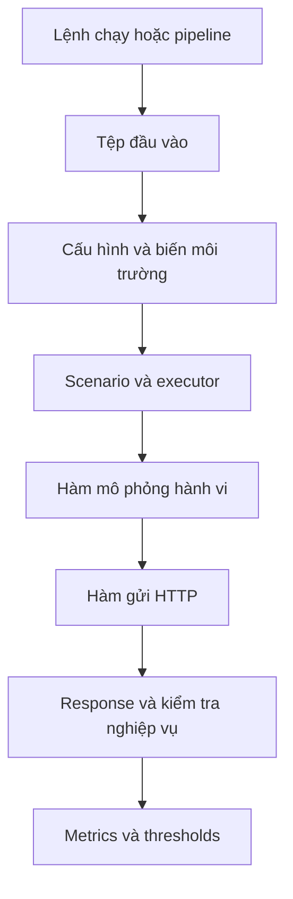

# JavaScript cho Performance Tester: từ ôn lại căn bản đến đọc và sửa mã kiểm thử hiệu năng

**Đối tượng:** người từng học JavaScript nhưng đã quên nhiều; cần đọc hiểu mã AI tạo ra, chỉnh đúng tham số và đánh giá một bài performance test.

**Ngày biên soạn, đối chiếu tài liệu:** 03/11/2026. Các ví dụ chính dùng JavaScript và k6; môi trường dùng để kiểm tra ví dụ có k6 **v2.3.0** và Node.js **v22.17.0**. Khi dự án của bạn dùng phiên bản khác, ưu tiên tài liệu tương ứng với phiên bản đó.

## Cách dùng giáo trình này

Mục tiêu không phải học thuộc mọi hàm của JavaScript. Sau khi học, bạn cần tự trả lời được năm câu hỏi với một đoạn mã bất kỳ:

1. Đoạn này lấy dữ liệu từ đâu và lưu vào biến nào?
2. Hàm nào thực sự được gọi, vào lúc nào, bao nhiêu lần?
3. Một lượt chạy kịch bản gửi những request nào, theo thứ tự nào?
4. Con số cần thay đổi là số VU, số iteration, tốc độ đến hay tổng request?
5. Kết quả đang chứng minh điều gì, và còn thiếu bằng chứng nào?

Tài liệu đi từ nền tảng đến thực hành trong phạm vi công việc này. Các chủ đề như framework giao diện, thuật toán chuyên sâu, lập trình prototype nâng cao không phải điều kiện để bắt đầu đọc script performance; phần nhận diện cú pháp vẫn giúp bạn biết khi nào cần tra cứu thêm.

### Ba tuyến đọc

| Nhu cầu | Nên đọc |
|---|---|
| Quên gần hết JS | Chương 1–10, sau đó 11–22; làm bài tập chương 28 |
| Cần đọc một script đang có ngay | Chương 1–6, 13, 16, 20, 23–25; quay lại nền tảng khi gặp cú pháp lạ |
| Chỉ cần biết sửa số lượng/tải ở đâu | Chương 12–13, 17–18, dự án chương 20–21, bảng tra chương 24 |

Mỗi lần học, nên gõ lại một ví dụ nhỏ, dự đoán kết quả rồi mới chạy. Nếu chỉ đọc và thấy “có vẻ hiểu”, bạn rất dễ bỏ qua khác biệt giữa khai báo hàm và gọi hàm, hoặc giữa số lượt chạy và số request.

### Quy ước ví dụ

- `js`, `javascript`: mã JavaScript; ví dụ ngắn có thể chỉ minh họa một ý, không phải tệp chạy độc lập.
- `powershell`: lệnh nhập vào cửa sổ PowerShell trên Windows; không chép vào tệp `.js`.
- `json`: dữ liệu JSON, không có comment và không có dấu phẩy cuối.
- `yaml`: cấu hình thường gặp ở Artillery hoặc pipeline.
- Các giá trị p95, error rate, VU, thời lượng là **ví dụ học tập**; yêu cầu thực tế phải có căn cứ nghiệp vụ và môi trường.
- Endpoint `http://127.0.0.1:3000` trong dự án mẫu là **API giả định trên máy cục bộ**, không phải một dịch vụ đã được cài sẵn. Chương 20 mô tả response cần có. Không thể trông chờ script thành công nếu chưa có API đó.
- Lệnh chạy tải dành cho hệ thống bạn quản lý hoặc được phép kiểm thử. Nên kiểm tra một request và một VU trước khi tăng tải.

### Một ví dụ để hình dung đích đến

```javascript
const count = 3;

function makePath(id) {
  return `/products/${id}`;
}

for (let index = 0; index < count; index++) {
  const path = makePath(index + 1);
  console.log(path);
}
```

Đọc thành lời: “Đặt số lượt là 3. Định nghĩa hàm nhận mã sản phẩm, trả về đường dẫn. Chạy vòng lặp với index lần lượt 0, 1, 2. Mỗi lượt gọi hàm với index cộng một, lưu đường dẫn rồi in ra.”

Kết quả:

```text
/products/1
/products/2
/products/3
```

Ví dụ này **chưa gửi HTTP request**. Chuỗi `/products/1` chỉ là văn bản. Nó chỉ trở thành một request khi được truyền vào API gửi HTTP như `http.get(...)` trong k6. Đây là thói quen đọc quan trọng: tìm lệnh thực hiện hành động, không suy đoán chỉ dựa vào tên biến.

## Mục lục

**Phần I — Nền tảng JavaScript để đọc code**

- [1. Bắt đầu đúng: bạn đang đọc ngôn ngữ nào, chạy ở đâu?](#chuong-1)
- [2. Đọc ký hiệu và cấu trúc một câu lệnh](#chuong-2)
- [3. Biến, phạm vi và kiểu dữ liệu](#chuong-3)
- [4. Toán tử, điều kiện và cách code rẽ nhánh](#chuong-4)
- [5. Hàm: khai báo, gọi, truyền dữ liệu và nhận kết quả](#chuong-5)
- [6. Object, array và cách dữ liệu di chuyển](#chuong-6)
- [7. Vòng lặp và các hàm xử lý array thường gặp](#chuong-7)
- [8. Chuỗi, số, JSON, thời gian và các hàm chuẩn cần biết](#chuong-8)
- [9. Module, file dự án, TypeScript và xử lý lỗi](#chuong-9)
- [10. Đồng bộ, bất đồng bộ và bài tự kiểm tra khả năng đọc code](#chuong-10)

**Phần II — Kiến thức và tư duy kiểm thử hiệu năng**

- [11. HTTP, API và dữ liệu: hiểu đúng thứ mà đoạn code đang gửi](#chuong-11)
- [12. Thuật ngữ hiệu năng và cách chọn mục tiêu kiểm thử](#chuong-12)
- [13. VU, iteration, concurrency, RPS: tính tải mà không nhầm đơn vị](#chuong-13)
- [14. Metrics, percentiles và tiêu chí đạt: đọc kết quả bằng đúng mẫu số](#chuong-14)
- [15. Đọc kết quả, tìm nguyên nhân và tránh kết luận sai](#chuong-15)

**Phần III — k6 và cấu trúc source thực tế**

- [16. k6 chạy một bài test như thế nào?](#chuong-16)
- [17. Những API k6 thường xuất hiện trong code do AI tạo](#chuong-17)
- [18. Cấu hình tải: nên dùng executor nào và sửa con số nào?](#chuong-18)
- [19. Đặt tiêu chí đúng: metric, check, threshold và tag](#chuong-19)
- [20. Cấu trúc một source code JS chuyên kiểm thử hiệu năng](#chuong-20)
- [21. Chạy, đọc cấu hình và chỉnh tải trong dự án mẫu](#chuong-21)
- [22. Mở rộng source thực tế: login, correlation, dữ liệu và reporting](#chuong-22)

**Phần IV — Đọc, chỉnh, kiểm tra và tự luyện**

- [23. Quy trình đọc một source code do AI tạo ra](#chuong-23)
- [24. Muốn thay đổi một con số: tìm và sửa ở đâu?](#chuong-24)
- [25. Các lỗi JS và k6 thường gặp, cách lần ra nguyên nhân](#chuong-25)
- [26. Rà soát code AI: một bài đọc có lỗi và cách sửa](#chuong-26)
- [27. Nhận diện cấu trúc dự án JS performance ngoài k6](#chuong-27)
- [28. Bài tập có đáp án: từ đọc cú pháp đến chọn đúng cấu hình](#chuong-28)
- [29. Lộ trình ôn tập 14 buổi và chuẩn tự đánh giá](#chuong-29)
- [30. Từ điển tra nhanh, công thức và tài liệu gốc](#chuong-30)

### Phạm vi kiểm chứng ví dụ

Dự án sáu tệp ở chương 20 đã được trích ra để kiểm tra nạp cấu hình của bốn profile. Những lượt chạy ngắn với API giả lập cục bộ cũng đã xác nhận: cả bốn profile chạy được; profile exact với ba iteration tạo ba GET và 12 quan sát check; JSON sai, ID sai hoặc HTTP 404 đều làm tiêu chí nghiệp vụ thất bại; cấu hình số sai/rỗng và cấu hình arrival mâu thuẫn bị chặn trước khi gửi request. Đây là kiểm chứng logic của ví dụ, không phải kết quả đánh giá năng lực của một hệ thống thật. Các đoạn cố ý có lỗi hoặc chỉ minh họa một phần được ghi rõ trong nội dung.

<a id="chuong-1"></a>

## 1. Bắt đầu đúng: bạn đang đọc ngôn ngữ nào, chạy ở đâu?

### 1.1. Mục tiêu học JavaScript của performance tester

Bạn không cần bắt đầu bằng việc xây một website hay học mọi tính năng của JavaScript. Trước hết, bạn cần đọc được một đoạn code và trả lời được sáu câu hỏi:

1. Dữ liệu đầu vào lấy từ đâu: giá trị viết trong code, file dữ liệu hay biến môi trường?
2. Hàm nào là điểm bắt đầu và ai gọi nó?
3. Điều kiện nào quyết định có gửi request tiếp hay dừng?
4. Một lượt chạy thực hiện những thao tác gì, bao nhiêu request?
5. Những con số nào điều khiển tải; những con số nào chỉ dùng để đánh giá kết quả?
6. Đổi một giá trị sẽ ảnh hưởng đến những chỗ nào?

Ví dụ, nhìn dòng `const total = Number(__ENV.TOTAL ?? 100);`, bạn cần hiểu rằng chương trình lấy `TOTAL` từ môi trường; nếu thiếu thì dùng `100`; sau đó chuyển sang kiểu số. Dòng này **chưa gửi request**. Chương trình còn phải dùng `total` ở một nơi khác thì con số đó mới có tác dụng.

### 1.2. JavaScript, ECMAScript, Node.js, trình duyệt và k6

| Tên | Hiểu theo cách thực hành | Khi đọc source test cần biết gì? |
|---|---|---|
| JavaScript, viết tắt JS | Ngôn ngữ dùng để mô tả dữ liệu và các bước xử lý | `const`, `if`, hàm, array, object là nền tảng chung |
| ECMAScript, ES | Tiêu chuẩn của ngôn ngữ JavaScript | ES6/ES2015 thường xuất hiện khi nói về `let`, arrow function, module |
| Runtime | Môi trường thực thi code | Runtime quyết định có những API nào và chạy file thế nào |
| Trình duyệt | Runtime phục vụ trang web | Có DOM, `document`, các API web như `fetch` |
| Node.js | Runtime thường dùng cho công cụ, backend và nhiều framework test | Thường có `process.env`, API file, thư viện npm |
| k6 | Công cụ tạo tải có runtime JavaScript riêng | Có `k6/http`, `check`, `sleep`, `__ENV` |
| TypeScript, TS | JavaScript bổ sung cú pháp mô tả kiểu dữ liệu | `name: string`, `interface`, `type` là dấu hiệu thường gặp |

**Cùng đuôi `.js` không có nghĩa là chạy bằng cùng một công cụ.**

```javascript
// JavaScript cơ bản: dùng được trong nhiều runtime.
const vus = 5;
const doubled = vus * 2;
console.log(doubled); // 10
```

```javascript
// Đoạn dành cho k6, không chạy trực tiếp bằng node file.js.
import http from 'k6/http';

export default function () {
  http.get('http://localhost:3000/health');
}
```

Khi một AI thêm `require('fs')`, `process.env` hoặc thư viện Node vào script k6, đừng chỉ kiểm tra cú pháp JS. Hãy kiểm tra thư viện đó có phù hợp với runtime k6 và cách build của dự án hay không. k6 có module riêng, module cục bộ, module từ xa và extension; module cục bộ cần đường dẫn rõ ràng như `./helpers.js`. [Tài liệu module của k6](https://grafana.com/docs/k6/latest/using-k6/modules/).

### 1.3. Thuật ngữ tối thiểu khi đọc code

| Thuật ngữ | Nghĩa | Ví dụ |
|---|---|---|
| Source code, source, mã nguồn | Nội dung chương trình do người hoặc AI viết | Các file `.js` trong dự án |
| Script | Một chương trình/đoạn mã dùng để thực hiện công việc | `smoke.js` |
| Statement, câu lệnh | Một chỉ dẫn hoàn chỉnh | `const vus = 5;` |
| Expression, biểu thức | Đoạn mã tạo ra một giá trị | `vus * 2`, `status === 200` |
| Identifier, định danh | Tên đặt cho biến, hàm… | `baseUrl`, `login` |
| Literal | Giá trị viết trực tiếp trong code | `5`, `'30s'`, `true` |
| Variable, biến | Một tên gắn với giá trị | `let attempt = 0;` |
| Function, hàm | Khối xử lý có thể được gọi | `buildHeaders(token)` |
| Argument, đối số | Giá trị đưa vào một lần gọi hàm | `'abc'` trong `login('abc')` |
| Parameter, tham số | Tên nhận đầu vào trong khai báo hàm | `username` trong `function login(username)` |
| Property, thuộc tính | Dữ liệu nằm trên object | `response.status` |
| Method, phương thức | Hàm nằm trên object | `response.json()` |
| Return value | Giá trị hàm trả về | `200` từ `getStatus()` |
| Side effect | Tác động ngoài việc tính và trả giá trị | Gửi HTTP, ghi log, sửa array đầu vào |
| Runtime error | Lỗi xảy ra khi thực thi | Đọc `user.name` khi `user` là `undefined` |
| Dependency | Thư viện/module mà code phụ thuộc | `k6/http`, file `client.js` |

### 1.4. Cách thực hành các ví dụ trong phần nền tảng

Các ví dụ ngắn thường **độc lập**, không phải những đoạn cần dán liên tiếp vào cùng một file. Một số khối minh họa nối tiếp cùng ví dụ hoặc chỉ chứa thân hàm; phần mô tả sẽ nói rõ khi cần dữ liệu/hàm ở khối trước. Vì vậy cùng tên biến có thể xuất hiện ở nhiều ví dụ. Những đoạn có chú thích `SAI` hoặc ghi rõ “gây lỗi” dùng để nhận diện lỗi, không phải mẫu để sao chép nguyên khối.

Với JS thuần, có thể tạo `practice.js` rồi chạy `node practice.js`, hoặc dùng Console của trình duyệt. Các ví dụ có `k6/http`, `__ENV`, `check`, `sleep` thuộc k6 và cần chạy bằng k6. Địa chỉ `localhost` chỉ hoạt động khi bạn có dịch vụ tương ứng trên máy.

---

<a id="chuong-2"></a>

## 2. Đọc ký hiệu và cấu trúc một câu lệnh

### 2.1. Mổ xẻ một dòng đơn giản

```javascript
const requestCount = 100;
```

- `const`: khai báo một tên mà chương trình không được gán lại sang giá trị khác.
- `requestCount`: tên do người viết đặt; ở đây có ý nghĩa là số request.
- `=`: gán giá trị bên phải cho tên bên trái.
- `100`: giá trị số.
- `;`: kết thúc câu lệnh.

Tên biến giúp con người hiểu ý định nhưng **không tự tạo ra hành vi**. Biến tên `requestCount` vẫn có thể chưa được dùng hoặc bị dùng sai. Phải tìm những nơi đọc biến này.

### 2.2. Những dấu thường gặp

| Ký hiệu | Thường có nghĩa gì? | Ví dụ và cách đọc |
|---|---|---|
| `()` | Khai báo tham số, gọi hàm hoặc gom biểu thức | `login(user)`: gọi `login`, đưa `user` vào |
| `{}` | Khối lệnh hoặc object | `if (ok) { ... }`; `{ timeout: '5s' }` |
| `[]` | Array hoặc truy cập theo chỉ mục/key | `users[0]`; `headers['Content-Type']` |
| `.` | Truy cập thuộc tính/phương thức | `res.status`, `res.json()` |
| `,` | Ngăn cách tham số, phần tử hoặc thuộc tính | `post(url, body, params)` |
| `:` | Ngăn tên thuộc tính với giá trị trong object | `{ vus: 10 }` |
| `;` | Kết thúc câu lệnh | `sleep(1);` |
| `'...'`, `"..."` | Chuỗi | `'10'` là chuỗi, không phải số |
| `` `...` `` | Template literal: chuỗi có thể chèn biểu thức | `` `${baseUrl}/users/${id}` `` |
| `${...}` | Tính biểu thức rồi chèn vào template literal | `` `user-${5}` `` tạo `'user-5'` |
| `=>` | Arrow function | `(r) => r.status === 200` |
| `...` | Spread hoặc rest, tùy vị trí | `{ ...headers }`; `function f(...args)` |
| `//` | Chú thích đến hết dòng | `// Dừng 1 giây` |
| `/* ... */` | Chú thích nhiều dòng | Ghi giải thích dài |

`{}` có nhiều vai trò nên cần nhìn ngữ cảnh:

```javascript
const user = { id: 7 };     // object chứa thuộc tính id

function getUser() {       // bắt đầu thân hàm
  return user;
}                         // kết thúc thân hàm

if (user.id === 7) {       // bắt đầu khối lệnh if
  console.log('Đúng user');
}
```

### 2.3. Đọc từ ngoài vào trong

```javascript
const payload = JSON.stringify({ productId: 42, quantity: 2 });
```

Đọc thành bốn bước:

1. Tạo object `{ productId: 42, quantity: 2 }`.
2. Lấy hàm `stringify` trên object chuẩn `JSON`.
3. Gọi hàm đó với object vừa tạo, nhận về một chuỗi JSON.
4. Gán chuỗi đó vào `payload`.

```javascript
const ids = users.filter((user) => user.active).map((user) => user.id);
```

Đọc từ trái sang phải theo từng mắt xích: lấy `users` → giữ những user có `active` truthy → lấy `id` của từng user còn lại → tạo array mới `ids`.

### 2.4. Thụt lề, chữ hoa/thường và dấu chấm phẩy

JS phân biệt chữ hoa/thường: `baseUrl`, `baseURL` và `BASE_URL` là ba tên khác nhau. Thụt lề không thay thế dấu `{}` nhưng giúp nhìn đúng khối lệnh. Một dòng mới không phải lúc nào cũng kết thúc câu lệnh theo ý bạn.

```javascript
// SAI nếu muốn trả object:
function buildWrong() {
  return
  { status: 200 };
}

console.log(buildWrong()); // undefined
```

```javascript
// Đúng: biểu thức trả về bắt đầu ngay sau return.
function buildCorrect() {
  return { status: 200 };
}
```

JS có cơ chế tự chèn dấu chấm phẩy trong một số tình huống. Đối với người ôn lại, hãy theo phong cách có sẵn của dự án và tránh xuống dòng ngay sau `return`. [MDN về câu lệnh return](https://developer.mozilla.org/en-US/docs/Web/JavaScript/Reference/Statements/return).

---

<a id="chuong-3"></a>

## 3. Biến, phạm vi và kiểu dữ liệu

### 3.1. `const`, `let`, `var`: chọn và đọc thế nào?

| Từ khóa | Gán lại được? | Phạm vi thường gặp | Lời khuyên khi đọc/sửa |
|---|---:|---|---|
| `const` | Không | Block `{}` hoặc module | Dùng mặc định nếu không cần gán lại |
| `let` | Có | Block `{}` hoặc module | Dùng cho biến đếm, trạng thái cần thay đổi |
| `var` | Có | Function hoặc global của script | Hiểu để đọc code cũ; tránh tự thêm vào code mới |

```javascript
const baseUrl = 'http://localhost:3000';
let completed = 0;

completed = completed + 1; // Được: let cho phép gán lại.
// baseUrl = 'http://localhost:4000'; // Gây lỗi: const không cho gán lại.
```

“Không gán lại được” không có nghĩa là bạn không được sửa con số trong file nguồn. Bạn hoàn toàn có thể đổi `const vus = 5;` thành `const vus = 10;` rồi chạy lại. Quy tắc của `const` áp dụng **trong một lần chương trình thực thi**.

### 3.2. `const` không làm object trở thành bất biến

```javascript
const config = { vus: 5 };
config.vus = 10;          // Được: sửa thuộc tính của cùng object.

// config = { vus: 20 };  // Lỗi: gán biến config sang object khác.

const ids = [1, 2];
ids.push(3);             // Được: array cũng là object.
console.log(ids);        // [1, 2, 3]
```

Đọc code AI cần tìm cả `config.vus = ...`, `push`, `splice`, `sort`, chứ không chỉ tìm nơi khai báo. Một giá trị cấu hình có thể bị thay đổi sau khi khai báo. Chi tiết về block scope, gán lại và thay đổi object có trong [MDN: tổng quan ngôn ngữ JavaScript](https://developer.mozilla.org/en-US/docs/Web/JavaScript/Guide/Language_overview).

### 3.3. Scope: biến nhìn thấy ở đâu?

```javascript
const baseUrl = 'http://localhost:3000'; // module scope

function buildUrl(path) {               // path chỉ thuộc lần gọi hàm này
  const url = `${baseUrl}${path}`;      // local/function body scope
  return url;
}

console.log(buildUrl('/health'));       // Được.
// console.log(url);                    // Lỗi: ngoài phạm vi của url.
```

```javascript
let vus = 5;

if (true) {
  let vus = 10; // Một biến khác cùng tên ở scope bên trong: shadowing.
  console.log(vus); // 10
}

console.log(vus); // 5
```

Đây là lỗi sửa cấu hình khá phổ biến: bạn đổi một biến cùng tên ở nhầm phạm vi, trong khi phần gửi tải vẫn dùng biến khác.

### 3.4. Hoisting và temporal dead zone: không cần học thuộc thuật ngữ, phải biết hậu quả

**Hoisting** là cách diễn đạt về việc các khai báo được xử lý trước phần thực thi trong phạm vi của chúng. Không nên hiểu rằng JS thật sự di chuyển mọi dòng code lên đầu file.

```javascript
sayHello(); // Được với function declaration trong ví dụ này.

function sayHello() {
  console.log('Xin chào');
}
```

```javascript
console.log(oldValue); // undefined
var oldValue = 10;
```

```javascript
// Ví dụ này gây ReferenceError:
console.log(newValue);
let newValue = 10;
```

Với `let`/`const`, từ lúc bước vào scope đến khi chạy qua chỗ khởi tạo là **temporal dead zone**, viết tắt TDZ. Đừng đọc biến trong khoảng đó. Khi dùng arrow function gán vào `const`, cũng phải khởi tạo xong mới gọi. [MDN về let và TDZ](https://developer.mozilla.org/en-US/docs/Web/JavaScript/Reference/Statements/let).

### 3.5. Các kiểu dữ liệu cần nhận diện

| Kiểu | Ví dụ | Tình huống test |
|---|---|---|
| `number` | `10`, `0.5`, `-1`, `NaN`, `Infinity` | VUs, số lần lặp, số milliseconds |
| `string` | `'10'`, `'30s'`, `'Bearer abc'` | URL, token, duration dạng cấu hình |
| `boolean` | `true`, `false` | Bật tắt debug, điều kiện kiểm tra |
| `undefined` | Chưa có giá trị/không tìm thấy thuộc tính | Thiếu biến môi trường hoặc thuộc tính response |
| `null` | Chủ động biểu diễn không có giá trị | API trả `token: null` |
| `object` | `{ status: 200 }`, `[1, 2]` | Config, JSON đã parse, danh sách data |
| `bigint` | `123n` | Số nguyên rất lớn; ít gặp, không tự JSON.stringify được |
| `symbol` | `Symbol('key')` | Ít gặp trong script tải cơ bản |

JS là ngôn ngữ có kiểu động: biến có thể được gán giá trị thuộc kiểu khác nếu dùng `let`. Điều đó không làm hai kiểu dữ liệu có cùng ý nghĩa.

```javascript
console.log(typeof 10);         // 'number'
console.log(typeof '10');       // 'string'
console.log(typeof undefined);  // 'undefined'
console.log(typeof null);       // 'object' — một đặc điểm lịch sử của JS.
console.log(typeof []);         // 'object'
console.log(Array.isArray([])); // true — cách kiểm tra array.
```

Phân biệt `undefined` và `null` trong ngữ cảnh API: thiếu key thường cho `undefined`; key tồn tại nhưng rỗng có thể là `null`. Phải đối chiếu hợp đồng API, không tự coi hai trường hợp đều hợp lệ.

### 3.6. Biến môi trường thường là chuỗi

```javascript
// Ví dụ k6: giả sử __ENV.VUS là chuỗi '10'.
const rawVus = __ENV.VUS;
const wrong = rawVus + 5;         // '105'
const correct = Number(rawVus) + 5; // 15
```

Cùng lỗi xảy ra với `process.env` trong Node.js. Đầu vào nhìn như số vẫn cần chuyển và kiểm tra kiểu.

```javascript
function toPositiveInteger(raw, fallback, fieldName) {
  const candidate = raw === undefined ? fallback : raw;

  if (String(candidate).trim() === '') {
    throw new Error(`${fieldName} không được để trống`);
  }

  const value = Number(candidate);

  if (!Number.isSafeInteger(value) || value <= 0) {
    throw new Error(`${fieldName} phải là số nguyên dương an toàn`);
  }

  return value;
}

console.log(toPositiveInteger('20', 5, 'VUS')); // 20
// toPositiveInteger('20abc', 5, 'VUS');       // Gây lỗi.
// toPositiveInteger('', 5, 'VUS');            // Gây lỗi.
// toPositiveInteger('2.5', 5, 'VUS');          // Gây lỗi.
```

`Number('')` và `Number('   ')` cho `0`; vì vậy phải quyết định rõ input trống có được dùng default không. `parseInt('20abc', 10)` cho `20`; tính chất này có thể che đầu vào sai. Với cấu hình tải, `Number` rồi kiểm tra số thường dễ kiểm soát hơn.

### 3.7. Truthy/falsy: điều kiện không bắt buộc phải là boolean

Những giá trị falsy thường gặp: `false`, `0`, `-0`, `0n`, `''`, `null`, `undefined`, `NaN`. Các giá trị như `'0'`, `'false'`, `[]`, `{}` đều truthy.

```javascript
console.log(Boolean('false')); // true: đây là chuỗi không rỗng.
console.log(Boolean([]));      // true: array rỗng vẫn là object.
console.log(Boolean(''));      // false
```

```javascript
// Cách đọc cờ bật/tắt từ môi trường theo quy ước cụ thể:
const debug = String('false').toLowerCase() === 'true';
console.log(debug); // false
```

Trong dự án thật, cần xác định tập giá trị hợp lệ: chỉ `'true'`/`'false'`, hay nhận cả `'1'`/`'0'`. Đừng mặc định `Boolean(raw)` là bộ parse cấu hình boolean.

---

<a id="chuong-4"></a>

## 4. Toán tử, điều kiện và cách code rẽ nhánh

### 4.1. Phép tính và phép gán

| Toán tử | Ý nghĩa | Ví dụ |
|---|---|---|
| `+`, `-`, `*`, `/` | Cộng, trừ, nhân, chia | `60 * 5` tạo `300` |
| `%` | Phần dư | `7 % 3` tạo `1` |
| `**` | Lũy thừa | `2 ** 3` tạo `8` |
| `=` | Gán | `count = 10` |
| `+=`, `-=`, `*=`, `/=` | Tính rồi gán lại | `count += 1` tương đương `count = count + 1` |
| `++`, `--` | Tăng/giảm một đơn vị | `attempt++` |
| `<`, `<=`, `>`, `>=` | So sánh | `res.status >= 500` |

`%` thường dùng để xoay vòng dữ liệu:

```javascript
const users = ['an', 'binh', 'chi'];
const iterationIndex = 4;
const index = iterationIndex % users.length;
console.log(users[index]); // 'binh': 4 % 3 = 1
```

Phải kiểm tra `users.length > 0`; chia lấy dư cho `0` cho `NaN`, sau đó truy cập array không cho user như mong muốn. Dùng modulo chỉ giúp chọn dữ liệu; nó không bảo đảm mỗi tài khoản chỉ có một VU sử dụng.

Đừng lạm dụng khác biệt `i++`/`++i` trong biểu thức. `i++` trả giá trị cũ rồi tăng, `++i` tăng rồi trả giá trị mới. Trong `for (...; ...; i++)`, khác biệt này thường không ảnh hưởng số vòng vì không dùng giá trị trả về của biểu thức tăng.

### 4.2. So sánh `==` và `===`

```javascript
console.log(200 == '200');  // true: có chuyển kiểu.
console.log(200 === '200'); // false: khác kiểu.
console.log(200 !== '200'); // true
```

Khi kiểm tra response, ưu tiên so sánh rõ kiểu:

```javascript
const response = { status: 200 };
const ok = response.status === 200;
```

Nhận diện lỗi đặc biệt nguy hiểm:

```javascript
let status = 500;

// SAI: đây là phép GÁN, không phải so sánh.
if (status = 200) {
  console.log('Nhánh này chạy vì 200 là truthy');
}
```

Với object và array, `===` so sánh cùng đối tượng được tham chiếu, không tự so nội dung:

```javascript
console.log({ id: 1 } === { id: 1 }); // false
const first = { id: 1 };
const second = first;
console.log(first === second);       // true
```

### 4.3. `&&`, `||`, `!`: vừa dùng làm điều kiện vừa trả giá trị

```javascript
const status = 200;
const token = 'abc';

const valid = status === 200 && token.length > 0;
const badStatus = status < 200 || status >= 300;
console.log(valid);     // true
console.log(badStatus); // false
console.log(!valid);    // false
```

`&&` dừng ở giá trị falsy đầu tiên hoặc trả giá trị cuối; `||` dừng ở giá trị truthy đầu tiên hoặc trả giá trị cuối. Chúng không nhất thiết trả boolean.

```javascript
console.log('abc' && 123); // 123
console.log('' || 'guest'); // 'guest'
```

“Dừng sớm” này gọi là **short circuit**. Trong `token && sendRequest(token)`, hàm chỉ được gọi nếu `token` truthy. Đây có thể là nguyên nhân một request không được gửi.

### 4.4. `??` khác `||` ở những giá trị hợp lệ như 0

```javascript
const pause = 0;

console.log(pause || 1); // 1: 0 bị coi là falsy.
console.log(pause ?? 1); // 0: chỉ dùng 1 nếu pause là null/undefined.
```

Với tham số cho phép bằng `0`, ví dụ think time, thay `??` bằng `||` có thể làm cấu hình mất tác dụng. Ngược lại, `'' ?? 5` vẫn cho chuỗi rỗng; `??` không kiểm tra tính hợp lệ. Không viết trực tiếp `a ?? b || c`; cần ngoặc như `(a ?? b) || c` và phải hiểu chủ đích. [MDN về nullish coalescing](https://developer.mozilla.org/en-US/docs/Web/JavaScript/Reference/Operators/Nullish_coalescing).

### 4.5. Optional chaining `?.`: tránh một nhóm lỗi truy cập, không xác nhận dữ liệu đúng

```javascript
const body = { data: null };
const token = body.data?.token;
console.log(token); // undefined, không văng lỗi vì data là null.
```

`body?.data?.token` dừng nếu `body` hoặc `data` là `null`/`undefined`. Nó không tự xử lý JSON sai, HTTP lỗi hay tên thuộc tính gõ sai. Và `missingVariable?.id` vẫn gây lỗi nếu `missingVariable` chưa hề được khai báo. [MDN về optional chaining](https://developer.mozilla.org/en-US/docs/Web/JavaScript/Reference/Operators/Optional_chaining).

Trong test, `const token = body?.data?.token ?? '';` mà sau đó vẫn gửi request có thể biến lỗi login thành lỗi hàng loạt ở bước sau. Hãy kiểm tra token rồi quyết định có dừng iteration không.

### 4.6. `if`, `else if`, `else`, ternary và `switch`

```javascript
function describeStatus(status) {
  if (status === 200) {
    return 'thành công';
  } else if (status === 429) {
    return 'bị giới hạn tốc độ';
  } else if (status >= 500) {
    return 'lỗi phía server';
  } else {
    return 'cần xem thêm';
  }
}
```

Ternary là toán tử chọn một trong hai giá trị:

```javascript
const isWrite = false;
const method = isWrite ? 'POST' : 'GET';
console.log(method); // 'GET'
```

Đọc là: nếu `isWrite` truthy thì lấy `'POST'`, ngược lại lấy `'GET'`. Tránh ternary lồng nhiều tầng khi cần sửa nhanh vì dễ chọn sai nhánh.

```javascript
function getPause(profile) {
  switch (profile) {
    case 'smoke':
      return 1;
    case 'load':
      return 0.5;
    default:
      throw new Error(`Không hỗ trợ profile: ${profile}`);
  }
}
```

Nếu `case` không có `return`, `break` hoặc `throw`, code có thể chạy tiếp sang case sau: **fall-through**. Đừng cho rằng mỗi case tự kết thúc.

### 4.7. Thứ tự ưu tiên: thêm ngoặc để ý định rõ

```javascript
console.log(10 + 5 * 2);   // 20
console.log((10 + 5) * 2); // 30

const hasToken = true;
const status = 500;
const isAdmin = false;
const allowed = hasToken && (status === 200 || isAdmin);
console.log(allowed); // false
```

`!` được tính trước các phép logic; `&&` ưu tiên hơn `||`. Thay vì ghi nhớ toàn bộ bảng ưu tiên, hãy thêm ngoặc khi một dòng có nhiều loại toán tử. `&` và `|` là toán tử bit, không phải cách viết rút gọn của `&&` và `||`.

---

<a id="chuong-5"></a>

## 5. Hàm: khai báo, gọi, truyền dữ liệu và nhận kết quả

### 5.1. Hình dạng một hàm

```javascript
function calculateTotal(iterations, requestsPerIteration) {
  const total = iterations * requestsPerIteration;
  return total;
}

const result = calculateTotal(100, 3);
console.log(result); // 300
```

Đọc lần lượt:

1. `function` bắt đầu khai báo hàm.
2. `calculateTotal` là tên hàm.
3. `iterations`, `requestsPerIteration` là tham số.
4. `{ ... }` là thân hàm, chưa chạy chỉ vì bạn viết khai báo.
5. `calculateTotal(100, 3)` mới là lần gọi; `100`, `3` là đối số.
6. Trong lần gọi này, `iterations = 100`, `requestsPerIteration = 3`.
7. `return total` trả `300` và kết thúc lần gọi.
8. Giá trị trả về được gán vào `result`.

Một hàm có thể được gọi nhiều lần với đầu vào khác nhau. Khi cần sửa số request, phải phân biệt sửa **logic trong hàm** hay sửa **đối số ở nơi gọi**.

### 5.2. Có khai báo hàm không có nghĩa hàm sẽ chạy

```javascript
function login() {
  console.log('Đang login');
}

// Chỉ khai báo như trên thì chưa in gì.
login(); // Bây giờ mới in.
```

Trong test framework, công cụ có thể tự gọi một hàm quy ước. Ví dụ k6 sẽ gọi hàm scenario đã được cấu hình. Vì thế đừng tìm một dòng `default()` rồi kết luận “không ai gọi nên không chạy”; cần biết quy ước của công cụ.

### 5.3. Tham số mặc định và tham số thiếu

```javascript
function buildName(prefix = 'test', index = 1) {
  return `${prefix}-${index}`;
}

console.log(buildName());            // 'test-1'
console.log(buildName('user', 7));    // 'user-7'
console.log(buildName(undefined, 3)); // 'test-3'
console.log(buildName(null, 3));      // 'null-3'
```

Giá trị mặc định của tham số được dùng khi đối số là `undefined` hoặc bị bỏ qua, không tự thay `null`, `0`, `''`. Nếu hàm nhận ba tham số thì vị trí rất quan trọng.

```javascript
function explainRequest(url, body, params) {
  return { url, body, params };
}

const request = explainRequest('/orders', '{"quantity":2}', { timeout: '5s' });
```

Đừng đoán vị trí tham số theo tên hàm khác. Ví dụ `http.get(url, params)` và `http.post(url, body, params)` có bố cục khác nhau; phần HTTP sẽ giải thích cụ thể.

### 5.4. `return` khác `console.log`

```javascript
function logOnly(a, b) {
  console.log(a + b);
}

const value = logOnly(2, 3); // Console có in 5.
console.log(value);          // undefined: hàm không trả kết quả.
```

```javascript
function add(a, b) {
  return a + b;
}

const value = add(2, 3); // 5; tự hàm không in gì.
```

`return;` không có biểu thức sẽ kết thúc hàm và trả `undefined`. `return` trong hàm helper chỉ thoát helper đó. Nó không tự kết thúc hàm đã gọi helper.

```javascript
function validateToken(token) {
  if (!token) return false;
  return true;
}

function scenario(token) {
  const valid = validateToken(token);
  if (!valid) return; // Cần dòng này nếu muốn thoát cả scenario.
  console.log('Tiếp tục request phụ thuộc token');
}
```

### 5.5. Function declaration, function expression và arrow function

```javascript
// Function declaration
function doubleA(value) {
  return value * 2;
}

// Function expression gán vào biến
const doubleB = function (value) {
  return value * 2;
};

// Arrow function có block: phải viết return nếu cần giá trị.
const doubleC = (value) => {
  return value * 2;
};

// Arrow function có expression: trả ngầm giá trị biểu thức.
const doubleD = (value) => value * 2;
```

Bốn hàm đều cho `10` khi gọi với `5` trong các ví dụ này. Nhưng chúng không giống nhau mọi mặt: declaration có thể gọi trước vị trí khai báo trong phạm vi thích hợp; các biến `const` phải được khởi tạo trước; arrow không có `this` riêng và không dùng làm constructor với `new`.

```javascript
const wrong = (id) => { id: id };   // Không trả object; kết quả undefined.
const correct = (id) => ({ id: id });
const shorter = (id) => ({ id });  // Shorthand: key id nhận giá trị biến id.
```

Ngoặc `({ ... })` giúp JS hiểu phần này là một biểu thức object. Nếu thấy arrow có `{}`, hãy tìm `return` trước khi cho rằng nó đã trả kết quả. [MDN: functions](https://developer.mozilla.org/en-US/docs/Web/JavaScript/Guide/Functions).

### 5.6. Gọi hàm và truyền chính hàm là hai việc khác nhau

```javascript
function isSuccess(response) {
  return response.status === 200;
}

const predicate = isSuccess;                // Giữ chính hàm.
const result = isSuccess({ status: 200 });   // Gọi hàm, giữ boolean true.
```

**Callback** là hàm được truyền cho hàm khác để hàm kia gọi vào thời điểm/phương thức nó quy định. Callback không tự có nghĩa là bất đồng bộ: `map` gọi callback đồng bộ.

```javascript
const statuses = [200, 500, 200];
const flags = statuses.map((status) => status === 200);
console.log(flags); // [true, false, true]
```

Ví dụ thường gặp trong k6:

```javascript
// Chỉ minh họa cách check nhận callback; response có sẵn trong script thực tế.
check(response, {
  'status là 200': (r) => r.status === 200,
});
```

`r` không phải từ khóa JS và không phải magic. Nó là tên tham số do người viết chọn. `check` sẽ đưa response vào callback. Bạn có thể đổi `r` thành `responseItem` nếu đổi đồng bộ ở phần thân.

### 5.7. Object truyền vào hàm: có thể bị sửa từ bên trong

```javascript
function increasePrimitive(value) {
  value += 1;
}

let count = 1;
increasePrimitive(count);
console.log(count); // 1

function changeConfig(config) {
  config.vus = 20;
}

const settings = { vus: 5 };
changeConfig(settings);
console.log(settings.vus); // 20
```

JS truyền đối số **theo giá trị**. Với object, giá trị được truyền là một tham chiếu tới object; vì thế hai biến có thể cùng trỏ đến một object. Nếu helper sửa thuộc tính thì người gọi thấy thay đổi. Nếu helper chỉ gán tham số sang object khác thì biến ở người gọi không tự đổi theo.

### 5.8. Closure: hàm nhớ scope bên ngoài

```javascript
function createPrefixer(prefix) {
  return function (id) {
    return `${prefix}-${id}`;
  };
}

const userName = createPrefixer('perf');
console.log(userName(7)); // 'perf-7'
```

`createPrefixer` đã chạy xong nhưng hàm được trả về vẫn dùng được `prefix`. Đây là closure. Trong source test, pattern này thường dùng tạo client, giữ cấu hình hoặc giữ cache token theo scope của runtime. Trong k6, đừng suy từ “có biến ngoài hàm” ra “mọi VU cùng chia sẻ và sửa biến đó”. Phần lifecycle sẽ nói rõ giới hạn chia sẻ. [MDN: closures](https://developer.mozilla.org/en-US/docs/Web/JavaScript/Guide/Closures).

### 5.9. `this` và method: chỉ cần đủ để không đọc nhầm

```javascript
const account = {
  name: 'tester',
  label() {
    return `user:${this.name}`;
  },
};

console.log(account.label()); // 'user:tester'
```

Trong lần gọi này, `this` là `account`. Với hàm thông thường, `this` phụ thuộc cách gọi. Nếu tách `const fn = account.label;` rồi gọi `fn()`, bạn có thể mất đối tượng nhận `this`. Arrow function lấy `this` từ scope bên ngoài, nên không thay mọi method bằng arrow một cách máy móc. Với helper test đơn giản, truyền đầu vào rõ ràng thường dễ đọc hơn phụ thuộc `this`.

---

<a id="chuong-6"></a>

## 6. Object, array và cách dữ liệu di chuyển

### 6.1. Object: nhóm dữ liệu theo tên

```javascript
const user = {
  id: 7,
  username: 'perf-user',
  active: true,
  profile: {
    role: 'tester',
  },
};

console.log(user.username);      // 'perf-user'
console.log(user['username']);   // 'perf-user'
console.log(user.profile.role);  // 'tester'
console.log(user.missing);       // undefined
```

Truy cập bằng ngoặc vuông cần thiết khi key có dấu gạch ngang hoặc key nằm trong biến:

```javascript
const headers = { 'Content-Type': 'application/json' };
const key = 'Content-Type';
console.log(headers[key]); // 'application/json'
```

Phân biệt `headers.key` tìm thuộc tính có tên đúng là `'key'`; `headers[key]` lấy **giá trị biến** `key` làm tên thuộc tính.

### 6.2. Array: danh sách có thứ tự, chỉ mục bắt đầu từ 0

```javascript
const users = [
  { id: 1, username: 'an' },
  { id: 2, username: 'binh' },
];

console.log(users.length);      // 2
console.log(users[0].username); // 'an'
console.log(users[1].id);       // 2
console.log(users[2]);          // undefined
```

`length` là thuộc tính nên không có `()`: `users.length`, không phải `users.length()`. `users[2].id` sẽ gây lỗi khi phần tử thứ ba không tồn tại.

### 6.3. Gán object không tự tạo bản sao

```javascript
const original = { vus: 5 };
const alias = original;

alias.vus = 10;
console.log(original.vus); // 10
```

Nếu AI tạo cấu hình smoke bằng `const smoke = baseConfig;` rồi đổi `smoke.vus`, rất có thể nó đang sửa luôn cấu hình gốc.

### 6.4. Destructuring: lấy thuộc tính ra biến

```javascript
const config = { vus: 5, duration: '30s' };
const { vus, duration } = config;

console.log(vus);      // 5
console.log(duration); // '30s'
```

```javascript
const { vus: userCount, timeout = '5s' } = { vus: 10 };
console.log(userCount); // 10: đổi tên biến nhận giá trị.
console.log(timeout);   // '5s': giá trị mặc định vì thiếu thuộc tính.

const [first, second] = ['a', 'b', 'c'];
console.log(first, second); // 'a', 'b'
```

Trong `{ vus: userCount }`, key nguồn là `vus`, tên biến mới là `userCount`; không phải ngược lại. Mặc định destructuring chỉ thay `undefined`, không thay `null`. Destructure từ chính `null`/`undefined` mà không bảo vệ sẽ gây lỗi.

```javascript
function printUser({ username, role = 'reader' }) {
  console.log(username, role);
}

printUser({ username: 'an' }); // 'an', 'reader'
```

Đây vẫn là hàm nhận **một object**, không phải hai đối số riêng.

### 6.5. Spread: trải thuộc tính/phần tử, thứ tự ghi đè rất quan trọng

```javascript
const base = { vus: 5, duration: '30s' };
const smoke = { ...base, vus: 1 };
console.log(smoke); // { vus: 1, duration: '30s' }

const wrongOrder = { vus: 1, ...base };
console.log(wrongOrder.vus); // 5: base ở sau ghi đè vus.
```

```javascript
const first = [1, 2];
const combined = [...first, 3];
console.log(combined); // [1, 2, 3]
```

Nhận diện pattern config phổ biến: `{ ...defaults, ...environmentConfig, ...overrides }`. Giá trị xuất hiện sau cùng thắng với các thuộc tính trùng tên. Đây là quy tắc của cách ghép object cụ thể này, không thay thế quy tắc ưu tiên cấu hình của công cụ test.

### 6.6. Spread chỉ sao chép nông: nested object vẫn có thể dùng chung

```javascript
const base = {
  headers: { Authorization: 'Bearer old' },
  timeout: '5s',
};

const copy = { ...base };
copy.headers.Authorization = 'Bearer new';

console.log(base.headers.Authorization); // 'Bearer new'
```

Object ngoài đã khác nhau nhưng `headers` bên trong vẫn là cùng một object. Nếu cần sửa header riêng:

```javascript
const base = {
  headers: { 'Content-Type': 'application/json' },
  timeout: '5s',
};

const params = {
  ...base,
  headers: {
    ...base.headers,
    Authorization: 'Bearer abc',
  },
};
```

Đừng tự coi `JSON.parse(JSON.stringify(obj))` là phương pháp deep clone cho mọi dữ liệu: nó không giữ nguyên mọi kiểu như `Date`, `undefined`, `BigInt` hoặc hàm. Việc có dùng `structuredClone` hay không còn phụ thuộc runtime và kiểu cần sao chép. [MDN về spread và giới hạn sao chép nông](https://developer.mozilla.org/en-US/docs/Web/JavaScript/Reference/Operators/Spread_syntax).

### 6.7. Rest: gom phần còn lại

```javascript
function sum(...values) {
  return values.reduce((total, value) => total + value, 0);
}

console.log(sum(1, 2, 3)); // 6

const { password, ...safeUser } = { username: 'an', password: 'secret' };
console.log(safeUser); // { username: 'an' }
```

`...` ở nơi tạo object/array hoặc truyền đối số thường là spread; ở tham số hàm hoặc mẫu destructuring thường là rest. Ví dụ loại password ở trên chỉ loại key tại cấp đó; password nằm sâu hơn hoặc token ở key khác vẫn còn.

### 6.8. Map và Set: đủ để nhận diện khi AI dùng

```javascript
const ids = new Set([1, 1, 2]);
console.log(ids.size); // 2
console.log(ids.has(1)); // true
console.log([...ids]); // [1, 2]

const tokenByUser = new Map();
tokenByUser.set('an', 'token-a');
console.log(tokenByUser.get('an')); // 'token-a'
console.log(tokenByUser.has('binh')); // false
```

`Set` lưu các giá trị duy nhất; `Map` lưu cặp key/value và có các method `set`, `get`, `has`, `delete`. Cả hai dùng `.size`, không dùng `.length`. Chúng không tự trở thành cache dùng chung giữa các VU hoặc giữa nhiều máy phát tải. `JSON.stringify(new Map(...))` cũng không tự tạo JSON danh sách key/value như nhiều người mong đợi.

---

<a id="chuong-7"></a>

## 7. Vòng lặp và các hàm xử lý array thường gặp

### 7.1. `for`: nhìn ba phần để đếm số lần chạy

```javascript
for (let i = 0; i < 3; i++) {
  console.log(i);
}
// In lần lượt: 0, 1, 2. Tổng 3 vòng.
```

`let i = 0` khởi tạo một lần; `i < 3` kiểm tra trước mỗi vòng; `i++` chạy sau thân vòng. Đổi thành `i <= 3` sẽ có 4 vòng. Đây là **off-by-one**, lỗi lệch một đơn vị.

Nếu thân vòng có `http.get(...)`, mỗi lần chạy hàm chứa vòng lặp sẽ gọi `http.get` ba lần. Nếu công cụ lại gọi hàm đó nhiều lần, tổng request sẽ còn nhân lên. **Vòng lặp JS và iteration của công cụ là hai tầng khác nhau.**

### 7.2. `for...of`, `for...in`, `while`, `do...while`

```javascript
const paths = ['/health', '/products'];

for (const path of paths) {
  console.log(path); // Giá trị: '/health', rồi '/products'.
}

for (const index in paths) {
  console.log(index); // Key: '0', rồi '1'.
}
```

`for...of` phù hợp để duyệt giá trị array. `for...in` duyệt tên thuộc tính enumerable, có thể gồm thuộc tính kế thừa; đừng mặc định dùng nó như cách lấy phần tử array.

```javascript
let attempt = 0;

while (attempt < 3) {
  attempt += 1;
  console.log(attempt); // 1, 2, 3
}
```

```javascript
let count = 0;

do {
  count += 1;
} while (false);

console.log(count); // 1: do...while luôn chạy thân ít nhất một lần.
```

Với `while`, luôn kiểm tra điều gì làm điều kiện đổi thành false. `while (true)` không có lối thoát có thể làm iteration không hoàn thành hoặc tạo tải ngoài dự tính.

### 7.3. `break`, `continue`, `return` không giống nhau

```javascript
for (let i = 0; i < 5; i++) {
  if (i === 1) continue; // Bỏ phần còn lại của vòng i=1.
  if (i === 3) break;    // Thoát vòng lặp.
  console.log(i);       // In 0, 2.
}
console.log('Sau vòng lặp'); // Vẫn chạy.
```

`return` thoát hàm hiện tại; `break` thoát vòng lặp/switch gần nhất phù hợp; `continue` chuyển đến vòng tiếp theo. `return` trong callback `forEach` chỉ kết thúc callback cho phần tử đó, không thoát hàm ngoài và không dừng toàn bộ `forEach`.

### 7.4. Bảng tra method array

| Method | Dùng làm gì? | Giá trị trả về / điều cần nhớ |
|---|---|---|
| `map` | Biến mỗi phần tử thành dạng khác | Array mới; callback phải trả giá trị cần lấy |
| `filter` | Giữ phần tử thỏa điều kiện | Array mới; callback trả truthy để giữ |
| `find` | Tìm phần tử đầu tiên thỏa điều kiện | Phần tử hoặc `undefined` |
| `findIndex` | Tìm chỉ mục đầu tiên thỏa điều kiện | Chỉ mục hoặc `-1` |
| `some` | Có ít nhất một phần tử thỏa không? | Boolean; dừng khi tìm được |
| `every` | Tất cả có thỏa không? | Boolean; array rỗng cho `true` |
| `forEach` | Thực hiện side effect cho từng phần tử | Luôn trả `undefined`; không đợi Promise callback |
| `reduce` | Gom nhiều phần tử thành một kết quả | Kiểu kết quả tùy accumulator |
| `includes` | Có giá trị này trong array không? | Boolean |
| `push` / `pop` | Thêm/xóa cuối array | Có sửa array gốc |
| `slice` | Lấy một đoạn | Array mới, không sửa gốc |
| `splice` | Xóa/chèn tại vị trí | Có sửa gốc; trả các phần tử bị xóa |
| `sort` / `reverse` | Sắp xếp/đảo thứ tự | Có sửa array gốc |
| `join` | Ghép phần tử thành chuỗi | Chuỗi |

### 7.5. Ví dụ map/filter/find/some/every

```javascript
const users = [
  { id: 1, active: true },
  { id: 2, active: false },
  { id: 3, active: true },
];

const activeUsers = users.filter((user) => user.active);
const activeIds = activeUsers.map((user) => user.id);
const selected = users.find((user) => user.id === 2);

console.log(activeIds); // [1, 3]
console.log(selected); // { id: 2, active: false }
console.log(users.some((user) => !user.active)); // true
console.log(users.every((user) => user.active)); // false
```

Lỗi quên `return`:

```javascript
const ids = [1, 2].map((id) => {
  id * 2; // Tính xong rồi bỏ kết quả.
});
console.log(ids); // [undefined, undefined]
```

Sửa bằng `return id * 2;` trong block hoặc dùng `(id) => id * 2`.

### 7.6. `reduce`: đọc accumulator và giá trị khởi đầu

```javascript
const durations = [100, 200, 300];

const total = durations.reduce((sum, duration) => {
  return sum + duration;
}, 0);

console.log(total); // 600
```

`0` là giá trị khởi đầu của `sum`. Các bước là `0 + 100`, `100 + 200`, `300 + 300`. Nếu thiếu giá trị khởi đầu, array rỗng có thể làm `reduce` văng lỗi. Đừng cố dùng `reduce` cho mọi thứ; một vòng `for...of` rõ ràng thường dễ bảo trì hơn đối với người đang ôn.

### 7.7. `sort` có hai bẫy

```javascript
const values = [2, 10, 1];
values.sort();
console.log(values); // [1, 10, 2]: mặc định so theo chuỗi.
```

```javascript
const original = [2, 10, 1];
const ordered = [...original].sort((a, b) => a - b);
console.log(ordered);  // [1, 2, 10]
console.log(original); // [2, 10, 1]: đã tạo bản sao trước sort.
```

`a - b` âm nghĩa là `a` xếp trước `b`; dương nghĩa là xếp sau. Việc sort thời gian phản hồi sai kiểu có thể làm báo cáo phân vị tự tính sai; phần đo lường nên dùng metric của công cụ thay vì tự viết thống kê khi chưa cần. [MDN: Array.sort](https://developer.mozilla.org/en-US/docs/Web/JavaScript/Reference/Global_Objects/Array/sort).

### 7.8. `forEach(async ...)` không có nghĩa “đợi tất cả chạy xong”

```javascript
// Minh họa JS bất đồng bộ; fetch phụ thuộc runtime có hỗ trợ.
async function wrong(urls) {
  urls.forEach(async (url) => {
    await fetch(url);
  });
  console.log('Dòng này không đợi mọi callback hoàn tất');
}
```

Nếu cần tuần tự, dùng `for...of` với `await`. Nếu cần đồng thời và các tác vụ độc lập, cân nhắc `Promise.all(urls.map(...))` cùng giới hạn concurrency phù hợp. Đổi tuần tự sang song song có thể đổi tải thực tế, không chỉ “tối ưu code”. [MDN: forEach và callback async](https://developer.mozilla.org/en-US/docs/Web/JavaScript/Reference/Global_Objects/Array/forEach).

---

<a id="chuong-8"></a>

## 8. Chuỗi, số, JSON, thời gian và các hàm chuẩn cần biết

### 8.1. String: URL, header, token và tên dữ liệu

```javascript
const username = '  PerfUser  ';
console.log(username.trim());         // 'PerfUser'
console.log(username.toLowerCase());  // '  perfuser  '
console.log('Bearer abc'.startsWith('Bearer ')); // true
console.log('/api/orders/7'.includes('/orders/')); // true
console.log('a,b,c'.split(','));       // ['a', 'b', 'c']
console.log(['a', 'b'].join(','));     // 'a,b'
```

String không bị sửa tại chỗ bởi các method này. `username.trim();` rồi tiếp tục dùng `username` vẫn giữ chuỗi cũ nếu không gán kết quả vào một biến.

| Method/thuộc tính | Ý nghĩa | Chú ý |
|---|---|---|
| `.length` | Độ dài theo đơn vị mã UTF-16 | Không luôn bằng số ký tự người dùng nhìn thấy |
| `.trim()` | Bỏ khoảng trắng hai đầu | Không bỏ khoảng trắng ở giữa |
| `.toLowerCase()` / `.toUpperCase()` | Đổi chữ hoa/thường | Không dùng tùy tiện với password/token |
| `.includes(text)` | Có chứa chuỗi con không? | Có phân biệt hoa/thường |
| `.startsWith(text)` / `.endsWith(text)` | Kiểm tra đầu/cuối | Thường dùng đọc loại token, hậu tố file |
| `.split(separator)` | Tách thành array | Tách CSV phức tạp bằng dấu phẩy thường không đủ |
| `.replace(a, b)` | Thay mẫu/chuỗi | Với mẫu chuỗi thông thường chỉ thay lần xuất hiện đầu |
| `.slice(start, end)` | Cắt từ start đến trước end | Chỉ mục bắt đầu từ 0 |

```javascript
const term = 'áo thun & quần';
const url = `/search?q=${encodeURIComponent(term)}`;
console.log(url); // /search?q=%C3%A1o%20thun%20%26%20qu%E1%BA%A7n
```

`encodeURIComponent` mã hóa **giá trị của một thành phần** như query parameter; đừng áp lên toàn bộ URL một cách máy móc vì nó mã hóa cả ký hiệu phân cách. Khi base URL/path/query được ghép bằng tay, kiểm tra dấu `/`, `?`, `&`, ký tự cần encode và nguy cơ encode hai lần.

### 8.2. Number, parseInt, parseFloat và NaN

```javascript
console.log(Number('12'));       // 12
console.log(Number('12.5'));     // 12.5
console.log(Number('12abc'));    // NaN
console.log(parseInt('12abc', 10)); // 12
console.log(parseFloat('12.5ms'));  // 12.5

console.log(Number.isNaN(Number('abc'))); // true
console.log(Number.isFinite(Infinity));   // false
console.log(Number.isInteger(2.5));        // false
console.log(Number.isSafeInteger(100));    // true
```

`NaN` nghĩa là kết quả không phải một số hợp lệ; `NaN === NaN` là `false`, nên dùng `Number.isNaN`. Những hàm parse tiền tố như `parseInt`/`parseFloat` không phải bộ kiểm tra chuỗi có hoàn toàn đúng định dạng hay không.

```javascript
console.log((1.2345).toFixed(2)); // '1.23' — CHUỖI.
console.log(0.1 + 0.2);         // 0.30000000000000004
```

Số thập phân có sai số biểu diễn nhị phân; đừng so mọi phép tính thập phân bằng `===` mà không cân nhắc dung sai. Với số tiền, tuân theo hợp đồng API, thường dùng đơn vị nguyên nhỏ nhất hoặc cách biểu diễn được hệ thống quy định.

### 8.3. Math: làm tròn và chọn dữ liệu

```javascript
console.log(Math.floor(2.9)); // 2
console.log(Math.ceil(2.1));  // 3
console.log(Math.round(2.5)); // 3
console.log(Math.min(5, 9));  // 5
console.log(Math.max(5, 9));  // 9

const users = ['an', 'binh', 'chi'];
const index = Math.floor(Math.random() * users.length);
console.log(users[index]); // Một phần tử ngẫu nhiên trong array.
```

`Math.random()` tạo số từ `0` đến nhỏ hơn `1`. Cách chọn trên có thể chọn trùng user giữa nhiều lần hoặc nhiều VU; nó không phải phương pháp chia tài khoản độc quyền. Nó cũng không phù hợp để tạo bí mật bảo mật. Muốn test tái lập, cần ghi lại/kiểm soát cách phân phối dữ liệu thay vì cho rằng mọi lần random đều tương đương.

### 8.4. JSON là định dạng văn bản, object là dữ liệu đã được JS hiểu

```javascript
const object = { username: 'an', active: true };
const jsonText = JSON.stringify(object);
const parsed = JSON.parse(jsonText);

console.log(typeof object);   // 'object'
console.log(typeof jsonText); // 'string'
console.log(parsed.username); // 'an'
```

Ví dụ JSON hợp lệ:

```json
{
  "username": "an",
  "active": true,
  "roles": ["reader"]
}
```

JSON yêu cầu key dạng chuỗi có dấu `"`, không cho comment, không cho trailing comma, không chứa hàm/`undefined`. Một object JS viết `{ username: 'an' }` không đồng nghĩa đoạn văn bản đó là JSON hợp lệ. [MDN: JSON](https://developer.mozilla.org/en-US/docs/Web/JavaScript/Reference/Global_Objects/JSON).

Những lỗi phổ biến:

- Parse hai lần: `JSON.parse(res.json())` thường sai vì `res.json()` của k6 đã parse.
- Gửi JSON hai lần: `JSON.stringify(JSON.stringify(payload))` tạo chuỗi JSON chứa một chuỗi, khác object dự kiến.
- Thấy HTTP 200 rồi parse mà không xem body; server có thể trả HTML hoặc body rỗng.
- Dùng `JSON.stringify` để giấu mọi lỗi cấu trúc; cần kiểm tra trường bắt buộc sau khi parse.

```javascript
function readToken(jsonText) {
  const body = JSON.parse(jsonText); // Có thể throw nếu văn bản sai JSON.
  const token = body?.data?.token;

  if (typeof token !== 'string' || token.length === 0) {
    throw new Error('Response không có token hợp lệ');
  }

  return token;
}

console.log(readToken('{"data":{"token":"abc"}}')); // 'abc'
```

### 8.5. Object.keys/values/entries, hasOwn và gộp dữ liệu

```javascript
const counts = { login: 10, search: 20 };

console.log(Object.keys(counts));   // ['login', 'search']
console.log(Object.values(counts)); // [10, 20]
console.log(Object.entries(counts)); // [['login', 10], ['search', 20]]

for (const [name, count] of Object.entries(counts)) {
  console.log(name, count);
}
```

Nếu cần biết key có tồn tại trực tiếp trên object không, các runtime hiện đại có `Object.hasOwn(obj, key)`. Khác với `if (obj[key])`, kiểm tra tồn tại không loại nhầm giá trị `0` hoặc `false`. Nếu dự án dùng runtime cũ, kiểm tra hỗ trợ trước khi thêm API mới.

`Object.assign(target, source)` sửa `target`; `{ ...source }` tạo object ngoài mới. Cả hai đều không tự deep clone dữ liệu lồng nhau.

### 8.6. Thời gian và đơn vị: đừng nhầm milliseconds với seconds

```javascript
const startedAtMs = Date.now(); // Số milliseconds từ mốc Unix epoch.
const createdAt = new Date().toISOString(); // Chuỗi thời gian UTC.

console.log(startedAtMs);
console.log(createdAt);
```

| Giá trị/API | Đơn vị/ý nghĩa thường dùng |
|---|---|
| `Date.now()` | Milliseconds tính từ epoch |
| `new Date().toISOString()` | Chuỗi UTC có hậu tố `Z` |
| `sleep(1)` trong k6 | Nghỉ 1 second cho VU gọi nó |
| `duration: '1m'` trong k6 | Chuỗi duration 1 phút |
| Threshold `p(95)<500` cho `http_req_duration` | 500 milliseconds |
| `timeout: '5s'` trong params k6 | Chờ request theo timeout 5 giây |

Tên như `elapsedMs`, `thinkTimeSeconds` giúp giảm nhầm. `Date.now()` phù hợp tạo timestamp nhưng không phải đồng hồ đơn điệu để tự thay toàn bộ metric thời gian của công cụ. Timestamp cộng random cũng không bảo đảm định danh duy nhất ở tải lớn/nhiều máy.

### 8.7. Regex: biết đọc để nhận diện kiểm tra/chiết xuất dữ liệu

```javascript
const path = '/orders/123';
console.log(/^\/orders\/\d+$/.test(path)); // true
```

`/.../` là một regular expression; `^` là đầu chuỗi, `$` là cuối chuỗi, `\d+` là một hoặc nhiều chữ số. `.test()` trả boolean. Regex có thể dùng kiểm tra định dạng hoặc gom tên URL, nhưng đừng dùng regex đơn giản để thay parser JSON/HTML trong mọi tình huống.

---

<a id="chuong-9"></a>

## 9. Module, file dự án, TypeScript và xử lý lỗi

### 9.1. `import` và `export`: nối các file lại với nhau

Ví dụ hai file:

```javascript
// helpers.js
export const DEFAULT_TIMEOUT = '5s';

export function buildHeaders(token) {
  return {
    'Content-Type': 'application/json',
    Authorization: `Bearer ${token}`,
  };
}
```

```javascript
// test.js
import { DEFAULT_TIMEOUT, buildHeaders } from './helpers.js';

const params = {
  timeout: DEFAULT_TIMEOUT,
  headers: buildHeaders('abc'),
};
```

`export` cho file khác dùng; `import` lấy phần đã xuất. `{ buildHeaders }` là **named import** nên phải khớp tên export, trừ khi chủ động đổi tên bằng `as`.

```javascript
import { buildHeaders as makeHeaders } from './helpers.js';
```

**Default export** có cú pháp khác:

```javascript
// client.js
export default function createClient(baseUrl) {
  return { baseUrl };
}
```

```javascript
// usage.js
import createClient from './client.js'; // Không có {}.
const client = createClient('http://localhost:3000');
```

Tên local của default import có thể khác tên gốc. Một file có thể có nhiều named export nhưng chỉ một default export. `export default` trong một module JS thông thường chỉ có nghĩa là xuất mặc định; k6 thêm quy ước dùng hàm default làm VU code nếu cấu hình không chỉ định hàm khác. [MDN: JavaScript modules](https://developer.mozilla.org/en-US/docs/Web/JavaScript/Guide/Modules).

### 9.2. Đường dẫn và cấu trúc file

| Đường dẫn | Cách hiểu |
|---|---|
| `./helpers.js` | File cùng thư mục với file đang import |
| `../config/env.js` | Đi lên một thư mục rồi vào `config` |
| `k6/http` | Module có sẵn do k6 cung cấp |
| URL `https://.../lib.js` | Module tải từ xa, nếu runtime hỗ trợ |
| `node:fs` | Module Node, không mặc định chạy trong k6 |

Trong source, đường dẫn import tương đối được hiểu từ file chứa câu import, không phải luôn từ thư mục bạn đang đứng trong terminal. Một AI tạo đúng file nhưng import sai `../` vẫn làm chương trình không khởi động được.

Module nhập vào có thể thực thi code ở cấp đầu của module khi được khởi tạo. Đừng coi import luôn chỉ “khai báo tên”; cần kiểm tra những side effect trong các file được import.

### 9.3. npm, package.json, lockfile và CommonJS

- `npm` là trình quản lý package thường dùng với Node.js. `npm install` cài dependency của dự án.
- `package.json` thường ghi dependency và các script như `"test:load": "k6 run tests/load.js"`.
- `npm run test:load` thực thi câu lệnh đã cấu hình; nó không có nghĩa mọi thứ sau đó chạy bằng Node.
- Lockfile như `package-lock.json` giúp cố định cây phiên bản dependency; nên đọc cùng cấu hình dự án khi cần tái lập kết quả.
- `require(...)` và `module.exports` thường là cú pháp CommonJS trong hệ sinh thái Node; khác cú pháp ES modules `import`/`export`.
- Bundler/build tool có thể chuyển/đóng gói code, nhưng không tự làm mọi API Node trở thành API k6.

Khi được yêu cầu “sửa số VU”, hãy đọc cả lệnh/script chạy. Có thể `package.json` truyền biến môi trường hoặc tham số làm giá trị trong file bạn đang sửa không được dùng.

### 9.4. Nhìn thấy TypeScript thì đọc thế nào?

```typescript
type User = {
  id: number;
  username: string;
};

function getName(user: User): string {
  return user.username;
}
```

Phần `: User`, `: string` mô tả kiểu; logic runtime chính vẫn là “nhận user, trả username”. `interface`, `type`, `as`, `Array<User>`, `Promise<Response>` là những ký hiệu cần nhận diện khi đọc TS.

**Khai báo kiểu không tự kiểm tra response từ mạng khi chạy.** `const user = data as User` không biến dữ liệu sai thành dữ liệu đúng và không thêm một bước xác thực runtime. Runtime/build tool quyết định có cần biên dịch/loại cú pháp kiểu trước khi chạy hay không; kiểm tra README và phiên bản k6 của dự án thay vì mặc định mọi file `.ts` chạy như nhau.

### 9.5. Class, constructor và `new`: đọc source có lớp bao client

```javascript
class ApiClient {
  constructor(baseUrl) {
    this.baseUrl = baseUrl;
  }

  buildUrl(path) {
    return `${this.baseUrl}${path}`;
  }
}

const client = new ApiClient('http://localhost:3000');
console.log(client.buildUrl('/health')); // 'http://localhost:3000/health'
```

`class` là khuôn tạo các instance; `new` tạo instance và chạy `constructor`; method nằm trong class mô tả hành vi. `this.baseUrl` là thuộc tính của instance đó. `extends` là kế thừa class, `super(...)` gọi phần của lớp cha. Người đọc test thường chỉ cần theo được `new Client(...)` → method được gọi → request thật nằm ở đâu; chưa cần học sâu toàn bộ prototype ngay từ đầu.

### 9.6. Những nhóm lỗi JS hay thấy

| Lỗi | Ví dụ nguyên nhân | Cách tiếp cận |
|---|---|---|
| `SyntaxError` | Thiếu `}`, dấu quote, dùng cú pháp sai | Kiểm tra vị trí báo lỗi và các dòng ngay trước |
| `ReferenceError` | Tên biến chưa khai báo, đọc trong TDZ | Kiểm tra spelling, scope, thứ tự khởi tạo |
| `TypeError` | Gọi một giá trị không phải hàm; đọc thuộc tính từ null | Xem giá trị thật và kiểu trước thao tác |
| `RangeError` | Giá trị vượt phạm vi mà API chấp nhận | Kiểm tra đơn vị và giới hạn input |
| `Error` tự tạo | `throw new Error('Thiếu BASE_URL')` | Đọc thông báo và điều kiện gây lỗi |

Stack trace là danh sách vị trí/call chain dẫn tới lỗi. Bắt đầu từ dòng thuộc source của bạn gần nơi lỗi phát sinh; sau đó lần ngược xem đầu vào đến từ đâu. Một thông báo ở `client.js:42` có thể bắt nguồn từ token sai được trả ở `login.js`, không nhất thiết lỗi nằm trong thao tác HTTP tại dòng 42.

### 9.7. `try`, `catch`, `finally`, `throw`

```javascript
function parseBody(text) {
  try {
    return JSON.parse(text);
  } catch (error) {
    throw new Error(`Không parse được JSON: ${error.message}`);
  } finally {
    // Có thể dùng cho việc dọn dẹp cục bộ.
    // Không return ở đây vì có thể ghi đè kết quả/lỗi trước đó.
  }
}
```

`try` chạy phần có thể lỗi; `catch` xử lý exception; `throw` phát exception; `finally` chạy khi rời cấu trúc trong luồng thực thi thông thường, kể cả sau `return`/`throw`. `finally` không phải bảo đảm dọn dẹp khi tiến trình bị kill hay máy bị mất điện.

Đừng để `catch { return {}; }` nuốt lỗi rồi tạo kết quả “trông có vẻ hợp lệ”. Trong test, một lỗi parse bị che có thể biến thành missing token hoặc payload sai. Cần quyết định rõ: ghi metric thất bại, dừng bước phụ thuộc, hay dừng cả test do lỗi cấu hình.

`try/catch` bắt exception, không tự bắt mọi HTTP status xấu. Một response 500 có thể vẫn là một object được API client trả về bình thường. Phải đọc contract của thư viện HTTP; logic status và business check là phần riêng.

---

<a id="chuong-10"></a>

## 10. Đồng bộ, bất đồng bộ và bài tự kiểm tra khả năng đọc code

### 10.1. Đồng bộ: bước sau chờ bước trước trong luồng code đó

```javascript
const a = 1;
const b = a + 2;
console.log(b); // 3
```

Với API HTTP đồng bộ truyền thống của k6:

```javascript
import http from 'k6/http';

export default function () {
  const first = http.get('http://localhost:3000/health');
  const second = http.get('http://localhost:3000/products');
}
```

Trong một lần chạy hàm của một VU, lời gọi thứ hai bắt đầu sau khi lời gọi thứ nhất trả về. Điều này không có nghĩa mọi VU đợi nhau: nhiều VU vẫn có thể tạo tải đồng thời. “Đồng bộ trong một luồng” và “mức đồng thời toàn bài test” là hai tầng cần phân biệt.

### 10.2. Promise: đại diện cho kết quả sẽ có sau

Promise có các trạng thái thường nói đến là `pending`, `fulfilled`, `rejected`. Một hàm trả Promise chưa trả ngay dữ liệu nghiệp vụ cuối cùng.

```javascript
async function getNumber() {
  return 42;
}

const result = getNumber();
console.log(result instanceof Promise); // true
```

Hàm `async` luôn trả Promise. `await` chờ Promise hoàn thành để lấy giá trị; nếu Promise reject, `await` ném lỗi vào luồng hàm đang chờ. Khối dưới nối tiếp ví dụ trên, dùng lại hàm `getNumber` vừa định nghĩa:

```javascript
async function example() {
  const value = await getNumber();
  console.log(value); // 42
}

example();
```

`await` không đóng băng toàn bộ chương trình. Nó tạm dừng phần tiếp tục của hàm async hiện tại trong khi runtime có thể xử lý những công việc khác. Một callback đồng bộ chạy quá lâu vẫn có thể giữ luồng JS của nó bận. [MDN: sử dụng Promise](https://developer.mozilla.org/en-US/docs/Web/JavaScript/Guide/Using_promises).

### 10.3. Event loop: mô hình đủ dùng khi đọc test

Hãy hình dung runtime có chỗ chạy code JS hiện tại và cơ chế nhận thông báo khi tác vụ bất đồng bộ hoàn thành. Code đồng bộ hiện tại phải nhường quyền thì phần tiếp tục của Promise mới có cơ hội chạy. Đây không phải lời hứa rằng từng hàm async có một CPU thread riêng.

```javascript
console.log('A');
Promise.resolve().then(() => console.log('B'));
console.log('C');
// Thứ tự: A, C, B.
```

Đọc đoạn trên: đăng ký callback `.then(...)` không gọi nó ngay giữa `A` và `C`. Không cần học chi tiết mọi hàng đợi của Node/trình duyệt để đọc k6, nhưng phải biết “đăng ký/châm ngòi tác vụ” khác “đã có kết quả”.

### 10.4. `asyncRequest` của k6 dùng với Promise/await

```javascript
import http from 'k6/http';

export default async function () {
  const response = await http.asyncRequest(
    'GET',
    'http://localhost:3000/health',
  );

  console.log(response.status);
}
```

`http.asyncRequest(...)` trả Promise chứa response. Viết `const res = http.asyncRequest(...); res.status` là đang đọc trên Promise, không phải response đã chờ xong. Còn `http.get(...)` trả response theo API đồng bộ; thêm `await` trước nó không tự làm request đó song song. [API asyncRequest của k6](https://grafana.com/docs/k6/latest/javascript-api/k6-http/asyncrequest/).

### 10.5. Tuần tự và đồng thời: thay cách gọi có thể thay workload

```javascript
import http from 'k6/http';

export default async function () {
  // Tuần tự: lần gọi sau chỉ bắt đầu sau await trước.
  const a = await http.asyncRequest('GET', 'http://localhost:3000/a');
  const b = await http.asyncRequest('GET', 'http://localhost:3000/b');
}
```

```javascript
import http from 'k6/http';

export default async function () {
  // Đồng thời: cả hai request được tạo trước khi chờ kết quả chung.
  const [a, b] = await Promise.all([
    http.asyncRequest('GET', 'http://localhost:3000/a'),
    http.asyncRequest('GET', 'http://localhost:3000/b'),
  ]);
}
```

Không dùng `Promise.all([http.get(urlA), http.get(urlB)])` rồi cho rằng đã song song: JS phải thực thi các lời gọi `http.get` đồng bộ để tạo array trước khi `Promise.all` nhận được chúng.

`Promise.all` reject khi một Promise đầu vào reject, nhưng không tự hủy các request khác đã bắt đầu. HTTP status 500 có làm Promise reject hay không còn tùy API; với `asyncRequest` bạn vẫn cần check status/response. `Promise.allSettled` chờ và mô tả kết quả của tất cả Promise; nó không tự coi kết quả nghiệp vụ là thành công.

Chỉ chạy đồng thời khi nghiệp vụ cho phép. “Tạo đơn” phải đợi “lấy token” hoặc “lấy productId” thì không thể tùy tiện đặt cạnh nhau trong Promise.all. Đồng thời tăng số request đang bay và thay đổi thời gian iteration, do đó có thể thay cả mức tải mà bài test tạo ra.

### 10.6. Xử lý lỗi async phải chờ đúng Promise

```javascript
async function failLater() {
  throw new Error('Có lỗi');
}

async function handle() {
  try {
    await failLater();
  } catch (error) {
    console.log(error.message); // 'Có lỗi'
  }
}

handle();
```

Nếu bỏ `await` bên trong `try`, rejection của Promise không được `catch` tại đó bắt theo ý muốn. Muốn xử lý trong chính `catch` này, dùng `await` bên trong `try`. `return failLater()` chỉ truyền Promise/rejection cho người gọi, không tương đương `return await failLater()` khi bạn cần bắt rejection tại `catch` hiện tại. Một cách khác là gắn `.catch(...)` phù hợp vào Promise. Đừng chữa bằng cách thêm `try/catch` rỗng quanh mọi dòng.

### 10.7. Bài tập đọc code 1: lấy cấu hình, tạo dữ liệu

```javascript
const raw = '12';
const total = Number(raw);
const users = ['an', 'binh', 'chi'];

function pickUser(index) {
  return users[index % users.length];
}

for (let i = 0; i < total; i++) {
  const user = pickUser(i);
  if (i < 3) console.log(user);
}
```

Tự trả lời trước khi đọc đáp án:

1. `total` có kiểu gì?

   **Đáp án:** Kiểu number, giá trị `12`, vì `Number(raw)` chuyển chuỗi `'12'` thành số.

2. Vòng lặp chạy bao nhiêu lần?

   **Đáp án:** 12 lần, với `i` lần lượt từ 0 đến 11; điều kiện `i < total` không nhận lượt `i = 12`.

3. `pickUser` được gọi bao nhiêu lần?

   **Đáp án:** 12 lần, một lần trong mỗi lượt vòng lặp. Điều kiện `i < 3` chỉ giới hạn việc in, không giới hạn lời gọi hàm.

4. Console in gì?

   **Đáp án:** Ba dòng `an`, `binh`, `chi`. Các lượt sau vẫn chọn user nhưng không vào nhánh in vì `i` không còn nhỏ hơn 3.

5. Có HTTP request nào được gửi không?

   **Đáp án:** Không. Code chỉ chuyển kiểu, chọn dữ liệu và ghi log; không có lời gọi API gửi HTTP.

### 10.8. Bài tập đọc code 2: lỗi trộn chuỗi và lỗi return

```javascript
const vus = '10';
const increased = vus + 5;
const ids = [1, 2, 3].map((id) => {
  id * 10;
});
```

**Đáp án:** `increased` là chuỗi `'105'`; `ids` là `[undefined, undefined, undefined]`. Sửa thành `Number(vus) + 5` và `map((id) => id * 10)` nếu đó là chủ đích. Trong cấu hình thực tế còn phải kiểm tra đầu vào số hợp lệ.

### 10.9. Bài tập đọc code 3: gán lại và sao chép nông

```javascript
const base = { headers: { token: 'old' }, vus: 5 };
const smoke = { ...base, vus: 1 };
smoke.headers.token = 'new';
```

**Đáp án:** `base.vus` vẫn là `5`, `smoke.vus` là `1`, nhưng `base.headers.token` thành `'new'`. Phải sao chép cả `headers` khi muốn thay đổi riêng object con đó.

### 10.10. Checklist để biết đã đủ nền tảng chuyển sang phần performance

- Bạn đọc được sự khác nhau giữa `login`, `login()` và `(user) => login(user)`.
- Bạn biết một hàm trả về gì và người gọi sử dụng giá trị đó ở đâu.
- Bạn phân biệt được string `'10'`, number `10`, duration string `'10s'`.
- Bạn tìm được scope của biến và những chỗ object bị thay đổi.
- Bạn đếm được số vòng của `for` và hiểu callback `map`/`filter` làm gì.
- Bạn không coi callback nào cũng là async, không coi async nào cũng chạy song song.
- Bạn theo được import từ file test sang helper/client rồi đến lời gọi HTTP.
- Bạn hiểu exception, HTTP failure và business failure cần được xử lý theo các cơ chế khác nhau.

Nếu còn vướng, quay lại đúng mục và tự thay một giá trị trong ví dụ nhỏ để dự đoán kết quả trước khi chạy. Khả năng dự đoán này quan trọng hơn việc nhớ thuộc tên mọi method.

<a id="chuong-11"></a>

## 11. HTTP, API và dữ liệu: hiểu đúng thứ mà đoạn code đang gửi

### 11.1. Một lệnh gọi API thực sự gồm những gì?

Trong bài test giao thức HTTP, chương trình đóng vai client: gửi request và nhận response. Client có thể đi qua CDN, load balancer, API gateway rồi mới tới dịch vụ và cơ sở dữ liệu. “Gọi một API” không cho biết công việc đã đi qua những thành phần nào. Đây là lý do phải kết hợp số đo phía client với số đo phía hệ thống. Xem [MDN: tổng quan HTTP](https://developer.mozilla.org/en-US/docs/Web/HTTP/Guides/Overview).

Một request đọc sản phẩm có thể được biểu diễn như sau:

```http
GET /api/products?category=book&limit=20 HTTP/1.1
Host: api.example.test
Accept: application/json
Authorization: Bearer <access-token>
```

Đọc từng phần:

| Thành phần | Ý nghĩa trong ví dụ | Khi sửa cần nghĩ tới |
|---|---|---|
| Scheme | `https` trong URL đầy đủ | HTTP hay HTTPS, có TLS hay không |
| Host | `api.example.test` | Môi trường nào đang được kiểm thử |
| Port | Thường được ngầm định, hoặc viết `:8443` | Dịch vụ/cổng nào nhận tải |
| Method | `GET` | Đọc, tạo, cập nhật hay xóa |
| Path | `/api/products` | Endpoint hoặc tài nguyên |
| Query string | `category=book&limit=20` | Bộ lọc, phân trang, kích thước kết quả |
| Header | `Accept`, `Authorization` | Định dạng, xác thực và metadata |
| Body | Không có trong ví dụ GET này | Dữ liệu nhập vào của POST/PUT/PATCH |

Phần sau ký tự `#` trong URL là fragment, chủ yếu phục vụ phía client; không phải query parameter gửi tới server. Đừng dùng `#user=123` để mong API nhận được `user=123`.

Ví dụ k6 gửi JSON:

```js
const payload = {
  productId: 'P001',
  quantity: 2,
};

const params = {
  headers: {
    'Content-Type': 'application/json',
    Accept: 'application/json',
    Authorization: 'Bearer ' + token,
  },
  timeout: '10s',
  tags: { name: 'POST /api/cart/items' },
};

const res = http.post(
  BASE_URL + '/api/cart/items',
  JSON.stringify(payload),
  params,
);
```

Ở đây:

1. `payload` là object JavaScript đang nằm trong bộ nhớ.
2. `JSON.stringify(payload)` chuyển object thành chuỗi JSON để gửi.
3. `Content-Type` thông báo kiểu dữ liệu của request body.
4. `Accept` thể hiện kiểu response client mong nhận.
5. `params` là cấu hình của **request này**; không phải cấu hình số VU.
6. `quantity: 2` nghĩa là mua hai sản phẩm. Sửa thành `100` không có nghĩa gửi 100 HTTP request.
7. `timeout: '10s'` là giới hạn chờ, không phải mục tiêu response time.

Trong k6, vị trí tham số có ý nghĩa. `http.get(url, params)` khác với `http.post(url, body, params)`. Khi AI đưa nhầm `headers` vào vị trí body, đoạn code có thể vẫn hợp lệ về cú pháp nhưng request sai ý định.

### 11.2. Các HTTP method thường gặp

| Method | Cách hiểu thực hành | Ví dụ |
|---|---|---|
| `GET` | Đọc biểu diễn tài nguyên | Đọc danh sách sản phẩm |
| `POST` | Gửi dữ liệu để server xử lý, thường tạo mới | Tạo đơn hàng |
| `PUT` | Thay thế biểu diễn tài nguyên theo hợp đồng API | Gửi toàn bộ hồ sơ cập nhật |
| `PATCH` | Cập nhật một phần | Đổi số điện thoại |
| `DELETE` | Yêu cầu xóa tài nguyên | Xóa giỏ hàng |
| `HEAD` | Giống GET về metadata, không lấy response body | Kiểm tra header |
| `OPTIONS` | Hỏi khả năng/giao thức được hỗ trợ | Tìm hiểu method được phép |

**Idempotent** nghĩa là lặp lại cùng một yêu cầu có tác động dự kiến tương đương thực hiện một lần. Điều này không đòi hỏi các lần trả cùng status/body. POST không mặc nhiên idempotent; retry tạo đơn có thể sinh nhiều đơn nếu API không có cơ chế chống lặp. **Safe method** có ý định chỉ đọc; server vẫn có thể ghi log khi xử lý. Xem [MDN: HTTP methods và đặc tính safe/idempotent](https://developer.mozilla.org/en-US/docs/Web/HTTP/Reference/Methods).

Trong dự án thực tế luôn đọc hợp đồng API: tên endpoint và method chưa đủ chứng minh nghiệp vụ của nó.

### 11.3. Response: status, header và body là ba lớp thông tin khác nhau

Ví dụ:

```http
HTTP/1.1 200 OK
Content-Type: application/json

{"success":false,"errorCode":"OUT_OF_STOCK"}
```

Transport/HTTP đã trả được kết quả `200`, nhưng nghiệp vụ thêm sản phẩm có thể thất bại. Vì vậy cần trả lời riêng:

- Có nhận được phản hồi HTTP không?
- HTTP status có đúng hợp đồng API không?
- Dữ liệu có đúng nghiệp vụ không?
- Thời gian có nằm trong mục tiêu không?

Bảng status để đọc log:

| Status | Cách đọc ngắn gọn |
|---|---|
| `200` | Request thành công theo HTTP |
| `201` | Đã tạo tài nguyên |
| `202` | Đã tiếp nhận, việc xử lý có thể chưa hoàn tất |
| `204` | Thành công và không có response body |
| `301`, `302`, `307`, `308` | Có chuyển hướng; cần xem đích và hành vi giữ/đổi method |
| `400` | Request không hợp lệ |
| `401` | Thiếu/sai thông tin xác thực |
| `403` | Server từ chối quyền truy cập |
| `404` | Không tìm thấy tài nguyên |
| `409` | Xung đột trạng thái |
| `429` | Quá nhiều yêu cầu theo giới hạn áp dụng |
| `500` | Lỗi phía server |
| `502` | Gateway nhận phản hồi không hợp lệ từ phía sau |
| `503` | Dịch vụ chưa sẵn sàng |
| `504` | Gateway chờ phía sau quá hạn |

Các nhóm status là `1xx` thông tin, `2xx` thành công, `3xx` chuyển hướng, `4xx` lỗi phía request/client và `5xx` lỗi phía server. Xem [MDN: HTTP response status codes](https://developer.mozilla.org/en-US/docs/Web/HTTP/Reference/Status).

Những suy luận cần tránh:

- Có `401` không đồng nghĩa hệ thống chịu tải kém: token có thể đã hết hạn.
- Có `409` không tự động là lỗi ứng dụng: nhiều VU có thể đang sửa cùng một bản ghi.
- Có `429` có thể là rate limiting hoạt động theo thiết kế; cần đối chiếu mục tiêu kiểm thử.
- Có `200` không chứng minh tải đã đi vào đúng nghiệp vụ: có thể đã bị chuyển về trang đăng nhập.
- `202` không chứng minh đơn hàng đã xử lý xong; có thể cần theo dõi tác vụ bất đồng bộ.

Một lỗi DNS, lỗi kết nối hay timeout có thể khiến không nhận được HTTP status thông thường. Khi đó cần xem `res.error` và `res.error_code`; đừng tìm mã `500` cho mọi kiểu thất bại. Đặc biệt, `status: 0` trong kết quả công cụ không phải một HTTP status do server gửi. Xem [k6: Response](https://grafana.com/docs/k6/latest/javascript-api/k6-http/response/).

### 11.4. Authentication, authorization, cookie, session, token

| Thuật ngữ | Câu hỏi mà nó giải quyết |
|---|---|
| Authentication | Bạn là ai? |
| Authorization | Bạn được làm gì? |
| Credential | Dữ liệu dùng để xác thực, như tài khoản/mật khẩu hoặc khóa |
| Session | Trạng thái phiên làm việc gắn với client |
| Cookie | Dữ liệu được server/client lưu và gửi theo quy tắc cookie |
| Access token | Giá trị client gửi để truy cập API |
| Refresh token | Giá trị dùng để lấy access token mới theo cơ chế của hệ thống |
| Bearer token | Ai sở hữu token có thể dùng nó theo quyền token cấp |
| CSRF token | Giá trị giúp kiểm tra tính hợp lệ của thao tác trong một số cơ chế bảo vệ CSRF |
| JWT | Một định dạng token; không phải mọi access token đều là JWT |

Cookie thường đi theo luồng `Set-Cookie` ở response rồi `Cookie` ở request sau. Cookie có phạm vi domain/path và thời hạn; không phải cứ có cùng tên là có thể gửi tới mọi endpoint. Xem [MDN: HTTP cookies](https://developer.mozilla.org/en-US/docs/Web/HTTP/Guides/Cookies).

Trong bài test, câu hỏi thiết kế quan trọng là **đăng nhập bao nhiêu lần và đăng nhập thay cho ai**:

- Một token dùng chung toàn bài: đơn giản, nhưng có thể tập trung tải vào một tài khoản và không đại diện nhiều người dùng.
- Đăng nhập mỗi iteration: dễ viết, nhưng vô tình kiểm thử rất nặng dịch vụ xác thực.
- Đăng nhập theo từng VU và tái sử dụng có kiểm soát: gần nhiều luồng người dùng hơn trong một số bài test.
- Chuẩn bị sẵn tài khoản/token: phù hợp khi mục tiêu chỉ là API nghiệp vụ, nhưng phải xét hạn token và tính hợp lệ phiên.

Không có một lựa chọn đúng cho mọi hệ thống. Ví dụ, nếu mục tiêu là “chịu được đợt đăng nhập đầu giờ”, việc bỏ login ra khỏi tải chính sẽ bỏ qua đúng điểm cần đo.

### 11.5. Correlation: lấy giá trị lần trước để dùng lần sau

**Correlation** là nối các bước bằng dữ liệu động từ response: token, CSRF token, cart ID, order ID, mã giao dịch.

```js
// Đoạn minh họa trong hàm chạy VU; cần có http, check,
// BASE_URL và thông tin tài khoản do dự án cung cấp.
const loginRes = http.post(
  BASE_URL + '/api/login',
  JSON.stringify({ username: account.username, password: account.password }),
  { headers: { 'Content-Type': 'application/json' } },
);

let loginData = null;
try {
  loginData = loginRes.json();
} catch {
  // Giữ null để check ghi nhận response không phải JSON hợp lệ.
}

const loginOK = check(loginRes, {
  'login status đúng': (r) => r.status === 200,
  'login có token': () =>
    typeof loginData?.accessToken === 'string' &&
    loginData.accessToken.length > 0,
});

if (!loginOK) {
  return; // Dừng iteration hiện tại; tránh gọi nghiệp vụ bằng token hỏng.
}

const token = loginData.accessToken;
const profileRes = http.get(BASE_URL + '/api/me', {
  headers: { Authorization: 'Bearer ' + token },
});
```

Giải thích cách đọc:

1. Request login diễn ra trước.
2. Parse response trong `try/catch` vì có lúc body là HTML/lỗi gateway.
3. Kiểm tra status và token; không chỉ “có chuỗi body”.
4. `check` trả boolean được dùng để quyết định luồng tiếp theo.
5. `return` ngăn gọi `/api/me` ở iteration thất bại.
6. Số request mỗi iteration lúc này **không cố định**: có thể là 1 hoặc 2.

Sai lầm hay gặp: copy token/order ID từ một lần ghi nhận rồi dùng mãi. Bài test có thể chạy vài phút đầu, sau đó hết hạn token hoặc thao tác vào dữ liệu đã bị xóa.

### 11.6. Parameterization: nhiều lần chạy dùng dữ liệu có chủ đích

**Parameterization** là thay các giá trị cố định bằng dữ liệu đầu vào: user, product ID, số trang, loại giao dịch, vùng địa lý.

Phân biệt:

- Correlation lấy giá trị từ **response trước**.
- Parameterization chọn giá trị từ **tập dữ liệu hoặc cấu hình**.
- Randomization chọn ngẫu nhiên; chỉ là một cách chọn dữ liệu.
- Data uniqueness bảo đảm không trùng theo phạm vi đã định; random không tự bảo đảm điều này.

Ví dụ nếu mọi VU đọc sản phẩm `P001`, cache có thể rất hiệu quả. Đổi thành một triệu product ID phân tán có thể tạo hit ratio khác hẳn. Cùng 500 RPS nhưng workload đã thay đổi.

Đối với thao tác ghi cần nghĩ tới:

- Mỗi VU có tài khoản riêng hay dùng chung?
- Có khóa dòng/xung đột do nhiều VU sửa cùng một object không?
- Tạo dữ liệu bao nhiêu, giữ lại hay dọn?
- Giá trị `email`/`orderReference` có yêu cầu duy nhất không?
- Dữ liệu có cạn trước khi test kết thúc không?
- Việc tạo/dọn dữ liệu có được tính vào số request đang báo cáo không?

**Checkpoint chương 11:** Khi nhìn thấy một số trong request, hãy xác định nó là số lượng hàng hóa, page size, ID, timeout, hay cấu hình tải. Chúng đều là con số nhưng điều khiển những thứ khác nhau.

**Đáp án gợi ý:** Trong `GET /products/123?limit=20`, `123` là ID và `20` là giới hạn số phần tử theo API contract, không phải 20 request. Trong params `timeout: '5s'`, số 5 là giới hạn chờ request; còn `vus: 10` trong options mới liên quan số VU. Phải xem nơi sử dụng và đơn vị trước khi sửa.

<a id="chuong-12"></a>

## 12. Thuật ngữ hiệu năng và cách chọn mục tiêu kiểm thử

### 12.1. Performance testing muốn trả lời câu hỏi nào?

Một mục tiêu tốt có đủ **nghiệp vụ + workload + điều kiện + tiêu chí**.

Ví dụ tự xây dựng cho bài học:

> Với dữ liệu 200.000 sản phẩm trên môi trường staging có hai instance ứng dụng, hệ thống cần xử lý 80 lượt tìm kiếm mới/giây trong 15 phút; ít nhất 95% request tìm kiếm dưới 500 ms, lỗi HTTP dưới 1%, đồng thời nội dung trả về đúng.

Các số trên chỉ để học cách phát biểu yêu cầu; không phải chuẩn mặc định cho mọi hệ thống. “Chạy 100 user xem có nhanh không” thiếu cách định nghĩa nhanh, hành vi user và cửa sổ đo.

| Thuật ngữ | Cách hiểu để dùng đúng |
|---|---|
| SUT — System Under Test | Hệ thống đang được kiểm thử |
| Workload | Tổ hợp hành vi, dữ liệu, tần suất và thời gian tạo tải |
| Scenario | Một cách tổ chức hành vi và lịch thực thi |
| User journey / flow | Chuỗi bước nghiệp vụ của người dùng |
| Load profile | Hình dạng tải theo thời gian |
| Baseline | Mốc tham chiếu thu được trong điều kiện đã ghi nhận |
| Benchmark | Bài đo có phương pháp và điều kiện xác định để so sánh |
| Capacity | Mức tải đáp ứng được các tiêu chí trong điều kiện cụ thể |
| Bottleneck | Thành phần/giới hạn đang cản trở tăng năng lực xử lý |
| Saturation | Tình trạng tài nguyên/khả năng xử lý gần hoặc đã đầy, dễ xuất hiện chờ |
| Scalability | Khả năng thay đổi năng lực khi tăng tài nguyên hoặc đổi quy mô |
| Resilience / recovery | Khả năng chịu sự cố và phục hồi về trạng thái mong muốn |
| Regression | Sự suy giảm so với mốc trước trong điều kiện so sánh phù hợp |

Ví dụ “capacity = 500 RPS” phải đi kèm endpoint/mix, dữ liệu, phần cứng, thời gian và SLO. Nếu ở 500 RPS có 30% lỗi thì 500 chưa chắc là capacity chấp nhận được.

### 12.2. Smoke, load, stress, spike, soak, breakpoint

| Loại | Câu hỏi chính | Hình dung workload |
|---|---|---|
| Smoke | Script, quyền truy cập, dữ liệu và checks có chạy đúng? | Tải rất nhỏ, ngắn |
| Average load | Hệ thống đáp ứng tải thông thường ra sao? | Tăng tới mức đại diện, giữ ổn định |
| Stress | Trên mức thông thường thì chất lượng suy giảm thế nào? | Tải cao hơn vận hành dự kiến |
| Spike | Tăng tải đột ngột có gây lỗi và có hồi phục được không? | Tăng nhanh, giữ ngắn, giảm |
| Soak / endurance | Chạy lâu có rò rỉ, tích tụ hoặc cạn tài nguyên không? | Tải có ý nghĩa trong thời gian dài |
| Breakpoint | Giới hạn chấp nhận được nằm ở đâu? | Tăng từng mức đến khi vượt tiêu chí |

Ranh giới tên gọi tùy tổ chức; không suy ra loại test chỉ từ “bao nhiêu VU”. Xem [k6: các loại kiểm thử tải](https://grafana.com/docs/k6/latest/testing-guides/test-types/).

Ví dụ lựa chọn:

- Ra mắt chức năng tìm kiếm: smoke → mức tải trung bình → tăng từng mức để xác định khoảng an toàn.
- Sự kiện mở bán: quan tâm spike và recovery, đồng thời dữ liệu tồn kho phải phản ánh đúng cạnh tranh.
- Dịch vụ chạy liên tục: soak để quan sát tăng bộ nhớ, connection, dữ liệu hoặc hàng đợi qua thời gian.
- Thay truy vấn DB: so sánh baseline và bản mới với cùng workload, không chỉ so hai ảnh chụp response time.

### 12.3. Ramp-up, steady state, ramp-down, warm-up, cooldown

- **Ramp-up:** tăng tải dần.
- **Steady state / plateau:** giữ tải ở một mức để quan sát.
- **Ramp-down:** giảm tải có chủ đích.
- **Warm-up:** giai đoạn làm nóng cache, kết nối, runtime hoặc ứng dụng.
- **Cooldown/recovery observation:** theo dõi sau khi giảm/dừng tải.

Các giai đoạn là quyết định của thiết kế test. Không có quy tắc “luôn bỏ hai phút đầu” áp dụng cho mọi hệ thống.

Ví dụ: một bài 1 phút tăng + 5 phút giữ + 1 phút giảm có 7 phút lịch tải. Nếu xem summary tổng, p95 đang gộp cả tải thấp lẫn tải cao. Muốn kết luận ở mức tải ổn định, cần phân tích đúng khoảng thời gian/mức tải hoặc tổ chức lần đo riêng.

**Warm-up không chỉ có một nghĩa.** Làm nóng trước khi đo có thể hữu ích khi đánh giá trạng thái ổn định. Nhưng nếu muốn đo cold start, bỏ toàn bộ lần chậm đầu tiên sẽ loại đi chính hiện tượng cần tìm.

**Think time và pacing:** think time là khoảng nghỉ mô phỏng người dùng giữa các thao tác; pacing là cách điều tiết nhịp/chu kỳ bắt đầu công việc. Chẳng hạn, flow mất 0,4 giây rồi luôn `sleep(1)` có chu kỳ khoảng 1,4 giây, không phải bắt đầu đều mỗi giây. Nếu mục tiêu là một lượt bắt đầu mỗi giây cho mỗi người dùng, logic chờ phải tính phần thời gian flow đã dùng; nếu flow đã quá một giây thì không còn thời gian dư để nghỉ. Với arrival-rate, executor lập lịch lượt bắt đầu theo `rate/timeUnit`, khác việc chèn một khoảng nghỉ cố định cuối hàm.

### 12.4. Protocol-level và browser-level

| Điểm | Kiểm thử giao thức HTTP/API | Kiểm thử bằng browser |
|---|---|---|
| Đơn vị hành vi | Gửi request theo mã | Điều khiển trình duyệt và trang |
| JavaScript của trang | Không tự chạy chỉ vì GET HTML | Có thực thi theo hành vi trang |
| CSS/ảnh/script con | Không tự tải chỉ vì tải HTML bằng `http.get` | Trình duyệt tải theo trang |
| Điểm mạnh | Tạo tải API và đo giao thức | Đo hành vi frontend/trải nghiệm hiển thị |
| Tài nguyên máy tạo tải | Thường nhẹ hơn mỗi user | Thường lớn hơn mỗi browser/VU |
| Số đo | Request, lỗi, thời gian API | Cộng thêm chỉ số trình duyệt/Web Vitals |

Đừng gọi `http.get('/home')` rồi kết luận “trang chủ tải hoàn toàn trong 200 ms”. Đó là thời gian request HTML theo phạm vi metric đang đo, chưa bao gồm mọi công việc trình duyệt. Tham khảo [k6: browser testing](https://grafana.com/docs/k6/latest/using-k6-browser/).

Một chiến lược có thể dùng nhiều VU ở mức giao thức và ít phiên browser để quan sát trải nghiệm dưới tải. Tuy nhiên phải xét tài nguyên máy tạo tải và tránh coi hai loại kết quả là cùng một metric.

### 12.5. Bộ thuật ngữ vận hành cần nhận diện khi đọc báo cáo

| Thuật ngữ | Hiểu để kết nối với hiện tượng chậm |
|---|---|
| DNS | Phân giải tên miền thành địa chỉ đích |
| TCP connection | Kết nối mạng truyền dữ liệu; một request không bắt buộc tương ứng một kết nối mới |
| TLS handshake | Bắt tay thiết lập bảo mật |
| Keep-alive / connection reuse | Tái sử dụng kết nối để giảm công việc thiết lập |
| Connection pool | Tập kết nối tái sử dụng có giới hạn |
| Thread / worker pool | Tập luồng/worker xử lý công việc |
| Queue / backlog | Công việc đến nhưng chưa được xử lý |
| Timeout | Hết thời gian chờ tại một lớp cụ thể |
| Retry | Thử lại; có thể làm tăng tải thực tế |
| Backoff / jitter | Giãn khoảng thử lại / thêm độ ngẫu nhiên để tránh dồn nhịp |
| Rate limiting / throttling | Giới hạn tốc độ theo chính sách |
| Cache hit / miss | Có/không tìm được dữ liệu trong cache |
| CDN | Lớp phân phối nội dung gần người dùng hơn |
| Load balancer | Phân phối request/kết nối tới nhiều đích |
| Autoscaling | Tăng/giảm tài nguyên theo cơ chế cấu hình |
| DB lock / contention | Chờ khóa / tranh chấp tài nguyên |
| Slow query | Truy vấn chậm theo tiêu chí của DB/đội dự án |
| Index | Cấu trúc hỗ trợ truy xuất dữ liệu; hiệu quả tùy truy vấn |
| GC — Garbage Collection | Thu hồi bộ nhớ; có thể gắn với pause/chi phí xử lý |
| Memory leak | Bộ nhớ bị giữ ngoài nhu cầu dự kiến, thường cần quan sát dài |
| I/O | Nhập/xuất: mạng, ổ đĩa và các thao tác liên quan |
| APM / tracing | Quan sát ứng dụng và đường đi qua các dịch vụ |
| Metric / log / trace | Số đo tổng hợp / sự kiện ghi lại / đường đi một tác vụ |
| Cardinality | Số tổ hợp nhãn metric; quá nhiều ID riêng dễ tăng chi phí quan sát |

Đây là danh sách để đọc hiểu và đặt giả thuyết. Thấy “DB lock” trong log chưa đủ chứng minh đó là nguyên nhân gốc; phải đối chiếu thời điểm, phạm vi và bằng chứng.

<a id="chuong-13"></a>

## 13. VU, iteration, concurrency, RPS: tính tải mà không nhầm đơn vị

### 13.1. Năm khái niệm phải tách rõ

| Khái niệm | Đơn vị/cách hiểu | Ví dụ |
|---|---|---|
| VU — Virtual User | Một ngữ cảnh người dùng ảo thực thi mã | 20 VU đang chạy kịch bản |
| Iteration | Một lượt chạy hàm kịch bản từ đầu đến cuối | Login → tìm kiếm → xem chi tiết |
| Request | Một yêu cầu giao thức cụ thể | Một GET tìm kiếm |
| RPS | Số HTTP request mỗi giây theo phạm vi đo | 300 request/giây |
| TPS | Số transaction mỗi giây, phải định nghĩa transaction | 20 đơn hàng hoàn tất/giây |

**Concurrency** là số công việc đồng thời trong một phạm vi. Cần nói rõ đang đo concurrent VU, concurrent request, concurrent DB query hay concurrent session.

30 VU không đồng nghĩa 30 request luôn đang xử lý:

- Một số VU có thể đang `sleep`.
- Một số đang parse JSON hoặc chọn dữ liệu.
- Một VU chạy tuần tự có thể đang chờ một request.
- Một VU dùng batch/async có thể phát nhiều request chồng lấn.
- Một tài khoản có thể được nhiều VU dùng chung; VU không tự tương đương tài khoản duy nhất.

Đặc biệt, trong cấu hình k6 arrival-rate, `rate` biểu thị **số iteration bắt đầu trên mỗi `timeUnit`**, không mặc nhiên là HTTP request/giây.

### 13.2. Ví dụ đếm request bằng cách đi theo luồng

```js
export default function () {
  http.get(BASE_URL + '/api/products');        // Request 1
  http.get(BASE_URL + '/api/products/P001');   // Request 2

  if (Math.random() < 0.2) {
    http.post(BASE_URL + '/api/cart/items', body, params); // Có thể là request 3
  }

  sleep(1);
}
```

Nếu không có redirect/retry:

- Mỗi iteration gửi ít nhất 2 request.
- Có khoảng 20% iteration gửi thêm 1 request.
- Số request kỳ vọng mỗi iteration = `2 + 0.2 × 1 = 2.2`.
- 100 iteration **không bảo đảm đúng 220 request** vì nhánh random dao động.
- Nếu có 50 iteration/giây thì kỳ vọng khoảng `50 × 2.2 = 110 RPS`.
- `sleep(1)` không sinh HTTP request.

Đây là ước tính thiết kế. Kết quả thực tế còn phụ thuộc nhánh lỗi, thời gian, giới hạn VU và mức hoàn thành.

### 13.3. Muốn “đúng 1.000 request” thì phải hỏi những gì?

Với một flow luôn có hai request, 500 iteration đầy đủ có thể tạo 1.000 request nghiệp vụ. Nhưng nhận định này cần đủ điều kiện:

1. Không có nhánh bỏ qua một request.
2. Không có retry tự viết.
3. Không có redirect tạo request bổ sung.
4. Không có request login/chuẩn bị/dọn dữ liệu nằm trong tổng đang xem.
5. Không có iteration bị gián đoạn hoặc lỗi JavaScript trước bước cuối.
6. Không hết `maxDuration` trước khi chạy đủ.
7. Đang đếm request do công cụ tạo, không phải số bản ghi được tạo hoặc số response nghiệp vụ thành công.

Vì vậy với yêu cầu tổng số chính xác, thường thiết kế scenario theo số iteration, chỉ một HTTP request trực tiếp trong mỗi iteration, kiểm soát redirect và điều kiện lỗi, rồi đối chiếu `http_reqs`. Nếu mục tiêu là **1.000 request thành công**, còn phải định nghĩa thành công và đếm riêng; 1.000 lần gửi không bảo đảm 1.000 lần thành công.

Ví dụ phép tính:

| Thiết kế | Tổng iteration dự kiến | Request/iteration | Request chính dự kiến |
|---|---:|---:|---:|
| Shared iterations: tổng 1.000 | 1.000 | 1 | 1.000 |
| Per VU: 10 VU, mỗi VU 100 iteration | 1.000 | 1 | 1.000 |
| Per VU: 10 VU, mỗi VU 100 iteration | 1.000 | 3 | 3.000 |
| 20 VU chạy 60 giây | Chưa biết trước | 1 | Chưa biết trước |
| 50 iteration/giây trong 60 giây | Khoảng 3.000 lịch bắt đầu | 2 | Khoảng 6.000 nếu thực thi đầy đủ |

“Khoảng” ở hàng cuối cần được kiểm chứng với dropped/interrupted iterations và thời gian hoàn thành.

### 13.4. Closed model: cố định số người dùng

Ở mô hình đóng, mỗi VU hoàn thành iteration hiện tại rồi mới chạy iteration tiếp theo. Khi mỗi lượt chậm hơn, chính VU đó bắt đầu lượt mới thưa hơn. Xem [k6: mô hình tải mở và đóng](https://grafana.com/docs/k6/latest/using-k6/scenarios/concepts/open-vs-closed/).

Ước tính ở trạng thái ổn định, cùng một kiểu flow:

```text
iteration/giây ≈ số VU / thời gian trung bình một vòng (giây)
RPS ≈ iteration/giây × số request trung bình mỗi iteration
```

Ví dụ tự xây dựng:

- 20 VU.
- Mỗi vòng có 2 request chạy tuần tự, trung bình tổng thời gian request là 0,4 giây.
- Có thêm 0,1 giây xử lý script.
- Có `sleep(1)`.
- Một vòng trung bình khoảng `0.4 + 0.1 + 1 = 1.5` giây.

Suy ra:

```text
20 / 1.5 ≈ 13,33 iteration/giây
13,33 × 2 ≈ 26,67 request/giây
```

Nếu tổng thời gian request tăng từ 0,4 lên 1,9 giây:

```text
Một vòng ≈ 1.9 + 0.1 + 1 = 3 giây
20 / 3 ≈ 6,67 iteration/giây
RPS ≈ 13,33
```

Số VU không đổi nhưng RPS giảm một nửa. Đó có thể là hệ quả tự nhiên của mô hình, không phải công cụ “quên gửi request”.

Các công thức trên dùng **trung bình**, không lấy p95 thay vào rồi xem là đẳng thức. Ramp-up, flow không đồng nhất và thời gian ngắn khiến ước tính kém chính xác hơn.

### 13.5. Open model: đặt lịch bắt đầu độc lập tốc độ hoàn thành

Với mô hình mở, lịch bắt đầu iteration hướng tới một tốc độ đã đặt. Nếu iteration đang chạy chậm hơn, cần thêm VU rảnh để tiếp tục bắt đầu lượt mới.

Ví dụ mong muốn 40 iteration/giây, mỗi iteration có đúng 3 request:

```text
RPS kỳ vọng ≈ 40 × 3 = 120
Số lịch bắt đầu trong 2 phút ≈ 40 × 120 = 4.800 iteration
Request chính kỳ vọng ≈ 4.800 × 3 = 14.400
```

Điều kiện: đủ tài nguyên/VU, không bỏ nhánh, không redirect/retry bổ sung, iteration hoàn thành như thiết kế. Cấu hình `rate: 40` không có lời hứa “server chắc chắn xử lý thành công 40 request/giây”.

**Dropped iteration** là lượt không được bắt đầu như dự kiến. Arrival-rate có thể bị drop khi không có VU rảnh; các executor theo số iteration cũng có thể drop do hết `maxDuration`. Nguyên nhân có thể từ cấu hình hoặc từ iteration kéo dài khi SUT chậm. Xem [k6: dropped iterations](https://grafana.com/docs/k6/latest/using-k6/scenarios/concepts/dropped-iterations/).

Đừng tự kết luận “drop = server lỗi” hoặc “chỉ cần tăng VU là xong”. Cần quan sát cả thời gian iteration lẫn CPU/bộ nhớ/mạng của máy phát tải.

### 13.6. Little's Law: công thức suy nghĩ về số công việc đang nằm trong hệ thống

Trong một hệ thống ổn định với phạm vi đo nhất quán:

```text
L = λ × W

L: số công việc trung bình đang ở trong phạm vi đang xét
λ: tốc độ công việc trung bình đi qua phạm vi đó
W: thời gian trung bình một công việc ở trong phạm vi đó
```

Đây là cách dùng quan hệ về **trung bình dài hạn** trong phạm vi bài học, không phải phép tính chính xác cho một giây bất kỳ hay một bài test đang sụp đổ. Phải chọn cùng loại công việc ở cả ba đại lượng. Xem [MIT: Queueing models — Little's Law](https://web.mit.edu/1.041/www/lectures/L8-queuing-models-2026sp.pdf).

Ví dụ 1 — request đang xử lý:

```text
100 request/giây × 0,2 giây/request ≈ 20 request đồng thời trung bình
```

Con số 20 chưa phải số VU cần cấu hình vì VU còn có think time, nhiều request, xử lý mã hoặc công việc khác.

Ví dụ 2 — ước tính VU cho arrival-rate:

```text
50 iteration/giây × 0,8 giây/iteration ≈ 40 VU bận trung bình
```

40 chỉ là mốc lý thuyết theo trung bình. Cần có dự phòng cho độ biến thiên và cho iteration chậm ở tải cao. Chọn đúng 40 VU rồi thấy drop không chứng minh công thức sai.

Không dùng:

```text
100 HTTP request/giây × 0,8 giây/iteration
```

nếu một iteration có nhiều request mà chưa quy đổi. Đây là lỗi trộn đơn vị.

### 13.7. Coordinated omission: khi bài test tự giảm áp lực lúc hệ thống chậm

Hình dung workload thực tế có 100 khách mới tới mỗi giây dù ứng dụng đang chậm. Nếu script giữ 20 VU và mỗi VU đợi xong mới lặp, ứng dụng chậm sẽ khiến số lượt mới giảm. Bài đo khi đó không còn tạo cùng dạng áp lực như lượng khách mới ngoài đời.

Đó là một rủi ro quan trọng liên quan coordinated omission trong đo hiệu năng. Tuy nhiên closed model vẫn phù hợp khi thực tế đúng là tập người dùng hữu hạn có hành vi đợi phản hồi. Chọn mô hình từ câu hỏi nghiệp vụ; đừng xem open model là lời giải tự động cho mọi sai lệch.

Ngay cả ở mô hình mở, dropped iterations nghĩa là không đạt trọn lịch dự kiến. Chỉ tính latency của những request đã gửi sẽ không mô tả hết phần tải không thể tạo.

### 13.8. Retry và redirect làm thay đổi số request như thế nào?

**Retry tự viết:**

```js
let res = http.get(url);
if (res.status >= 500) {
  res = http.get(url); // Một lượt thử nữa: thêm một request
}
```

Nếu 1.000 iteration đều gửi một lần và 100 iteration phải retry một lần, tổng lệnh gọi HTTP là `1.000 + 100 = 1.100`. Nếu retry cũng thất bại, số request thành công còn thấp hơn. Không nên thêm retry chỉ để làm tỷ lệ thành công trông đẹp hơn; nó thay đổi cả traffic lẫn trải nghiệm.

**Redirect:** một lời gọi có thể đi qua nhiều response/request. Response object trả về phản ánh bước cuối, nên chỉ nhìn `res.status` cuối có thể bỏ qua đường vòng. `redirects` trong params điều khiển giới hạn theo request. Xem [k6: HTTP Params](https://grafana.com/docs/k6/latest/javascript-api/k6-http/params/) và [k6: Response khi có redirect](https://grafana.com/docs/k6/latest/javascript-api/k6-http/response/).

**Traffic ngoài kịch bản chính:** HTTP từ `setup`/`teardown` cũng có thể nằm trong metric chung. Nếu muốn báo cáo “request nghiệp vụ”, cần gắn tag hoặc đo riêng phạm vi, không trừ đại một con số mà không kiểm chứng.

**Checkpoint chương 13:** Trước khi sửa “số lượng request”, viết rõ mình muốn sửa tổng request, request/giây, iteration/giây, VU đồng thời hay số request bên trong một lượt. Khi chưa trả lời được, chưa biết đúng biến để sửa.

**Đáp án gợi ý:** “Tôi muốn **tổng 300 lượt đọc**, mỗi lượt một GET, chia cho 3 VU” dẫn đến profile `exact`, `ITERATIONS=300`, `VUS=3` trong dự án mẫu. “Tôi muốn bắt đầu **25 lượt/giây**” dẫn đến profile `arrival`, `RATE=25` với `timeUnit: '1s'`; không đổi `VUS` rồi coi là 25 RPS.

<a id="chuong-14"></a>

## 14. Metrics, percentiles và tiêu chí đạt: đọc kết quả bằng đúng mẫu số

### 14.1. Thời gian phản hồi không chỉ có một loại

Một trải nghiệm có thể có nhiều đồng hồ:

```text
người dùng thao tác
  → script/frontend chuẩn bị
  → chờ tài nguyên/kết nối
  → thiết lập kết nối/TLS nếu cần
  → gửi request
  → chờ dữ liệu đầu tiên
  → nhận hết response
  → parse/xử lý/render
  → người dùng thấy kết quả
```

Không phải metric nào cũng phủ toàn bộ chuỗi. Khi hai công cụ báo khác số, trước tiên kiểm tra chúng bắt đầu và dừng đồng hồ ở đâu.

Trong k6:

| Metric thời gian | Cách đọc |
|---|---|
| `http_req_duration` | Thời gian gửi + chờ + nhận; loại trừ giai đoạn thiết lập DNS/kết nối ban đầu |
| `http_req_sending` | Gửi dữ liệu request |
| `http_req_waiting` | Chờ phản hồi/TTFB |
| `http_req_receiving` | Nhận response |
| `http_req_connecting` | Thiết lập TCP |
| `http_req_tls_handshaking` | Bắt tay TLS |
| `http_req_blocked` | Chờ trước khi bắt đầu request, như chờ slot kết nối |

Các đại lượng có thể có quan hệ bao chứa; không cộng máy móc mọi cột để tạo một “tổng”. Xem [k6: built-in HTTP metrics](https://grafana.com/docs/k6/latest/using-k6/metrics/reference/).

`http_req_waiting` cao không chứng minh thời gian CPU phía server cao. Nó có thể gồm chờ hàng đợi, phụ thuộc DB/dịch vụ khác và thời gian mạng. Thời gian phía client và thời gian xử lý phía server là hai phạm vi khác nhau.

### 14.2. Average, median, p90, p95, p99

| Chỉ số | Ý nghĩa |
|---|---|
| `min` | Mẫu nhanh nhất |
| `max` | Mẫu chậm nhất |
| `avg` | Tổng thời gian chia số mẫu |
| `median` / `p50` | Trung vị của phân bố |
| `p90` | Mốc phân vị 90 |
| `p95` | Mốc phân vị 95 |
| `p99` | Mốc phân vị 99 |

Cách hiểu thực hành: `p95 = 480 ms` cho biết khoảng 95% mẫu nằm ở hoặc dưới mốc 480 ms theo cách tính percentile của công cụ. Nó không có nghĩa “95% user luôn nhanh”, cũng không có nghĩa “95% request đúng 480 ms”.

Ví dụ tự xây dựng: 100 request, trong đó 95 request mất 100 ms và 5 request mất 2.000 ms:

```text
avg = (95 × 100 + 5 × 2.000) / 100
    = 195 ms
```

Average 195 ms có thể nghe ổn, nhưng 5 request chậm tới 2 giây. Giá trị percentile tại điểm biên có thể phụ thuộc nội suy/cách tính; ý chính là phân bố có một đuôi chậm mà average che khuất.

Những điều cần nhớ:

- Ít mẫu thì p99 rất thiếu ổn định; đừng xem p99 của 10 request như bằng chứng chắc chắn.
- Không lấy trung bình p95 của các máy/giai đoạn rồi gọi là p95 chung.
- p95 chung có thể che endpoint ít traffic nhưng rất chậm.
- Lỗi trả nhanh có thể kéo average xuống trong lúc trải nghiệm xấu đi.
- Timeout cắt việc chờ không chứng minh server xử lý xong.
- Nếu bỏ mẫu lỗi khỏi latency, phải xem error rate song song.

Một báo cáo có ích nêu cả phân bố thời gian, số mẫu, lỗi và phạm vi endpoint/thời gian.

### 14.3. Throughput, RPS, TPS, bandwidth và đơn vị

**Throughput** là tốc độ hoàn thành/xử lý theo đơn vị và phạm vi đã chọn. RPS có thể là tốc độ request do client tạo hoặc server tiếp nhận; TPS có thể là transaction thử hoặc transaction thành công. Phải ghi rõ.

Ví dụ:

```text
Trong 60 giây:
  6.000 HTTP request
  1.500 lượt checkout thử
  1.470 checkout thành công

RPS trung bình theo cửa sổ 60 giây = 6.000 / 60 = 100
Checkout thử/giây = 1.500 / 60 = 25
Checkout thành công/giây = 1.470 / 60 = 24,5
```

Ba con số cùng đúng và nói ba điều khác nhau. Nếu request còn hoàn tất trong giai đoạn chờ dừng, phải định nghĩa cửa sổ và mẫu số nhất quán.

Đơn vị hay nhầm:

| Ký hiệu | Nghĩa |
|---|---|
| `ms` | Millisecond; `1.000 ms = 1 s` |
| `s` | Giây |
| `m` | Phút trong duration string của k6 |
| `B` | Byte |
| `b` | Bit; `1 B = 8 b` |
| `MB` | Thường là 1.000.000 byte theo SI |
| `MiB` | 1.048.576 byte |
| `MB/s` | Megabyte mỗi giây |
| `Mbps` | Megabit mỗi giây |
| `rate = 0.01` | Tỷ lệ 1%, không phải 0,01% |

Ví dụ `10 MB/s` tương đương khoảng `80 Mbps` theo quy đổi thập phân, chưa tính overhead các lớp giao thức. Băng thông liên kết không đồng nghĩa toàn bộ dùng được cho payload nghiệp vụ.

### 14.4. Nhận diện nhóm metric trong k6

| Metric | Ý nghĩa khi đọc summary |
|---|---|
| `http_reqs` | Tổng request HTTP công cụ tạo |
| `iterations` | Số lượt chạy hàm VU được ghi nhận |
| `vus` | Số VU đang hoạt động |
| `vus_max` | Số VU tối đa có thể dùng theo cấp phát |
| `data_sent`, `data_received` | Dữ liệu gửi/nhận |
| `iteration_duration` | Thời gian của lượt thực thi; thống kê tổng còn có thể bao gồm setup/teardown |

Nếu cần đo chính xác một flow, hãy đặt metric riêng quanh flow hoặc lọc đúng scenario. Không mặc nhiên coi `iteration_duration` tổng là thời gian của một endpoint. Xem [k6: standard built-in metrics](https://grafana.com/docs/k6/latest/using-k6/metrics/reference/).

Khi đọc “1.000 iteration hoàn tất”, đừng tự dịch thành “1.000 giao dịch thành công”: hàm có thể đã `return` sớm hoặc nghiệp vụ trả lỗi. Thành công phải được đo riêng.

### 14.5. Counter, Gauge, Rate, Trend là loại số đo, không phải tên nghiệp vụ

| Loại | Lưu/diễn tả điều gì? | Ví dụ cách dùng |
|---|---|---|
| Counter | Cộng dồn giá trị thêm vào | Số checkout thành công |
| Gauge | Giá trị được cập nhật; có last/min/max | Độ dài hàng đợi do script đo được |
| Rate | Tỷ lệ mẫu khác 0 | Tỷ lệ thành công hoặc thất bại |
| Trend | Phân bố các mẫu, tính avg/percentile | Thời gian flow |

Xem [k6: các loại custom metric](https://grafana.com/docs/k6/latest/javascript-api/k6-metrics/).

Đoạn minh họa:

```js
import { Counter, Rate, Trend } from 'k6/metrics';

// Tạo metric ở init, ngoài hàm VU.
const checkoutSuccess = new Counter('checkout_success');
const businessFailure = new Rate('business_failure');
const checkoutDuration = new Trend('checkout_duration', true);

// Ví dụ phần thân của một hàm chạy VU:
// const startedAt = Date.now();
// ... thực hiện flow checkout ...
// const ok = ... boolean theo nghiệp vụ ...;
// checkoutDuration.add(Date.now() - startedAt);
// businessFailure.add(!ok);
// if (ok) checkoutSuccess.add(1);
```

`true` ở tham số thứ hai của `Trend` cho biết đây là metric thời gian. Nếu đo bằng `Date.now()` thì hiệu lấy theo millisecond. Phạm vi metric riêng gồm những bước bạn bao quanh: thêm `sleep` vào giữa cũng sẽ làm tăng thời gian flow. Xem [k6: Trend](https://grafana.com/docs/k6/latest/javascript-api/k6-metrics/trend/).

Lỗi rất thường gặp:

```js
if (!ok) {
  businessFailure.add(true);
}
```

Nếu chỉ thêm mẫu khi lỗi, Rate không biết những lượt thành công và có thể trở thành 100% lỗi. Cần thêm cả `true` khi lỗi lẫn `false` khi thành công; `businessFailure.add(!ok)` thể hiện đúng ý đó nếu được gọi một lần trên mỗi giao dịch cần đếm.

Tên `businessFailure` cũng quan trọng: `add(true)` ở Rate nghĩa là “mẫu dương”, còn nó là thành công hay lỗi phụ thuộc tên và cách bạn định nghĩa.

### 14.6. Check, HTTP failure và threshold là ba cơ chế khác nhau

| Cơ chế | Trả lời câu hỏi | Tác động cần nhớ |
|---|---|---|
| `check` | Lần kiểm tra điều kiện này đúng không? | Ghi tỷ lệ; không tự dừng iteration |
| `http_req_failed` | Response có bị coi là HTTP không mong đợi không? | Dựa chính sách expected status/response callback |
| `threshold` | Metric tổng hợp có đáp ứng tiêu chí không? | Quyết định bài test đạt hay không đạt theo tiêu chí đã đặt |

Check thất bại vẫn có thể cho chương trình chạy tiếp. Muốn dừng nhánh hiện tại, dùng kết quả boolean để `return`/xử lý phù hợp; muốn test không đạt theo checks, đặt threshold. Xem [k6: Checks](https://grafana.com/docs/k6/latest/using-k6/checks/).

Mặc định k6 coi status từ `200` đến `399` là expected cho cơ chế HTTP failure; `http_req_failed` không tự đọc `success: false` trong JSON. `setResponseCallback` và `responseCallback` có thể thay chính sách này. Xem [k6: setResponseCallback](https://grafana.com/docs/k6/latest/javascript-api/k6-http/set-response-callback/).

Ví dụ:

```js
export const options = {
  thresholds: {
    http_req_duration: ['p(95)<500'],
    http_req_failed: ['rate<0.01'],
    checks: ['rate>0.99'],
    business_failure: ['rate<0.01'],
  },
};
```

Đọc bằng lời:

- Phân vị 95 của thời gian request dưới 500 ms.
- Tỷ lệ HTTP failure nhỏ hơn 1%.
- Tỷ lệ các lần check đúng lớn hơn 99%.
- Tỷ lệ mẫu business failure nhỏ hơn 1%.

Đây là ví dụ minh họa; cần có metric và điều kiện phù hợp trong script. Threshold là biểu thức **để đạt**. `rate<0.01` và `rate<=0.01` khác nhau ở điểm đúng 1%. Xem [k6: Thresholds](https://grafana.com/docs/k6/latest/using-k6/thresholds/).

**Mẫu số của checks không phải số request.** Một response có hai check tạo hai lần đánh giá. Nếu 100 request đều có hai check, trong đó 10 lần check body sai, tỷ lệ checks đạt là `190/200 = 95%`; không suy ra trực tiếp “95% request thành công”.

Nếu mỗi endpoint có số check khác nhau, endpoint nhiều check còn chiếm trọng số lớn hơn trong tỷ lệ tổng. Để đo transaction success, nên định nghĩa boolean/metric cho transaction đó.

### 14.7. Global metric, tag, group và nguy cơ che mất endpoint

Ví dụ hệ thống có:

- 9.900 request lấy danh sách, rất nhanh.
- 100 request thanh toán, rất chậm.

Metric tổng nghiêng mạnh về API danh sách; thanh toán chỉ chiếm 1% số mẫu. Có thể cần threshold riêng:

```js
thresholds: {
  'http_req_duration{name:GET /api/products}': ['p(95)<300'],
  'http_req_duration{name:POST /api/checkout}': ['p(95)<800'],
}
```

Tên trong filter phải khớp tag được gắn tại request. `group` tổ chức bước và tạo thông tin nhóm; nó không làm các request trở thành một HTTP request duy nhất. Gắn tên có cấu trúc ổn định như `GET /api/orders/:id` giúp tránh mỗi ID tạo một chuỗi label riêng. Xem [k6: tags và groups](https://grafana.com/docs/k6/latest/using-k6/tags-and-groups/).

### 14.8. SLI, SLO, SLA và availability

- **SLI:** chỉ số đã được định nghĩa để đo chất lượng dịch vụ.
- **SLO:** mục tiêu cho SLI trong phạm vi/cửa sổ cụ thể.
- **SLA:** thỏa thuận dịch vụ có nội dung và hệ quả đã được các bên xác lập.
- **Availability:** mức dịch vụ có thể sử dụng; có thể định nghĩa theo thời gian hoặc tỷ lệ request hợp lệ thành công.

Các khái niệm và cách chọn mẫu số được giải thích trong [Google SRE: Service Level Objectives](https://sre.google/sre-book/service-level-objectives/).

Ví dụ mục tiêu nội bộ “99,9% request hợp lệ thành công trong 30 ngày” khác với “bài k6 10 phút không có lỗi”. Test ngắn có thể là một bằng chứng trong điều kiện cụ thể; không chứng minh được toàn bộ availability của tháng.

**Checkpoint chương 14:** Với mọi tỷ lệ, hãy hỏi “tử số là gì, mẫu số là gì?”. Với mọi thời gian, hỏi “bắt đầu từ đâu, kết thúc ở đâu?”. Với mọi p95, hỏi “gộp những endpoint và giai đoạn nào?”.

**Đáp án gợi ý:** `business_success = 0.97` có thể là 97 giao dịch hợp lệ trên 100 giao dịch được đánh giá, nếu code ghi một mẫu cho mỗi giao dịch. `http_req_duration` đo gửi + chờ + nhận theo k6, không phải toàn bộ thời gian người dùng đi hết flow. `p95 = 500 ms` cần ghi rõ tập mẫu, chẳng hạn GET chi tiết sản phẩm trong giai đoạn giữ tải; không tự áp dụng cho mọi endpoint và toàn bộ hành trình.

<a id="chuong-15"></a>

## 15. Đọc kết quả, tìm nguyên nhân và tránh kết luận sai

### 15.1. Thứ tự đọc một lần chạy

1. **Đọc tính hợp lệ của bài test:** URL/môi trường đúng, dữ liệu đúng, token không hết hạn, checks nghiệp vụ được thực thi.
2. **Đọc tải thực tế:** đạt bao nhiêu VU/iteration rate/RPS, có dropped hoặc interrupted iteration không.
3. **Đọc lỗi:** HTTP, transport, parse JSON, lỗi nghiệp vụ và lỗi mã script.
4. **Đọc thời gian:** theo endpoint/scenario và giai đoạn, cả mẫu thành công lẫn toàn bộ khi phù hợp.
5. **Đối chiếu threshold:** tiêu chí nào không đạt, vì sao và trong phạm vi nào.
6. **Đối chiếu hệ thống và máy phát tải:** có dấu hiệu bão hòa, hàng đợi hay giới hạn tài nguyên ở đâu.
7. **Viết kết luận có giới hạn:** phát hiện, bằng chứng, giả thuyết, bước xác minh tiếp.

Không bắt đầu bằng “average thấp nên hệ thống tốt”. Có thể 80% request bị chặn ngay tại gateway và trả lỗi rất nhanh.

### 15.2. Một kết quả giả định để tập đọc

Đây là dữ liệu tự dựng để học, không phải kết quả chạy thực tế:

```text
Mục tiêu: 100 iteration/giây, mỗi iteration đúng 1 GET /api/search
Khoảng giữ tải: 120 giây

Scheduled workload: khoảng 12.000 iteration
Iteration bắt đầu thực tế: 11.500
Dropped iterations: 500
HTTP request: 11.500
HTTP failure: 2%
Search response có nội dung đúng: 97%
Latency toàn bộ request: avg 180 ms, p95 650 ms
Latency request expected: p95 700 ms
```

Diễn giải:

- Bài không tạo đủ toàn bộ lịch mục tiêu; có 500 lượt chưa bắt đầu.
- Không được ghi “đã đạt ổn định 100 RPS” chỉ vì cấu hình là 100.
- Trên các request đã gửi, lỗi HTTP 2% đã vượt một mục tiêu giả định 1%.
- Nội dung đúng 97% và HTTP success 98% không phải cùng định nghĩa; cần điều tra phần chênh.
- Nếu SLO minh họa là p95 dưới 500 ms thì cả hai p95 nêu trên đều không đạt.
- p95 expected cao hơn p95 toàn bộ có thể do các lỗi được trả rất nhanh.
- Chưa đủ dữ kiện để kết luận nguyên nhân nằm ở DB, app hay máy phát tải.

Không trừ/cộng cơ học các tỷ lệ khi chưa biết tập giao nhau. Chẳng hạn “2% HTTP lỗi và 3% body lỗi” không đương nhiên thành 5% giao dịch lỗi.

### 15.3. Quan sát phía client và phía server cùng một thời điểm

Một khung hữu ích là latency, traffic, errors và saturation; đây là bốn tín hiệu được trình bày trong [Google SRE: Monitoring Distributed Systems](https://sre.google/sre-book/monitoring-distributed-systems/).

Các câu hỏi thực hành:

| Phạm vi | Nên nhìn những gì? |
|---|---|
| Máy phát tải | CPU, bộ nhớ, mạng, connection/socket, giới hạn tài nguyên, logging |
| Gateway/load balancer | Tốc độ vào, mã lỗi, queue, giới hạn, backend được chọn |
| Ứng dụng | Thời gian theo endpoint, số request đang xử lý, worker/thread pool, GC |
| Database | Thời gian truy vấn, active connection, lock, I/O, truy vấn chậm |
| Cache | Hit ratio, latency, eviction, bộ nhớ |
| Hàng đợi | Độ dài, độ trễ xử lý, tốc độ vào/ra, retry |
| Dịch vụ phụ thuộc | Latency, lỗi, timeout, rate limit |
| Hạ tầng | CPU limit/throttling, bộ nhớ, disk/network, số instance và thay đổi scaling |

Không cần thu mọi metric trước mọi bài nhỏ. Chọn số đo đủ để xác nhận giả thuyết và câu hỏi của bài test.

CPU trung bình 40% không loại trừ bottleneck:

- Một lõi/worker có thể đã đầy trong khi tổng trung bình còn thấp.
- Ứng dụng có thể chờ DB connection.
- Một tài nguyên có quota hoặc lock.
- Network/disk/DB có thể là giới hạn.
- Trung bình theo phút có thể che đợt nghẽn ngắn.

### 15.4. Bảng đọc triệu chứng để đặt giả thuyết

| Triệu chứng | Giả thuyết cần kiểm chứng | Bằng chứng tìm thêm |
|---|---|---|
| RPS giảm khi VU không đổi, latency tăng | Closed workload tự giảm tốc khi lượt chạy lâu | Iteration duration, think time, executor |
| Arrival-rate có nhiều drop ngay đầu | Cấp phát VU chưa đủ hoặc máy phát tải bận | Số VU rảnh, tài nguyên máy phát |
| Drop tăng dần khi test chạy | SUT chậm dần, flow dài ra, tài nguyên tích tụ | Latency theo thời gian, queue, bộ nhớ |
| HTTP `401` tăng đồng loạt sau một khoảng | Token/session hết hạn | Thời điểm expiry, luồng refresh |
| HTTP `409` chỉ ở flow ghi | Trùng dữ liệu hoặc cạnh tranh trạng thái | Account/ID dùng chung, khóa, hợp đồng API |
| HTTP `429` tăng | Chạm giới hạn tốc độ | Chính sách rate limit, header, phạm vi tài khoản/IP |
| TTFB cao, receiving thấp | Chờ xử lý/hàng đợi/phụ thuộc hoặc mạng trước byte đầu | Trace, thời gian DB, network |
| Receiving cao | Response lớn, mạng chậm hoặc tốc độ gửi phía đích hạn chế | Kích thước payload, băng thông |
| Kết nối/TLS tăng nhưng request duration ổn | Thay đổi connection reuse/đích/mạng | Lịch tạo kết nối, keep-alive, TLS |
| Avg đẹp nhưng p99 xấu | Có đuôi chậm hoặc nhóm endpoint bị che | Phân bố theo endpoint, lỗi, trace |
| App CPU thấp nhưng DB chờ nhiều | Tác vụ bị chặn phía DB/pool | Lock, query, active connection |
| Máy phát tải CPU cao, RPS không tăng | Công cụ/script có thể đang là giới hạn | Log, parse lớn, VU/browser, số máy phát |

Mỗi hàng là hướng điều tra, không phải kết luận nguyên nhân. “Có tương quan thời gian” mạnh hơn một ảnh chụp ngẫu nhiên, nhưng vẫn cần kiểm tra quan hệ nhân quả.

### 15.5. Logging, parsing và dữ liệu cũng có thể làm bài đo lệch

Ví dụ AI thêm:

```js
console.log(JSON.stringify(res));
```

ở mỗi request. Ở tải lớn, format dữ liệu và ghi log có thể tiêu tốn đáng kể tài nguyên máy phát, chưa kể làm lộ dữ liệu nếu chứa credential/token.

Cách thực hành:

- Khi kiểm tra script, dùng tải nhỏ và log phần cần đọc.
- Khi đo chính thức, giảm log chi tiết, đặc biệt body lớn.
- Không bỏ parse/check nghiệp vụ chỉ để RPS tăng mà không ghi rõ đổi phạm vi test.
- Nếu không cần body, có thể tối ưu cách nhận/lưu body; nếu cần correlation thì phải giữ phần cần đọc.
- Theo dõi tập dữ liệu và bộ nhớ; không tích lũy mọi response vào một array toàn cục.

Thay `sleep(1)` bằng `sleep(0.1)` cũng có thể tăng throughput mạnh ở mô hình đóng. Đó là đổi hành vi người dùng, không phải tối ưu hệ thống.

### 15.6. So sánh hai lần chạy sao cho có ý nghĩa

Trước khi kết luận bản mới nhanh hơn/chậm hơn, đối chiếu:

- Cùng version script và định nghĩa check/metric?
- Cùng endpoint, tỷ lệ nghiệp vụ, kích thước payload?
- Cùng dữ liệu và trạng thái cache?
- Cùng mô hình tải, ramp, thời gian giữ tải?
- Cùng cấu hình ứng dụng, DB, số instance và phụ thuộc?
- Cùng vị trí/tài nguyên máy tạo tải?
- Có deployment/autoscaling/job nền xảy ra giữa chừng?
- Cùng phạm vi lấy mẫu: tất cả request hay chỉ thành công?

Nếu khác một trong những điều trên, vẫn có thể học được điều gì đó, nhưng phải mô tả sự khác biệt thay vì quy mọi thay đổi cho một dòng code ứng dụng.

### 15.7. Cách viết kết luận mà người khác có thể kiểm tra lại

Mẫu thực hành cho báo cáo:

```text
Mục tiêu:
  Kiểm tra GET /api/search với 100 iteration/giây trong 10 phút giữ tải.

Điều kiện:
  Staging, bản ứng dụng X, 2 instance, dữ liệu Y, script commit Z.

Tải thực tế:
  ... iteration bắt đầu, ... request, ... dropped/interrupted.

Chất lượng:
  HTTP failure ..., business success ..., p95 ..., p99 ... .

Đánh giá:
  Đạt/không đạt từng tiêu chí đã thống nhất.

Quan sát liên quan:
  Thời điểm latency tăng trùng với ..., kèm metric/trace ... .

Giả thuyết:
  ...; cần xác minh bằng ... .

Giới hạn:
  Chưa mô phỏng ..., chưa đo ..., môi trường khác production ở ... .
```

Phân biệt ba mức:

- **Dữ kiện:** p95 của endpoint là 820 ms trong cửa sổ đã chọn.
- **Nhận định theo tiêu chí:** không đạt mục tiêu p95 dưới 500 ms.
- **Giả thuyết nguyên nhân:** có thể chờ DB pool; cần metric pool và trace để xác nhận.

Đừng chuyển thẳng từ “không đạt” sang “phải tăng CPU” khi chưa biết chỗ đang giới hạn.

### 15.8. Năm câu hỏi tự kiểm tra

1. 50 VU có chắc là 50 request/giây không?

   **Đáp án:** Không; phụ thuộc số request trong flow, thời gian request, xử lý script, think time và mức hoàn thành. Ví dụ mỗi VU hoàn thành một lượt một GET trong 2 giây thì 50 VU chỉ ước tính khoảng 25 request/giây ở trạng thái ổn định.

2. `rate: 100` trong arrival-rate có chắc là 100 HTTP RPS không?

   **Đáp án:** Không; đó là số iteration trên `timeUnit`. Nếu `timeUnit: '1s'` và mỗi iteration có hai request, kỳ vọng gần 200 RPS khi đủ tải và thực thi đầy đủ; dropped/nhánh/retry/redirect có thể làm kết quả khác.

3. Mỗi request có ba check, checks đạt 99% thì request thành công là 99%?

   **Đáp án:** Chưa kết luận được vì mẫu số checks là số điều kiện được đánh giá. Cần định nghĩa request/giao dịch thành công và đếm riêng những lần đạt tất cả điều kiện cần thiết.

4. Tăng timeout từ 5 giây lên 30 giây có làm server nhanh hơn không?

   **Đáp án:** Không. Nó đổi thời gian client cho phép chờ; có thể giữ request/VU bận lâu hơn và đổi tải thực tế. Muốn chứng minh server nhanh hơn phải đo thời gian trong điều kiện workload có thể so sánh.

5. Test 5 phút không lỗi có chứng minh availability tháng là 100% không?

   **Đáp án:** Không; phạm vi và thời gian đo khác nhau. Chỉ có thể báo không quan sát lỗi theo định nghĩa đã dùng trong 5 phút, tại môi trường và workload đã chạy.

Sau phần này, bạn đã có nền tảng để đọc cấu hình tải mà không đánh đồng user, iteration, request và giao dịch; đồng thời biết dùng metric để kiểm tra xem script AI tạo có thực hiện đúng ý định hay không.

<a id="chuong-16"></a>

## 16. k6 chạy một bài test như thế nào?

### 16.1. Đọc một script từ hai góc nhìn

Một file k6 có hai loại câu lệnh cùng xuất hiện:

- **JavaScript**: khai báo biến, gọi hàm, xử lý object, kiểm tra điều kiện.
- **Quy ước của k6**: tên `options`, hàm `setup`, hàm được chỉ định bằng `exec`, metric và executor.

Ví dụ `export const options = {...}` vừa dùng cú pháp export của JS, vừa cung cấp cấu hình cho k6. Nếu đổi tên thành `myOptions` rồi không gán lại cho `options`, k6 không tự hiểu đó là cấu hình test.

Một hàm `readProduct()` không tự lặp vô hạn vì nó là JavaScript. **Executor của k6** quyết định lúc nào gọi hàm đó và gọi bao nhiêu lần. Đây là điểm cần tìm trước khi sửa số lượng tải.

### 16.2. Vòng đời: init → setup → VU code → teardown

```text
Khởi tạo script, import module, đọc dữ liệu, tạo metric
                         ↓
                setup() nếu có
                         ↓
          Executor phân việc cho nhiều VU
                         ↓
       Mỗi VU thực hiện nhiều iteration của flow
                         ↓
               teardown() nếu có
                         ↓
       Xuất kết quả; handleSummary() nếu được khai báo
```

| Vùng | Dùng để làm gì? | Điểm cần nhớ khi đọc code |
|---|---|---|
| Init, code ngoài các hàm vòng đời | Import, tạo cấu hình, đọc file, tạo metric | Không đặt HTTP request tại đây |
| `setup()` | Chuẩn bị dữ liệu hoặc điều kiện chung | Không phải một lần cho mỗi VU |
| `default()` hoặc hàm `exec` | Thực hiện nghiệp vụ cần tạo tải | Một lần gọi tương ứng một iteration |
| `teardown(data)` | Kết thúc, xử lý dữ liệu chuẩn bị ban đầu | Không nhận một object tổng hợp các thay đổi từ mọi VU |
| `handleSummary(data)` | Tùy biến đầu ra kết quả cuối test | Không phải nơi thực hiện nghiệp vụ tạo tải |

Khung tối giản để nhận diện các vùng:

```javascript
import http from 'k6/http';

export const options = {
  vus: 1,
  iterations: 1,
};

export function setup() {
  return { productId: 'p001' };
}

export default function (data) {
  http.get(`http://127.0.0.1:3000/products/${data.productId}`);
}

export function teardown(data) {
  // Ví dụ chỉ dùng lại productId ban đầu; không có cleanup HTTP.
}
```

Trong test độc lập thông thường, `setup()` và `teardown()` chạy một lần cho bài test. Init phải chuẩn bị môi trường JS riêng cho các VU; đừng hiểu dòng khai báo ở cấp module là một biến dùng chung giữa tất cả VU. Khi thiết kế chạy phân tán hoặc chia test thành nhiều tiến trình, cần kiểm tra thêm cách hệ thống điều phối từng lần chạy. Tài liệu chính thức mô tả vòng đời và giới hạn truyền dữ liệu ở [k6 — Test lifecycle](https://grafana.com/docs/k6/latest/using-k6/test-lifecycle/).

### 16.3. State nào thuộc một iteration, state nào thuộc một VU?

```javascript
let token;                       // State của từng VU, có thể giữ qua iteration.

export default function () {
  const startedAt = Date.now();   // Biến mới cho lần gọi hàm hiện tại.
  // ...
}
```

Nếu VU 1 gán `token = 'abc'`, VU 2 không tự nhận `'abc'`. Tương tự, `let counter = 0` ngoài hàm rồi `counter++` không tạo bộ đếm tổng toàn bài test. Muốn cộng số liệu từ các VU, dùng metric như `Counter`; muốn phân phối dữ liệu, dùng chiến lược gán dữ liệu rõ ràng.

`setup()` trả về object không có nghĩa mọi VU cùng sửa một object sống duy nhất. Hãy xem dữ liệu được truyền đi như các bản sao. Các thay đổi trong flow không tự xuất hiện trong `teardown()`.

`SharedArray` giúp nhiều VU đọc tập dữ liệu với cách dùng bộ nhớ hiệu quả hơn. Nó là nguồn dữ liệu chỉ đọc, không phải cơ chế truyền thông tin hay khóa phân phối tài khoản giữa các VU. Xem [k6 — SharedArray](https://grafana.com/docs/k6/latest/javascript-api/k6-data/sharedarray/).

### 16.4. Tìm hàm thực sự chạy

```javascript
export const options = {
  scenarios: {
    product_load: {
      executor: 'constant-vus',
      vus: 5,
      duration: '30s',
      exec: 'readProduct',
    },
  },
};

export function readProduct() {
  // K6 gọi hàm này, vì exec là 'readProduct'.
}

export default function () {
  // Không được product_load gọi chỉ vì có chữ default.
}
```

Tên scenario là `product_load`; tên hàm là `readProduct`; tên executor là `constant-vus`. Ba tên có ba vai trò khác nhau. Đổi tên hàm phải đổi chuỗi trong `exec` cho khớp. Các scenario không mặc nhiên chạy nối tiếp; muốn trì hoãn thời điểm bắt đầu, xem `startTime`. Tài liệu: [k6 — Scenarios](https://grafana.com/docs/k6/latest/using-k6/scenarios/).

<a id="chuong-17"></a>

## 17. Những API k6 thường xuất hiện trong code do AI tạo

### 17.1. Bảng đọc nhanh import

| Code | Cung cấp gì? | Khi cần sửa, nhìn vào đâu? |
|---|---|---|
| `import http from 'k6/http'` | Các hàm gửi HTTP request | Method, URL, payload, headers, timeout |
| `import { check, sleep, group, fail } from 'k6'` | Kiểm tra, nghỉ, nhóm bước, dừng iteration | Điều kiện nghiệp vụ, think time, cách xử lý lỗi |
| `import { Rate, Trend, Counter, Gauge } from 'k6/metrics'` | Metric tự định nghĩa | Ý nghĩa mẫu số và nơi gọi `.add()` |
| `import { SharedArray } from 'k6/data'` | Tập dữ liệu chỉ đọc | File dữ liệu và cách chọn dòng |
| `import exec from 'k6/execution'` | Thông tin VU, iteration, scenario | Chiến lược gán dữ liệu, điều kiện theo scenario |
| `import { config } from '../config/settings.js'` | Module do dự án tự viết | Mở đúng file được import để truy nguồn cấu hình |

Một tên như `getProduct`, `login`, `makeHeaders`, `randomUser` thường là hàm của dự án. Đừng đoán chữ `get` nghĩa là chắc chắn chỉ có một request; cần mở định nghĩa hàm để xem retry, auth hoặc request phụ bên trong.

### 17.2. `http.get`: URL và params nằm ở đâu?

```javascript
const res = http.get(
  'http://127.0.0.1:3000/products/p001',
  {
    headers: { Accept: 'application/json' },
    timeout: '5s',
    redirects: 0,
    tags: { name: 'GET /products/:id', endpoint: 'product_detail' },
  },
);
```

Đọc từ ngoài vào trong:

1. `http.get(...)` gửi một thao tác GET và chờ response theo API đồng bộ này.
2. Đối số thứ nhất là URL.
3. Đối số thứ hai là object params, chứa headers, timeout, tags, v.v.
4. `const res = ...` giữ Response để đọc status, body, timings.
5. `redirects: 0` không đi theo redirect; nếu server trả 302 thì nhận chính 302.
6. `name` là nhãn phân tích metric, không thay đổi đường dẫn gửi lên server.

Đừng truyền payload vào đối số thứ hai của `http.get()` rồi nghĩ nó giống POST. Khi cần query, tạo query string đúng cách. Chi tiết tham số có tại [k6 — HTTP Params](https://grafana.com/docs/k6/latest/javascript-api/k6-http/params/).

### 17.3. `post`, `put`, `patch`, `del`: thứ tự đối số khác GET

```javascript
const payload = { name: 'Sản phẩm thử nghiệm', price: 100000 };

const res = http.post(
  'http://127.0.0.1:3000/products',
  JSON.stringify(payload),
  {
    headers: { 'Content-Type': 'application/json' },
    timeout: '5s',
    tags: { name: 'POST /products' },
  },
);
```

Thứ tự là **URL → body → params**. `JSON.stringify(payload)` tạo chuỗi JSON. `Content-Type` thông báo định dạng dữ liệu cho server. Chỉ đặt header JSON nhưng vẫn truyền object tùy tiện không bảo đảm body là JSON đúng như API yêu cầu.

| API | Dạng thường đọc thấy |
|---|---|
| `http.get` | `http.get(url, params)` |
| `http.post` | `http.post(url, body, params)` |
| `http.put` | `http.put(url, body, params)` |
| `http.patch` | `http.patch(url, body, params)` |
| `http.del` | `http.del(url, body, params)` |
| `http.request` | `http.request(method, url, body, params)` |

`del` là tên hàm DELETE của module này. GET, POST, PUT không chỉ khác nhau ở tên: cần khớp hợp đồng API và semantics nghiệp vụ. Các hàm có chữ ký đầy đủ trong [k6 — HTTP API](https://grafana.com/docs/k6/latest/javascript-api/k6-http/).

### 17.4. Đọc Response

```javascript
const status = res.status;             // Ví dụ 200; kiểu number.
const rawBody = res.body;              // Thường là chuỗi nếu giữ body dạng text.
const data = res.json();               // Parse JSON; có thể ném lỗi.
const durationMs = res.timings.duration;
```

| Thuộc tính/hàm | Đọc để biết |
|---|---|
| `res.status` | Status HTTP; lỗi mạng có thể không có status HTTP hợp lệ |
| `res.body` | Nội dung phản hồi, nếu không bị bỏ bằng cấu hình |
| `res.json()` | Object/array được parse từ JSON |
| `res.error`, `res.error_code` | Thông tin lỗi cần phân biệt với body lỗi nghiệp vụ |
| `res.url` | URL cuối được lấy, có ý nghĩa khi theo redirect |
| `res.timings.*` | Thời gian từng phần, theo milliseconds |

Không gọi `res.json()` vô điều kiện rồi giả định API lúc nào cũng trả JSON. Gateway có thể trả HTML khi lỗi; API có thể trả body rỗng; transport có thể thất bại. Cũng không đặt `discardResponseBodies: true` rồi vẫn viết check dựa vào body mà không giữ body cho request cần kiểm tra. Xem [k6 — Response](https://grafana.com/docs/k6/latest/javascript-api/k6-http/response/).

### 17.5. `check`: ghi kết quả kiểm tra

```javascript
const ok = check(res, {
  'HTTP 200': (r) => r.status === 200,
  'body có dữ liệu': (r) => typeof r.body === 'string' && r.body.length > 0,
});
```

Hai callback được gọi với cùng response. `ok` là `true` khi mọi điều kiện trong lời gọi này đều đạt. Một request có hai điều kiện tạo hai quan sát check. Bởi vậy 99% check pass không tự động bằng 99% request đúng nghiệp vụ.

Một check fail thông thường vẫn cho code chạy tiếp. Nếu cần bỏ bước sau, dùng điều kiện `if (!ok) return;`. Nếu cần toàn bài test fail khi tỉ lệ vượt mức, khai báo threshold thích hợp. API được mô tả ở [k6 — check](https://grafana.com/docs/k6/latest/javascript-api/k6/check/).

### 17.6. `group`, `sleep`, `fail`: ba công việc khác nhau

```javascript
import { check, group, sleep, fail } from 'k6';

export default function () {
  group('Xem sản phẩm', function () {
    // Các HTTP request thuộc bước này.
  });

  sleep(1.5); // 1,5 giây, không phải 1,5 milliseconds.
}
```

- `group` tổ chức các bước và metric; không tự tạo người dùng, không tự lặp, không tự chạy song song. Callback đồng bộ là lựa chọn đơn giản cho các ví dụ HTTP trong tài liệu này.
- `sleep(1.5)` cho VU nghỉ; làm tăng thời gian iteration và thường giảm throughput ở mô hình VU cố định. Trong code bất đồng bộ, `sleep` chặn event loop của VU; không dùng nó như một Promise delay.
- `fail('lý do')` ném lỗi để kết thúc iteration hiện tại ngay tại vị trí đó. Nó không phải lệnh dừng toàn bộ bài test và không thay cho tiêu chí threshold.

Đối chiếu chi tiết tại [k6 — group](https://grafana.com/docs/k6/latest/javascript-api/k6/group/), [k6 — sleep](https://grafana.com/docs/k6/latest/javascript-api/k6/sleep/) và [k6 — JavaScript API](https://grafana.com/docs/k6/latest/javascript-api/). Nếu thấy `exec.test.abort(...)`, hãy đọc đó là thao tác ở phạm vi toàn test, khác với `fail(...)` của module `k6`.

### 17.7. Tuần tự, batch và async

**Tuần tự**:

```javascript
const first = http.get('http://127.0.0.1:3000/products/p001');
const second = http.get('http://127.0.0.1:3000/products/p002');
```

Request thứ hai bắt đầu sau khi lời gọi đầu trả về. Một iteration đi qua hai lời gọi này có hai GET, nếu không có nhánh bỏ qua, exception hay request bổ sung.

**Batch**:

```javascript
const responses = http.batch([
  ['GET', 'http://127.0.0.1:3000/products/p001', null,
    { tags: { name: 'GET /products/:id' } }],
  ['GET', 'http://127.0.0.1:3000/products/p002', null,
    { tags: { name: 'GET /products/:id' } }],
]);
```

Hai request có thể chạy song song theo các giới hạn batch/connection. Số request vẫn là hai. Chuyển từ tuần tự sang batch thay đổi concurrency và thời gian iteration; đây là thay đổi mô hình tải, dù không đổi số VU.

**Async**:

```javascript
export default async function () {
  const res = await http.asyncRequest(
    'GET',
    'http://127.0.0.1:3000/products/p001',
    null,
    { timeout: '5s' },
  );
  // Từ đây res là Response sau khi Promise hoàn tất.
}
```

Thêm `async` vào hàm chứa hai `http.get()` không tự biến hai GET thành song song. Ngược lại, quên `await` một API trả Promise có thể khiến code kiểm tra Promise thay vì response. Khi gặp async, lần theo từng API để biết nó đồng bộ hay trả Promise; đừng đánh đồng JS của browser, Node và k6.

### 17.8. Execution context: ID của VU và iteration

```javascript
import exec from 'k6/execution';

export default function () {
  const vuId = exec.vu.idInTest;
  const iterationId = exec.scenario.iterationInTest;
}
```

`idInTest` giúp nhận diện VU; `iterationInTest` là số thứ tự iteration trong scenario, bắt đầu từ 0. Không giả định VU thứ 10 luôn thực hiện iteration thứ 10. Trong bài nhiều scenario, muốn dữ liệu không trùng phải tính cả phạm vi scenario; số iteration duy nhất trong một scenario không phải kho ID toàn cục cho mọi scenario. Xem [k6 — Execution context](https://grafana.com/docs/k6/latest/javascript-api/k6-execution/).

<a id="chuong-18"></a>

## 18. Cấu hình tải: nên dùng executor nào và sửa con số nào?

### 18.1. Hai cách khai báo thường gặp

**Cách ngắn cho bài nhỏ:**

```javascript
export const options = {
  vus: 5,
  duration: '30s',
};
```

**Cách scenario, rõ mục tiêu:**

```javascript
export const options = {
  scenarios: {
    read_products: {
      executor: 'constant-vus',
      vus: 5,
      duration: '30s',
      exec: 'readProduct',
    },
  },
};
```

Với code có nhiều tầng cấu hình, đừng thêm đồng thời `vus`, `duration`, `iterations`, `stages` ở cấp trên rồi hy vọng chúng trộn đúng vào mọi scenario. Chọn một cách mô tả tải rõ ràng. Các ví dụ dự án phía sau dùng **`options.scenarios` cùng biến môi trường của dự án**, để vị trí sửa có thể truy ra được.

### 18.2. Bảng lựa chọn executor

| Nhu cầu | Executor | Con số chính | Không được suy diễn thành |
|---|---|---|---|
| Giữ 20 VU trong 5 phút | `constant-vus` | `vus`, `duration` | Bảo đảm 20 RPS |
| Tăng VU từ thấp lên cao | `ramping-vus` | `startVUs`, `stages[].target`, `stages[].duration` | `target` là số request |
| Chia tổng 1.000 iteration cho nhóm VU | `shared-iterations` | `iterations`, `vus`, `maxDuration` | 1.000 iteration cho mỗi VU |
| Mỗi VU chạy 100 iteration | `per-vu-iterations` | `iterations`, `vus`, `maxDuration` | Tổng chỉ có 100 iteration |
| Bắt đầu 50 iteration mỗi giây | `constant-arrival-rate` | `rate`, `timeUnit`, `duration`, số VU cấp phát | Luôn đạt 50 HTTP request thành công mỗi giây |
| Tăng dần tốc độ bắt đầu iteration | `ramping-arrival-rate` | `startRate`, `timeUnit`, `stages[].target` | `target` là số VU |

Danh mục và đặc điểm executor: [k6 — Executors](https://grafana.com/docs/k6/latest/using-k6/scenarios/executors/).

### 18.3. Recipe A: VU cố định

Phần cấu hình sau dùng cùng một hàm `default` đã có trong script:

```javascript
export const options = {
  scenarios: {
    steady_users: {
      executor: 'constant-vus',
      vus: 10,
      duration: '2m',
      gracefulStop: '15s',
    },
  },
};
```

`10` là số VU hoạt động theo mô hình này. Khi server chậm hơn, VU chờ lâu hơn và hoàn thành ít iteration hơn. Có thể giảm `sleep` để mỗi VU lặp nhanh hơn, nhưng việc đó đổi hành vi người dùng mô phỏng; không nên sửa chỉ để ép kết quả RPS đẹp.

`duration` là thời gian lập lịch tải chính. `gracefulStop` cho iteration đang chạy một khoảng thời gian để kết thúc; không có nghĩa tạo thêm tải mới ở cùng tốc độ trong cả khoảng đó.

### 18.4. Recipe B: tăng, giữ, rồi giảm VU

```javascript
export const options = {
  scenarios: {
    users_ramp: {
      executor: 'ramping-vus',
      startVUs: 0,
      stages: [
        { duration: '30s', target: 10 },
        { duration: '2m', target: 10 },
        { duration: '30s', target: 0 },
      ],
      gracefulRampDown: '15s',
      gracefulStop: '15s',
    },
  },
};
```

Ý nghĩa: tăng từ 0 lên 10 VU trong 30 giây, giữ 10 VU trong 2 phút, giảm về 0 trong 30 giây. `target` là đích ở cuối mỗi stage. Tổng thời gian các stage là 3 phút; thời gian thực tế còn liên quan quá trình khởi tạo và kết thúc.

Đừng tính tổng VU bằng `10 + 10 + 0`. Stage là các đoạn của một đường tải theo thời gian.

### 18.5. Recipe C: tổng 1.000 iteration

```javascript
export const options = {
  scenarios: {
    exact_work: {
      executor: 'shared-iterations',
      vus: 10,
      iterations: 1000,
      maxDuration: '5m',
      gracefulStop: '15s',
    },
  },
};
```

Mục tiêu là cả nhóm 10 VU thực hiện tổng 1.000 iteration. VU chạy nhanh có thể nhận nhiều iteration hơn VU chạy chậm. Nếu mỗi iteration luôn gọi đúng một GET, không retry, không redirect, không setup/teardown HTTP, thì khi hoàn tất toàn bộ công việc sẽ quan sát khoảng đếm tương ứng 1.000 GET được thực hiện bởi flow.

Đây vẫn không phải lời hứa rằng server nhận đủ hoặc trả thành công đủ 1.000 request: có thể lỗi mạng, bị dừng sớm, maxDuration không đủ hoặc iteration bị ngắt. Phải đối chiếu `iterations`, `http_reqs`, lỗi và số iteration gián đoạn. Tài liệu về phần công việc không được chạy: [k6 — Dropped iterations](https://grafana.com/docs/k6/latest/using-k6/scenarios/concepts/dropped-iterations/).

### 18.6. Recipe D: mỗi VU có một số lần riêng

```javascript
export const options = {
  scenarios: {
    each_user: {
      executor: 'per-vu-iterations',
      vus: 10,
      iterations: 100,
      maxDuration: '5m',
    },
  },
};
```

Mục tiêu tổng là `10 × 100 = 1.000` iteration. Khác recipe C, mỗi VU có phần việc 100 iteration. Hữu ích khi mô phỏng từng tài khoản làm một số công việc bằng nhau, nhưng VU chậm nhất có thể quyết định thời gian hoàn thành.

### 18.7. Recipe E: giữ tốc độ bắt đầu iteration

```javascript
export const options = {
  scenarios: {
    steady_arrivals: {
      executor: 'constant-arrival-rate',
      rate: 20,
      timeUnit: '1s',
      duration: '1m',
      preAllocatedVUs: 20,
      maxVUs: 40,
      gracefulStop: '15s',
    },
  },
};
```

Mục tiêu lập lịch là 20 iteration bắt đầu mỗi giây, tương đương khoảng 1.200 lượt bắt đầu trong 60 giây nếu đáp ứng điều kiện cấp VU và thực thi. Nếu một iteration có 3 request, nhu cầu request có thể gần 60 req/s; nhánh nghiệp vụ, redirect và retry vẫn làm con số khác đi.

`preAllocatedVUs` là lượng VU chuẩn bị trước, `maxVUs` là trần được phép dùng cho scenario. Tăng `maxVUs` không đổi `rate`. Nếu response chậm, số VU cần dùng có thể tăng. Hết VU rảnh sẽ có iteration không khởi chạy; xem `dropped_iterations`.

Không thêm một `sleep(1)` cuối iteration để điều khiển rate ở recipe này. Executor đã lên lịch lượt bắt đầu; sleep chỉ giữ VU bận thêm. Một khoảng chờ giữa các bước có thể cần cho nghiệp vụ, nhưng phải chủ động tính nó vào thời gian iteration và nhu cầu VU. Xem [k6 — Constant arrival rate](https://grafana.com/docs/k6/latest/using-k6/scenarios/executors/constant-arrival-rate/).

### 18.8. Recipe F: tăng tốc độ theo stage

```javascript
export const options = {
  scenarios: {
    arrivals_ramp: {
      executor: 'ramping-arrival-rate',
      startRate: 5,
      timeUnit: '1s',
      preAllocatedVUs: 30,
      maxVUs: 60,
      stages: [
        { duration: '30s', target: 20 },
        { duration: '1m', target: 20 },
        { duration: '30s', target: 0 },
      ],
    },
  },
};
```

Ở đây `target: 20` nghĩa là 20 iteration trên mỗi `timeUnit`, khác `target: 20` trong `ramping-vus`. Khi đọc AI code, hãy đọc `executor` trước `target` để hiểu đơn vị. Chi tiết: [k6 — Ramping arrival rate](https://grafana.com/docs/k6/latest/using-k6/scenarios/executors/ramping-arrival-rate/).

### 18.9. Cấu hình nào thắng nếu cùng xuất hiện nhiều nơi?

Thứ tự ưu tiên tổng quát tăng dần là:

```text
Mặc định của k6
    < file cấu hình được k6 đọc
    < options trong script
    < biến môi trường cấu hình k6
    < cờ dòng lệnh
```

Ví dụ script đơn giản khai báo `vus: 5`; cờ dòng lệnh `--vus 10` có độ ưu tiên cao hơn với option tương ứng. Nhưng không nên suy ra mọi cờ ngắn tự động sửa mọi scenario bạn viết. Các shortcut về tải có thể thay mô tả tải hoặc xung đột với scenario; phải xem đúng phiên bản và cấu hình thực tế. Khi dự án đã dùng scenario rõ ràng, dùng các biến `VUS`, `RATE`, `DURATION_SECONDS` mà dự án chủ động đọc.

Đối chiếu quy tắc ở [k6 — How to use options](https://grafana.com/docs/k6/latest/using-k6/k6-options/how-to/) và từng option tại [k6 — Options reference](https://grafana.com/docs/k6/latest/using-k6/k6-options/reference/).

Hai lệnh sau không giống nhau:

```powershell
k6 run -e VUS=10 tests/product.test.js
```

```powershell
k6 run --vus 10 some-simple-script.js
```

Lệnh đầu truyền chuỗi vào `__ENV.VUS`; script phải có code đọc rồi gán nó vào options. Lệnh sau trực tiếp dùng option của công cụ. Tên `VUS` không có quyền năng đặc biệt nếu script không đọc nó. Tương tự, file `.env` không tự được nạp chỉ vì đặt cạnh script; cần cơ chế nạp cụ thể. Tài liệu: [k6 — Environment variables](https://grafana.com/docs/k6/latest/using-k6/environment-variables/).

<a id="chuong-19"></a>

## 19. Đặt tiêu chí đúng: metric, check, threshold và tag

### 19.1. Ba câu hỏi cần tách rõ

1. **Request có lỗi theo quy tắc HTTP của công cụ không?** Xem `http_req_failed`.
2. **Response có đúng nghiệp vụ không?** Viết `check` và/hoặc custom metric theo định nghĩa nghiệp vụ.
3. **Toàn bài test có đạt yêu cầu không?** Đặt thresholds phù hợp, đồng thời kiểm tra bài đã tạo đủ tải dự kiến.

Một response 200 với `{"success":false}` có thể không bị tính vào HTTP failure, nhưng vẫn sai nghiệp vụ. Một response 404 có thể là kết quả đúng của ca tìm tài nguyên không tồn tại, tùy hợp đồng API. Cần cấu hình rõ quy tắc status mong đợi thay vì sửa check đơn lẻ rồi nghĩ HTTP failure đã thay đổi.

Mặc định k6 đánh dấu status 200–399 là expected theo cơ chế của HTTP module; có thể dùng `http.expectedStatuses` và `responseCallback` để chỉ định chính xác. Ví dụ request đặc biệt được phép nhận 404 nên đặt quy tắc ngay ở params của request đó; đừng nới toàn bộ bài test. Xem [k6 — expectedStatuses](https://grafana.com/docs/k6/latest/javascript-api/k6-http/expected-statuses/).

### 19.2. Threshold không phải timeout

```javascript
export const options = {
  thresholds: {
    http_req_duration: ['p(95)<500'],
    http_req_failed: ['rate<0.01'],
  },
};
```

- `p(95)<500`: yêu cầu percentile 95 của metric thời gian này dưới 500ms.
- `rate<0.01`: yêu cầu tỷ lệ HTTP failure dưới 1%.
- Request mất 800ms không tự bị hủy ở 500ms chỉ vì threshold đó.
- Timeout nằm ở cấu hình request, chẳng hạn `timeout: '5s'`.
- Mốc 500ms và 1% trong ví dụ chỉ là mục tiêu để học cú pháp; hệ thống thực phải lấy theo yêu cầu đã thống nhất.

Các biểu thức của một metric phải nằm trong cùng một mảng:

```javascript
thresholds: {
  http_req_duration: ['p(95)<500', 'p(99)<1000'],
}
```

Không lặp lại hai key `http_req_duration` trong một object JS: key sau sẽ ghi đè key trước. Chi tiết cú pháp và tác động đến kết quả test: [k6 — Thresholds](https://grafana.com/docs/k6/latest/using-k6/thresholds/).

### 19.3. Custom Rate: định nghĩa mẫu số trước khi viết code

```javascript
import { Rate } from 'k6/metrics';

const businessSuccess = new Rate('business_success');

// Trong flow: ghi đúng một mẫu cho mỗi nghiệp vụ được đánh giá.
businessSuccess.add(true);
businessSuccess.add(false);
```

Nếu có 100 lần `.add(...)`, trong đó 97 lần true, metric là 0,97, thường hiển thị 97%. Một `Rate` không tự mang nghĩa “mỗi giây”; ở đây nó là tỷ lệ mẫu không bằng 0. `Counter` với aggregation `rate` mới thường dùng để diễn tả số đếm mỗi giây.

Với rate success:

```javascript
business_success: ['rate>=0.99']
```

Với rate error:

```javascript
business_errors: ['rate<0.01']
```

Hướng dấu ngược nhau vì ý nghĩa metric khác nhau. Tên `business_success` là do tác giả dự án chọn; phải tìm nơi `.add()` để biết tử số và mẫu số thật. Xem [k6 — Metrics API](https://grafana.com/docs/k6/latest/javascript-api/k6-metrics/).

Nếu code chỉ `.add(true)` khi thành công và không `.add(false)` khi thất bại, tỷ lệ thành công có thể luôn 100% trên những mẫu được ghi. Đây là lỗi đo lường rất dễ lọt qua khi đọc code do AI tạo.

### 19.4. Trend, Counter, Gauge: đọc đúng chức năng

```javascript
import { Trend, Counter, Gauge } from 'k6/metrics';

const journeyMs = new Trend('journey_duration_ms', true);
const ordersCreated = new Counter('orders_created');
const returnedItems = new Gauge('returned_items');
```

| Loại | Ví dụ ghi mẫu | Điều đang đo |
|---|---|---|
| `Trend` | `journeyMs.add(Date.now() - start)` | Phân bố các thời gian, dùng avg/p95/p99 |
| `Counter` | `ordersCreated.add(1)` | Tổng số đơn tạo thành công theo định nghĩa tại chỗ add |
| `Gauge` | `returnedItems.add(items.length)` | Giá trị tức thời được ghi, không phải phép cộng mọi mẫu |

Tạo custom metric ở init; ghi mẫu trong flow. Tên chứa `_ms` là quy ước giúp đọc hiểu; tác giả vẫn phải truyền số đúng đơn vị. Nếu truyền seconds vào metric mà threshold được hiểu là milliseconds, kết luận sẽ sai khoảng 1.000 lần. Các loại metric được giới thiệu tại [k6 — Metrics](https://grafana.com/docs/k6/latest/using-k6/metrics/).

### 19.5. Tags: lọc đúng endpoint, tránh quá nhiều giá trị

```javascript
http.get(`http://127.0.0.1:3000/products/${productId}`, {
  tags: {
    name: 'GET /products/:id',
    endpoint: 'product_detail',
  },
});
```

`productId` thay đổi; tên metric vẫn ổn định để gom endpoint. Không dùng token, email, UUID mỗi request hoặc nội dung body làm custom tag. Hàng triệu tổ hợp nhãn làm kết quả khó dùng và tăng chi phí thu thập.

Threshold cho riêng endpoint:

```javascript
thresholds: {
  'http_req_duration{endpoint:product_detail}': ['p(95)<500'],
}
```

Tên tag trong threshold phải giống tag ở request. Nếu code dùng `endpoint: 'product_details'` nhưng threshold lọc `product_detail`, bạn đang lọc sai tập mẫu. Bên cạnh threshold thời gian/tỷ lệ, nên kiểm tra có mẫu hoặc có số request đủ để kết luận.

Tags ở HTTP params gắn lên các HTTP metric phát ra tại request đó. Tags truyền cho `check(..., ..., tags)` gắn lên check metric; tags truyền cho custom `.add(value, tags)` gắn lên custom metric. Đừng giả định một object params tự được lan sang mọi metric bạn tự phát. Tài liệu: [k6 — Tags and Groups](https://grafana.com/docs/k6/latest/using-k6/tags-and-groups/) và [k6 — HTTP Requests](https://grafana.com/docs/k6/latest/using-k6/http-requests/).

### 19.6. Guardrail dừng sớm và số lượng mẫu

Khi cần một tiêu chí dừng sớm đã thống nhất cho bài test, có thể dùng dạng dài:

```javascript
thresholds: {
  http_req_failed: [{
    threshold: 'rate<0.05',
    abortOnFail: true,
    delayAbortEval: '20s',
  }],
}
```

`delayAbortEval` hoãn việc xét dừng sớm; nó không loại các mẫu warm-up khỏi phân tích. Nếu muốn báo cáo một giai đoạn steady state riêng, cần cách tách dữ liệu/giai đoạn rõ ràng. Dừng sớm đồng nghĩa không thể hứa hoàn tất tổng số iteration đã đặt.

Với 5 request, p99 không có sức thuyết phục như với một tập lớn và workload đại diện. Smoke test xác nhận script chạy và kiểm tra nghiệp vụ; nó không chứng minh năng lực tải của hệ thống chỉ vì các threshold đều xanh.

<a id="chuong-20"></a>

## 20. Cấu trúc một source code JS chuyên kiểm thử hiệu năng

### 20.1. Một cấu trúc thực dụng và cách mở rộng

Không có một cây thư mục bắt buộc cho mọi đội. Cấu trúc tốt giúp người đọc trả lời nhanh: cấu hình ở đâu, request ở đâu, dữ liệu ở đâu và tiêu chí ở đâu.

```text
performance-tests/
├── config/
│   └── settings.js           # Đọc env, kiểm tra giá trị, tạo options.
├── data/
│   ├── products.json         # Dữ liệu đầu vào.
│   └── products.js           # Nạp SharedArray và chọn dữ liệu.
├── clients/
│   └── product-client.js     # URL, HTTP method, headers, timeout, request tags.
├── flows/
│   └── read-product.js       # Một hành vi nghiệp vụ và cách đánh giá thành công.
└── tests/
    └── product.test.js       # Điểm chạy; export options và hàm scenario.
```

Khi lớn hơn có thể thêm `auth/`, `utils/`, `scenarios/`, `reports/`, `README.md`, file pipeline và file khóa dependency. Đừng tách thêm chỉ để có nhiều thư mục. Một helper nhỏ chỉ dùng một nơi có thể đặt cạnh flow đến khi có lý do tái sử dụng.

Trong dự án mẫu, quan hệ gọi là:

```text
product.test.js
  ├── config/settings.js → options.scenarios → executor
  └── runReadProduct()
        ├── selectProduct() → products.json
        ├── getProduct() → HTTP GET
        ├── check(...) → kết quả từng điều kiện
        └── businessSuccess.add(...) → một kết quả nghiệp vụ
```

### 20.2. Hợp đồng API giả định của ví dụ

Phần dưới là **một dự án mẫu đầy đủ nằm trong tài liệu**, chưa phải hệ thống bán hàng có sẵn. Để chạy, cần lưu đúng sáu file và cung cấp API thử nghiệm có hợp đồng sau:

```text
Base URL: http://127.0.0.1:3000

GET /products/p001
HTTP 200
Content-Type: application/json
Body: {"id":"p001","name":"Bút thử nghiệm"}

GET /products/p002
HTTP 200
Content-Type: application/json
Body: {"id":"p002","name":"Sổ thử nghiệm"}

GET /products/p003
HTTP 200
Content-Type: application/json
Body: {"id":"p003","name":"Thước thử nghiệm"}
```

API cần trả `id` kiểu string đúng như đầu vào và `name` là string có nội dung. Chưa cần đăng nhập. Không có retry, không có setup HTTP, không đi theo redirect. **Mỗi iteration đi đến lời gọi HTTP sẽ thực hiện đúng một thao tác GET của flow**; không nhầm điều này với đảm bảo nhận đủ response thành công.

Nếu áp dụng cho API thực có dạng `{"data":{"id":...}}`, phải sửa phần đọc body/check cho đúng hợp đồng. Đừng sửa bằng cách bỏ check đi chỉ để chạy xanh.

### 20.3. File `config/settings.js`

```javascript
// config/settings.js
// Đây là nơi tập trung các con số thường cần thay đổi.

function readNumber(name, fallback, min, max, integer = false) {
  const raw = __ENV[name];
  const value = raw === undefined ? fallback : Number(raw);

  if (
    (raw !== undefined && raw.trim() === '') ||
    !Number.isFinite(value) ||
    value < min ||
    value > max ||
    (integer && !Number.isInteger(value))
  ) {
    throw new Error(
      `${name} phải là ${integer ? 'số nguyên' : 'số'} từ ${min} đến ${max}`,
    );
  }

  return value;
}

const profiles = {
  smoke:   { vus: 1,  duration: 10, think: 1 },
  load:    { vus: 10, duration: 60, think: 1 },
  arrival: { vus: 10, duration: 30, think: 0 },
  exact:   { vus: 1,  duration: 10, think: 0 },
};

const profileName = (__ENV.PROFILE ?? 'smoke').trim().toLowerCase();

if (!Object.prototype.hasOwnProperty.call(profiles, profileName)) {
  throw new Error('PROFILE phải là smoke, load, arrival hoặc exact');
}

const profile = profiles[profileName];
const baseUrl = (__ENV.BASE_URL ?? 'http://127.0.0.1:3000')
  .trim()
  .replace(/\/+$/, '');

// Kiểm tra sơ bộ; khi đổi môi trường vẫn phải xác nhận đúng host cần test.
if (!/^https?:\/\/[^\s]+$/.test(baseUrl)) {
  throw new Error('BASE_URL phải bắt đầu bằng http:// hoặc https://');
}

export const config = {
  profile: profileName,
  baseUrl,
  vus: readNumber('VUS', profile.vus, 1, 200, true),
  durationSeconds: readNumber('DURATION_SECONDS', profile.duration, 1, 3600, true),
  thinkSeconds: readNumber('THINK_SECONDS', profile.think, 0, 60),
  iterations: readNumber('ITERATIONS', 10, 1, 100000, true),
  maxDurationSeconds: readNumber('MAX_DURATION_SECONDS', 120, 1, 3600, true),
  rate: readNumber('RATE', 10, 1, 1000, true),
  preAllocatedVUs: readNumber('PRE_ALLOCATED_VUS', 10, 1, 200, true),
  maxVUs: readNumber('MAX_VUS', 30, 1, 200, true),
  requestTimeoutSeconds: readNumber('REQUEST_TIMEOUT_SECONDS', 10, 1, 120, true),
  p95Ms: readNumber('P95_MS', 500, 1, 60000),
  maxErrorRate: readNumber('MAX_ERROR_RATE', 0.01, 0, 1),
  minBusinessSuccessRate: readNumber('MIN_BUSINESS_SUCCESS_RATE', 0.99, 0, 1),
};

if (config.profile === 'exact' && config.vus > config.iterations) {
  throw new Error('Profile exact yêu cầu VUS không lớn hơn ITERATIONS');
}

if (config.profile === 'arrival') {
  if (config.maxVUs < config.preAllocatedVUs) {
    throw new Error('MAX_VUS phải lớn hơn hoặc bằng PRE_ALLOCATED_VUS');
  }
  if (config.thinkSeconds !== 0) {
    throw new Error('Profile arrival của ví dụ yêu cầu THINK_SECONDS=0');
  }
}

export function createOptions(c) {
  const common = {
    exec: 'readProduct',
    gracefulStop: `${c.requestTimeoutSeconds + 5}s`,
    tags: { workload: c.profile },
  };

  let scenario;

  if (c.profile === 'exact') {
    scenario = {
      ...common,
      executor: 'shared-iterations',
      vus: c.vus,
      iterations: c.iterations,
      maxDuration: `${c.maxDurationSeconds}s`,
    };
  } else if (c.profile === 'arrival') {
    scenario = {
      ...common,
      executor: 'constant-arrival-rate',
      rate: c.rate,
      timeUnit: '1s',
      duration: `${c.durationSeconds}s`,
      preAllocatedVUs: c.preAllocatedVUs,
      maxVUs: c.maxVUs,
    };
  } else {
    scenario = {
      ...common,
      executor: 'constant-vus',
      vus: c.vus,
      duration: `${c.durationSeconds}s`,
    };
  }

  const thresholds = {
    'http_reqs{endpoint:product_detail}': ['count>0'],
    'http_req_duration{endpoint:product_detail}': [`p(95)<${c.p95Ms}`],
    'http_req_failed{endpoint:product_detail}': [`rate<=${c.maxErrorRate}`],
    'business_success{endpoint:product_detail}': [
      `rate>=${c.minBusinessSuccessRate}`,
    ],
  };

  if (c.profile === 'arrival' || c.profile === 'exact') {
    thresholds.dropped_iterations = ['count==0'];
  }

  if (c.profile === 'exact') {
    // Đây là đếm request flow, KHÔNG khẳng định mọi request đều thành công.
    thresholds['http_reqs{endpoint:product_detail}'] = [
      `count==${c.iterations}`,
    ];
  }

  return {
    scenarios: { product_read: scenario },
    thresholds,
    summaryTrendStats: ['avg', 'min', 'med', 'max', 'p(95)', 'p(99)'],
  };
}
```

**Đọc kỹ các quyết định trong file này:**

- `__ENV` chứa chuỗi. `Number(raw)` biến `'20'` thành `20`; sau đó kiểm tra hữu hạn, khoảng giá trị và điều kiện số nguyên.
- Chuỗi trắng được chặn riêng để tránh `Number('')` biến thành 0 ngoài ý muốn.
- `??` cho phép giữ giá trị được truyền vào; không dùng `||` để vô tình thay một giá trị 0 hợp lệ bằng mặc định.
- Các giới hạn 200 VU, 1.000 iteration/s, 3.600 giây là **giới hạn học tập do ví dụ chọn**, không phải giới hạn của k6, cũng không có nghĩa môi trường nào cũng chịu được tải đó.
- `RATE` chỉ được dùng ở profile `arrival`; `VUS` chỉ được dùng ở các profile theo VU/iteration; `ITERATIONS` chỉ dùng ở `exact`.
- Mẫu đọc và kiểm tra tất cả các khóa khi khởi tạo. Vì vậy một giá trị sai còn lưu trong biến môi trường vẫn có thể gây lỗi dù profile hiện tại không dùng khóa đó để tạo tải; hãy xóa hoặc sửa đầu vào sai.
- `DURATION_SECONDS` không điều khiển `exact`; `MAX_DURATION_SECONDS` mới là trần thời gian cho profile này.
- Với `exact`, `VUS` không được lớn hơn `ITERATIONS`: executor `shared-iterations` kiểm tra điều kiện này. Guard của dự án báo lỗi sớm bằng thông báo dễ đọc; nếu muốn tổng 5 lượt thì không cấu hình 10 VU. Có thể đối chiếu điều kiện trong [mã nguồn SharedIterationsConfig.Validate của k6](https://github.com/grafana/k6/blob/master/lib/executor/shared_iterations.go).
- `maxErrorRate` là tỷ lệ từ 0 đến 1. Giá trị `0.01` nghĩa là 1%, không phải 0,01%.
- Trong dự án này threshold HTTP failure là `<=` để cho phép cấu hình `MAX_ERROR_RATE=0` với ý nghĩa không chấp nhận mẫu lỗi nào; nhớ phân biệt với `<` ở các ví dụ khác.
- `gracefulStop` lấy timeout cộng thêm 5 giây, giúp request đang chạy có cơ hội kết thúc. Nó không cứu được mọi trường hợp tiến trình bị tắt hoặc máy hết tài nguyên.
- `summaryTrendStats` chỉ chọn những thống kê thời gian cần hiển thị; nó không thay đổi workload.

### 20.4. File `data/products.json`

```json
[
  { "id": "p001" },
  { "id": "p002" },
  { "id": "p003" }
]
```

JSON dùng dấu nháy kép cho key/string và không có comment hay dấu phẩy cuối phần tử. File này chứa ID đầu vào; không phải một mảng response mẫu để tự coi request là thành công.

### 20.5. File `data/products.js`

```javascript
// data/products.js
import { SharedArray } from 'k6/data';
import exec from 'k6/execution';

const products = new SharedArray('product-input-data', function () {
  const rows = JSON.parse(open(import.meta.resolve('./products.json')));

  if (!Array.isArray(rows) || rows.length === 0) {
    throw new Error('products.json phải là một mảng không rỗng');
  }

  for (const row of rows) {
    if (!row || typeof row.id !== 'string' || row.id.trim() === '') {
      throw new Error('Mỗi dòng products.json cần id kiểu string có nội dung');
    }
  }

  return rows;
});

export function selectProduct() {
  const index = exec.scenario.iterationInTest % products.length;
  return products[index];
}
```

`import.meta.resolve('./products.json')` xác định đường dẫn dựa trên **module `data/products.js` đang chứa lời gọi**, tương tự cách resolve một import. Sau đó `open(...)` đọc file tại đường dẫn đã xác định. Cách viết rõ gốc đường dẫn này tránh phụ thuộc vào suy đoán về thư mục terminal hoặc khác biệt giữa các API đọc file. Giữ đúng cấu trúc để JSON nằm cạnh module đó. Code nạp dữ liệu ở init, không đọc lại file trong mỗi iteration. Xem [k6 — import.meta.resolve](https://grafana.com/docs/k6/latest/javascript-api/import.meta/resolve/).

Phép `% products.length` quay vòng dữ liệu. Với một scenario, index lần lượt có dạng `0, 1, 2, 0, 1, 2, ...`; việc VU nào nhận dòng nào phụ thuộc lịch thực thi. Cách này làm ví dụ dễ kiểm tra và không tạo thêm random noise. Nó **không** cấp dữ liệu độc quyền: nhiều lượt có thể đọc cùng sản phẩm, điều hoàn toàn phù hợp với GET đọc dữ liệu.

Nếu chuyển sang đơn hàng hoặc tài khoản cần tính duy nhất, phải thiết kế chiến lược khác. Không bỏ modulo rồi dùng một file quá ngắn, vì index vượt mảng sẽ cho `undefined`.

### 20.6. File `clients/product-client.js`

```javascript
// clients/product-client.js
import http from 'k6/http';
import { config } from '../config/settings.js';

const expectedProductStatus = http.expectedStatuses(200);

export function getProduct(productId) {
  return http.get(
    `${config.baseUrl}/products/${encodeURIComponent(productId)}`,
    {
      headers: { Accept: 'application/json' },
      timeout: `${config.requestTimeoutSeconds}s`,
      redirects: 0,
      responseCallback: expectedProductStatus,
      tags: {
        name: 'GET /products/:id',
        endpoint: 'product_detail',
      },
    },
  );
}
```

Đây là file mở đầu tiên khi muốn sửa HTTP method, path hoặc header của API sản phẩm. `encodeURIComponent` biến ID thành một path segment an toàn hơn về ký tự đặc biệt. Nó không kiểm tra quyền hoặc tự làm dữ liệu hợp lệ theo nghiệp vụ.

Request quy định chính xác status 200 là expected. Callback `expectedProductStatus` được tạo ở init rồi dùng lại, thay vì tạo mới trong mỗi lượt gửi request. Response 201 hoặc 302 không được xem là thành công cho hợp đồng GET cụ thể này. `redirects: 0` giúp nhìn thấy redirect thay vì âm thầm phát thêm request.

### 20.7. File `flows/read-product.js`

```javascript
// flows/read-product.js
import { check } from 'k6';
import { Rate } from 'k6/metrics';
import { selectProduct } from '../data/products.js';
import { getProduct } from '../clients/product-client.js';

const businessSuccess = new Rate('business_success');
const metricTags = { endpoint: 'product_detail' };

export function runReadProduct() {
  const product = selectProduct();
  let response = null;
  let body = null;

  try {
    response = getProduct(product.id);

    if (response.status === 200) {
      try {
        body = response.json();
      } catch (error) {
        // Giữ body=null để các check phản ánh JSON không hợp lệ.
      }
    }
  } catch (error) {
    // Không che lỗi thành công: response/body vẫn thiếu và check sẽ fail.
    // Không in token hoặc toàn bộ response trong vòng lặp tải.
  }

  const result = { response, body, expectedId: product.id };

  const ok = check(
    result,
    {
      'HTTP 200': (r) => r.response !== null && r.response.status === 200,
      'JSON object hợp lệ': (r) =>
        r.body !== null &&
        typeof r.body === 'object' &&
        !Array.isArray(r.body),
      'id đúng sản phẩm': (r) =>
        r.body !== null && r.body.id === r.expectedId,
      'name có nội dung': (r) =>
        r.body !== null &&
        typeof r.body.name === 'string' &&
        r.body.name.trim().length > 0,
    },
    metricTags,
  );

  // Một mẫu success/failure cho một lần đánh giá nghiệp vụ.
  businessSuccess.add(ok, metricTags);
}
```

Giải nghĩa một iteration bình thường:

1. Chọn một sản phẩm.
2. Gọi GET một lần.
3. Nếu status 200 thì thử parse JSON; parse lỗi được phản ánh thành check fail.
4. Kiểm tra transport/status, hình dạng dữ liệu và các điều kiện nghiệp vụ.
5. Nếu cả bốn điều kiện đúng thì ghi `true`; chỉ cần một điều kiện sai thì ghi `false` vào `business_success`.

Vì vậy 100 lần flow được đánh giá tạo 100 mẫu business success và 400 quan sát check. Ví dụ 10 response có status 200 nhưng sai ID, còn các điều kiện khác đúng, tỷ lệ check pass có thể là 390/400 = 97,5%; tỷ lệ nghiệp vụ thành công chỉ là 90/100 = 90%.

Lưu ý phạm vi: nếu tiến trình bị tắt cứng hoặc iteration bị ngắt trước dòng `.add()`, không có mẫu business success cho iteration đó. `business_success` chỉ nói về các lần đã được đánh giá; vẫn phải đối chiếu số đếm request/iteration và trạng thái chạy. Không có một metric tỷ lệ nào tự chứng minh toàn bộ khối lượng dự kiến đã hoàn thành.

`catch` trong ví dụ chuyển các lỗi tại request/parse thành thất bại đo được. Nó không biến lỗi thành thành công. Khi sửa đổi helper phức tạp hơn, nên quan sát lỗi script riêng để tránh một bug lập trình bị gom chung thành lỗi nghiệp vụ. Với smoke test, có thể tạm log thông tin lỗi ngắn không chứa dữ liệu nhạy cảm để chẩn đoán; khi chạy tải chính nên giảm log.

### 20.8. File `tests/product.test.js`

```javascript
// tests/product.test.js
import { sleep } from 'k6';
import { config, createOptions } from '../config/settings.js';
import { runReadProduct } from '../flows/read-product.js';

export const options = createOptions(config);

export function readProduct() {
  runReadProduct();

  if (config.thinkSeconds > 0) {
    sleep(config.thinkSeconds);
  }
}
```

Không cần `default` trong file này, vì scenario do `createOptions` tạo đã chỉ định `exec: 'readProduct'`. Hàm `readProduct` phải được export để k6 gọi theo tên.

Khi bạn thấy bài chạy 60 giây, đừng chỉ tìm chuỗi `'60s'` trong entry. Con số có thể đến từ `profiles.load.duration`, biến môi trường `DURATION_SECONDS`, rồi được nội suy thành chuỗi có đơn vị tại `createOptions`.

### 20.9. Đi qua một cấu hình cụ thể từ đầu đến cuối

Với lệnh:

```powershell
k6 run -e PROFILE=exact -e VUS=2 -e ITERATIONS=12 tests/product.test.js
```

Luồng đọc cấu hình là:

```text
PROFILE='exact', VUS='2', ITERATIONS='12'
          ↓ đọc từ __ENV, kiểm tra và đổi số
config.profile='exact', config.vus=2, config.iterations=12
          ↓ createOptions(config)
executor='shared-iterations', vus=2, iterations=12
          ↓ exec='readProduct'
Tổng 12 lượt gọi readProduct được chia cho nhóm 2 VU
          ↓ mỗi lượt gọi runReadProduct
Mỗi lượt có một getProduct → một thao tác GET, redirect bị tắt
```

Nếu cả 12 lượt hoàn tất và request đều được thực hiện, kỳ vọng `http_reqs{endpoint:product_detail}` là 12. Có 12 mẫu business success sau đánh giá và 48 quan sát check. Mục tiêu số lượng và tỷ lệ pass là hai loại yêu cầu cùng cần kiểm tra.

<a id="chuong-21"></a>

## 21. Chạy, đọc cấu hình và chỉnh tải trong dự án mẫu

### 21.1. Chạy ở đúng thư mục bằng đúng công cụ

Các lệnh dưới đây giả định terminal đang ở thư mục `performance-tests` đã lưu sáu file bên trên. Cần có k6 trên máy. Kiểm tra công cụ:

```powershell
k6 version
```

Đừng chạy `node tests/product.test.js` rồi kết luận code sai vì không tìm thấy module `k6`. Script này được thiết kế cho runtime k6. Node chỉ dùng để học những ví dụ JS thuần hoặc chạy công cụ riêng có thiết kế cho Node.

Cũng không phải cứ có `.js` thì cần `npm install`. Sáu file mẫu dùng module tích hợp của k6 và import file cục bộ; không dùng npm dependency.

### 21.2. Kiểm tra cấu hình trước khi gửi traffic

```powershell
k6 inspect tests/product.test.js
```

`inspect` giúp phát hiện vấn đề nạp script, đường dẫn và options mà không chạy flow tạo tải. Kiểm tra này không chứng minh API đang hoạt động, không bảo đảm credentials đúng và không thay cho smoke test.

Có thể xem một profile khác:

```powershell
k6 inspect -e PROFILE=arrival -e RATE=20 tests/product.test.js
```

Sau đó xem phần scenario xem có đúng executor, rate, thời gian và số VU bạn muốn không. Nếu có lỗi số, ví dụ `VUS=abc`, hàm kiểm tra cấu hình phải báo lỗi trước khi bắt đầu flow.

### 21.3. Chạy smoke trước

```powershell
k6 run -e PROFILE=smoke tests/product.test.js
```

Mặc định: 1 VU, 10 giây, nghỉ 1 giây sau mỗi flow. Số request không cố định; nó phụ thuộc thời gian response, xử lý code và nhịp nghỉ.

Smoke tập trung xác nhận URL, contract response, import, file dữ liệu và check. Nếu API chưa có trên `127.0.0.1:3000`, bài sẽ lỗi kết nối; không phải chỉ tăng timeout là sửa được.

### 21.4. Chạy tổng số lượt cố định

```powershell
k6 run -e PROFILE=exact -e VUS=2 -e ITERATIONS=100 tests/product.test.js
```

Mục tiêu: tổng 100 iteration cho 2 VU. Không phải 100 cho mỗi VU. Nếu công việc dài, có thể đổi giới hạn:

```powershell
k6 run -e PROFILE=exact -e VUS=2 -e ITERATIONS=100 -e MAX_DURATION_SECONDS=300 tests/product.test.js
```

Đừng bỏ qua threshold số lượng trong profile này nếu đang xác nhận “đã tạo đủ 100 lượt”. Nếu `business_success=100%` nhưng chỉ có 20 request, bài vẫn chưa làm đủ công việc dự kiến.

### 21.5. Chạy tải theo VU

```powershell
k6 run -e PROFILE=load -e VUS=20 -e DURATION_SECONDS=120 -e THINK_SECONDS=1 tests/product.test.js
```

Mục tiêu: 20 VU trong 120 giây, mỗi VU nghỉ một giây sau flow. Không hứa trước tổng request. Muốn ước lượng, dùng thời gian iteration quan sát được và các giả định đã nêu ở phần workload; sau đó kiểm chứng số đo thực tế.

### 21.6. Chạy theo arrival rate

```powershell
k6 run -e PROFILE=arrival -e RATE=20 -e DURATION_SECONDS=60 -e PRE_ALLOCATED_VUS=20 -e MAX_VUS=40 tests/product.test.js
```

Mục tiêu: bắt đầu 20 iteration/s trong 60 giây. Vì base flow có một GET nên trong điều kiện không drop/gián đoạn, tốc độ phát GET sẽ gần tốc độ iteration. Dùng dữ liệu theo thời gian để xem có duy trì đủ tải không; summary trung bình toàn bài có thể bao gồm thời gian kết thúc các request đang chạy.

`VUS=50` không thay đổi tốc độ của profile `arrival`, vì nhánh arrival trong `createOptions` không dùng `config.vus`. Muốn đổi tốc độ, sửa `RATE`; muốn cấp thêm khả năng thực thi song song, sửa `PRE_ALLOCATED_VUS`/`MAX_VUS` và kiểm tra tài nguyên máy tạo tải.

Nếu có `dropped_iterations`, đừng chỉ tăng VU rồi ghi “đã sửa performance”. Cần phân biệt cấu hình ban đầu thiếu VU, máy tạo tải quá tải và SUT phản hồi chậm khiến VU bị giữ lâu.

### 21.7. Đổi môi trường, timeout và tiêu chí

```powershell
k6 run -e PROFILE=smoke -e BASE_URL=http://127.0.0.1:4000 -e REQUEST_TIMEOUT_SECONDS=5 tests/product.test.js
```

```powershell
k6 run -e PROFILE=load -e P95_MS=700 -e MAX_ERROR_RATE=0 -e MIN_BUSINESS_SUCCESS_RATE=1 tests/product.test.js
```

Lệnh thứ hai yêu cầu HTTP failure không có mẫu lỗi, nghiệp vụ thành công 100% trên các mẫu được đánh giá và p95 dưới 700ms. Đây là ví dụ thay yêu cầu cho một lần chạy; không coi nới threshold là cách tối ưu hệ thống.

Các số decimal dùng dấu chấm như `0.01`, không dùng `0,01`. Các khoảng thời gian của dự án mẫu nhập số seconds; tác giả code thêm hậu tố `s` trước khi chuyển cho k6.

### 21.8. Biến môi trường trong PowerShell và ảnh hưởng còn lưu

Ngoài `-e`, có thể đặt biến cho cả terminal hiện tại:

```powershell
$env:PROFILE = 'load'
$env:VUS = '20'
k6 inspect --include-system-env-vars tests/product.test.js
```

Lệnh `k6 run` cục bộ thường nhận biến môi trường hệ thống; `k6 inspect` mặc định không đưa chúng vào `__ENV`, nên ví dụ inspect này dùng rõ `--include-system-env-vars`. Cách dùng `-e` trong các lệnh trước cho biết trực tiếp biến nào được truyền và dễ ghi lại hơn.

Các biến này còn tồn tại trong terminal cho tới khi xóa hoặc đóng phiên. Đó là một lý do sửa mặc định trong file nhưng kết quả chạy vẫn không đổi. Có thể xóa đúng biến vừa đặt:

```powershell
Remove-Item Env:PROFILE -ErrorAction SilentlyContinue
Remove-Item Env:VUS -ErrorAction SilentlyContinue
```

Lệnh xóa ở đây chỉ gỡ biến môi trường trong phiên terminal, không xóa file. Khi ghi lại kết quả test, lưu cả lệnh chạy và cấu hình hiệu lực, đừng chỉ lưu source.

### 21.9. Ma trận vị trí chỉnh trong sáu file

| Muốn đổi | Điểm cần sửa | Kiểm tra thêm |
|---|---|---|
| Số VU của load | `VUS` hoặc mặc định `profiles.load.vus` ở `config/settings.js` | Đang dùng profile theo VU |
| Thời gian load/arrival | `DURATION_SECONDS` | Không dùng cho `exact` |
| Tổng lượt trong exact | `ITERATIONS` | Một lượt có bao nhiêu request; `maxDuration` đủ không |
| Tốc độ bắt đầu lượt mỗi giây | `RATE` với `PROFILE=arrival` | `timeUnit: '1s'`, dropped, số VU |
| Khả năng cấp VU cho arrival | `PRE_ALLOCATED_VUS`, `MAX_VUS` | Không phải thay đổi target rate |
| Think time | `THINK_SECONDS` | Profile arrival mẫu yêu cầu 0 |
| URL môi trường | `BASE_URL` | Host đúng môi trường; contract API giống nhau |
| API path/method | `clients/product-client.js` | Tham số hàm, body, headers, tags |
| ID sản phẩm | `data/products.json` | Sản phẩm tồn tại, dữ liệu đại diện |
| Quy tắc chọn dữ liệu | `selectProduct` trong `data/products.js` | Trùng dữ liệu, phân bố, tính duy nhất |
| Điều kiện thành công nghiệp vụ | `flows/read-product.js` | Status, schema, ID và name |
| p95, error budget | `P95_MS`, `MAX_ERROR_RATE`, `MIN_BUSINESS_SUCCESS_RATE` | Yêu cầu đã thống nhất, đúng dấu so sánh |
| HTTP timeout | `REQUEST_TIMEOUT_SECONDS` | Khác với threshold thời gian |
| Retry | Base project chưa có; nếu thêm thì ở client/helper có chủ đích | Số request tăng, đo attempt hay operation |

<a id="chuong-22"></a>

## 22. Mở rộng source thực tế: login, correlation, dữ liệu và reporting

### 22.1. Extension login minh họa — không thuộc sáu file base

Đoạn sau minh họa một hợp đồng **giả định khác**: POST `/auth/login` nhận JSON username/password và trả `{"accessToken":"..."}`. Chỉ thêm khi API thực có contract tương ứng. Đừng dán đè entry của base project rồi vẫn cho rằng mỗi iteration chỉ có một request.

```javascript
import http from 'k6/http';
import { check } from 'k6';

export function login(baseUrl, username, password) {
  const res = http.post(
    `${baseUrl}/auth/login`,
    JSON.stringify({ username, password }),
    {
      headers: { 'Content-Type': 'application/json' },
      timeout: '5s',
      redirects: 0,
      tags: { name: 'POST /auth/login', endpoint: 'login' },
    },
  );

  let token = null;

  if (res.status === 200) {
    try {
      const body = res.json();
      if (body && typeof body.accessToken === 'string') {
        token = body.accessToken;
      }
    } catch (error) {
      // token giữ null, check sẽ thất bại.
    }
  }

  const ok = check({ status: res.status, token }, {
    'login HTTP 200': (r) => r.status === 200,
    'có access token': (r) =>
      typeof r.token === 'string' && r.token.trim().length > 0,
  });

  if (!ok) {
    throw new Error('Login thất bại hoặc thiếu access token');
  }

  return token;
}
```

Đưa token vào request sau là **correlation**: lấy giá trị động từ response trước để dùng trong bước tiếp theo.

```javascript
const res = http.get(`${baseUrl}/profile`, {
  headers: { Authorization: `Bearer ${token}` },
  timeout: '5s',
  tags: { name: 'GET /profile' },
});
```

`token` là biến; không viết chuỗi `'Bearer token'` rồi nghĩ JS tự thay tên biến. Template literal với `${token}` hoặc nối chuỗi đúng cách mới đưa giá trị vào.

### 22.2. Login ở đâu làm thay đổi tải?

| Chiến lược | Có nghĩa gì? | Hệ quả cần tính |
|---|---|---|
| Một lần trong `setup()` | Chuẩn bị token chung rồi trả dữ liệu cho VU | Có thể mọi VU cùng danh tính; không đại diện cho người dùng độc lập |
| Mỗi VU login khi chưa có token | Token giữ ở biến cấp module của từng VU | Tải login tập trung ở lần đầu; VU cấp bổ sung có thể login muộn hơn |
| Mỗi iteration login | Mỗi flow bao gồm login | Auth trở thành một phần workload, tổng request tăng |
| Refresh khi gần hết hạn | Flow kiểm tra hạn và refresh có chủ đích | Có request phụ theo chu kỳ; cần tránh đồng loạt refresh ngoài thực tế |

Chọn theo câu hỏi cần đo. Nếu bài test nhắm API sản phẩm đã đăng nhập, việc login lại mỗi request có thể đo nhầm năng lực auth. Nếu bài test nhắm luồng đăng nhập, dùng token chung ở setup lại bỏ qua thao tác cần đo.

Không dán token/password thật vào tài liệu, source hoặc log. Dùng cơ chế cấu hình/secret phù hợp môi trường. Khi dùng biến môi trường phải hiểu cách công cụ CI hoặc terminal hiển thị lịch sử lệnh; ghi lại tên biến và cách cấp, không đưa giá trị secret vào báo cáo.

### 22.3. Parameterization và dữ liệu có tính duy nhất

Đổi ID theo từng lượt là parameterization. Lấy `orderId` vừa tạo để GET/DELETE là correlation. Hai kỹ thuật có thể cùng xuất hiện:

```text
Chọn user từ file dữ liệu
  → login lấy token
  → tạo order từ một payload theo dữ liệu
  → nhận orderId
  → lấy chi tiết đúng orderId
```

Cần xem account có dùng chung được không, thao tác có khóa bản ghi không, có yêu cầu email/username duy nhất không và dữ liệu sẽ cạn lúc nào. Chạy 500 VU với một tài khoản có thể gây lock/session contention khác với 500 tài khoản độc lập.

`Math.random()` không bảo đảm duy nhất. `Date.now()` cũng không bảo đảm duy nhất khi nhiều VU/máy tạo giá trị cùng millisecond. Khi cần ID duy nhất, dùng cơ chế được API hỗ trợ hoặc thiết kế ID có phạm vi run/scenario/iteration rõ ràng; xác minh thêm trong chạy phân tán.

Dữ liệu cũng ảnh hưởng cache: ba ID trong ví dụ rất dễ nóng cache. Đó là lựa chọn để học luồng code. Khi đánh giá hệ thống thực, phân bố số lượng ID, tần suất truy cập và kích thước response phải đại diện cho workload mục tiêu. Các kỹ thuật nạp dữ liệu được mô tả ở [k6 — Data parameterization](https://grafana.com/docs/k6/latest/examples/data-parameterization/).

### 22.4. Retry: thêm một vòng lặp là đổi cả phép đo

```javascript
// Pseudocode: không phải retry policy đề xuất cho mọi API.
for (let attempt = 1; attempt <= 3; attempt++) {
  const res = sendRequest();
  if (res.status === 200) {
    return res;
  }
}
```

Một operation có tối đa ba attempt. Nếu đang đặt 100 iteration/s, số HTTP request có thể vượt 100 req/s khi có retry. Cần đo riêng operation success, attempt count và tổng thời gian operation nếu retry là hành vi thật của client.

Với thao tác tạo đơn/thanh toán, retry có thể tạo trùng side effect nếu không có idempotency phù hợp. Không thêm retry để “làm error rate thấp hơn” mà bỏ qua tác động đến hệ thống và yêu cầu nghiệp vụ.

### 22.5. Báo cáo và khả năng chạy lại

Một source chuyên nghiệp thường kèm cách lưu những thông tin sau:

- Phiên bản source/commit và phiên bản k6.
- Môi trường, phiên bản ứng dụng và điều kiện hạ tầng liên quan.
- Lệnh chạy, cấu hình hiệu lực, profile và thời điểm chạy.
- Dữ liệu đầu vào cùng quy tắc phân bố.
- Actual iterations/RPS, lỗi, dropped/interrupted iterations và kết quả thresholds.
- Dữ liệu quan sát ở phía server và máy tạo tải, cùng mốc thời gian để đối chiếu.

Nếu dùng output chi tiết, có thể ví dụ:

```powershell
k6 run -e PROFILE=smoke --out json=results.json tests/product.test.js
```

File output nhiều sample có thể lớn khi chạy tải dài. Chọn cách xuất theo nhu cầu phân tích; đừng log từng body ra console để thay thế reporting. `handleSummary` là chỗ dành cho tùy biến kết quả tổng hợp, còn dữ liệu theo thời gian cần cơ chế output phù hợp. Xem [k6 — Results output](https://grafana.com/docs/k6/latest/results-output/).

Khi đọc một repo do AI tạo, file README cần trả lời được cách chuẩn bị dữ liệu, cách kiểm tra nhỏ, cách thay tải và nơi xem kết quả. Nếu chỉ có một lệnh chạy với nhiều số mà không giải thích đơn vị, hãy lần theo config và làm rõ các con số trước khi chạy.

<a id="chuong-23"></a>

## 23. Quy trình đọc một source code do AI tạo ra

### 23.1. Đọc theo đường đi của dữ liệu và điều khiển

Đừng bắt đầu bằng việc cố hiểu từng dòng của mọi tệp. Trước hết hãy vẽ được bức tranh chạy chương trình:



Nếu trình đọc Markdown không hiển thị Mermaid, đọc theo thứ tự: **lệnh chạy → tệp đầu vào → cấu hình → scenario → flow → client HTTP → kiểm tra → tiêu chí đánh giá**.

### 23.2. Tám bước áp dụng được vào dự án thật

**Bước 1 — Tìm lệnh thực sự được dùng để chạy.**

Đọc `README.md`, phần `scripts` trong `package.json`, tệp `.ps1`, cấu hình CI như `.github/workflows/*.yml`, `Jenkinsfile` hoặc tệp container. Tệp tên `main.js` không mặc nhiên là đầu vào. Có thể lệnh chạy thật là `k6 run tests/product.test.js`.

Ví dụ `package.json`:

```json
{
  "scripts": {
    "perf:smoke": "k6 run -e PROFILE=smoke tests/product.test.js",
    "perf:load": "k6 run -e PROFILE=load tests/product.test.js"
  }
}
```

`npm run perf:smoke` gọi lệnh đã ghi ở đây. Có `package.json` không có nghĩa phần test chạy bằng Node.js: ở ví dụ này npm chỉ khởi động **k6**. Đọc tiếp các tham số `-e`, `--config` và cờ dòng lệnh vì chúng có thể quyết định cấu hình hiệu lực.

**Bước 2 — Xác định runtime và thư viện.**

`import http from 'k6/http'` chỉ ra API của k6. `import ... from 'node:fs'`, `process.env` hoặc `axios` gợi ý Node.js. `document.querySelector` gợi ý API trình duyệt. `page.goto` có thể đến từ thư viện kiểm thử trình duyệt; phải xem `import` để biết thư viện nào.

**Bước 3 — Khoanh vùng cấu hình.**

Tìm `options`, `scenarios`, `executor`, `__ENV`, `process.env`, `duration`, `iterations`, `vus`, `rate`, `stages`, `BASE_URL`, `timeout`. Với cấu hình tự viết, đọc cả hàm chuyển kiểu và validate. Một con số ở README chưa chắc là con số được dùng khi chạy.

Nếu có công cụ `rg`, có thể tìm trong thư mục dự án:

```powershell
rg -n --glob '!node_modules/**' --glob '!.git/**' '(__ENV|process\.env|scenarios|executor|iterations|vus|rate|thresholds)' .
```

Đây là lệnh tìm chữ, không gửi request. Trong trình soạn thảo, chức năng tìm toàn dự án cũng làm được việc tương tự.

**Bước 4 — Tìm hàm mà scenario gọi.**

Với k6, nếu scenario có `exec: 'readProduct'`, tìm `export function readProduct`. Nếu không có `exec`, xem hàm `default`. Nếu hàm đó gọi `runReadProduct()`, mở phần định nghĩa `runReadProduct` rồi đọc tiếp. Không nhầm chuỗi tên hàm trong `exec` với một lời gọi JS như `readProduct()`.

**Bước 5 — Lần đến nơi thực sự gửi request.**

Tìm `http.get`, `http.post`, `http.request`, `http.batch`, `http.asyncRequest`, hoặc hàm bọc chúng. Ghi lại cho từng bước: method, URL, query, body, headers, timeout và điều kiện được chạy. Ví dụ `login()` có thể gửi request; `buildLoginBody()` có thể chỉ tạo object. Tên hàm không chứng minh được tác dụng của nó.

**Bước 6 — Đếm request theo từng nhánh.**

Đừng chỉ đếm số từ `http.get` trong tệp. Phải nhân với vòng lặp, xem retry, redirect, hàm con, request trong `setup`, và điều kiện `return` sớm. Một hàm `sendRequest()` duy nhất có thể được gọi 100 lần.

**Bước 7 — Đọc response và cách kết luận.**

Tìm `status`, `json`, `check`, custom `Rate`, `thresholds`, `throw`, `fail` và `return`. Kiểm tra có xác minh nghiệp vụ hay chỉ status 200; có threshold gắn với checks/custom metric hay chỉ in log. Phần tạo báo cáo không tự bổ sung tiêu chí pass/fail còn thiếu.

**Bước 8 — Tóm tắt lại bằng lời của mình.**

Ví dụ đạt yêu cầu: “Lệnh chạy chọn profile arrival. Mỗi giây dự kiến bắt đầu 10 iteration. Một iteration chọn một product ID từ dữ liệu, gửi một GET không tự theo redirect, kiểm tra HTTP 200 và ID trong body. Tốc độ HTTP mục tiêu xấp xỉ 10 request/s khi các iteration được bắt đầu đầy đủ. Có threshold HTTP error, p95 và tỷ lệ nghiệp vụ thành công. Chưa có API thì chưa chạy được.”

Nếu chưa nói được đoạn tương tự, hãy tiếp tục truy dấu trước khi sửa tải.

### 23.3. Lập một bảng truy dấu nhỏ

| Câu hỏi | Ghi chép khi đọc dự án |
|---|---|
| Chạy bằng gì? | `k6 run ...`, `npm run ...` hay `artillery run ...` |
| Tệp đầu vào? | Đường dẫn được lệnh gọi |
| Profile và môi trường? | Cấu hình nào được chọn; URL nào có hiệu lực |
| Mô hình tải? | Giữ VU, giữ tốc độ đến hay cố định số iteration |
| Một iteration làm gì? | Danh sách request và nhánh |
| Dữ liệu từ đâu? | JSON, CSV, setup, biến môi trường, response trước |
| Thay đổi yêu cầu ở đâu? | Khóa cấu hình, tệp và cách truyền khi chạy |
| Thế nào là thành công? | Status, business check, thresholds và tải thực đạt |

### 23.4. Comment và tên biến là gợi ý; code mới quyết định hành vi

```javascript
const REQUESTS_PER_SECOND = 100;

export const options = {
  vus: REQUESTS_PER_SECOND,
  duration: '30s',
};
```

Mặc dù biến được đặt tên “requests per second”, ở đây nó được gán vào `vus`, nên chương trình cấu hình **100 VU**, chưa có cam kết 100 request/s. Khi sửa code AI, hãy kiểm tra nơi giá trị được sử dụng.

<a id="chuong-24"></a>

## 24. Muốn thay đổi một con số: tìm và sửa ở đâu?

### 24.1. Trước khi sửa, hãy nói rõ đơn vị

“Tăng lên 100” chưa phải một yêu cầu đầy đủ. Bạn cần phân biệt:

- 100 VU hoạt động trong một khoảng thời gian.
- Bắt đầu 100 iteration mỗi giây.
- Gửi tổng cộng khoảng 100 HTTP request.
- Hoàn thành 100 giao dịch nghiệp vụ mỗi giây.
- Mỗi VU lặp kịch bản 100 lần.

Những bài test này tạo tải khác nhau. Chọn đúng executor trước rồi mới chọn con số.

### 24.2. Bảng tra cho dự án mẫu chương 20–21

Các biến dưới đây được đọc ở `config/settings.js`; chúng là tên do dự án mẫu quy định. Đổi `-e VUS=20` chỉ có tác dụng khi code đọc `__ENV.VUS` và dùng giá trị đó trong cấu hình.

| Bạn muốn thay đổi | Khóa/biến cần xem | Phạm vi và điều cần kiểm tra |
|---|---|---|
| Chọn kiểu chạy | `PROFILE` | `smoke`, `load`, `arrival`, `exact` |
| Tăng số VU cho smoke/load | `VUS` | Có tác dụng trong profile dùng VU; không biến thành RPS |
| Chạy lâu hơn | `DURATION_SECONDS` | Áp dụng profile theo thời lượng; exact dùng giới hạn riêng |
| Chạy tổng N iteration | `PROFILE=exact`, `ITERATIONS` | `shared-iterations` chia tổng số này cho các VU |
| Giới hạn thời gian để exact hoàn thành | `MAX_DURATION_SECONDS` | Hết giới hạn có thể không hoàn thành đủ iteration |
| Tăng tốc độ bắt đầu iteration | `PROFILE=arrival`, `RATE` | Đơn vị iteration/s vì mẫu dùng `timeUnit: '1s'` |
| Cấp VU cho arrival | `PRE_ALLOCATED_VUS`, `MAX_VUS` | Không phải tốc độ tải; kiểm tra `dropped_iterations` và máy phát tải |
| Đổi nhịp nghỉ giữa lượt | `THINK_SECONDS` | Với load VU, giảm nghỉ thường tăng throughput; mẫu arrival dùng 0 |
| Đổi hệ thống đích | `BASE_URL` | Kiểm tra domain, môi trường và đường dẫn ghép thêm |
| Đổi ngưỡng chờ request | `REQUEST_TIMEOUT_SECONDS` | Giây; khác giới hạn p95, khác tổng thời lượng test |
| Đổi yêu cầu p95 | `P95_MS` | Mili giây; thay đổi tiêu chí đánh giá, không trực tiếp tạo thêm tải |
| Đổi ngưỡng lỗi HTTP | `MAX_ERROR_RATE` | Tỷ lệ 0–1, ví dụ 0.01 là 1% |
| Đổi tỷ lệ nghiệp vụ thành công tối thiểu | `MIN_BUSINESS_SUCCESS_RATE` | Tỷ lệ 0–1; khác tỷ lệ lỗi HTTP |
| Đổi product ID dùng kiểm thử | `data/products.json` | Cấu trúc dữ liệu, ID hợp lệ, phân bố cache |
| Đổi endpoint/method/header | `clients/product-client.js` | Có thể thay đổi số request và response cần đọc |
| Đổi điều kiện thành công | `flows/read-product.js` | Kiểm tra status, kiểu dữ liệu, ID và metric ghi nhận |
| Thêm một request trong hành vi | Flow và/hoặc client | Đếm lại request/iteration, điều chỉnh mô hình tải và thresholds nếu cần |

### 24.3. Bốn thao tác thường gặp

Các lệnh dưới đây chỉ áp dụng sau khi bạn đã tạo các tệp của chương 20 và có API phù hợp. Chạy từ thư mục gốc của **dự án mẫu đó**.

**Muốn 20 VU chạy 2 phút:**

```powershell
k6 run -e PROFILE=load -e VUS=20 -e DURATION_SECONDS=120 tests/product.test.js
```

**Muốn tổng 500 iteration chia cho 5 VU:**

```powershell
k6 run -e PROFILE=exact -e VUS=5 -e ITERATIONS=500 -e MAX_DURATION_SECONDS=300 tests/product.test.js
```

Với flow mẫu một GET/iteration, không redirect, không retry và không request ngoài flow, 500 iteration đi đến bước gửi request tương ứng 500 lần gọi GET. Vẫn phải đối chiếu số request thực tế: cấu hình số iteration không bảo đảm mọi request nhận được HTTP response thành công, cũng không bảo đảm máy chủ đã hoàn thành đủ 500 tác vụ nghiệp vụ.

**Muốn mục tiêu 25 iteration/s trong 1 phút:**

```powershell
k6 run -e PROFILE=arrival -e RATE=25 -e DURATION_SECONDS=60 -e PRE_ALLOCATED_VUS=30 -e MAX_VUS=60 tests/product.test.js
```

30/60 VU chỉ là số minh họa cho bài tập. Hãy sizing bằng thời lượng iteration quan sát được và mức dự phòng. Nếu một iteration gửi nhiều request, 25 iteration/s sẽ không còn tương đương 25 request/s.

**Muốn p95 nhỏ hơn 800 ms:**

```powershell
k6 run -e PROFILE=smoke -e P95_MS=800 tests/product.test.js
```

Lệnh này đổi ngưỡng đánh giá. Nó không làm API nhanh hơn. Cũng cần xác định sample p95 thuộc endpoint nào, giai đoạn tải nào và có bao gồm request lỗi hay không.

### 24.4. Bốn nơi một giá trị có thể bị ghi đè

Trong một dự án thật, đường đi có thể là:

```text
Giá trị mặc định trong source
    → biến môi trường được đọc bởi config
    → cấu hình k6 options tạo ra từ config
    → tùy chọn dòng lệnh/cấu hình của công cụ
```

Ngoài ra, pipeline có thể quyết định lệnh cuối cùng và biến đầu vào. Phải phân biệt **thứ tự ưu tiên của k6 options** với thứ tự xử lý do **hàm config tự viết** quy định. Xem chương 18 cho quy tắc cụ thể; không đoán rằng `--vus` chắc chắn sửa được `scenarios.<tên>.vus` trong một script dùng scenario tường minh. [Tài liệu k6 về cách dùng options](https://grafana.com/docs/k6/latest/using-k6/k6-options/how-to/).

Một lỗi thực tế: bạn sửa `VUS` từ 10 thành 20 trong source, nhưng lệnh chạy vẫn truyền `-e VUS=5`. Nếu hàm config ưu tiên `__ENV.VUS`, script sẽ tiếp tục tạo cấu hình từ số 5. Hãy đọc cấu hình hiệu lực trong phần khởi động/inspect và lệnh mà pipeline thật sự dùng.

### 24.5. Quy trình sửa có kiểm soát

1. Viết ra trạng thái trước/sau, có đơn vị: “10 → 20 VU”, “100 → 500 tổng iteration”.
2. Tìm biến nguồn, nơi chuyển kiểu và nơi dùng nó.
3. Xác nhận profile và executor phù hợp.
4. Sửa một nhóm tham số có cùng mục đích; tránh đồng thời đổi cả tải, dữ liệu và SLO khi đang tìm nguyên nhân.
5. Kiểm tra phần thay đổi, cú pháp và cấu hình trước khi chạy.
6. Chạy ít tải để xác minh URL, token, payload và business checks.
7. Chạy mức tải cần đo, đối chiếu tải dự kiến với tải thực tế.
8. Lưu cấu hình, phiên bản source, điều kiện môi trường và kết quả để so sánh được lần sau.

<a id="chuong-25"></a>

## 25. Các lỗi JS và k6 thường gặp, cách lần ra nguyên nhân

### 25.1. Đọc thông báo lỗi theo thứ tự

Ví dụ minh họa:

```text
TypeError: Cannot read properties of undefined (reading 'id')
    at runReadProduct (flows/read-product.js:27:18)
    at readProduct (tests/product.test.js:12:3)
```

Đọc như sau: loại lỗi là `TypeError`; chương trình đang đọc `.id` trên một giá trị `undefined`; hãy mở phần truy cập ở flow trước, sau đó xem hàm phía trên đã truyền dữ liệu nào vào đó. `27:18` thường là dòng 27, cột 18; số dòng cụ thể trong dự án của bạn có thể khác ví dụ.

Đừng sửa bằng cách thêm `?.` vào mọi chỗ rồi bỏ qua lỗi. Optional chaining có thể phù hợp nếu trường đó tùy chọn; nếu API bắt buộc có ID thì thiếu ID phải được ghi nhận là sai nghiệp vụ. [Tra cứu các loại lỗi JavaScript trên MDN](https://developer.mozilla.org/en-US/docs/Web/JavaScript/Reference/Errors).

### 25.2. Bảng lỗi và điểm cần kiểm tra

| Biểu hiện | Khả năng cần kiểm tra | Hành động có ích |
|---|---|---|
| `SyntaxError`, thiếu `)` hoặc `}` | Ngoặc, dấu phẩy, chuỗi chưa đóng; lỗi có thể nằm trước dòng báo | Kiểm tra khối code gần đó, dùng định dạng code để thấy cấu trúc |
| `ReferenceError: x is not defined` | Sai tên biến, sai scope, thiếu import | Tìm định nghĩa `x` và nơi đang dùng; JS phân biệt hoa/thường |
| Không truy cập được biến trước khởi tạo | Dùng `let`/`const` trước dòng khởi tạo | Sắp xếp lại code, tránh nhầm với hoisting của function declaration |
| `Assignment to constant variable` | Gán lại biến khai báo bằng const | Xem có cần gán lại không; nếu có mới đổi sang let |
| `Cannot read ... undefined/null` | Dữ liệu thiếu, sai nhánh, quên return, sai tên field | Kiểm tra đầu vào và giá trị hàm trả về |
| `x is not a function` | `x` là dữ liệu/undefined hoặc bị gán đè | Kiểm tra import, tên export và biến cùng tên |
| JSON parse lỗi, có dấu `<` | Có thể đang nhận HTML, trang login, gateway error | Xem status và Content-Type; chỉ log dữ liệu không nhạy cảm ở tải nhỏ |
| URL có `undefined` | Thiếu biến môi trường/ID; ghép sai đường dẫn | Validate đầu vào trước khi phát tải |
| `NaN`, cấu hình số không hợp lệ | `Number('abc')` cho NaN; chuỗi rỗng/trắng lại có thể thành 0; hoặc sai đơn vị | Chặn chuỗi rỗng/trắng, chuyển kiểu và kiểm tra `Number.isFinite`/`isInteger` |
| `process is not defined` trong k6 | Dùng API Node trong runtime k6 | Với env của k6 xem `__ENV`; thư viện khác cần kiểm tra khả năng tương thích |
| Không tìm thấy `k6/http` khi dùng node | Chạy script k6 bằng Node.js | Dùng đúng công cụ `k6 run` |
| Lỗi resolve import | Sai đường dẫn, sai hoa/thường, thiếu tệp, dùng gói Node không tương thích | Kiểm tra từ vị trí tệp import, không chỉ thư mục hiện tại |
| `ECONNREFUSED`/connection refused | Sai host/port; dịch vụ chưa chạy hoặc không lắng nghe | Kiểm tra API có hoạt động ở địa chỉ đó không |
| DNS/lookup lỗi | Sai domain, mạng, VPN, resolver | Kiểm tra từ chính máy/container chạy test |
| TLS/certificate lỗi | Chuỗi chứng chỉ, hostname, CA của môi trường | Kiểm tra cấu hình chứng chỉ; đừng tắt kiểm tra TLS theo thói quen |
| Status 401/403 | Token hết hạn, quyền, header/cookie/CSRF sai | Xác minh luồng auth bằng một người dùng trước |
| Status 429 | Chính sách rate limit hoặc quota | Phân tích giới hạn có thuộc yêu cầu cần test không; đừng mặc định tăng retry |
| Status 5xx | Sự cố ở app hoặc tầng trung gian | Đối chiếu log/trace, timeout và metrics theo mốc thời gian |
| Status 0 trong k6 | Không nhận được HTTP response hợp lệ | Xem `error`/`error_code`, kết nối, timeout; 0 không phải status HTTP chuẩn |
| `dropped_iterations` tăng | Thiếu VU khả dụng, SUT chậm, hoặc hết maxDuration tùy executor | Xem thời điểm bắt đầu drop, iteration duration, VU và tài nguyên máy phát tải |
| Số request ít hơn dự kiến | Return sớm, lỗi trước request, thiếu thời gian, drop, abort | Đếm theo nhánh và so config với kết quả |
| Số request nhiều hơn dự kiến | Vòng lặp, retry, redirect, request setup, nhiều scenario | Truy dấu tất cả hàm HTTP và cấu hình redirect |
| Tăng VU mà RPS không tăng | SUT bão hòa, pacing, thiếu tài nguyên máy phát, rate limit | Đo theo từng tầng; không kết luận chỉ từ số VU |

`dropped_iterations` là iteration chưa được bắt đầu theo kế hoạch, không đồng nghĩa HTTP error; nguyên nhân phụ thuộc executor. [Giải thích chính thức về dropped iterations](https://grafana.com/docs/k6/latest/using-k6/scenarios/concepts/dropped-iterations/).

### 25.3. Ba loại lỗi cần xử lý khác nhau

**Lỗi script:** sai cú pháp, biến undefined, parse dữ liệu không đúng. Cần sửa code hoặc dữ liệu đầu vào.

**Lỗi của request/nghiệp vụ:** timeout, 500, body sai. Script nên ghi nhận kết quả và hành xử theo thiết kế workload; không “sửa cho hết lỗi” bằng cách xóa check.

**Không đạt mục tiêu hiệu năng/tải:** p95 vượt ngưỡng, throughput thấp hơn mục tiêu hoặc thiếu iteration. Cần xác minh cấu hình rồi phân tích nguyên nhân với metrics hệ thống.

Ví dụ: response 200 nhưng không có trường `id` có thể là lỗi nghiệp vụ hợp lệ mà test phải bắt được. Nếu code truy cập mù `response.json().data.id` rồi văng lỗi, bạn đồng thời có một điểm yếu trong xử lý response. Hãy ghi nhận lần gọi không thành công và ngừng bước phụ thuộc dữ liệu đó; đừng tạo thêm request với ID undefined.

### 25.4. Những cách “sửa cho xanh” làm mất ý nghĩa bài test

- Tăng timeout từ 5 giây lên 5 phút mà không giải thích yêu cầu thời gian đáp ứng.
- Nâng p95 threshold đến khi pass rồi gọi đó là tối ưu performance.
- Chỉ đo request 200 để che request 500; không báo tỷ lệ lỗi toàn bộ.
- Catch mọi lỗi rồi tiếp tục, nhưng không ghi metric thất bại.
- Thêm retry vô hạn để cuối cùng nhận response 200.
- Giảm tải khi SUT chậm mà vẫn báo đạt mức tải ban đầu.
- Thay dữ liệu bằng một ID được cache rất nóng trong khi workload thật có nhiều ID.
- In toàn bộ body và token ở mọi request, làm tăng chi phí trên máy phát tải và lộ dữ liệu.

Hướng xử lý đúng là làm rõ hiện tượng và tiêu chí đánh giá, rồi đưa bằng chứng cho kết luận.

<a id="chuong-26"></a>

## 26. Rà soát code AI: một bài đọc có lỗi và cách sửa

### 26.1. Đoạn mã cố ý có lỗi — không dùng làm mẫu chạy

```javascript
import http from 'k6/http';
import { check } from 'k6';

const amount = __ENV.AMOUNT || 100;

export const options = {
  vus: amount, // 100 request mỗi giây
  duration: '1m',
};

function makeBody(id) {
  const body = { productId: id, quantity: 1 };
}

export default function () {
  const response = http.post(
    'http://127.0.0.1:3000/orders',
    makeBody(1)
  );

  check(response, {
    'status 201': (r) => { r.status = 201; },
  });
}
```

### 26.2. Phân tích từng vấn đề

| Vị trí | Vấn đề | Tác động |
|---|---|---|
| `__ENV.AMOUNT \|\| 100` | Env nhận chuỗi; không validate; tên không nói đơn vị | Có thể nhận `abc`, giá trị ngoài ý muốn; khó biết nó là VU hay request |
| `vus: amount` | Comment khẳng định RPS nhưng cấu hình là VU | Dễ thiết kế sai tải |
| `makeBody` | Tạo biến nhưng quên `return` | Hàm trả undefined, body gửi đi không đúng |
| `http.post` | Chưa serialize JSON và chưa đặt Content-Type JSON | Không bảo đảm body theo API contract |
| `r.status = 201` | Dùng phép gán thay vì so sánh | Không kiểm tra status thật; còn cố thay đổi thuộc tính response |
| Arrow `{ ... }` | Không return kết quả check | Hàm trả undefined nên check không thành công |
| Chỉ có check | Chưa có threshold gắn với tiêu chí kiểm tra | Check fail không tự bảo đảm toàn bài test có exit code thất bại |
| URL đặt trực tiếp | Khó đổi môi trường có kiểm soát | Dễ sửa nhầm hoặc để sót URL ở request khác |
| Không kiểm tra body nghiệp vụ | Chỉ nhìn status | Có thể bỏ qua sai nội dung đơn hàng |

`check()` ghi nhận điều kiện; cần threshold thích hợp để đưa kết quả đó vào tiêu chí pass/fail của test. [k6 Checks](https://grafana.com/docs/k6/latest/using-k6/checks/).

### 26.3. Sửa một phần nhỏ để thấy tư duy đúng

Phần dưới chỉ sửa **hàm tạo payload và kiểm tra**, chưa phải một test hoàn chỉnh. API contract giả định: tạo đơn trả status 201 cùng JSON `{ "orderId": "..." }`.

```javascript
function makeBody(id) {
  return JSON.stringify({ productId: id, quantity: 1 });
}

const params = {
  headers: { 'Content-Type': 'application/json' },
  timeout: '5s',
  tags: { name: 'POST /orders' },
};

// Đặt phần này trong hàm scenario, với baseUrl đã được validate.
const response = http.post(`${baseUrl}/orders`, makeBody(1), params);

let body = null;
try {
  body = response.json();
} catch (error) {
  // Giữ body = null để điều kiện kiểm tra dưới đây ghi nhận sai.
}

const validOrder = (
  response.status === 201 &&
  typeof body?.orderId === 'string' &&
  body.orderId.length > 0
);

check(response, {
  'status is 201': (r) => r.status === 201,
  'valid order created': () => validOrder,
});
```

Để bài test hoàn chỉnh, còn cần imports, tải, validate cấu hình, thresholds và dữ liệu phù hợp. Nếu dùng custom `Rate` cho nghiệp vụ, hãy ghi đúng một mẫu success/failure cho mỗi giao dịch, kể cả nhánh lỗi; tránh chỉ gọi `.add(true)` khi thành công. Khi gửi POST tạo dữ liệu, cũng cần chiến lược tài khoản/dữ liệu và xử lý việc chạy lại.

### 26.4. Bảng tự kiểm trước khi tin một script

- [ ] Tôi biết runtime và phiên bản công cụ.
- [ ] Tôi biết lệnh chạy thật, tệp đầu vào và cấu hình có hiệu lực.
- [ ] Tôi giải thích được từng tham số tải kèm đơn vị.
- [ ] Tôi xác định được request trong một iteration và những nhánh làm số đó thay đổi.
- [ ] Dữ liệu env được chuyển kiểu/validate, có thông báo dễ hiểu khi sai.
- [ ] Token, ID và dữ liệu response được lấy đúng từ bước trước.
- [ ] Body đúng định dạng API; header, timeout và redirect được xem xét.
- [ ] Có kiểm tra nghiệp vụ; request 200 chưa mặc nhiên là giao dịch đúng.
- [ ] Thresholds thể hiện tiêu chí thật; tải thực đạt cũng được xem xét.
- [ ] Mọi nhánh thất bại cần đo đều có metric tương ứng.
- [ ] Không có log bí mật hoặc log quá nhiều trong đường chạy nóng.
- [ ] Tôi đã kiểm tra ở mức tải nhỏ rồi mới tăng tải.
- [ ] Báo cáo lưu tải dự kiến, tải thực đạt, error rate, percentiles và điều kiện môi trường.

### 26.5. Cách yêu cầu AI giúp mà vẫn giữ quyền kiểm soát

Bạn có thể dùng mẫu yêu cầu sau, thay các thông tin trong ngoặc vuông:

```text
Hãy giải thích source performance này cho người đang ôn lại JavaScript.
Runtime/phiên bản: [k6 hoặc Node/Artillery + phiên bản].
Mục tiêu của tôi: [20 VU / 500 tổng iteration / 25 iteration mỗi giây].

1. Chỉ ra lệnh chạy, tệp đầu vào và nguồn cấu hình có hiệu lực.
2. Vẽ luồng gọi hàm; giải thích đầu vào, đầu ra và side effect từng hàm.
3. Liệt kê request theo từng nhánh của một iteration.
4. Phân biệt con số cấu hình và con số đo được; ghi rõ đơn vị.
5. Chỉ ra đúng khóa cấu hình/tệp cần sửa để đạt mục tiêu trên.
6. Nêu các giả định về response, token, dữ liệu, retry và redirect.
7. Đề xuất thay đổi nhỏ nhất, giải thích tác động và cách kiểm chứng.
8. Nếu API/option chưa chắc được phiên bản này hỗ trợ, tra tài liệu chính thức.
```

Sau khi AI sửa, yêu cầu nó giải thích phần khác nhau trước/sau. Tự đối chiếu với source và kết quả; câu trả lời “đã tối ưu” chưa phải bằng chứng.

<a id="chuong-27"></a>

## 27. Nhận diện cấu trúc dự án JS performance ngoài k6

### 27.1. Những lớp trách nhiệm thường lặp lại

Tên thư mục có thể thay đổi, nhưng đa số source dễ bảo trì sẽ tách được các trách nhiệm sau:

| Trách nhiệm | Tên thường gặp | Câu hỏi cần trả lời |
|---|---|---|
| Khởi động | `tests`, `scripts`, `main`, entrypoint | Công cụ bắt đầu ở đâu? |
| Cấu hình | `config`, `profiles`, `environments` | Môi trường và tải lấy từ đâu? |
| Hành vi | `flows`, `scenarios`, `journeys` | Người dùng thực hiện gì? |
| Gửi request | `clients`, `api`, `services`, `requests` | HTTP method, URL và payload ở đâu? |
| Dữ liệu | `data`, `fixtures`, `payloads` | Tài khoản, ID, tham số lấy từ đâu? |
| Kiểm tra | `checks`, `assertions`, `validators` | Đúng chức năng được xác định thế nào? |
| Chỉ số | `metrics`, `thresholds`, `reports` | Thành công/thất bại được đo thế nào? |
| Hàm hỗ trợ | `utils`, `helpers`, `lib` | Chuyển dữ liệu, sinh giá trị, chọn phần tử thế nào? |
| Tự động hóa | CI, container, `.ps1`, npm scripts | Ai truyền tham số cuối cùng? |

Không cần chia một script 30 dòng thành 15 thư mục. Tách khi giúp người đọc biết phải sửa ở đâu; tên và ranh giới phải phản ánh việc thực sự làm.

### 27.2. Artillery: tìm tải ở config, hành vi ở scenarios

Một cấu trúc có thể gặp:

```text
artillery-project/
├── tests/read-products.yml
├── processors/product-hooks.cjs
├── data/products.csv
├── package.json
└── README.md
```

Ví dụ sau minh họa cách đọc cấu hình YAML, dùng endpoint cục bộ giả định:

```yaml
config:
  target: 'http://127.0.0.1:3000'
  phases:
    - duration: 20
      arrivalRate: 2
      rampTo: 6
scenarios:
  - flow:
      - get:
          url: '/products/101'
      - think: 1
      - get:
          url: '/products/102'
```

Đọc phần `phases`: trong 20 giây phát sinh VU mới với tốc độ tăng từ 2 lên 6 VU/s. `arrivalRate` ở đây là **tốc độ VU mới đến**, không phải số VU đồng thời hay RPS HTTP. Mỗi VU trong flow mẫu thực hiện hai GET và có nghỉ. Thời gian sinh VU không nhất thiết bằng toàn bộ thời gian test vì VU cuối cùng còn phải hoàn thành flow. Trong Artillery, cấu hình test còn có thể được viết bằng JS/TS; hãy nhận diện qua lệnh chạy và nội dung. [Tài liệu chính thức về test script và phases](https://www.artillery.io/docs/reference/test-script).

Nếu gặp `processor`, `beforeRequest`, `afterResponse`, `beforeScenario` hoặc `function`, hãy mở tệp JavaScript được cấu hình làm processor. Những hook này có thể thay payload, lấy token, sinh dữ liệu hoặc đọc response. Một nhánh không gọi callback hoàn tất trong kiểu hook dùng callback có thể làm luồng không tiếp tục như mong đợi; đối chiếu đúng chữ ký hook theo phiên bản. Hook async thì xem `await` và lỗi bị throw. [Artillery HTTP engine: custom JS/TS và hooks](https://www.artillery.io/docs/reference/engines/http).

### 27.3. Node.js: đọc package.json và cơ chế tải trước

Một script Node có `fetch`, `axios` hoặc `Promise.all` chưa tự trở thành bộ phát tải có kiểm soát. Phải tìm phần lập lịch: có giới hạn concurrency không, có pacing không, có chờ hoàn thành không, metric và kết luận pass/fail được tạo ra thế nào?

Ví dụ về ý nghĩa luồng chạy:

```javascript
// Chỉ minh họa; sendOne là hàm async giả định.
for (let i = 0; i < 10; i++) {
  await sendOne();
}
```

Lần lượt chờ từng lần gọi hoàn thành. So với:

```javascript
// Chỉ minh họa; không phải cấu hình đảm bảo 10 request/s.
await Promise.all(
  Array.from({ length: 10 }, () => sendOne())
);
```

Gọi để khởi động 10 công việc rồi chờ tập kết quả. Đây là một đợt công việc đồng thời theo khả năng API, kết nối và runtime; không phải lịch phát đều 10 request trong từng giây. Thêm một vòng lặp ngoài sẽ thay đổi tải rất nhiều.

Nếu thấy `require`/`module.exports`, đó là cú pháp CommonJS; `import`/`export` là cú pháp ES modules. Trong Node.js, `.cjs`, `.mjs` và trường `type` trong `package.json` giúp xác định cách hiểu module. Đừng đổi hàng loạt cú pháp module trước khi xem dự án đang được chạy/build bằng gì. [Node.js Packages](https://nodejs.org/api/packages.html).

### 27.4. Browser automation: số dòng không phản ánh số network request

Một `page.goto(...)` có thể kéo theo HTML, CSS, JavaScript, ảnh và các lời gọi API do trang thực hiện. Ngược lại, một `http.get(...)` ở mức giao thức không tự thực thi toàn bộ JavaScript của trang. Khi đọc test trình duyệt, hãy xem điều kiện chờ, thao tác người dùng, tài nguyên tải, cache và metrics của trình duyệt. Không lấy phép đếm một dòng lệnh bằng một request để tính tải browser. [k6: browser và protocol tests](https://grafana.com/docs/k6/latest/using-k6-browser/).

<a id="chuong-28"></a>

## 28. Bài tập có đáp án: từ đọc cú pháp đến chọn đúng cấu hình

Hãy thử tự trả lời trước khi đọc đáp án. Các đoạn có ký hiệu API giả định như `sendOne` dùng để suy luận, không phải tệp chạy độc lập.

### Bài 1 — Chuỗi hay số?

```javascript
const raw = '20';
console.log(raw + 5);
console.log(Number(raw) + 5);
console.log(raw === 20);
```

**Đáp án:** `'205'`, `25`, `false`. Toán tử `+` với chuỗi có thể nối chuỗi; `Number` chuyển chuỗi hợp lệ sang số; `===` không ép chuỗi thành số.

### Bài 2 — const có làm object bất biến không?

```javascript
const config = { vus: 5 };
const alias = config;
alias.vus = 10;
console.log(config.vus);
```

**Đáp án:** `10`. Hai biến đang tham chiếu cùng một object; `const` ngăn gán lại biến `config`, không ngăn sửa thuộc tính của object.

### Bài 3 — Hàm tạo URL bị lỗi gì?

```javascript
const makeUrl = (id) => { `/products/${id}`; };
console.log(makeUrl(8));
```

**Đáp án:** `undefined`, vì arrow có block `{}` nhưng không `return`. Sửa thành ``const makeUrl = (id) => `/products/${id}`;`` hoặc dùng block với `return`.

### Bài 4 — Truyền hàm hay gọi hàm?

```javascript
function sayHello() {
  return 'hello';
}

const first = sayHello;
const second = sayHello();
```

**Đáp án:** `first` nhận giá trị hàm, có thể gọi bằng `first()`; `second` nhận chuỗi `'hello'` vì `sayHello()` đã được gọi. `second()` sẽ lỗi vì chuỗi không phải hàm.

### Bài 5 — Fallback với số 0

```javascript
const thinkSeconds = 0;
console.log(thinkSeconds || 1);
console.log(thinkSeconds ?? 1);
```

**Đáp án:** `1` rồi `0`. `||` dùng fallback với giá trị falsy; `??` chỉ dùng fallback với null/undefined. Nếu 0 là cấu hình hợp lệ để không nghỉ, `||` có thể làm sai ý muốn.

### Bài 6 — Đếm iteration và request

```javascript
export const options = {
  scenarios: {
    example: {
      executor: 'shared-iterations',
      vus: 4,
      iterations: 120,
      maxDuration: '2m',
    },
  },
};
```

Giả sử mỗi iteration có đúng hai GET, không nhánh/redirect/retry/setup HTTP, và toàn bộ iteration đều chạy đủ đến cả hai GET. Có bao nhiêu request?

**Đáp án:** `120 × 2 = 240`, không nhân thêm 4. `shared-iterations` chia tổng 120 iteration cho 4 VU. Điều kiện hoàn thành đủ trong `maxDuration` là cần thiết.

Nếu executor đổi thành `per-vu-iterations`, giữ `vus: 4`, `iterations: 120`, cùng giả định hoàn thành đủ thì tổng iteration là `4 × 120 = 480`; tổng request là `480 × 2 = 960`.

### Bài 7 — Đọc rate đúng đơn vị

```javascript
{
  executor: 'constant-arrival-rate',
  rate: 60,
  timeUnit: '1m',
  duration: '2m',
  preAllocatedVUs: 5,
  maxVUs: 20,
}
```

**Đáp án:** tốc độ mục tiêu 60 iteration/phút, tương đương 1 iteration/s; trong 2 phút dự kiến lên lịch khoảng 120 iteration. Không phải 60 request/s, không phải 60 VU. Request thực phụ thuộc số request/iteration và iteration có được bắt đầu, hoàn thành đủ hay không.

### Bài 8 — Điều gì sai trong check?

```javascript
check(response, {
  'status ok': (r) => { r.status === 200; },
});
```

**Đáp án:** quên return trong arrow block. Sửa `(r) => r.status === 200` hoặc `(r) => { return r.status === 200; }`. Biểu thức bên trong được tính nhưng không tự trở thành giá trị trả về khi dùng block.

### Bài 9 — RPS gần đúng trong mô hình VU

Có 20 VU. Mỗi iteration chỉ gửi một request, request trung bình mất 0.25 giây, sau đó nghỉ 0.75 giây; bỏ qua thời gian xử lý khác. Ước tính RPS ổn định?

**Đáp án:** một iteration khoảng `0.25 + 0.75 = 1 giây`; mỗi VU khoảng 1 iteration/s; tổng khoảng 20 request/s. Đây là ước lượng với giả định ổn định, không phải cam kết của cấu hình. Nếu thời gian request tăng lên 1.25 giây, chu kỳ thành 2 giây và throughput chỉ khoảng 10 request/s.

### Bài 10 — Nhánh làm thay đổi số request

Một flow gửi GET tìm kiếm ở mọi iteration; 30% iteration gửi thêm GET chi tiết; 10% trong nhóm đã xem chi tiết gửi thêm POST giỏ hàng. Ước tính request/iteration trung bình?

**Đáp án:** `1 + 0.30 + 0.30 × 0.10 = 1.33`. 10% ở đây là tỷ lệ có điều kiện trong nhóm 30%, nên chỉ tương ứng 3% của toàn bộ iteration. Với mục tiêu 100 iteration/s và đủ tải, kỳ vọng khoảng 133 request/s. Phân bố thực tế của mẫu ngẫu nhiên có dao động; không bảo đảm từng giây đúng 133.

### Bài 11 — Retry tạo thêm tải thế nào?

Có 1,000 thao tác gốc. Mỗi thao tác gửi một request; 8% thất bại lần đầu và tất cả những thao tác đó được retry đúng một lần, không theo redirect. Bao nhiêu lần gọi HTTP?

**Đáp án:** `1,000 + 80 = 1,080`. Tỷ lệ nghiệp vụ thành công cuối cùng và tỷ lệ lỗi của mọi lần gọi HTTP là hai đại lượng khác nhau. Cần biết bao nhiêu retry thành công để tính tỷ lệ nghiệp vụ cuối cùng.

### Bài 12 — Check pass có nghĩa toàn bộ request đúng không?

Có 100 response. Mỗi response có hai checks. 90 response pass cả hai; 10 response pass status nhưng fail body. Tỷ lệ checks pass? Tỷ lệ response pass cả hai?

**Đáp án:** checks pass `(90 × 2 + 10 × 1) / 200 = 95%`. Response pass cả hai là `90/100 = 90%`. Vì vậy một metric theo từng giao dịch thường hữu ích hơn khi bạn cần nói “bao nhiêu giao dịch hợp lệ”.

### Bài 13 — Tính phân vị mà không cộng p95

API A có p95 200 ms, API B có p95 400 ms. Có thể kết luận luồng tuần tự A → B có p95 600 ms không?

**Đáp án:** không. Phân vị của tổng phụ thuộc phân bố chung và tương quan của các thời gian. Hãy đo trực tiếp thời gian luồng A → B và tính p95 từ tập mẫu luồng đó.

### Bài 14 — HTTP pass nhưng nghiệp vụ fail

Response status 200, body là `{ "success": false, "reason": "out_of_stock" }`. Bạn có thể báo giao dịch mua hàng thành công chỉ vì `http_req_failed` không ghi nhận lỗi không?

**Đáp án:** không. Cần đối chiếu API contract: hết hàng có thể là một kết quả nghiệp vụ dự kiến trong một test riêng, nhưng không thể tự coi là mua thành công. Định nghĩa business checks và metric giao dịch theo đúng mục tiêu test.

### Bài 15 — Chọn nơi sửa

Trong dự án chương 20–21, bạn cần gửi tổng 300 lượt đọc sản phẩm bằng 3 VU, không cần giữ 300 request/s. Hãy chọn profile và tham số.

**Đáp án gợi ý:** `PROFILE=exact`, `VUS=3`, `ITERATIONS=300`, thêm `MAX_DURATION_SECONDS` phù hợp. Không đặt `RATE=300`. Sau chạy đối chiếu iterations, http_reqs, số bị ngắt/dropped, checks và nghiệp vụ. Với flow một GET không redirect/retry, số lần gọi dự kiến là 300 nếu đi đến đầy đủ bước HTTP.

### Bài 16 — Bạn đang đo thiếu thất bại

```javascript
if (response.status === 200) {
  businessSuccess.add(true);
}
```

**Đáp án:** mẫu này bỏ qua mọi response không phải 200, nên tỷ lệ có thể luôn trông như 100%. Cần ghi `false` cho giao dịch thất bại; đồng thời tiêu chí true phải bao gồm nội dung nghiệp vụ, không chỉ status. Đặt một điểm ghi nhận cuối flow thường giúp tránh ghi thiếu hoặc ghi hai lần.

### Bài 17 — Vì sao đủ 50 VU vẫn thiếu tải đến?

Arrival target 100 iteration/s. Thời lượng một iteration tăng lên 1 giây, tối đa chỉ cấp 50 VU. Bỏ qua overhead, có đủ VU để giữ lịch không?

**Đáp án:** không. Nhu cầu trung bình xấp xỉ `100 × 1 = 100` VU đang bận, chưa có dự phòng cho đuôi chậm. Với 50 VU có thể không bắt đầu đủ iteration. Tăng VU cần đi cùng kiểm tra tài nguyên máy phát và nguyên nhân iteration chậm; không chỉ tăng giới hạn rồi bỏ qua SUT.

### Bài 18 — Điểm khác giữa bỏ qua flow và dừng test

Sau login fail, `return` trong hàm flow có bảo đảm cả bài test dừng và fail không?

**Đáp án:** không. `return` chỉ thoát lời gọi hàm hiện tại. `fail()` của k6 ném lỗi để kết thúc iteration hiện tại, nhưng bản thân nó cũng không phải cơ chế đảm bảo toàn bộ test dừng với exit code thất bại. Hãy thiết kế metric/threshold hoặc cơ chế dừng test phù hợp. [k6 fail()](https://grafana.com/docs/k6/latest/javascript-api/k6/fail/).

<a id="chuong-29"></a>

## 29. Lộ trình ôn tập 14 buổi và chuẩn tự đánh giá

Mỗi buổi có thể dành khoảng 45–90 phút. Nếu một chủ đề chưa chắc, dành thêm buổi thực hành; không cần chạy theo thời gian.

| Buổi | Nội dung | Sản phẩm bạn tự làm được |
|---|---|---|
| 1 | Runtime, ký hiệu, biến, kiểu dữ liệu | Dịch 15 dòng JS thành lời, chỉ ra đâu là số/chuỗi |
| 2 | Toán tử, truthy/falsy, if, ternary | Giải thích `0`, `'0'`, `\|\|`, `??`, `===` |
| 3 | Object, array, reference, destructuring | Đọc config lồng nhau và tìm đường dẫn thuộc tính |
| 4 | Hàm, tham số, return, arrow | Tìm và sửa lỗi quên return; phân biệt hàm và lời gọi |
| 5 | Vòng lặp và array methods | Tính số lượt xử lý, dùng map/filter/find đúng ý nghĩa |
| 6 | JSON, string, number, date, modules | Đọc payload/response; lần theo import/export |
| 7 | Error, Promise, async/await | Phân biệt tuần tự/đồng thời; biết thao tác nào cần await |
| 8 | HTTP, auth, correlation, test data | Vẽ luồng login → token → request có xác thực |
| 9 | VU, iteration, request rate và executor | Chọn đúng cấu hình cho ba yêu cầu tải khác nhau |
| 10 | Metrics, percentiles, checks, thresholds | Giải thích bản kết quả minh họa mà không chỉ nhìn màu xanh |
| 11 | k6 lifecycle, API và cấu hình | Chỉ ra init/setup/VU/teardown và phạm vi state |
| 12 | Đọc dự án chương 20–21 | Tìm chỗ sửa VU, rate, ID, timeout và p95 |
| 13 | Sửa code nhỏ có kiểm chứng | Thay một tham số, dự đoán tác động, đối chiếu kết quả |
| 14 | Review code AI và báo cáo | Hoàn thành bảng truy dấu, bài tập và kết luận có điều kiện |

### Chuẩn “đã đủ để đọc và chỉnh code”

Bạn không cần viết lại cả framework từ trí nhớ. Nhưng với một script mới, bạn nên làm được những việc sau mà không cần AI quyết định hộ:

1. Xác định đúng công cụ chạy và tệp bắt đầu.
2. Giải thích cấu trúc object cấu hình và những hàm được gọi.
3. Chỉ rõ số VU/iteration/rate/timeUnit và tác động của chúng.
4. Liệt kê request cùng token/dữ liệu mà chúng phụ thuộc.
5. Tính số request dự kiến với các giả định được nêu rõ.
6. Chỉnh một cấu hình đúng chỗ, kiểm tra thay đổi và chạy xác minh nhỏ.
7. Nhận diện khi script thiếu business checks hoặc tải thực không đạt.
8. Viết kết luận phân biệt quan sát được, giả thuyết và điều còn cần đo.

### Mẫu ghi chép cho mỗi lần chạy

```text
Mục tiêu:
Phiên bản source/công cụ:
Môi trường và cấu hình SUT:
Tập dữ liệu và tài khoản:
Profile/executor:
Tải đặt ra (VU hoặc iteration/s hoặc tổng iteration):
Request/giao dịch trong một iteration:
Thời lượng và giai đoạn tải:
Tiêu chí pass/fail:

Kết quả quan sát:
- Iteration dự kiến / bắt đầu / hoàn thành / bị ngắt / dropped (nếu có):
- HTTP request count và throughput:
- Tỷ lệ lỗi HTTP:
- Tỷ lệ nghiệp vụ thành công:
- p50 / p95 / p99 theo endpoint hoặc giao dịch cần quan tâm:
- Tài nguyên máy phát tải và SUT:

Kết luận trong phạm vi môi trường và workload đã chạy:
Điểm chưa xác minh:
Bước kiểm tra tiếp theo:
```

Không phải mọi công cụ đều hiển thị sẵn mọi dòng trên. Hãy ghi rõ đại lượng nào đo trực tiếp, đại lượng nào suy ra và đại lượng nào chưa có; không tự điền bằng con số cấu hình.

<a id="chuong-30"></a>

## 30. Từ điển tra nhanh, công thức và tài liệu gốc

### 30.1. Từ vựng đọc source JavaScript

| Từ | Hiểu trong ngữ cảnh đọc mã |
|---|---|
| Declaration | Khai báo biến/hàm/tên |
| Assignment | Gán giá trị vào biến hoặc thuộc tính |
| Expression | Biểu thức tạo ra giá trị, như `count + 1` |
| Statement | Câu lệnh, như `if`, `return`, khai báo |
| Identifier | Tên biến/hàm/tham số |
| Literal | Giá trị viết trực tiếp, như `10`, `'load'`, `{}` |
| Binding | Liên kết một tên với giá trị |
| Scope | Phạm vi có thể dùng một tên |
| Parameter | Tham số trong phần định nghĩa hàm |
| Argument | Giá trị truyền vào khi gọi hàm |
| Invoke/call | Gọi thực thi một hàm |
| Return value | Giá trị mà hàm trả lại |
| Callback | Hàm truyền vào để đoạn code khác gọi |
| Closure | Hàm vẫn truy cập được môi trường từ vựng nơi nó được tạo |
| Property | Thuộc tính trong object |
| Method | Hàm được dùng như thuộc tính của object |
| Reference | Tham chiếu đến object/array/hàm |
| Mutation | Sửa nội dung giá trị đang tồn tại, như đổi thuộc tính |
| Immutable | Không thể thay đổi; phải xem đang nói tới binding hay dữ liệu |
| Destructuring | Tách thuộc tính/phần tử vào biến |
| Spread | Trải thuộc tính/phần tử; sao chép object/array theo cách này là nông |
| Rest parameter | Gom các argument còn lại thành array |
| Module | Đơn vị mã có import/export hoặc cơ chế module tương ứng |
| Dependency | Thư viện/tệp mà code phụ thuộc |
| Runtime | Môi trường thực thi JS cùng các API được cung cấp |
| Side effect | Tác động ngoài giá trị trả về, như gửi HTTP, ghi log, sửa object |
| Pure function | Hàm có kết quả phụ thuộc đầu vào và không tạo side effect quan sát được |
| Sync | Lời gọi đồng bộ hoàn tất rồi luồng gọi tiếp tục |
| Async | Công việc bất đồng bộ, thường thể hiện kết quả qua Promise/callback |
| Promise | Đại diện cho kết quả thành công/thất bại trong tương lai |
| Await | Chờ Promise trong luồng async; không phải cách đặt RPS |
| Exception | Ngoại lệ được throw |
| Stack trace | Chuỗi vị trí gọi dẫn tới lỗi |
| Guard clause | Kiểm tra điều kiện và thoát sớm khi không thể tiếp tục |
| Validation | Kiểm tra dữ liệu/cấu hình có thỏa điều kiện |
| Serialization | Chuyển dữ liệu thành dạng truyền/lưu, như JSON.stringify |
| Parsing | Đọc dạng biểu diễn thành cấu trúc dữ liệu, như JSON.parse |
| Entry point | Điểm/tệp bắt đầu chương trình |
| Refactor | Sắp xếp lại mã có chủ đích giữ nguyên hành vi quan sát được |
| Hard-coded | Giá trị viết trực tiếp trong source |
| Environment variable | Đầu vào dạng biến môi trường của tiến trình/runtime |
| Fixture | Dữ liệu/môi trường chuẩn bị cho test |
| Helper/utility | Hàm hỗ trợ, không mặc định là không có HTTP |
| Lint/formatter | Công cụ phát hiện kiểu lỗi/quy ước và định dạng code; không chứng minh workload đúng |
| Build/bundle | Chuyển đổi/gom source; cần xem output nào thật sự chạy |

### 30.2. Từ vựng performance bổ sung

| Từ | Ý nghĩa cần nhớ |
|---|---|
| SUT | System under test, hệ thống được kiểm thử |
| Load generator | Máy/tiến trình phát tải |
| Workload model | Mô hình hành vi, dữ liệu và tải theo thời gian |
| VU | Virtual user, đơn vị thực thi hành vi; không đồng nghĩa kết nối hay RPS |
| Concurrency | Số công việc/người dùng/request đồng thời; luôn nói rõ đang đếm loại nào |
| Iteration | Một lượt thực thi hàm/kịch bản theo công cụ |
| Arrival rate | Tốc độ bắt đầu đơn vị công việc mới; phải nêu đơn vị đó là VU hay iteration |
| Request rate/RPS | Số HTTP request trên giây |
| TPS | Giao dịch trên giây; định nghĩa giao dịch trước khi đếm |
| Throughput | Lượng công việc xử lý trên đơn vị thời gian |
| Latency/response time | Tên gọi thời gian với ranh giới đo cụ thể; xem định nghĩa metric |
| Tail latency | Phần đuôi chậm của phân bố, thường xem p95/p99 |
| Percentile | Phân vị của một tập mẫu xác định |
| Pacing | Điều tiết nhịp bắt đầu/chu kỳ công việc |
| Think time | Khoảng người dùng suy nghĩ/nghỉ giữa thao tác |
| Ramp-up/down | Tăng/giảm tải theo thời gian |
| Steady state | Giai đoạn tương đối ổn định để phân tích |
| Warm-up | Giai đoạn làm nóng cache/JIT/connection hoặc đưa tải lên mức đo |
| Graceful stop | Khoảng cho iteration đang chạy cơ hội hoàn tất trước khi bị ngắt |
| Timeout | Giới hạn chờ của một thao tác; khác SLO thời gian đáp ứng |
| Bottleneck | Điểm giới hạn năng lực tại điều kiện đang xét |
| Saturation | Mức tài nguyên/hàng đợi đến gần hoặc đạt giới hạn hữu ích |
| Headroom | Phần năng lực dự phòng |
| Backpressure | Cơ chế giới hạn/đẩy ngược khi bên nhận không theo kịp |
| Retry | Thử lại; tạo thêm attempt/tải và có thể che thời gian người dùng trải qua |
| Backoff/jitter | Giãn nhịp thử lại/độ lệch ngẫu nhiên để tránh thử lại cùng lúc |
| Rate limiting | Giới hạn tốc độ/quota theo một chính sách |
| Connection pool | Nhóm kết nối tái sử dụng; không bằng số người dùng |
| Keep-alive | Tái sử dụng kết nối để giảm chi phí thiết lập |
| Cache hit/miss | Dữ liệu có/không có trong cache tại lần truy cập |
| Cardinality | Số tổ hợp giá trị nhãn; quá cao làm metric khó quản lý và tăng chi phí |
| Correlation | Lấy giá trị động từ response để dùng ở request sau |
| Parameterization | Thay giá trị cố định bằng dữ liệu/đầu vào thay đổi |
| Idempotency | Gửi lại yêu cầu theo cùng ngữ nghĩa không tạo thêm tác động như một thao tác mới; cần xem API contract |
| SLA/SLO/SLI | Cam kết dịch vụ / mục tiêu dịch vụ / chỉ báo dùng để đo; không dùng thay thế tùy ý |
| Baseline | Mốc đo có cấu hình và điều kiện đã biết để so sánh |
| Regression | Hiệu năng/chức năng kém đi so với mốc có thể so sánh |
| Observability | Khả năng dùng metrics, logs, traces và ngữ cảnh để hiểu hành vi hệ thống |

### 30.3. Tờ ghi nhớ công thức

```text
Tổng request của flow cố định
  = số iteration thực đi đến các bước HTTP × request/iteration

Shared iterations hoàn thành đủ
  = tổng iteration cấu hình (chia cho các VU)

Per-VU iterations hoàn thành đủ
  = VU × iteration mỗi VU

Iteration/s mục tiêu của arrival executor
  = rate / số giây trong timeUnit

RPS kỳ vọng khi đủ tải và workload ổn định
  ≈ iteration/s × request trung bình/iteration

Closed model với chu kỳ gần ổn định
  iteration/s ≈ VU / thời gian toàn chu kỳ iteration (giây)

Số đơn vị công việc trung bình đang ở trong một hệ ổn định
  ≈ tốc độ đi qua hệ × thời gian trung bình ở trong hệ
  (Little's Law, phải giữ cùng ranh giới và đơn vị)

HTTP error rate
  = attempt HTTP được coi lỗi / tổng attempt HTTP đo được

Business success rate
  = giao dịch hợp lệ / tổng giao dịch được tính theo định nghĩa

1 giây = 1000 ms; 1 ms = 1000 µs
1 byte = 8 bit
```

Khi có nhánh, retry, redirect, setup/teardown HTTP hoặc request do trình duyệt tự phát sinh, hãy bổ sung những thành phần đó vào phép đếm. Các công thức ước lượng không thay thế số đo thực tế.

### 30.4. Tra tài liệu theo vấn đề

| Bạn đang cần tra | Tài liệu chính thức |
|---|---|
| Khái niệm và cấu trúc JavaScript | [MDN JavaScript Guide](https://developer.mozilla.org/en-US/docs/Web/JavaScript/Guide) |
| Tên hàm và object có sẵn | [MDN JavaScript Reference](https://developer.mozilla.org/en-US/docs/Web/JavaScript/Reference) |
| Ý nghĩa HTTP | [MDN HTTP overview](https://developer.mozilla.org/en-US/docs/Web/HTTP/Overview) |
| Chạy test k6 | [Running k6](https://grafana.com/docs/k6/latest/get-started/running-k6/) |
| Vòng đời script | [k6 test lifecycle](https://grafana.com/docs/k6/latest/using-k6/test-lifecycle/) |
| Chọn executor và cách tạo tải | [k6 executors](https://grafana.com/docs/k6/latest/using-k6/scenarios/executors/) |
| Đọc số đo có sẵn | [k6 built-in metrics](https://grafana.com/docs/k6/latest/using-k6/metrics/reference/) |
| Hàm HTTP, check, sleep, data, metrics | [k6 JavaScript API](https://grafana.com/docs/k6/latest/javascript-api/) |
| Tiêu chí pass/fail | [k6 thresholds](https://grafana.com/docs/k6/latest/using-k6/thresholds/) |
| Cấu hình có hiệu lực | [k6 options](https://grafana.com/docs/k6/latest/using-k6/k6-options/how-to/) |
| Biến truyền từ lệnh chạy | [k6 environment variables](https://grafana.com/docs/k6/latest/using-k6/environment-variables/) |
| Dự án dùng Artillery | [Artillery test script](https://www.artillery.io/docs/reference/test-script) |
| Dự án dùng Node.js | [Node.js documentation](https://nodejs.org/docs/latest-v22.x/api/) |

Các liên kết chi tiết đã được đặt gần phần kiến thức liên quan trong từng chương. Khi tra API, cần kiểm tra ba thứ: **runtime**, **phiên bản** và **chữ ký hàm**. Một đoạn JS hợp lệ về cú pháp vẫn có thể sai công cụ chạy, sai mô hình tải hoặc sai nghiệp vụ.
